# AAR - Insurance Campaign Microservices

📖 Information

This repository implements an insurance campaign management platform as a Java 25 and Spring Boot 4 microservices case study. Client requests enter through a central API Gateway, while the platform uses service discovery, centralized configuration, independent data stores, asynchronous messaging, gRPC communication, role-based security, observability, and automated testing.

The project demonstrates user authentication, RSA-signed JWT authorization, campaign lifecycle management, dashboard statistics, audit logging, Redis-backed rate limiting, Kafka events, Elasticsearch storage, Prometheus metrics, Loki logs, Tempo traces, and Grafana dashboards.

---

## Architecture Overview

The complete application flow is shown below. REST traffic enters through API Gateway, Dashboard Service communicates with Campaign Service through gRPC, Kafka handles asynchronous events, and the observability stack collects metrics, logs, and traces.

### Full System Diagram

```mermaid
flowchart LR
    Client[Client / Postman / Browser]
    Swagger[Swagger UI]

    subgraph Edge["Edge Layer"]
        Gateway[API Gateway<br/>Port 8080]
        Redis[(Redis<br/>Rate Limiting and Cache)]
    end

    subgraph Platform["Platform Services"]
        Eureka[Discovery Server<br/>Eureka - 8761]
        Config[Config Server<br/>8888]
    end

    subgraph Services["Business Microservices"]
        Auth[Auth Service<br/>8081]
        Campaign[Campaign Service<br/>REST 8082 / gRPC 9090]
        Dashboard[Dashboard Service<br/>8083]
        Log[Log Service<br/>8084]
    end

    subgraph Data["Data and Messaging"]
        AuthDB[(Auth PostgreSQL<br/>5433)]
        CampaignDB[(Campaign PostgreSQL<br/>5434)]
        Kafka[(Apache Kafka<br/>9092 / 19092)]
        KafkaUI[Kafka UI<br/>8090]
        Elasticsearch[(Elasticsearch<br/>9200)]
        DLQ[(log-events.DLQ)]
    end

    subgraph Shared["Shared Modules"]
        Common[Common Module]
        Security[Security Module]
        GrpcContract[gRPC Contract Module]
    end

    subgraph Observability["Observability"]
        OTel[OpenTelemetry Collector<br/>4317 / 4318]
        Prometheus[Prometheus<br/>9091]
        Tempo[Tempo<br/>3200]
        Loki[Loki<br/>3100]
        Promtail[Promtail<br/>9080]
        Grafana[Grafana<br/>3000]
    end

    subgraph Quality["Code Quality"]
        Sonar[SonarQube<br/>9000]
    end

    Client --> Gateway
    Swagger --> Gateway
    Gateway --> Auth
    Gateway --> Campaign
    Gateway --> Dashboard
    Gateway --> Log
    Gateway --> Redis

    Auth --> AuthDB
    Auth -->|Authentication audit via HttpExchange| Log
    Campaign --> CampaignDB
    Campaign --> Redis
    Campaign -->|Produces events| Kafka
    Dashboard -->|gRPC| Campaign
    Log -->|Consumes log events| Kafka
    Log --> Elasticsearch
    Kafka --> DLQ
    KafkaUI --> Kafka

    Eureka -. Service registration and discovery .-> Gateway
    Eureka -. Service registration and discovery .-> Auth
    Eureka -. Service registration and discovery .-> Campaign
    Eureka -. Service registration and discovery .-> Dashboard
    Eureka -. Service registration and discovery .-> Log
    Config -. Centralized configuration .-> Gateway
    Config -. Centralized configuration .-> Auth
    Config -. Centralized configuration .-> Campaign
    Config -. Centralized configuration .-> Dashboard
    Config -. Centralized configuration .-> Log

    Common -. Shared responses, exceptions, filters .-> Auth
    Common -. Shared responses, exceptions, filters .-> Campaign
    Common -. Shared responses, exceptions, filters .-> Dashboard
    Common -. Shared responses, exceptions, filters .-> Log
    Security -. JWT validation .-> Gateway
    Security -. JWT validation .-> Campaign
    Security -. JWT validation .-> Dashboard
    Security -. JWT validation .-> Log
    GrpcContract -. Generated protobuf classes .-> Campaign
    GrpcContract -. Generated protobuf classes .-> Dashboard

    Gateway -->|OTLP/gRPC traces<br/>4317| OTel
    Auth -->|OTLP/gRPC traces<br/>4317| OTel
    Campaign -->|OTLP/gRPC traces<br/>4317| OTel
    Dashboard -->|OTLP/gRPC traces<br/>4317| OTel
    Log -->|OTLP/gRPC traces<br/>4317| OTel
    OTel -->|OTLP/gRPC<br/>tempo:4317| Tempo

    Gateway -->|Actuator metrics| Prometheus
    Auth -->|Actuator metrics| Prometheus
    Campaign -->|Actuator metrics| Prometheus
    Dashboard -->|Actuator metrics| Prometheus
    Log -->|Actuator metrics| Prometheus

    Gateway -->|File logs| Promtail
    Auth -->|File logs| Promtail
    Campaign -->|File logs| Promtail
    Dashboard -->|File logs| Promtail
    Log -->|File logs| Promtail
    Promtail -->|Loki Push API| Loki

    Prometheus --> Grafana
    Tempo --> Grafana
    Loki --> Grafana
```

## Core Business Rules

### Dashboard Statistics Behavior

`dashboard-service` exposes only real campaign lifecycle statuses:

- `PENDING_APPROVAL`
- `ACTIVE`
- `DEACTIVE`

`DUPLICATE` is intentionally excluded because duplicate campaign creation is rejected with `409 Conflict`; no duplicate campaign row is inserted.

### Campaign Rules

- Campaign title must start with a Turkish letter, another Unicode letter, or a digit.
- Campaign title length must be between 10 and 50 characters.
- Campaign description length must be between 20 and 200 characters.
- Supported categories are `TSS`, `OSS`, `LIFE`, and `OTHER`.
- DTO flow follows `CreateCampaignRequest -> Campaign -> CampaignResponse`.
- `LIFE` campaigns are created as `ACTIVE`.
- `TSS`, `OSS`, and `OTHER` campaigns are created as `PENDING_APPROVAL`.
- Same category, title, and description is rejected with `409 CONFLICT`.
- `PENDING_APPROVAL` campaigns can be approved and become `ACTIVE`.
- `ACTIVE` or `PENDING_APPROVAL` campaigns can be deactivated and become `DEACTIVE`.
- Reactivating a deactivated campaign is intentionally not implemented in this proof of concept.
- Campaign status history is available as an additional endpoint.
- Requests taking more than `5 ms` are published as log events and stored by `log-service` in Elasticsearch.
- API Gateway applies Redis-backed rate limiting and returns `429 Too Many Requests` when the configured limit is exceeded.
- `auth-service` sends authentication audit events to `log-service` through `HttpExchange`, protected by Resilience4j Circuit Breaker, Retry, and Bulkhead.

---

### Component Responsibilities

| Component | Responsibility |
|---|---|
| Discovery Server | Registers services and provides discovery through Netflix Eureka. |
| Config Server | Supplies centralized Spring configuration from the configuration repository. |
| API Gateway | Routes requests, validates JWTs, applies Redis rate limiting, and exposes aggregated Swagger/OpenAPI endpoints. |
| Auth Service | Handles users, roles, login, refresh tokens, password reset, logout, RSA JWT signing, and authentication audit events. |
| Campaign Service | Manages campaign lifecycle, persistence, validation, caching, Kafka events, and the gRPC server. |
| Dashboard Service | Retrieves campaign statistics and campaign history from Campaign Service through gRPC. |
| Log Service | Consumes log events, stores audit and slow-request logs in Elasticsearch, and sends failed records to the DLQ. |
| Common Module | Provides shared API responses, exceptions, filters, constants, and utilities. |
| Security Module | Provides shared JWT validation and Spring Security components. |
| gRPC Contract Module | Contains Protocol Buffer contracts and generated gRPC classes. |

---

## Service Ports

| Component | Host Port | Purpose |
|---|---:|---|
| API Gateway | 8080 | Main client entry point |
| Auth Service | 8081 | Authentication API |
| Campaign Service | 8082 | Campaign REST API |
| Dashboard Service | 8083 | Dashboard REST API |
| Log Service | 8084 | Audit and slow-request API |
| Discovery Server | 8761 | Eureka dashboard and registry |
| Config Server | 8888 | Centralized configuration |
| Campaign gRPC Server | 9090 | Dashboard-to-Campaign gRPC |
| Auth PostgreSQL | 5433 | `auth_db` |
| Campaign PostgreSQL | 5434 | `campaign_db` |
| Redis | 6379 | Cache and rate limiting |
| Kafka Host Listener | 9092 | Host/IntelliJ clients |
| Kafka Internal Listener | 19092 | Docker-internal clients |
| Kafka UI | 8090 | Kafka administration UI |
| Elasticsearch | 9200 | Search and audit-log storage |
| Prometheus | 9091 | Metrics UI |
| Grafana | 3000 | Dashboards, logs, and traces |
| Tempo | 3200 | Trace backend API |
| Loki | 3100 | Log backend API |
| Promtail | 9080 | Promtail metrics |
| OpenTelemetry Collector gRPC | 4317 | Current OTLP trace receiver used by the services |
| OpenTelemetry Collector HTTP | 4318 | Optional OTLP/HTTP receiver |
| SonarQube | 9000 | Code-quality UI |

---

## API Documentation

| Component | URL |
|---|---|
| API Gateway | `http://localhost:8080` |
| Gateway Swagger UI | `http://localhost:8080/swagger-ui/index.html` |
| Eureka | `http://localhost:8761` |
| Config Server | `http://localhost:8888` |
| Auth Service | `http://localhost:8081` |
| Campaign Service | `http://localhost:8082` |
| Dashboard Service | `http://localhost:8083` |
| Log Service | `http://localhost:8084` |
| Kafka UI | `http://localhost:8090` |
| Elasticsearch | `http://localhost:9200` |
| Elasticsearch Health | `http://localhost:9200/_cluster/health` |
| Prometheus | `http://localhost:9091` |
| Grafana | `http://localhost:3000` |
| Tempo Readiness | `http://localhost:3200/ready` |
| Loki Readiness | `http://localhost:3100/ready` |
| Promtail Metrics | `http://localhost:9080/metrics` |
| SonarQube | `http://localhost:9000` |

Default local Grafana credentials:

```text
Username: admin
Password: admin
```

### Swagger and OpenAPI

API Gateway Swagger UI:

```text
http://localhost:8080/swagger-ui/index.html
```

Gateway-owned OpenAPI documents:

```text
http://localhost:8080/openapi/auth
http://localhost:8080/openapi/campaign
http://localhost:8080/openapi/dashboard
http://localhost:8080/openapi/logs
```

Direct service Swagger UIs:

```text
Auth Service:      http://localhost:8081/swagger-ui/index.html
Campaign Service:  http://localhost:8082/swagger-ui/index.html
Dashboard Service: http://localhost:8083/swagger-ui/index.html
Log Service:       http://localhost:8084/swagger-ui/index.html
```

The Gateway first tries to retrieve each live service OpenAPI document. When a service document is temporarily unavailable, the Gateway returns a fallback OpenAPI document so the Swagger UI can still open.

---

## Authentication and Authorization

`auth-service` is fully self-contained. It does not call or depend on a separate `user-service`. Users, roles, refresh tokens and password reset tokens are stored in the `auth_db` PostgreSQL database.

Seed users:

```json
{
  "username": "demo",
  "email": "demo@example.com",
  "password": "password",
  "roles": ["ROLE_USER", "ROLE_ADMIN"]
}
```

```json
{
  "username": "admin",
  "email": "admin@example.com",
  "password": "password",
  "roles": ["ROLE_ADMIN"]
}
```

```json
{
  "username": "user",
  "email": "user@example.com",
  "password": "password",
  "roles": ["ROLE_USER"]
}
```

Register `ROLE_USER` or `ROLE_ADMIN`:

```bash
curl -X POST http://localhost:8080/api/v1/auth/register \
  -H "Content-Type: application/json" \
  -d '{
    "username": "caseuser",
    "email": "caseuser@example.com",
    "password": "password123",
    "fullName": "Case User",
    "role": "ROLE_USER"
  }'
```

Login and get access/refresh tokens:

```bash
curl -X POST http://localhost:8080/api/v1/auth/login \
  -H "Content-Type: application/json" \
  -d '{"usernameOrEmail":"demo","password":"password"}'
```

You can also login as pure `ROLE_USER` using:

```bash
curl -X POST http://localhost:8080/api/v1/auth/login \
  -H "Content-Type: application/json" \
  -d '{"usernameOrEmail":"user","password":"password"}'
```

Refresh token:

```bash
curl -X POST http://localhost:8080/api/v1/auth/refresh-token \
  -H "Content-Type: application/json" \
  -d '{"refreshToken":"<refresh-token>"}'
```

Forgot/reset password flow:

```bash
curl -X POST http://localhost:8080/api/v1/auth/forgot-password \
  -H "Content-Type: application/json" \
  -d '{"usernameOrEmail":"demo@example.com"}'

curl -X POST http://localhost:8080/api/v1/auth/reset-password \
  -H "Content-Type: application/json" \
  -d '{"resetToken":"<reset-token>","newPassword":"newPassword123"}'
```

Logout by revoking refresh token:

```bash
curl -X POST http://localhost:8080/api/v1/auth/logout \
  -H "Content-Type: application/json" \
  -d '{"refreshToken":"<refresh-token>"}'
```

Use the returned access token as:

```text
Authorization: Bearer <access-token>
```

### JWT Public/Private Key Setup

`auth-service` now signs JWT access tokens with an RSA private key and the other services validate tokens with the RSA public key. This replaces the old shared `JWT_SECRET` approach.

Default demo keys are included for local development:

```text
security/src/main/resources/keys/public.pem
api-gateway/src/main/resources/keys/public.pem
auth-service/src/main/resources/keys/public.pem
auth-service/src/main/resources/keys/private.pem
```

For production, replace these demo keys and provide external key locations:

```bash
JWT_PUBLIC_KEY_LOCATION=file:/run/secrets/jwt-public.pem
JWT_PRIVATE_KEY_LOCATION=file:/run/secrets/jwt-private.pem
```

### Auth Service Resilience4j for Log Service

`auth-service` sends authentication audit events to `log-service` through `LogServiceHttpClient`.

The HTTP Exchange client is protected directly on the client method:

```java
@HttpExchange("/api/v1/logs")
public interface LogServiceHttpClient {

    @PostExchange("/auth-audit")
    @CircuitBreaker(name = "logServiceHttpClient")
    @Retry(name = "logServiceHttpClient")
    @Bulkhead(name = "logServiceHttpClient", type = Bulkhead.Type.SEMAPHORE)
    void sendAuthAuditLog(@RequestBody AuthAuditLog request);

}
```

The same instance name must exist in `application.yml`:

```yaml
resilience4j:
  circuitbreaker:
    instances:
      logServiceHttpClient:
        failure-rate-threshold: ${LOG_SERVICE_CB_FAILURE_RATE_THRESHOLD:50}
        sliding-window-type: COUNT_BASED
        sliding-window-size: ${LOG_SERVICE_CB_SLIDING_WINDOW_SIZE:10}
        minimum-number-of-calls: ${LOG_SERVICE_CB_MINIMUM_NUMBER_OF_CALLS:5}
        permitted-number-of-calls-in-half-open-state: ${LOG_SERVICE_CB_PERMITTED_CALLS_IN_HALF_OPEN_STATE:3}
        wait-duration-in-open-state: ${LOG_SERVICE_CB_WAIT_DURATION_IN_OPEN_STATE:30s}
        record-exceptions:
          - java.lang.RuntimeException
        ignore-exceptions:
          - io.github.resilience4j.bulkhead.BulkheadFullException

  retry:
    instances:
      logServiceHttpClient:
        max-attempts: ${LOG_SERVICE_RETRY_MAX_ATTEMPTS:3}
        wait-duration: ${LOG_SERVICE_RETRY_WAIT_DURATION:500ms}
        retry-exceptions:
          - java.lang.RuntimeException
        ignore-exceptions:
          - io.github.resilience4j.circuitbreaker.CallNotPermittedException
          - io.github.resilience4j.bulkhead.BulkheadFullException

  bulkhead:
    instances:
      logServiceHttpClient:
        max-concurrent-calls: ${LOG_SERVICE_BULKHEAD_MAX_CONCURRENT_CALLS:10}
        max-wait-duration: ${LOG_SERVICE_BULKHEAD_MAX_WAIT_DURATION:0ms}
```

The audit call is a secondary side effect. Therefore, authentication must continue even when `log-service` is down, the circuit breaker is open, the bulkhead is full, or retries fail.

`AuthAuditService` catches and logs these cases locally:

```text
CallNotPermittedException -> circuit breaker is open
BulkheadFullException     -> too many concurrent audit calls
Exception                 -> log-service call failed after retry
```

Default environment values:

```yaml
LOG_SERVICE_CB_FAILURE_RATE_THRESHOLD: 50
LOG_SERVICE_CB_SLIDING_WINDOW_SIZE: 10
LOG_SERVICE_CB_MINIMUM_NUMBER_OF_CALLS: 5
LOG_SERVICE_CB_PERMITTED_CALLS_IN_HALF_OPEN_STATE: 3
LOG_SERVICE_CB_WAIT_DURATION_IN_OPEN_STATE: 30s
LOG_SERVICE_RETRY_MAX_ATTEMPTS: 3
LOG_SERVICE_RETRY_WAIT_DURATION: 500ms
LOG_SERVICE_BULKHEAD_MAX_CONCURRENT_CALLS: 10
LOG_SERVICE_BULKHEAD_MAX_WAIT_DURATION: 0ms
```

For Docker Compose, these variables are defined under `auth-service.environment`.

### Campaign Role Authorization

`campaign-service` now enforces role-based access with method security. The API Gateway still forwards requests, but the final authorization decision is made inside `campaign-service`.

Allowed actions:

| Endpoint | ROLE_ADMIN | ROLE_USER |
|---|---:|---:|
| `POST /api/v1/campaigns` | Yes | No |
| `PATCH /api/v1/campaigns/{id}/approve` | Yes | No |
| `PATCH /api/v1/campaigns/{id}/deactivate` | Yes | No |
| `GET /api/v1/campaigns/{id}/history` | Yes | No |
| `GET /api/v1/campaigns/statistics` | Yes | No |
| `GET /api/v1/campaigns/{id}` | Yes | Yes |
| `GET /api/v1/campaigns?page=0&size=10&sort=createdAt,desc` | Yes | Yes |

A pure `ROLE_USER` token returns `403 FORBIDDEN` when trying to create, approve, deactivate, view history or view campaign statistics.

---

## Endpoint Table

The following endpoints are routed through API Gateway.

Gateway base URL:

```text
http://localhost:8080
```

### Auth Service

These endpoints are routed through the API Gateway.

| Module | Method | Endpoint | Description | Request Body / Params |
|--------|--------|----------|-------------|------------------------|
| Auth | POST | `/api/v1/auth/register` | Register a new user with `ROLE_USER` or `ROLE_ADMIN` | `username`, `email`, `password`, `fullName`, `role` |
| Auth | POST | `/api/v1/auth/login` | Login with username/email and password, then return access and refresh tokens | `usernameOrEmail`, `password` |
| Auth | POST | `/api/v1/auth/refresh-token` | Rotate refresh token and return a new access token | `refreshToken` |
| Auth | POST | `/api/v1/auth/forgot-password` | Generate a password reset token for the given username or email | `usernameOrEmail` |
| Auth | POST | `/api/v1/auth/reset-password` | Reset the user password with a valid reset token | `resetToken`, `newPassword` |
| Auth | POST | `/api/v1/auth/logout` | Logout by revoking the refresh token | `refreshToken` |

### Campaign Service

These endpoints are routed through the API Gateway.

| Module | Method | Endpoint | Description | Request Body / Params |
|--------|--------|----------|-------------|------------------------|
| Campaigns | POST | `/api/v1/campaigns` | Create a new campaign. Only `ROLE_ADMIN` is allowed | `title`, `description`, `category` |
| Campaigns | GET | `/api/v1/campaigns` | List campaigns with pagination and sorting. `ROLE_ADMIN` and `ROLE_USER` are allowed | Query params: `page`, `size`, `sort` |
| Campaigns | GET | `/api/v1/campaigns/{id}` | Get campaign detail by campaign id. `ROLE_ADMIN` and `ROLE_USER` are allowed | Path variable: `id` |
| Campaign Approval | PATCH | `/api/v1/campaigns/{id}/approve` | Approve a `PENDING_APPROVAL` campaign and make it `ACTIVE`. Only `ROLE_ADMIN` is allowed | Path variable: `id` |
| Campaign Deactivation | PATCH | `/api/v1/campaigns/{id}/deactivate` | Deactivate an `ACTIVE` or `PENDING_APPROVAL` campaign. Only `ROLE_ADMIN` is allowed | Path variable: `id` |
| Campaign History | GET | `/api/v1/campaigns/{id}/history` | Get campaign status history. Only `ROLE_ADMIN` is allowed | Path variable: `id` |
| Campaign Statistics | GET | `/api/v1/campaigns/statistics` | Get campaign status statistics. Only `ROLE_ADMIN` is allowed | No request body |

### Dashboard Service

These endpoints are routed through the API Gateway.

| Module | Method | Endpoint | Description | Request Body / Params |
|--------|--------|----------|-------------|------------------------|
| Dashboard Statistics | GET | `/api/v1/dashboard/classifieds/statistics` | Get dashboard campaign statistics from `campaign-service` through gRPC. Only `ROLE_ADMIN` is allowed | No request body |
| Dashboard Campaign History | GET | `/api/v1/dashboard/campaigns/{campaignId}/history` | Get campaign history for dashboard from `campaign-service` through gRPC. Only `ROLE_ADMIN` is allowed | Path variable: `campaignId` |

### Log Service

These endpoints are routed through the API Gateway.

| Module | Method | Endpoint | Description | Request Body / Params |
|--------|--------|----------|-------------|------------------------|
| Auth Audit Logs | POST | `/api/v1/logs/auth-audit` | Save authentication audit event sent by `auth-service` HttpExchange | `serviceName`, `eventType`, `usernameOrEmail`, `message`, `status`, `occurredAt` |
| Slow Request Logs | GET | `/api/v1/logs/slow-requests` | List slow request logs stored in Elasticsearch. Only `ROLE_ADMIN` is allowed | Query params: `page`, `size` |

### API Gateway OpenAPI and Swagger

These endpoints are served by API Gateway.

| Module | Method | Endpoint | Description | Request Body / Params |
|--------|--------|----------|-------------|------------------------|
| Swagger UI | GET | `/swagger-ui/index.html` | Open Gateway Swagger UI | No request body |
| Auth OpenAPI | GET | `/openapi/auth` | Gateway-owned OpenAPI document for auth-service | No request body |
| Campaign OpenAPI | GET | `/openapi/campaign` | Gateway-owned OpenAPI document for campaign-service | No request body |
| Dashboard OpenAPI | GET | `/openapi/dashboard` | Gateway-owned OpenAPI document for dashboard-service | No request body |
| Log OpenAPI | GET | `/openapi/logs` | Gateway-owned OpenAPI document for log-service | No request body |

### Actuator / Monitoring Endpoints

These endpoints are available on each service when actuator exposure is enabled.

| Module | Method | Endpoint | Description | Request Body / Params |
|--------|--------|----------|-------------|------------------------|
| Actuator Health | GET | `/actuator/health` | Check application health | No request body |
| Actuator Prometheus | GET | `/actuator/prometheus` | Expose Prometheus metrics | No request body |

### Main API Flow Through API Gateway

Create campaign with a `ROLE_ADMIN` token:

```bash
curl -X POST http://localhost:8080/api/v1/campaigns \
  -H "Authorization: Bearer <admin-access-token>" \
  -H "Content-Type: application/json" \
  -d '{
    "title": "TSS Kampanya 2026",
    "description": "Tamamlayıcı sağlık sigortası için özel kampanya açıklaması",
    "category": "TSS"
  }'
```

Trying the same request with a pure `ROLE_USER` token returns `403 FORBIDDEN`.

Get campaign by id with a `ROLE_USER` or `ROLE_ADMIN` token:

```bash
curl http://localhost:8080/api/v1/campaigns/<campaignId> \
  -H "Authorization: Bearer <user-or-admin-access-token>"
```

List campaigns with pagination and sorting using a `ROLE_USER` or `ROLE_ADMIN` token:

```bash
curl "http://localhost:8080/api/v1/campaigns?page=0&size=10&sort=createdAt,desc" \
  -H "Authorization: Bearer <user-or-admin-access-token>"
```

Approve campaign:

```bash
curl -X PATCH http://localhost:8080/api/v1/campaigns/<campaignId>/approve \
  -H "Authorization: Bearer <admin-access-token>"
```

Deactivate campaign:

```bash
curl -X PATCH http://localhost:8080/api/v1/campaigns/<campaignId>/deactivate \
  -H "Authorization: Bearer <admin-access-token>"
```

Campaign history:

```bash
curl http://localhost:8080/api/v1/campaigns/<campaignId>/history \
  -H "Authorization: Bearer <admin-access-token>"
```

Dashboard statistics:

```bash
curl http://localhost:8080/api/v1/dashboard/classifieds/statistics \
  -H "Authorization: Bearer <admin-access-token>"
```

Slow request logs:

```bash
curl http://localhost:8080/api/v1/logs/slow-requests \
  -H "Authorization: Bearer <admin-access-token>"
```

### API Gateway Rate Limiter

`api-gateway` protects all routes with a Redis-backed Spring Cloud Gateway `RequestRateLimiter`.

The rate-limit key is resolved as:

```text
Authenticated request   -> JWT subject, for example user:admin
Unauthenticated request -> client IP, for example ip:127.0.0.1
Invalid token request   -> client IP fallback
```

Default rule:

```text
The same user or same client IP can send 1 request every 5 seconds.
```

RateLimiter values:

```yaml
RATE_LIMITER_REPLENISH_RATE: 1
RATE_LIMITER_BURST_CAPACITY: 5
RATE_LIMITER_REQUESTED_TOKENS: 5
```

Meaning:

```text
replenishRate = 1      -> Redis adds 1 token per second
burstCapacity = 5      -> bucket can hold 5 tokens
requestedTokens = 5    -> each request costs 5 tokens
```

Expected behavior:

```text
First request immediately  -> 200 OK
Second request immediately -> 429 Too Many Requests
Wait 5 seconds             -> request is allowed again
```

When the limit is exceeded, API Gateway returns a JSON error response:

```json
{
  "code": "TOO_MANY_REQUESTS",
  "message": "Too many requests. Please wait 5 seconds before sending another request.",
  "status": 429,
  "path": "/api/v1/campaigns/<campaignId>",
  "validationErrors": {},
  "timestamp": "2026-07-29T10:00:00Z"
}
```

Test quickly with PowerShell:

```powershell
$headers = @{
  Authorization = "Bearer <access-token>"
}

1..5 | ForEach-Object {
  try {
    $response = Invoke-WebRequest `
      -Uri "http://localhost:8080/api/v1/campaigns/<campaignId>" `
      -Method GET `
      -Headers $headers

    Write-Host "$_ -> $($response.StatusCode)"
  } catch {
    Write-Host "$_ -> $($_.Exception.Response.StatusCode.value__)"
  }
}
```

### Direct Service Endpoints

All main endpoints are also exposed directly by their services. Use the same paths from the endpoint table, but replace the API Gateway base URL with the direct service base URL.

| Service | Direct Base URL | Main Paths |
|---------|-----------------|------------|
| Auth Service | `http://localhost:8081` | `/api/v1/auth/register`, `/api/v1/auth/login`, `/api/v1/auth/refresh-token`, `/api/v1/auth/forgot-password`, `/api/v1/auth/reset-password`, `/api/v1/auth/logout` |
| Campaign Service | `http://localhost:8082` | `/api/v1/campaigns`, `/api/v1/campaigns/{id}`, `/api/v1/campaigns/{id}/approve`, `/api/v1/campaigns/{id}/deactivate`, `/api/v1/campaigns/{id}/history`, `/api/v1/campaigns/statistics` |
| Dashboard Service | `http://localhost:8083` | `/api/v1/dashboard/classifieds/statistics`, `/api/v1/dashboard/campaigns/{campaignId}/history` |
| Log Service | `http://localhost:8084` | `/api/v1/logs/auth-audit`, `/api/v1/logs/slow-requests` |

---

## Messaging, Caching, and gRPC

### Kafka and DLQ

Host and UI endpoints:

```text
Kafka:    localhost:9092
Kafka UI: http://localhost:8090
```

Docker containers communicate with Kafka through:

```text
kafka:19092
```

Local topics are auto-created:

- `campaign-events`
- `log-events`
- `log-events.DLQ`

`log-service` uses `DefaultErrorHandler` and `DeadLetterPublishingRecoverer`, so failed log records are sent to the `.DLQ` topic.

Kafka UI can inspect brokers, topics, partitions, records, and consumer groups.

### Redis

Redis is available at:

```text
localhost:6379
```

Redis is used for:

- API Gateway rate limiting
- Campaign statistics caching
- Cache eviction when campaigns are created or their status changes

`campaign-service` caches status statistics under `campaign-statistics`.

### gRPC

`campaign-service` exposes gRPC on port `9090`.

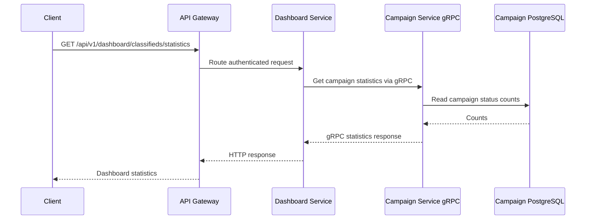

Shared Protocol Buffer definitions are located in `grpc-contract/src/main/proto/campaign.proto`.

---

## Observability

The observability configuration is stored under the `observability/` directory:

```text
observability/
├── grafana/
│   ├── dashboards/
│   │   └── campaign-logs-traces.json
│   └── provisioning/
│       ├── dashboards/
│       │   └── dashboards.yml
│       └── datasources/
│           └── datasources.yml
├── loki/
│   └── loki-config.yml
├── otel-collector/
│   └── otel-collector.yml
├── prometheus/
│   ├── prometheus-local.yml
│   └── prometheus.yml
├── promtail/
│   └── promtail-config.yml
└── tempo/
    └── tempo.yml
```

The observability responsibilities are separated:

- Prometheus collects metrics from Spring Boot Actuator.
- Promtail reads application log files and sends them to Loki.
- Application services export trace spans to the OpenTelemetry Collector.
- The OpenTelemetry Collector forwards trace spans to Tempo.
- Grafana uses Prometheus, Loki, and Tempo as provisioned datasources.
- `log-service` stores authentication audit events and slow-request events in Elasticsearch; this is separate from the file-log pipeline handled by Promtail and Loki.

### Metrics Flow

The full Docker Compose Prometheus configuration uses a `15s` scrape interval and scrapes these endpoints:

| Prometheus Job | Target |
|---|---|
| `api-gateway` | `api-gateway:8080/actuator/prometheus` |
| `auth-service` | `auth-service:8081/actuator/prometheus` |
| `campaign-service` | `campaign-service:8082/actuator/prometheus` |
| `dashboard-service` | `dashboard-service:8083/actuator/prometheus` |
| `log-service` | `log-service:8084/actuator/prometheus` |

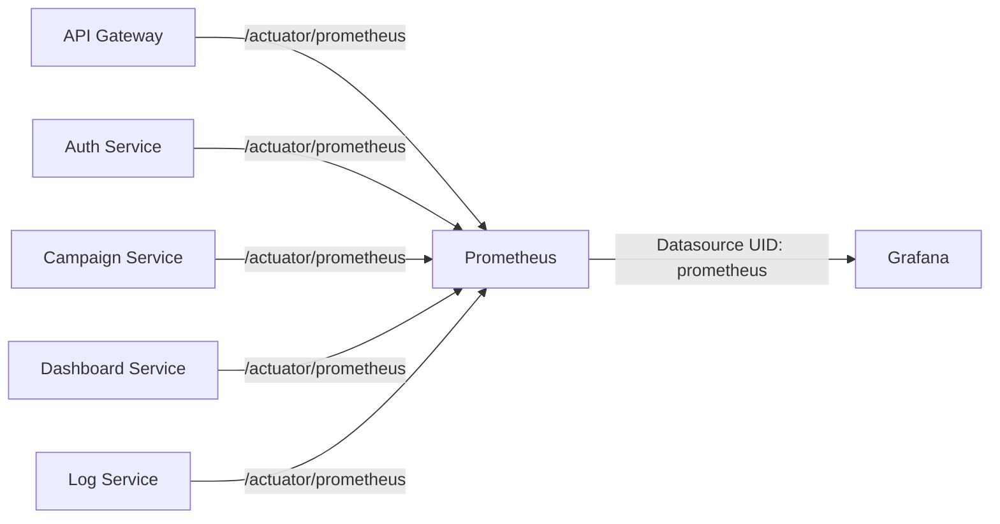

When the Spring Boot services run from IntelliJ IDEA or the terminal while Prometheus runs in Docker, `prometheus-local.yml` uses `host.docker.internal`.

Grafana connects to Prometheus through:

```text
http://prometheus:9090
```

Prometheus is configured as the default Grafana datasource with UID:

```text
prometheus
```

OTLP metrics export is disabled for the Spring Boot applications because Prometheus is the metrics backend:

```yaml
management:
  otlp:
    metrics:
      export:
        enabled: false
```

### Tempo Trace Flow

#### OTLP Ports

The OpenTelemetry Collector exposes both standard OTLP receivers:

| Protocol | Port | Usage in This Project |
|---|---:|---|
| OTLP/gRPC | `4317` | Used by the Spring Boot services to export traces |
| OTLP/HTTP | `4318` | Available as an alternative receiver, but not used by the current service configuration |

The current application configuration uses:

```text
OTLP/gRPC -> OpenTelemetry Collector port 4317
```

The alternative transport would be:

```text
OTLP/HTTP -> OpenTelemetry Collector port 4318
```

For OTLP/HTTP trace export, the signal-specific endpoint must include `/v1/traces`:

```text
http://otel-collector:4318/v1/traces
```

The current Docker Compose configuration intentionally uses OTLP/gRPC:

```yaml
OTEL_TRACES_EXPORTER: otlp
OTEL_EXPORTER_OTLP_TRACES_ENDPOINT: http://otel-collector:4317
OTEL_EXPORTER_OTLP_TRACES_PROTOCOL: grpc
```

This configuration controls only how observability spans are sent to the OpenTelemetry Collector. It does not change the business communication protocol used by a service.

The two gRPC connections are independent:

```text
Dashboard Service -> Campaign Service: business gRPC on port 9090
Spring Boot Services -> OpenTelemetry Collector: OTLP/gRPC on port 4317
```

#### Trace Pipeline

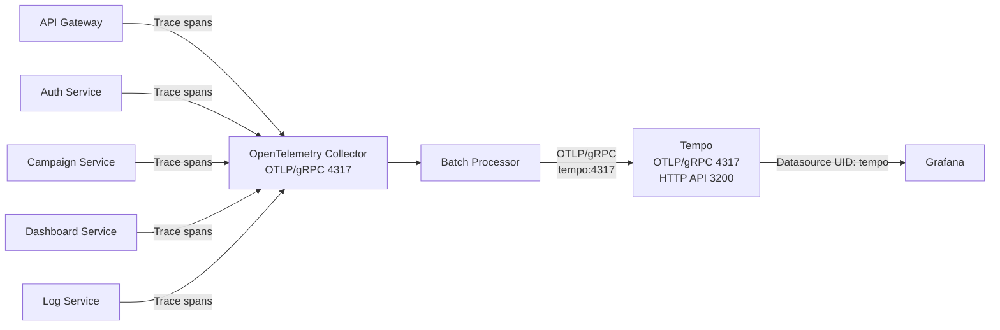

The Collector pipeline is:

```text
OTLP Receiver -> Batch Processor -> Tempo Exporter + Debug Exporter
```

Collector receiver configuration:

```yaml
receivers:
  otlp:
    protocols:
      grpc:
        endpoint: 0.0.0.0:4317
      http:
        endpoint: 0.0.0.0:4318
```

Collector-to-Tempo export:

```yaml
exporters:
  otlp/tempo:
    endpoint: tempo:4317
    tls:
      insecure: true
```

Tempo:

- exposes its query and readiness HTTP API on port `3200`
- accepts OTLP/gRPC internally on port `4317`
- accepts OTLP/HTTP internally on port `4318`
- stores trace WAL data under `/var/tempo/wal`
- stores local trace blocks under `/var/tempo/blocks`
- enables `span-metrics`, `service-graphs`, and `service-graphs-connection-info`
- sends generated span and service-graph metrics to Prometheus through remote write

Grafana connects to Tempo through:

```text
http://tempo:3200
```

The Tempo datasource uses UID:

```text
tempo
```

Tempo-to-Loki correlation uses the trace ID:

```logql
{job=~".*-logs", trace_id="${__trace.traceId}"}
```

The Tempo service-map datasource is Prometheus.

#### Tempo Verification

Select **Last 1 hour**, generate new requests, and start with the query below to list all available traces:

```traceql
{}
```

Then query individual services:

**API Gateway**

```traceql
{ resource.service.name = "api-gateway" }
```

**Auth Service**

```traceql
{ resource.service.name = "auth-service" }
```

**Campaign Service**

```traceql
{ resource.service.name = "campaign-service" }
```

**Dashboard Service**

```traceql
{ resource.service.name = "dashboard-service" }
```

**Log Service**

```traceql
{ resource.service.name = "log-service" }
```

Find error spans:

```traceql
{ status = error }
```

Find slow Campaign Service spans:

```traceql
{ resource.service.name = "campaign-service" && duration > 500ms }
```

### Loki Log Flow

Promtail collects file logs from these five application services:

| Service | File Mounted in Promtail | Loki Job Label |
|---|---|---|
| API Gateway | `/var/log/insurance/api-gateway.log` | `api-gateway-logs` |
| Auth Service | `/var/log/insurance/auth-service.log` | `auth-service-logs` |
| Campaign Service | `/var/log/insurance/campaign-service.log` | `campaign-service-logs` |
| Dashboard Service | `/var/log/insurance/dashboard-service.log` | `dashboard-service-logs` |
| Log Service | `/var/log/insurance/log-service.log` | `log-service-logs` |

Docker Compose mounts the host log directory as:

```yaml
volumes:
  - ./logs:/var/log/insurance:ro
```

Every application writes its log file under the shared host directory:

```text
./logs/
├── api-gateway.log
├── auth-service.log
├── campaign-service.log
├── dashboard-service.log
└── log-service.log
```

Promtail pushes the collected entries to:

```text
http://loki:3100/loki/api/v1/push
```

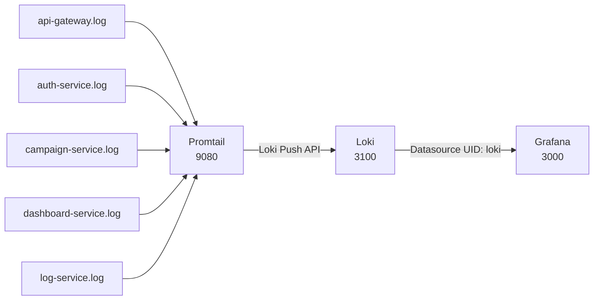

Each stream includes a fixed `service` label and a service-specific `job` label.

Promtail parses the Spring Boot log context:

```text
LEVEL [service,trace_id,span_id]
```

The pipeline promotes these fields to Loki labels:

- `level`
- `trace_id`
- `span_id`

The `service` label comes from the static Promtail target configuration.

#### Loki Verification

Use **Grafana -> Explore -> Loki**.

All services:

```logql
{job=~".*-logs"}
```

Campaign Service:

```logql
{job="campaign-service-logs", service="campaign-service"}
```

Auth Service:

```logql
{job="auth-service-logs", service="auth-service"}
```

API Gateway:

```logql
{job="api-gateway-logs", service="api-gateway"}
```

Dashboard Service:

```logql
{job="dashboard-service-logs", service="dashboard-service"}
```

Log Service:

```logql
{job="log-service-logs", service="log-service"}
```

Additional examples:

Campaign Service errors:

```logql
{job="campaign-service-logs", service="campaign-service", level="ERROR"}
```

Search by trace ID:

```logql
{job=~".*-logs", trace_id="<TRACE_ID>"}
```

Loki uses:

- filesystem chunk storage under `/tmp/loki/chunks`
- filesystem rule storage under `/tmp/loki/rules`
- TSDB schema `v13`
- in-memory ring storage
- replication factor `1`
- authentication disabled for local development

Grafana connects to Loki through:

```text
http://loki:3100
```

The Loki datasource uses UID:

```text
loki
```

The Loki datasource defines a `TraceID` derived field. When a log line contains a valid trace ID, Grafana can open the corresponding trace in Tempo.

### Grafana Provisioning

Grafana automatically provisions these datasources:

| Datasource | UID | Internal URL |
|---|---|---|
| Prometheus | `prometheus` | `http://prometheus:9090` |
| Loki | `loki` | `http://loki:3100` |
| Tempo | `tempo` | `http://tempo:3200` |

The dashboard provider is:

```text
Campaign Observability
```

The dashboard is loaded into the Grafana folder:

```text
Campaign
```

Dashboard title:

```text
Campaign - Logs and Traces
```

Dashboard UID:

```text
campaign-logs-traces
```

#### Service Selector

The dashboard uses a fixed multi-select variable instead of deriving services only from existing Loki data:

```text
api-gateway
auth-service
campaign-service
dashboard-service
log-service
```

The **All** value expands to:

```text
api-gateway|auth-service|campaign-service|dashboard-service|log-service
```

The same selector controls all three dashboard panels.

#### Dashboard Panels

| Panel | Datasource | Query |
|---|---|---|
| Service Logs from Loki | Loki | `{job=~".*-logs", service=~"${service:regex}"}` |
| HTTP Request Rate | Prometheus | `sum by (job) (rate(http_server_requests_seconds_count{job=~"${service:regex}", uri!~"/actuator.*"}[$__rate_interval]))` |
| Log Count per Interval by Service and Level | Loki | `sum by (service, level) (count_over_time({job=~".*-logs", service=~"${service:regex}", level=~"TRACE\|DEBUG\|INFO\|WARN\|ERROR"}[$__auto]))` |

Behavior:

- Selecting one service filters all three panels to that service.
- Selecting multiple services filters all three panels to those services.
- Selecting **All** displays all five services.
- When **All** is selected, the raw log panel interleaves log entries and identifies each entry through its `service` label.
- The raw log panel is limited to `500` lines to avoid excessive rendering.

Open Grafana:

```text
http://localhost:3000
```

Default local credentials:

```text
Username: admin
Password: admin
```

### Useful Observability Endpoints

| Component | URL | Purpose |
|---|---|---|
| Grafana | `http://localhost:3000` | Dashboards, logs, metrics, and traces |
| Prometheus | `http://localhost:9091` | Metrics UI and targets |
| Tempo Readiness | `http://localhost:3200/ready` | Tempo health check |
| Loki Readiness | `http://localhost:3100/ready` | Loki health check |
| Promtail Metrics | `http://localhost:9080/metrics` | Promtail internal metrics |
| Promtail Targets | `http://localhost:9080/targets` | Log-file target status |
| Collector OTLP/gRPC | `localhost:4317` | Current trace-export receiver |
| Collector OTLP/HTTP | `localhost:4318` | Optional HTTP/protobuf receiver |

Actuator endpoints used by Prometheus:

| Endpoint | Purpose |
|---|---|
| `/actuator/health` | Service health information |
| `/actuator/prometheus` | Micrometer metrics in Prometheus format |


---

### Technologies

| Area | Technologies |
|---|---|
| Language and runtime | Java 25, Virtual Threads, Java Records |
| Application framework | Spring Boot 4, Spring Cloud |
| Service platform | Eureka, Spring Cloud Config, Spring Cloud Gateway |
| Security | Spring Security, RSA JWT public/private keys |
| Persistence | PostgreSQL, Spring Data JPA, Liquibase |
| Cache and rate limiting | Redis |
| Messaging | Apache Kafka, Kafka UI, DLQ |
| Service-to-service communication | REST, Spring `HttpExchange`, gRPC |
| Search and audit storage | Elasticsearch |
| Resilience | Resilience4j Circuit Breaker, Retry, Bulkhead |
| Metrics | Spring Boot Actuator, Micrometer, Prometheus |
| Tracing | OpenTelemetry, OpenTelemetry Collector, Tempo |
| Logging | Application service file logs, Promtail, Loki |
| Visualization | Grafana |
| Quality | SonarQube |
| Testing | JUnit, Mockito, Testcontainers |
| Build and delivery | Maven, Docker, Docker Compose, GitHub Actions |

### Java 25 Usage

- Maven compiler release is set to `25`.
- Virtual threads are enabled with `spring.threads.virtual.enabled=true`.
- DTOs and domain models use Java records.
- Business rules use modern switch expressions.

---

### Postman

Import:

```text
postman/Insurance Campaign Microservices.postman_collection.json
```

The collection includes both gateway and direct service requests.

---

## Run the Application

### Prerequisites

- JDK 25
- Maven 3.9+
- Docker Desktop with Docker Compose
- Git
- IntelliJ IDEA or another Java IDE
- At least enough Docker resources for PostgreSQL, Kafka, Elasticsearch, SonarQube, and the observability stack

Docker must be running for Docker Compose and Testcontainers-based integration tests.

### Maven Run

Use the local infrastructure Compose file when the Spring Boot services will run from IntelliJ IDEA or Maven.

Start PostgreSQL, Redis, Kafka, Kafka UI, Elasticsearch, Prometheus, Grafana, Tempo, Loki, Promtail, OpenTelemetry Collector, and SonarQube:

```bash
docker compose -f docker-compose-local.yml up -d
```

Check infrastructure status:

```bash
docker compose -f docker-compose-local.yml ps
```

Follow infrastructure logs:

```bash
docker compose -f docker-compose-local.yml logs -f
```

Then start services in this order:

```bash
mvn -pl discovery-server spring-boot:run
mvn -pl config-server spring-boot:run
mvn -pl auth-service spring-boot:run
mvn -pl campaign-service spring-boot:run
mvn -pl dashboard-service spring-boot:run
mvn -pl log-service spring-boot:run
mvn -pl api-gateway spring-boot:run
```

Stop local infrastructure:

```bash
docker compose -f docker-compose-local.yml down
```

### Docker Run

Use the full Compose file when every service and infrastructure component should run as a container.

The repository contains two Compose files:

- `docker-compose.yml` runs all Spring Boot services and infrastructure.
- `docker-compose-local.yml` runs only infrastructure while services run from IntelliJ IDEA or Maven.

Build and start everything:

```bash
docker compose up -d --build
```

Check container status:

```bash
docker compose ps
```

Follow all logs:

```bash
docker compose logs -f
```

Follow one service:

```bash
docker compose logs -f auth-service
```

Stop the stack:

```bash
docker compose down
```

Stop the stack and delete persistent volumes:

```bash
docker compose down -v
```

> `docker compose down -v` permanently deletes data stored in the Compose volumes.

### Docker Images Used by Docker Compose

The Docker Compose files currently use the following infrastructure images:

| Component | Docker Image |
|---|---|
| PostgreSQL | `postgres:latest` |
| Redis | `redis:latest` |
| Apache Kafka | `apache/kafka:latest` |
| Kafka UI | `kafbat/kafka-ui:latest` |
| Elasticsearch | `docker.elastic.co/elasticsearch/elasticsearch:9.4.2` |
| Prometheus | `prom/prometheus:latest` |
| Grafana | `grafana/grafana:latest` |
| Tempo | `grafana/tempo:latest` |
| Loki | `grafana/loki:latest` |
| Promtail | `grafana/promtail:latest` |
| OpenTelemetry Collector Contrib | `otel/opentelemetry-collector-contrib:latest` |
| SonarQube Community Build | `sonarqube:community` |

> Most infrastructure services use `latest` tags for this local case study. Elasticsearch uses an explicit version because its Docker registry does not provide a `latest` tag.

---

### Application Images Published on Docker Hub

The Spring Boot service images are published under the `noyandocker` Docker Hub account.

| Service | Docker Image | Docker Hub Repository |
|---|---|---|
| Campaign Service | `noyandocker/campaign-campaign-service` | [Open repository](https://hub.docker.com/repository/docker/noyandocker/campaign-campaign-service) |
| Log Service | `noyandocker/campaign-log-service` | [Open repository](https://hub.docker.com/repository/docker/noyandocker/campaign-log-service) |
| Auth Service | `noyandocker/campaign-auth-service` | [Open repository](https://hub.docker.com/repository/docker/noyandocker/campaign-auth-service) |
| Dashboard Service | `noyandocker/campaign-dashboard-service` | [Open repository](https://hub.docker.com/repository/docker/noyandocker/campaign-dashboard-service) |
| API Gateway | `noyandocker/campaign-api-gateway` | [Open repository](https://hub.docker.com/repository/docker/noyandocker/campaign-api-gateway) |
| Config Server | `noyandocker/campaign-config-server` | [Open repository](https://hub.docker.com/repository/docker/noyandocker/campaign-config-server) |
| Discovery Server | `noyandocker/campaign-discovery-server` | [Open repository](https://hub.docker.com/repository/docker/noyandocker/campaign-discovery-server) |

Pull an image by replacing `<tag>` with the required published tag:

```bash
docker pull noyandocker/campaign-campaign-service:<tag>
docker pull noyandocker/campaign-log-service:<tag>
docker pull noyandocker/campaign-auth-service:<tag>
docker pull noyandocker/campaign-dashboard-service:<tag>
docker pull noyandocker/campaign-api-gateway:<tag>
docker pull noyandocker/campaign-config-server:<tag>
docker pull noyandocker/campaign-discovery-server:<tag>
```

Inspect a downloaded image:

```bash
docker image inspect noyandocker/campaign-campaign-service:<tag>
```

The repository name `campaign-campaign-service` intentionally contains the word `campaign` twice: the first occurrence identifies the project, and the second identifies the service.

---

## Tests

Run all unit and integration tests:

```bash
mvn clean verify
```

Run a specific module:

```bash
mvn -pl auth-service test
```

Run a module with required Maven dependencies:

```bash
mvn -pl campaign-service -am test
```

Testing includes:

- JUnit unit tests
- Mockito-based isolation tests
- Controller and security tests
- Repository tests
- Integration tests
- Testcontainers PostgreSQL tests
- Testcontainers Kafka tests where applicable
- Authentication audit and Resilience4j failure scenarios

Docker must be running for Testcontainers-based tests.

---

### SonarQube

Start SonarQube:

```bash
docker compose -f docker-compose-local.yml up -d sonarqube
```

Open:

```text
http://localhost:9000
```

Initial local credentials:

```text
Username: admin
Password: admin
```

Run analysis on Bash-compatible terminals:

```bash
mvn clean verify sonar:sonar \
  -Dsonar.host.url=http://localhost:9000 \
  -Dsonar.token=<SONAR_TOKEN>
```

Run analysis from Windows PowerShell:

```powershell
mvn clean verify sonar:sonar `
  -Dsonar.host.url=http://localhost:9000 `
  -Dsonar.token=<SONAR_TOKEN>
```

Never commit a SonarQube token to Git.

---

### GitHub Actions

`.github/workflows/ci-cd.yml` contains:

- Java 25 Maven verification
- Test execution
- Optional SonarQube analysis
- Docker build and push for every service using repository-root Docker context

---

## Folder Structure

```text
insurance-campaign-microservices/
├── .github/
│   └── workflows/
│       └── ci-cd.yml
├── api-gateway/
├── auth-service/
├── campaign-service/
├── common/
├── config-server/
├── dashboard-service/
├── discovery-server/
├── grpc-contract/
├── log-service/
├── security/
├── config-repository/
├── observability/
│   ├── grafana/
│   │   ├── dashboards/
│   │   │   └── campaign-logs-traces.json
│   │   └── provisioning/
│   │       ├── dashboards/
│   │       │   └── dashboards.yml
│   │       └── datasources/
│   │           └── datasources.yml
│   ├── loki/
│   │   └── loki-config.yml
│   ├── otel-collector/
│   │   └── otel-collector.yml
│   ├── prometheus/
│   │   ├── prometheus-local.yml
│   │   └── prometheus.yml
│   ├── promtail/
│   │   └── promtail-config.yml
│   └── tempo/
│       └── tempo.yml
├── postman/
├── docker-compose.yml
├── docker-compose-local.yml
├── pom.xml
├── sonar-project.properties
└── README.md
```

---

## Troubleshooting

### Docker Compose Reset

When Kafka UI, Tempo, Loki, Elasticsearch, or another infrastructure service remains in `Created`, `Exited`, or an unhealthy state, reset local volumes:

```bash
docker compose -f docker-compose-local.yml down -v --remove-orphans
docker compose -f docker-compose-local.yml pull
docker compose -f docker-compose-local.yml up -d
```

Reset the full stack:

```bash
docker compose down -v --remove-orphans
docker compose pull
docker compose up -d --build
```

The Compose files use the official Apache Kafka image. Kafka listeners are:

- Host applications and IntelliJ IDEA: `localhost:9092`
- Docker containers: `kafka:19092`

PostgreSQL volumes are mounted at `/var/lib/postgresql` for compatibility with the current PostgreSQL image layout.

Elasticsearch uses a fixed image tag because its registry does not provide a `latest` tag.


### Tempo Returns No Traces

Generate new requests after restarting the services because failed or previously unexported spans cannot appear retroactively.

Start with:

```traceql
{}
```

Use a wider time range such as **Last 1 hour**.

Check the application and Collector logs:

```bash
docker compose logs --tail=200 api-gateway auth-service campaign-service dashboard-service log-service otel-collector tempo
```

The application must export to:

```text
http://otel-collector:4317
```

with:

```text
OTEL_EXPORTER_OTLP_TRACES_PROTOCOL=grpc
```

Do not append `/v1/traces` to an OTLP/gRPC endpoint.

The `/v1/traces` path is used only with OTLP/HTTP:

```text
http://otel-collector:4318/v1/traces
```

A repeated message such as the following indicates an OTLP/HTTP endpoint-path mismatch:

```text
Failed to export spans. Server responded with HTTP status code 404.
```

### Loki Returns No Logs

Check Promtail targets:

```text
http://localhost:9080/targets
```

Check the shared host log directory:

```bash
ls -la ./logs
```

Check Promtail and Loki logs:

```bash
docker compose logs --tail=200 promtail loki
```

Verify all streams:

```logql
{job=~".*-logs"}
```

Verify Campaign Service specifically:

```logql
{job="campaign-service-logs", service="campaign-service"}
```

When a service has not written a log line inside the selected Grafana time range, its query correctly returns no data.

### gRPC Code Generation

The `com.casestudy.insurancecampaign.grpc` package is generated from:

```text
grpc-contract/src/main/proto/campaign.proto
```

When IntelliJ IDEA reports `Cannot resolve symbol 'grpc'`, run:

```bash
mvn -U -pl grpc-contract -am clean install
mvn -U -pl campaign-service -am clean compile
```

Then reload all Maven projects in IntelliJ IDEA.

Project requirements:

- Project SDK: JDK 25
- Maven Runner JRE: JDK 25

### gRPC Runtime Version Mismatch

An error such as:

```text
java.lang.NoClassDefFoundError: io/grpc/InternalGlobalInterceptors
```

usually means Maven resolved incompatible gRPC module versions. The root Maven configuration must align `grpc-core`, `grpc-api`, `grpc-stub`, and `grpc-protobuf` through one version/BOM.

Rebuild from the root:

```bash
mvn -U clean install
```

### Swagger Gateway Checks

```bash
curl http://localhost:8080/openapi/auth
curl http://localhost:8080/openapi/campaign
curl http://localhost:8080/auth/v3/api-docs
curl http://localhost:8081/v3/api-docs
```

For local IntelliJ runs, Gateway service URLs default to:

```text
AUTH_SERVICE_URI=http://localhost:8081
CAMPAIGN_SERVICE_URI=http://localhost:8082
DASHBOARD_SERVICE_URI=http://localhost:8083
LOG_SERVICE_URI=http://localhost:8084
```

Docker Compose overrides them with container service names.

---

## Package Namespace

The package namespace documented by the current project is:

```text
com.casestudy.insurancecampaign
```

Example:

```text
com.casestudy.insurancecampaign.gateway.ApiGatewayApplication
```

---

### 📸 Screenshots

<details>
<summary>Click here to show the screenshots of project</summary>
    <p> Figure 1 </p>
    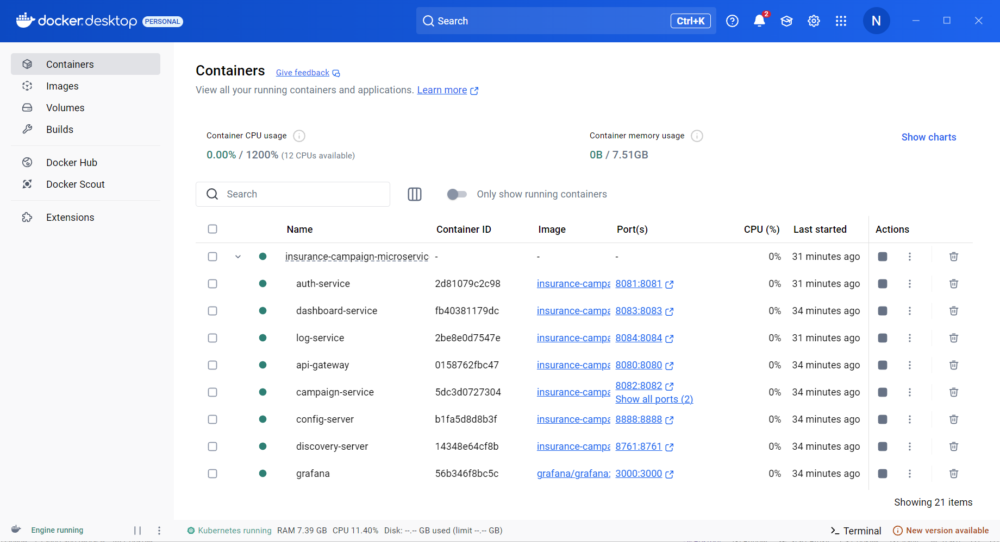
    <p> Figure 2 </p>
    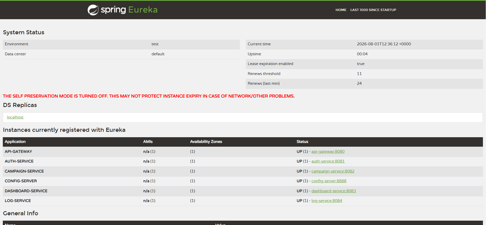
    <p> Figure 3 </p>
    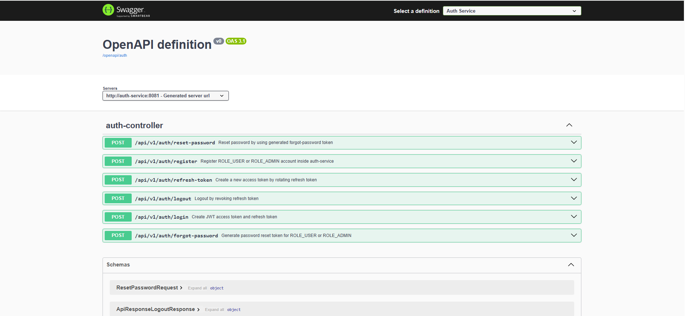
    <p> Figure 4 </p>
    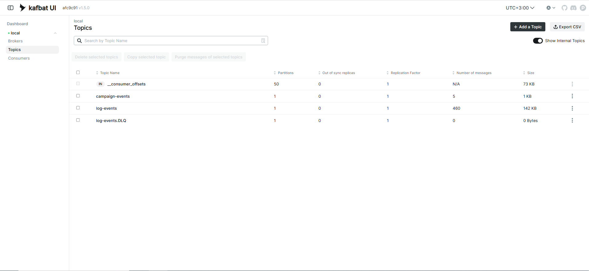
    <p> Figure 5 </p>
    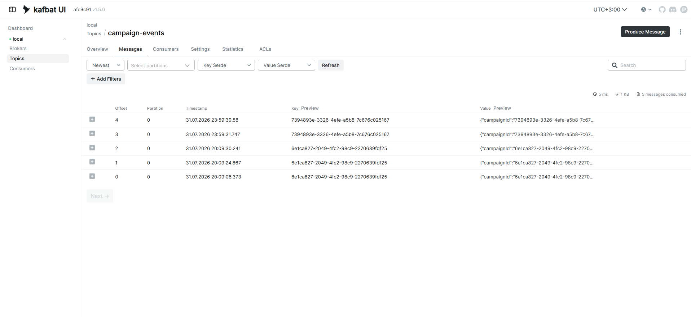
    <p> Figure 6 </p>
    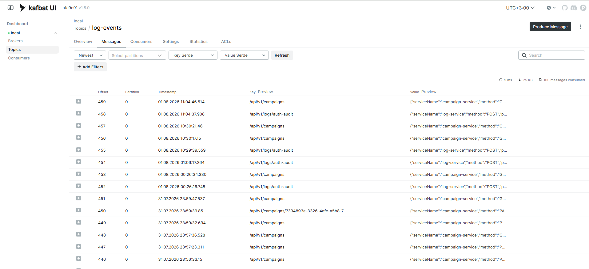
    <p> Figure 7 </p>
    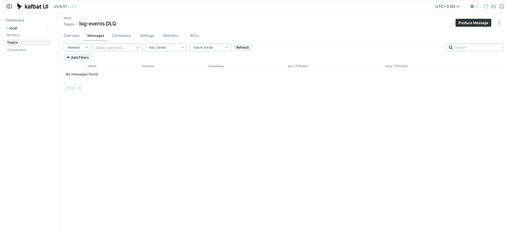
    <p> Figure 8 </p>
    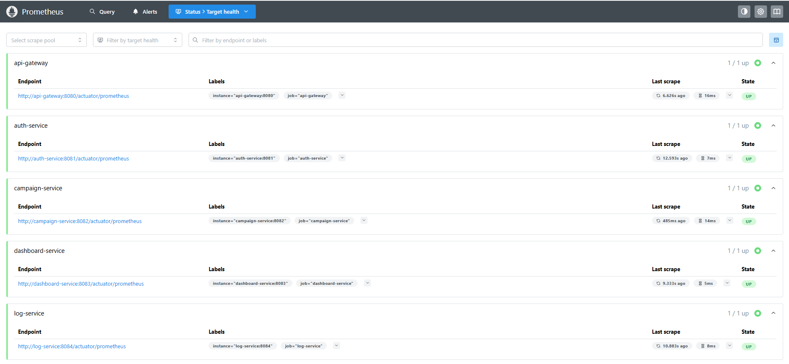
    <p> Figure 9 </p>
    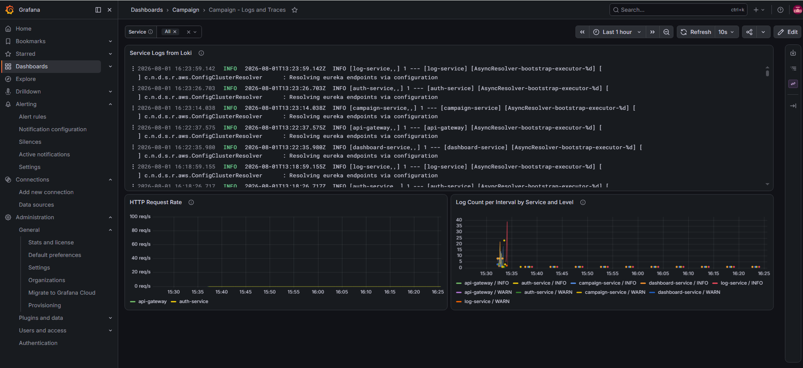
    <p> Figure 10 </p>
    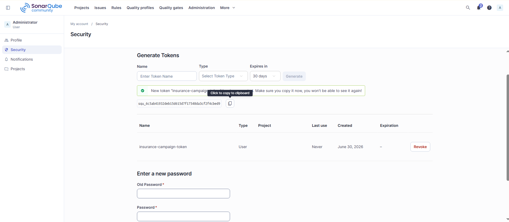
    <p> Figure 11 </p>
    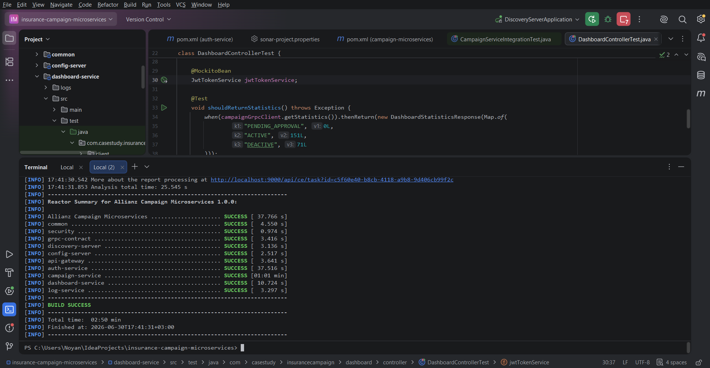
    <p> Figure 12 </p>
    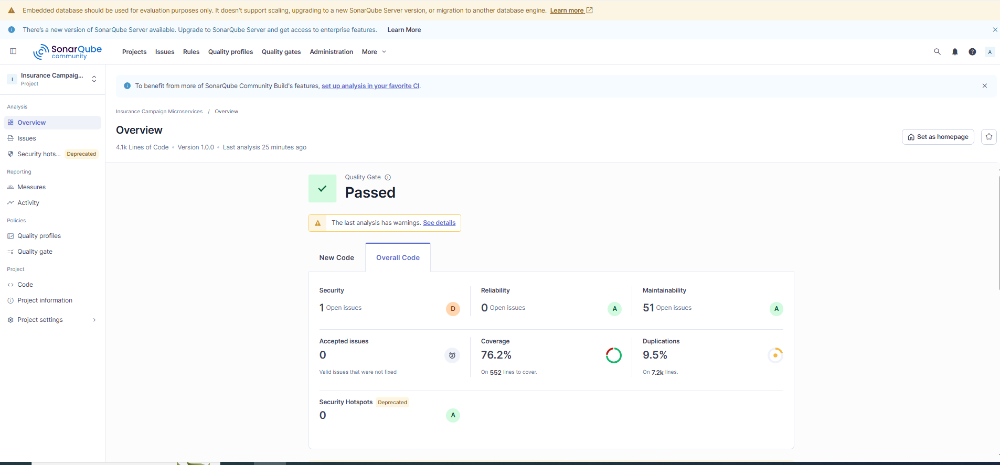
    <p> Figure 13 </p>
    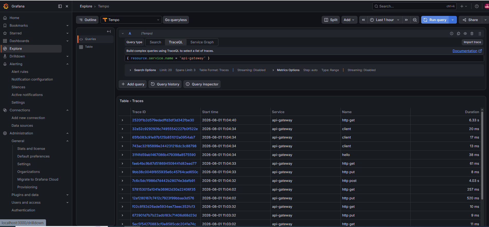
    <p> Figure 14 </p>
    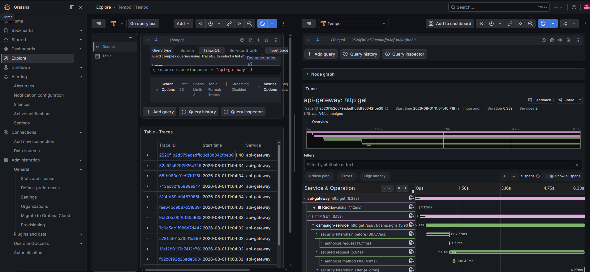
    <p> Figure 15 </p>
    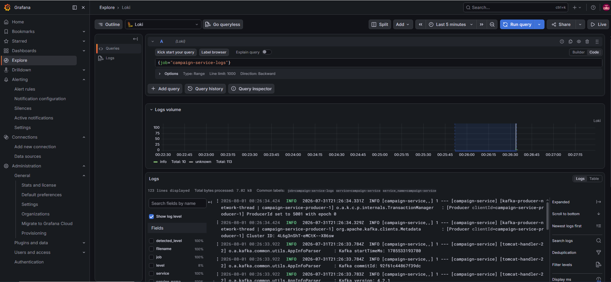
    <p> Figure 16 </p>
    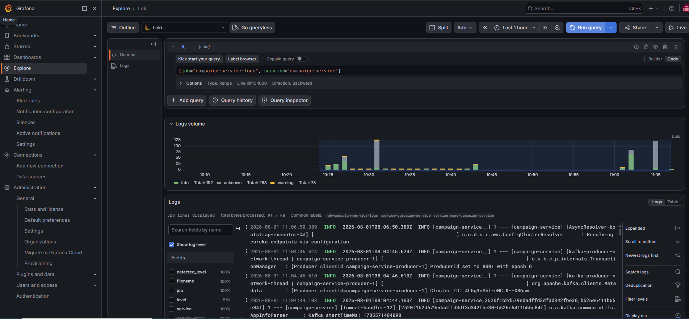
</details>

### Contributors

- [Amil Abdullazada (AAR)](https://github.com/UserAAR)
