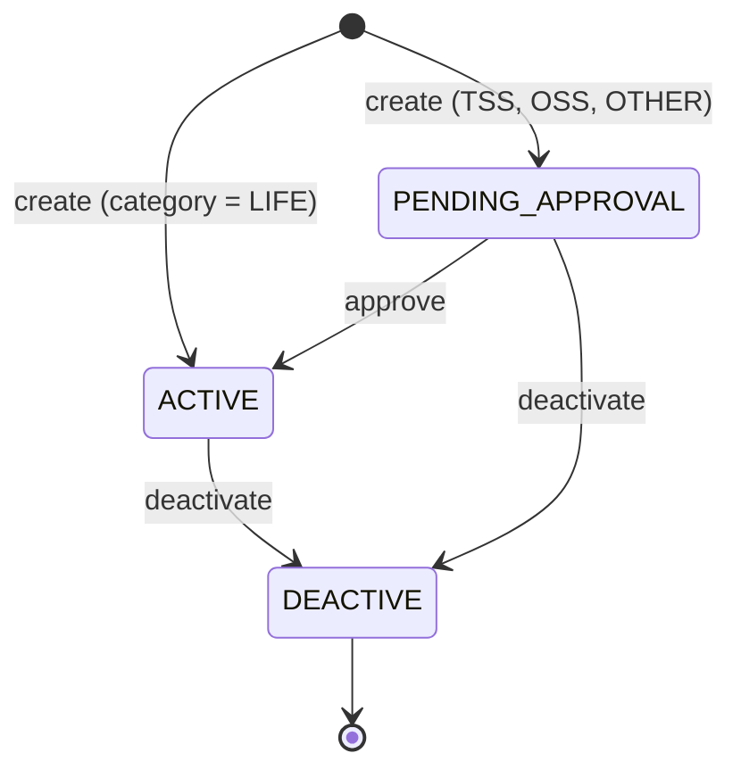
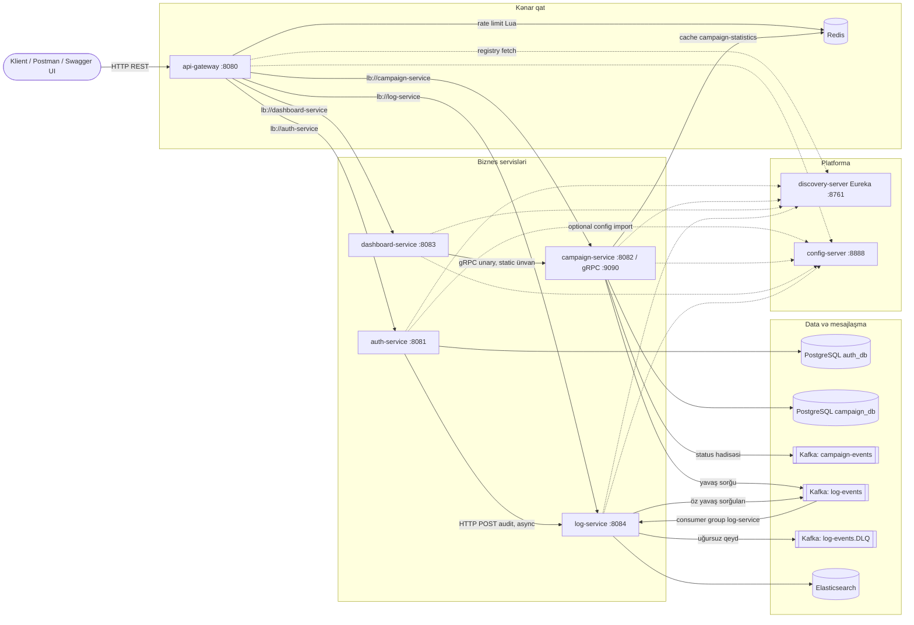

# 2. Sistemin biznes və arxitektura xəritəsi

Bu fəsil kod siniflərinə girmədən əvvəl sistemin **nə üçün** mövcud olduğunu, **kimin** istifadə etdiyini,
**hansı əməliyyatları** dəstəklədiyini və bu əməliyyatların **hansı komponentlər** arasında necə hərəkət etdiyini
göstərir. Sonrakı bütün fəsillər bu xəritəyə istinad edir.

## 2.1 Sistem hansı problemi həll edir

Repozitoriya sığorta şirkəti üçün **marketinq kampaniyalarının idarə edilməsi** platformasını həyata keçirir. Kök
`pom.xml`-də layihə belə təsvir olunur [FAKT] (`pom.xml:11-12`): "Java 25 Spring Boot microservices case study for
Allianz Sigorta Campaign API". Yəni bu, real biznes ssenarisini modelləşdirən **case study** layihəsidir — istehsal
sistemi deyil, lakin istehsal sistemlərində rast gəlinən demək olar ki, bütün infrastruktur komponentlərini ehtiva edir.

Biznes problemi sadədir, lakin bir neçə qaydası var:

1. Sığorta məhsulları dörd kateqoriyaya bölünür: `TSS` (tamamlayıcı sağlıq sığortası), `OSS` (özəl sağlıq
   sığortası), `LIFE` (həyat sığortası) və `OTHER` [FAKT] (`CampaignCategory.java:3-8`). Kateqoriya adları türk
   sığorta terminologiyasından gəlir; test məlumatlarında "Tamamlayıcı sağlık sigortası" ifadəsi istifadə olunur
   (`CampaignServiceTest.java:51`).
2. Kampaniya yaradılarkən onun **ilkin statusu kateqoriyadan asılıdır**: `LIFE` dərhal `ACTIVE`, qalanları
   `PENDING_APPROVAL` [FAKT] (`CampaignService.java:133-138`).
3. Eyni kateqoriya, başlıq və təsvirə malik ikinci kampaniya yaradıla bilməz — `409 Conflict` [FAKT]
   (`CampaignService.java:140-150`, `GlobalExceptionHandler.java:36-52`).
4. Status keçidləri məhduddur: yalnız `PENDING_APPROVAL → ACTIVE` (təsdiq) və `ACTIVE|PENDING_APPROVAL → DEACTIVE`
   (deaktivasiya) [FAKT] (`CampaignService.java:91-111`). `DEACTIVE`-dən geri qayıtmaq yoxdur; README bunu
   "proof of concept-də qəsdən həyata keçirilməyib" kimi qeyd edir.
5. Hər status dəyişikliyi **tarixçəyə** yazılır və **hadisə (event)** kimi Kafka-ya göndərilir [FAKT]
   (`CampaignService.java:162-169`, `177-191`).
6. Rəhbərlik üçün **dashboard** statuslar üzrə sayları və kampaniya tarixçəsini göstərir [FAKT]
   (`DashboardController.java:39-57`).

Bu biznes qaydalarının ətrafında platforma xidmətləri qurulub: autentifikasiya, avtorizasiya, audit, yavaş
sorğuların izlənməsi, rate limiting, mərkəzi konfiqurasiya, servis kəşfi və tam observability.

## 2.2 Aktorlar və imkanlar

| Aktor | Necə tanınır | Nə edə bilər | Mənbə |
|---|---|---|---|
| Anonim istifadəçi | Token yoxdur | Qeydiyyat, login, refresh, forgot/reset password, logout | `ServiceSecurityConfiguration.java:96-106`, `AuthController.java` |
| `ROLE_USER` | JWT `roles` claim | Kampaniyaların siyahısı və detalı | `CampaignController.java:50-64` |
| `ROLE_ADMIN` | JWT `roles` claim | Yaratmaq, təsdiq, deaktiv, tarixçə, statistika, dashboard, yavaş sorğular | `CampaignController.java:42-92`, `DashboardController.java`, `SlowRequestLogController.java` |
| Daxili servis (`ROLE_INTERNAL_SERVICE`) | auth-service-in imzaladığı JWT | Audit hadisəsini log-service-ə yazmaq | `LogServiceHttpClientConfiguration.java:21-48`, `AuthAuditLogController.java:29-35` |
| Operator / developer | Brauzer | Swagger UI, Eureka, Kafka UI, Grafana, Prometheus, SonarQube | `docker-compose.yml`, README |

[RİSK] Qeydiyyat sorğusu rolu istifadəçinin özündən qəbul edir (`RegisterRequest.java:18-24`); `UserRole`
enum-unda `ROLE_ADMIN` var (`UserRole.java:10-22`). Nəticədə anonim istifadəçi özünü admin kimi qeydiyyatdan keçirə
bilər. Bu, 9 və 21-ci fəsillərdə ətraflı təhlil olunur (tapıntı F01).

## 2.3 Əsas biznes obyektləri

| Obyekt | Harada saxlanılır | Sahib servis | Əsas sahələr |
|---|---|---|---|
| Campaign | `campaign_db.campaigns` | campaign-service | `id (uuid)`, `title`, `description`, `category`, `status`, `duplicate_of`, `created_at`, `updated_at` |
| CampaignStatusHistory | `campaign_db.campaign_status_histories` | campaign-service | `campaign_id`, `previous_status`, `new_status`, `reason`, `changed_at` |
| AppUser | `auth_db.app_users` | auth-service | `username`, `email`, `password` (hash), `roles` (vergüllə ayrılmış), `status` |
| RefreshToken | `auth_db.refresh_tokens` | auth-service | `token_hash` (SHA-256), `expires_at`, `revoked_at`, `user_id` |
| PasswordResetToken | `auth_db.password_reset_tokens` | auth-service | `token_hash`, `expires_at`, `used_at`, `user_id` |
| AuthAuditLog | Elasticsearch `auth-audit-logs` | log-service | `serviceName`, `eventType`, `usernameOrEmail`, `status`, `message`, `occurredAt` |
| SlowRequest | Elasticsearch `slow-request-logs` | log-service | `serviceName`, `method`, `path`, `status`, `durationMs`, `traceId`, `headers`, `occurredAt` |
| CampaignStatusChangedEvent | Kafka `campaign-events` | campaign-service (producer) | `campaignId`, `category`, `previousStatus`, `newStatus`, `reason`, `occurredAt` |
| SlowRequestLogEvent | Kafka `log-events` | campaign/log-service (producer), log-service (consumer) | yuxarıdakı SlowRequest sahələri |

Kampaniyanın status həyat dövrü [FAKT] (`CampaignService.java:56-111`, `CampaignStatus.java`):

[FAKT] `CampaignStatus.DUPLICATE` enum-da mövcuddur (`CampaignStatus.java:3-8`) və servis bu statusa malik
kampaniyaların yenilənməsini qadağan edir (`CampaignService.java:171-175`), lakin heç bir kod yolu kampaniyanı
`DUPLICATE` statusuna keçirmir. Təkrar sorğu sadəcə rədd edilir. [NƏTİCƏ] `DUPLICATE` və `duplicate_of` sütunu
əvvəlki dizayn variantının (təkrarların ayrıca sətir kimi saxlanması) qalığıdır; README də "DUPLICATE is
intentionally excluded" deyir. Bu, 6-cı fəsildə müzakirə olunur.

## 2.4 Komponentlərin inventarı

Repozitoriya 10 Maven modulundan ibarətdir: 3 paylaşılan kitabxana və 7 müstəqil yerləşdirilən Spring Boot tətbiqi
[FAKT] (`pom.xml:14-25`).

| Komponent | Növ | Port | Məsuliyyət |
|---|---|---|---|
| `api-gateway` | Tətbiq (Spring Cloud Gateway, WebFlux) | 8080 | Vahid giriş nöqtəsi, marşrutlaşdırma, JWT yoxlaması, Redis rate limiting, OpenAPI aqreqasiyası |
| `auth-service` | Tətbiq (Spring MVC) | 8081 | İstifadəçilər, rollar, login, refresh/reset token, RSA ilə JWT imzalama, audit hadisələri |
| `campaign-service` | Tətbiq (MVC + gRPC server) | 8082, 9090 | Kampaniya həyat dövrü, tarixçə, statistika cache-i, Kafka hadisələri, gRPC API |
| `dashboard-service` | Tətbiq (MVC + gRPC klient) | 8083 | Statistika və tarixçəni gRPC ilə alır, REST kimi təqdim edir |
| `log-service` | Tətbiq (MVC + Kafka consumer) | 8084 | Yavaş sorğu hadisələrini Kafka-dan oxuyur, auditləri HTTP ilə qəbul edir, Elasticsearch-də saxlayır, DLQ |
| `discovery-server` | Tətbiq (Eureka Server) | 8761 | Servis reyestri |
| `config-server` | Tətbiq (Spring Cloud Config, `native`) | 8888 | Mərkəzi konfiqurasiya |
| `common` | Kitabxana | — | `ApiResponse`/`ApiError`, istisnalar, `GlobalExceptionHandler`, Kafka producer, yavaş sorğu filtri, observation |
| `security` | Kitabxana | — | Servlet servisləri üçün JWT filtri, `SecurityFilterChain`, RSA açar oxuma |
| `grpc-contract` | Kitabxana | — | `campaign.proto` və ondan generasiya olunan Java kodu |

İnfrastruktur [FAKT] (`docker-compose.yml`): iki PostgreSQL instansı (`auth-db` 5433, `campaign-db` 5434),
Redis (6379), Apache Kafka KRaft rejimində (9092 host, 19092 daxili), Kafka UI (8090), Elasticsearch 9.4.2 (9200),
Prometheus (9091), Grafana (3000), Tempo (3200), Loki (3100), Promtail (9080), OpenTelemetry Collector (4317/4318),
SonarQube (9000).

## 2.5 Arxitektura diaqramı (təsdiqlənmiş)

Aşağıdakı diaqram yalnız kodda və konfiqurasiyada təsdiqlənən əlaqələri göstərir. Bütöv xətlər biznes trafikini,
qırıq xətlər platforma əlaqələrini (kəşf, konfiqurasiya, telemetriya) göstərir.

Diaqramdan çıxan bir neçə vacib müşahidə:

- [FAKT] `campaign-events` mövzusuna yazılır, lakin repozitoriyada onu oxuyan consumer yoxdur — bu hadisə gələcək
  və ya xarici istehlakçılar üçün nəşr olunur. [NAMƏLUM] Onu kimin oxuduğu repozitoriyadan müəyyən edilə bilməz.
- [FAKT] Eureka-dan istifadə edən yeganə klient tərəf **api-gateway**-dir (`lb://` URI-ləri və `@LoadBalanced`
  `WebClient.Builder`). dashboard-service campaign-service-ə **static** gRPC ünvanı ilə qoşulur
  (`dashboard-service/src/main/resources/application.yml:12-15`), auth-service log-service-ə **static** HTTP URL ilə
  (`auth-service/src/main/resources/application.yml:21-24`). Bütün servislər Eureka-da qeydiyyatdan keçir, lakin
  servislərarası çağırışlar kəşfdən istifadə etmir.
- [FAKT] Yavaş sorğu filtri yalnız classpath-ində `spring-kafka` olan servislərdə işləyir: campaign-service və
  log-service. `common` modulunda `spring-kafka` `optional` olaraq elan edilib (`common/pom.xml:27-31`), yəni
  tranzitiv ötürülmür; auth-service və dashboard-service-də bu kitabxana yoxdur (Maven asılılıq ağacı ilə
  təsdiqlənib). api-gateway `common`-dan ümumiyyətlə asılı deyil.
- [FAKT] Telemetriya (diaqramda göstərilməyib): bütün tətbiqlər trace-ləri OTLP/gRPC ilə OpenTelemetry Collector-a
  (4317), o da Tempo-ya göndərir; Prometheus biznes servislərini `/actuator/prometheus` üzərindən scrape edir;
  servislər log fayllarını `./logs` qovluğuna yazır, Promtail onları Loki-yə ötürür (fəsil 17).

## 2.6 Sinxron və asinxron sərhədlər

| Qarşılıqlı əlaqə | Model | Uğursuzluq nəticəsi |
|---|---|---|
| Klient → Gateway → servis | Sinxron HTTP | Klient birbaşa xəta görür (401/403/404/409/429/500/503) |
| Dashboard → Campaign (gRPC) | Sinxron, deadline-sız blocking stub | Campaign düşərsə dashboard 500 qaytarır (fəsil 13) |
| Auth → Log (audit) | `@Async` + Resilience4j; çağıran üçün asinxron | Audit itir, login davam edir (fəsil 14) |
| Campaign → Kafka (`campaign-events`) | Fire-and-forget, tranzaksiya daxilində | Hadisə itə və ya commit olunmayan dəyişiklik üçün göndərilə bilər (fəsil 11) |
| Servis → Kafka (`log-events`) | Fire-and-forget, HTTP filtrinin `finally` blokunda | Yavaş sorğu qeydi itə bilər; Kafka əlçatmazdırsa sorğu gecikə bilər |
| Kafka → log-service | Consumer group, retry + DLQ | Elasticsearch xətası → 3 təkrar → DLQ |
| Campaign → Redis cache | Sinxron | Redis xətası `@Cacheable` metodunda xəta yaradır |

## 2.7 Data sahibliyi

Mikroservis arxitekturasının əsas prinsiplərindən biri **"hər servis öz datasının sahibidir"** prinsipidir. Bu
repozitoriyada:

- [FAKT] auth-service və campaign-service ayrı PostgreSQL instanslarına malikdir (`docker-compose.yml:93-130`); heç
  bir servis digərinin bazasına qoşulmur.
- [FAKT] dashboard-service-in öz bazası yoxdur; kampaniya datasını yalnız gRPC kontraktı vasitəsilə alır. Bu,
  "paylaşılan baza" anti-pattern-indən qaçmağın düzgün nümunəsidir.
- [FAKT] log-service Elasticsearch-in yeganə istifadəçisidir.
- [FAKT] Redis iki fərqli məqsədlə iki servis tərəfindən paylaşılır: gateway rate limit açarları və campaign-service
  cache-i. Açar ad fəzaları fərqlidir (`request_rate_limiter.*` və `campaign-statistics::*`). [NƏTİCƏ] Bu, lokal
  case study üçün qəbuledilən sadələşdirmədir; istehsalda adətən ayrı Redis məntiqi bazaları və ya instansları
  istifadə olunur.

## 2.8 Əsas axınların icmalı

Detallı izləmə 20-ci fəsildədir. Burada yalnız ümumi mənzərə:

| Axın | Giriş nöqtəsi | Toxunduğu komponentlər |
|---|---|---|
| Login | `POST /api/v1/auth/login` | Gateway (rate limit) → auth-service → auth_db → (async) log-service → Elasticsearch |
| Kampaniya yaratmaq | `POST /api/v1/campaigns` | Gateway (rate limit, JWT) → campaign-service (JWT, `@PreAuthorize`, `@Valid`) → campaign_db → Redis (evict) → Kafka `campaign-events` → (filtr) Kafka `log-events` → log-service → Elasticsearch |
| Təsdiq / deaktivasiya | `PATCH /api/v1/campaigns/{id}/approve|deactivate` | Yuxarıdakı kimi, əlavə status yoxlaması ilə |
| Dashboard statistikası | `GET /api/v1/dashboard/classifieds/statistics` | Gateway → dashboard-service → gRPC → campaign-service → Redis cache / campaign_db |
| Kampaniya tarixçəsi | `GET /api/v1/campaigns/{id}/history` və ya dashboard üzərindən | campaign_db |
| Yavaş sorğuları oxumaq | `GET /api/v1/logs/slow-requests` | Gateway → log-service → Elasticsearch |
| Refresh / reset / logout | `POST /api/v1/auth/...` | auth-service → auth_db → audit |

## 2.9 Komponent düşdükdə nə baş verir

| Düşən komponent | Müşahidə olunan nəticə | Etiket |
|---|---|---|
| auth_db | Login və qeydiyyat 500 qaytarır; artıq verilmiş access token-lər işləməyə davam edir, çünki digər servislər token-i yalnız public key ilə yoxlayır | [NƏTİCƏ] |
| campaign_db | Kampaniya API-ləri 500; statistika cache-dədirsə gRPC cavab verə bilər | [NƏTİCƏ] |
| Redis | Gateway rate limiting **açıq qalır** (sorğular buraxılır); campaign statistikası cache xətası verir | [FAKT] SCG mənbəsi / [NƏTİCƏ] |
| Kafka | Hadisələr və yavaş sorğu jurnalları itir; producer metadata gözləyərkən sorğular gecikə bilər | [NƏTİCƏ] |
| Elasticsearch | Consumer təkrar cəhd edib DLQ-ya yazır; audit POST xəta verir, auth axını təsirlənmir | [NƏTİCƏ] |
| log-service | Auditlər itir (yalnız auth-service logunda xəbərdarlıq) | [FAKT] `AuthAuditService.java:147-179` |
| campaign-service | Dashboard 500, gateway campaign marşrutu xəta | [NƏTİCƏ] |
| Eureka | Gateway-in `lb://` marşrutları yeni instansları tapa bilmir; keşlənmiş reyestr müəyyən müddət işləyir | [NƏTİCƏ] |
| Config Server | `optional:` olduğu üçün servislər lokal konfiqurasiya ilə başlayır | [FAKT] `spring.config.import` |

## 2.10 Öyrənmə ardıcıllığı

Asılılıqlara görə tövsiyə olunan sıra: build və modul quruluşu (3) → Spring mexanizmləri (4) → REST və təbəqələr (5)
→ ən sadə biznes servisi olan campaign-service (6) → onun persistence qatı (7) → validasiya və istisnalar (8) →
auth-service (9) → bütün sistem üzrə security (10) → asinxron mesajlaşma, axtarış saxlaması, gRPC, HTTP klientləri,
Redis, Spring Cloud, observability, konteynerlər, testlər (11–19) → uçdan-uca axınlar (20) → qiymətləndirmə və dizayn
(21–22) → production və müsahibə (23–24).

## 2.11 Praktiki tapşırıqlar

Tapşırıqları öz fork-unuzda, ayrıca branch-da edin. Çətinlik: ★ — 30 dəqiqəyə qədər, ★★ — bir neçə saat, ★★★ — təxminən bir gün. "Gözlənilən nəticə" koddan çıxardığım proqnozdur; sizdə fərqli çıxarsa, səbəbini tapmaq tapşırığın ən dəyərli hissəsidir.

**T1 ★ — Xəritəni yaddaşdan çəkin.** Kağızda və ya Mermaid-də beş tətbiq servisini, Eureka və Config Server-i,
PostgreSQL, Redis, Kafka və Elasticsearch-ü, aralarındakı bütün kanalları (REST, gRPC, HTTP, Kafka) çəkin. Sonra 2.5-dəki
diaqramla müqayisə edin. **Yoxlama:** hər kanalın protokolu və istiqaməti düzgündür: dashboard → campaign (gRPC),
auth → log (HTTP), campaign və log → Kafka → log-service → Elasticsearch.

**T2 ★ — Sistemi qaldırın.** `docker compose up -d --build`, sonra `docker compose ps`. Eureka UI-də
(`http://localhost:8761`) hansı servislərin qeydiyyatdan keçdiyini yazın və hər servisin `application.yml`-indəki
`eureka.client` ayarları ilə müqayisə edin. **Yoxlama:** siyahınız konfiqurasiya ilə üst-üstə düşür.

**T3 ★★ — Status maşınını əl ilə keçin.** `admin` istifadəçisi ilə login olun (şifrə 1.6-da göstərilən changelog-dadır),
bir `LIFE` və bir `TSS` kampaniyası yaradın, `TSS`-i əvvəlcə approve, sonra deactivate edin və
`GET /api/v1/campaigns/{id}/history` ilə tarixçəni oxuyun. Rate limit hər marşrut üçün 5 saniyədə bir sorğu buraxır —
sorğular arasında gözləyin və ya lokal olaraq `RATE_LIMITER_REQUESTED_TOKENS=1` verin. **Gözlənilən nəticə:** `TSS`
kampaniyasının tarixçəsində üç sətir: `null → PENDING_APPROVAL`, `PENDING_APPROVAL → ACTIVE`, `ACTIVE → DEACTIVE`.

**T4 ★★ — Uğursuzluq cədvəlini sınayın.** `docker compose stop redis`, sonra statistika endpoint-ini və kampaniya
yaratmanı çağırın; nəticəni 2.9-dakı cədvəllə müqayisə edin, sonra Redis-i qaytarın. **Yoxlama:** fərqləri qeyd edin —
hər fərq ya kitabdakı proqnozun, ya da sizin mühitinizin xüsusiyyətidir.

## 2.12 Müsahibə sualları

**S1. Bu sistemi 1 dəqiqədə izah edin.**
Cavab: Sığorta kampaniyalarını idarə edən mikroservis platformasıdır. Klient sorğuları Spring Cloud Gateway-dən
keçir; gateway JWT-ni yoxlayır və Redis əsaslı rate limit tətbiq edir. auth-service istifadəçiləri və token-ləri
idarə edir, JWT-ni RSA private key ilə imzalayır; digər servislər public key ilə yoxlayır. campaign-service kampaniya
həyat dövrünü (yaratma, təsdiq, deaktivasiya, tarixçə) PostgreSQL-də saxlayır, statistikanı Redis-də cache edir,
status dəyişikliklərini Kafka-ya hadisə kimi yazır və gRPC API təqdim edir. dashboard-service statistikanı bu gRPC ilə
alır. log-service Kafka-dan yavaş sorğu hadisələrini və HTTP ilə audit hadisələrini qəbul edib Elasticsearch-də
saxlayır. Eureka, Config Server və Prometheus/Loki/Tempo/Grafana platforma təbəqəsidir.

**S2. Niyə dashboard-service öz bazasından deyil, gRPC-dən istifadə edir?**
Cavab: Kampaniya datasının sahibi campaign-service-dir. Dashboard-un həmin cədvəllərə birbaşa qoşulması servis
sərhədini pozar, sxem dəyişikliyini iki servisə bağlayar. gRPC kontraktı (`campaign.proto`) aydın, tipli və
versiyalana bilən interfeys verir. Alternativ — campaign hadisələrindən dashboard-un öz oxu modelini (CQRS read
model) qurmaqdır; bu, campaign-service düşdükdə belə dashboard-un işləməsinə imkan verərdi, lakin son ardıcıllıq
(eventual consistency) və əlavə infrastruktur gətirərdi.

**S3. Hansı əlaqələr asinxrondur və bu nə qazandırır?**
Cavab: Kafka hadisələri (`campaign-events`, `log-events`) və auth audit (`@Async`). Qazanc: çağıran əməliyyat ikinci
dərəcəli yan təsirin (audit, jurnal) uğursuzluğundan təcrid olunur və cavab müddəti artmır. Bədəli: zəmanətli
çatdırılma və ardıcıllıq üçün əlavə mexanizmlər (outbox, idempotent consumer, DLQ) lazımdır; bu layihədə onların
yalnız bir hissəsi var.

**S4. Bu arxitekturada tək uğursuzluq nöqtələri hansılardır?**
Cavab: Lokal konfiqurasiyada hər infrastruktur komponenti tək instansdır (Kafka replication factor 1, tək
Eureka, tək Redis). Biznes baxımından api-gateway (bütün trafik) və campaign-service (həm REST, həm dashboard üçün
gRPC) kritikdir. Redis düşərsə rate limiting söndürülmüş kimi davranır — bu, açıq-aşkar seçilmiş fail-open
davranışıdır.

## 2.13 Xülasə

- Sistem kampaniya həyat dövrünü (yaratma → təsdiq → deaktivasiya) və onu dəstəkləyən platforma xidmətlərini
  həyata keçirir.
- 7 tətbiq, 3 kitabxana modulu; hər biznes servisi öz datasının sahibidir.
- Sinxron əlaqələr: HTTP (gateway, audit) və gRPC (dashboard → campaign). Asinxron: Kafka.
- Eureka yalnız gateway marşrutlaşdırmasında istifadə olunur; servislərarası çağırışlar static ünvanlıdır.
- Növbəti fəsil repozitoriyanın Maven quruluşunu, versiyaları və build prosesini izah edir.
