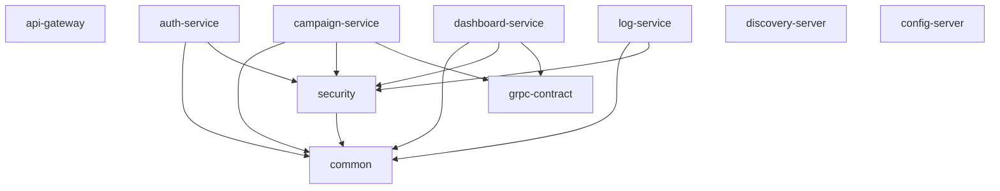

# 3. Repozitoriya quruluşu, Maven və build sistemi

## 3.1 Niyə build quruluşunu əvvəldən öyrənirik

Mikroservis repozitoriyasında ilk sual "hansı kod hansı prosesdə işləyir?" sualıdır. Bu sualın cavabı build
konfiqurasiyasındadır: hansı modul müstəqil tətbiqdir, hansı kitabxanadır, kim kimdən asılıdır, versiyalar haradan
gəlir. Bu fəsildən sonra siz istənilən sinfi gördükdə onun hansı JVM prosesində yaşadığını və hansı asılılıqların
onu mümkün etdiyini deyə biləcəksiniz.

## 3.2 Monorepo və multi-module Maven

Layihə **monorepo**-dur: bütün servislər bir Git repozitoriyasında, bir Maven reaktorunda qurulur. Kök `pom.xml`
`packaging=pom` olan **aqreqator və parent** POM-dur [FAKT] (`pom.xml:5-25`):

<!-- src: pom.xml:7-25 -->
```xml
<groupId>com.casestudy.insurancecampaign</groupId>
<artifactId>campaign-microservices</artifactId>
<version>1.0.0</version>
<packaging>pom</packaging>
<name>Allianz Campaign Microservices</name>
<description>Java 25 Spring Boot microservices case study for Allianz Sigorta Campaign API</description>

<modules>
    <module>common</module>
    <module>security</module>
    <module>grpc-contract</module>
    <module>discovery-server</module>
    <module>config-server</module>
    <module>api-gateway</module>
    <module>auth-service</module>
    <module>campaign-service</module>
    <module>dashboard-service</module>
    <module>log-service</module>
</modules>
```

İki anlayışı ayırmaq lazımdır:

- **Aqreqasiya (`<modules>`)** — `mvn` kökdən işə salındıqda hansı modulların bir reaktorda qurulacağını bildirir.
  Maven modullar arası asılılıqlara baxıb düzgün sıra müəyyən edir (reaktor sıralaması), siyahının yazılış sırası
  deyil.
- **Varislik (`<parent>`)** — hər modul `<parent>` olaraq kök POM-u göstərir və onun `properties`,
  `dependencyManagement`, `pluginManagement` və `build/plugins` bölmələrini miras alır.

Monorepo-nun üstünlüyü: paylaşılan kontraktlar (`grpc-contract`, `common` hadisələri) atomik dəyişdirilir, bir
commit-də həm producer, həm consumer yenilənir. Mənfi tərəfi: modullar müstəqil versiyalanmır (hamısı `1.0.0`),
bir modulun dəyişməsi bütün image-lərin yenidən qurulmasına səbəb olur (CI-də matrix build hər servisi qurur,
fəsil 18).

## 3.3 Versiya idarəetməsi: BOM import və `spring-boot-starter-parent` olmaması

Diqqətəlayiq qərar: kök POM `spring-boot-starter-parent`-dən miras **almır**. Bunun əvəzinə Spring Boot, Spring
Cloud, gRPC və Testcontainers üçün dörd **BOM** (Bill of Materials) idxal edilir [FAKT] (`pom.xml:69-100`):

<!-- src: pom.xml:69-100 -->
```xml
<dependencyManagement>
    <dependencies>
        <dependency>
            <groupId>org.springframework.boot</groupId>
            <artifactId>spring-boot-dependencies</artifactId>
            <version>${spring.boot.version}</version>
            <type>pom</type>
            <scope>import</scope>
        </dependency>
        <dependency>
            <groupId>org.springframework.cloud</groupId>
            <artifactId>spring-cloud-dependencies</artifactId>
            <version>${spring.cloud.version}</version>
            <type>pom</type>
            <scope>import</scope>
        </dependency>
        <dependency>
            <groupId>io.grpc</groupId>
            <artifactId>grpc-bom</artifactId>
            <version>${grpc.version}</version>
            <type>pom</type>
            <scope>import</scope>
        </dependency>
        <dependency>
            <groupId>org.testcontainers</groupId>
            <artifactId>testcontainers-bom</artifactId>
            <version>${testcontainers.version}</version>
            <type>pom</type>
            <scope>import</scope>
        </dependency>
    </dependencies>
</dependencyManagement>
```

**BOM nədir?** `type=pom, scope=import` olan asılılıq Maven-ə deyir: "həmin POM-un `dependencyManagement`
bölməsini bura kopyala". Nəticədə modullar `spring-boot-starter-web` kimi asılılıqları versiyasız yaza bilir; versiya
BOM-dan gəlir. Bu, tranzitiv asılılıqların bir-biri ilə uyğun versiyalarda olmasını təmin edir.

**`spring-boot-starter-parent` istifadə etməməyin nəticələri** [NƏTİCƏ]:
- Parent POM-un verdiyi plugin konfiqurasiyaları (məsələn, `spring-boot-maven-plugin`-in `repackage` icrası,
  resursların filtrlənməsi, `-parameters` kompilyator bayrağı) avtomatik gəlmir. Layihə bunları özü edir:
  `spring-boot-maven-plugin` versiyası `pluginManagement`-də (`pom.xml:111-115`), `repackage` icrası isə hər tətbiq
  modulunda ayrıca yazılıb (məs. `campaign-service/pom.xml:184-194`); `<parameters>true</parameters>` isə
  kompilyator konfiqurasiyasındadır (`pom.xml:138-145`).
- `-parameters` bayrağı vacibdir: Spring `@PathVariable UUID id` kimi annotasiyalarda ad verilmədikdə parametr adını
  bytecode-dan oxuyur. Bu bayraq olmasaydı, `@PathVariable` adları açıq yazılmalı olardı.
- Üstünlük: layihə başqa korporativ parent POM-dan miras ala bilər və bir neçə BOM-u (Cloud, gRPC) bərabər
  hüquqlu idxal edir. **BOM sırası vacibdir**: eyni artefakt bir neçə BOM-da olarsa, birinci idxal edilən qalib gəlir.
  Spring Boot BOM-u birincidir.

**gRPC BOM-un rolu.** README-də "gRPC Runtime Version Mismatch" bölməsi `NoClassDefFoundError:
io/grpc/InternalGlobalInterceptors` xətasını təsvir edir və həll kimi bütün `grpc-*` modullarının bir BOM ilə
uyğunlaşdırılmasını göstərir. [NƏTİCƏ] Bu xəta adətən `grpc-core` (net.devh starter-dən tranzitiv) və `grpc-api`
(birbaşa elan edilmiş) fərqli versiyalarda həll olunduqda yaranır; `grpc-bom` hamısını 1.80.0-a bağlayır.
Asılılıq ağacı bunu təsdiqləyir: campaign-service-də `grpc-core`, `grpc-netty-shaded`, `grpc-services` hamısı
`1.80.0`-dır.

## 3.4 Versiyalar cədvəli

| Komponent | Versiya | Necə müəyyən edilib |
|---|---|---|
| Java | 25 | `pom.xml:28-29` |
| Spring Boot | 4.1.0 | `pom.xml:30` |
| Spring Cloud | 2025.1.2 | `pom.xml:31` |
| Spring Framework / Security | 7.0.8 / 7.1.0 | `mvn dependency:tree` |
| Hibernate ORM | 7.4.1.Final | `mvn dependency:tree` |
| Liquibase | 5.0.3 | `mvn dependency:tree` |
| Spring Kafka / kafka-clients | 4.1.0 / 4.2.1 | `mvn dependency:tree` |
| Spring Data Elasticsearch / Elasticsearch Java client | 6.1.0 / 9.4.2 | `mvn dependency:tree` |
| Spring Cloud Gateway | 5.0.2 | `mvn dependency:tree` |
| gRPC / Protobuf / net.devh starter | 1.80.0 / 4.34.2 / 3.1.0.RELEASE | `pom.xml:35-37` |
| JJWT | 0.12.6 | `pom.xml:34` |
| Resilience4j | 2.4.0 (`resilience4j-spring-boot4`) | `auth-service/pom.xml:16` |
| springdoc-openapi | 2.8.13 | `pom.xml:32` |
| Testcontainers | 1.21.3 | `pom.xml:33` |

Bu versiyalar kitabdakı bütün framework davranışı izahlarının əsasıdır. Məsələn, Spring Boot 4-də auto-
configuration modullara bölünüb, Jackson 3 standart JSON kitabxanası olub; Spring Kafka 4-də `JsonSerializer`
köhnəlmiş (deprecated) elan edilib. Bunlar aşağıda və müvafiq fəsillərdə izah olunur.

## 3.5 Modullar arası asılılıq qrafı



[FAKT] `api-gateway`, `discovery-server` və `config-server` heç bir daxili moduldan asılı deyil. Gateway reaktiv
(WebFlux) olduğu üçün servlet əsaslı `security` modulunu istifadə edə bilməz; buna görə öz JWT siniflərini
(`GatewayJwtTokenService`, `GatewayPemKeyUtils`) saxlayır. [NƏTİCƏ] Bu, kod təkrarına səbəb olsa da, reaktiv və
servlet stack-larının qarışmasının qarşısını alır. Eyni səbəbdən observation konfiqurasiyası üç dəfə kopyalanıb
(tapıntı F23, fəsil 17).

### Paylaşılan modulun "gizli" təsiri

`common` və `security` modullarında `@Component`, `@Configuration`, `@RestControllerAdvice` olan siniflər var. Onlar
tətbiqə avtomatik qoşulmur — Spring Boot yalnız `@SpringBootApplication` sinfinin paketini və alt paketlərini skan
edir. Bütün tətbiqlər skan bazasını genişləndirir [FAKT] (məs. `CampaignServiceApplication.java:8`):

```java
@SpringBootApplication(scanBasePackages = "com.casestudy.insurancecampaign")
```

Bu tək sətir sayəsində `common.exception.GlobalExceptionHandler`, `security.ServiceSecurityConfiguration`,
`common.web.SlowRequestLoggingFilter` və s. hər servisdə bean-ə çevrilir. Bu mexanizm 4-cü fəsildə ətraflı
izah olunur. Alternativ (və kitabxanalar üçün daha "Spring-vari") yol öz auto-configuration-unuzu
`META-INF/spring/org.springframework.boot.autoconfigure.AutoConfiguration.imports` faylı ilə qeydiyyatdan keçirməkdir.

## 3.6 Spring Boot 4-ün modullaşdırılmış auto-configuration-u

Spring Boot 4-də əvvəllər `spring-boot-autoconfigure` jar-ında olan auto-configuration-lar texnologiya üzrə ayrı
modullara bölünüb (`spring-boot-kafka`, `spring-boot-liquibase`, `spring-boot-data-redis`, `spring-boot-security`
və s.). Starter-lər bu modulları gətirir. Bu repozitoriyada bunun real nəticələri var [FAKT] (POM-lar və asılılıq
ağacı):

| Modul | POM-da nə var | Nəticə |
|---|---|---|
| campaign-service | `spring-kafka` (starter yox) | Boot-un Kafka auto-configuration-u **yoxdur**; `KafkaTemplate` yalnız `common`-dakı `KafkaJsonConfiguration`-dan gəlir |
| log-service | `spring-kafka` + `spring-boot-kafka` | Boot `ConsumerFactory`-ni `spring.kafka.consumer.*` xassələrindən qurur; `KafkaTemplate`/`ProducerFactory` `@ConditionalOnMissingBean` olduğu üçün `common`-dakı bean-lər qalib gəlir |
| campaign/auth-service | `liquibase-core` + `spring-boot-liquibase` | Liquibase startup-da changelog-u icra edir |
| auth-service | `spring-boot-starter-restclient` | `RestClient` və HTTP Service Client (`@ImportHttpServices`) dəstəyi |
| bütün biznes servisləri | `spring-boot-starter-opentelemetry` | Micrometer Tracing + OTel bridge + OTLP exporter |
| testlər | `spring-boot-starter-webmvc-test` | `@AutoConfigureMockMvc` yeni paketdə: `org.springframework.boot.webmvc.test.autoconfigure` |

[NƏTİCƏ] Praktiki dərs: Spring Boot 4-də "kitabxananı əlavə etdim, amma auto-configuration işləmir" problemi
yarandıqda əvvəlcə müvafiq `spring-boot-*` modulunun və ya starter-in classpath-də olduğunu yoxlayın.

## 3.7 Jackson 3 və Jackson 2 birgə yaşayışı

Spring Boot 4 standart olaraq **Jackson 3** (`tools.jackson.core:jackson-databind`, paket `tools.jackson.*`)
istifadə edir. Asılılıq ağacında campaign-service üçün həm Jackson 3 (`3.1.4`), həm Jackson 2 (`2.21.4`) görünür.
Jackson 2 iki yoldan gəlir:

1. `common/pom.xml:32-35` — `jackson-datatype-jsr310` birbaşa elan olunub. [NƏTİCƏ] Bu modul Spring Kafka-nın
   `JsonSerializer`-i (Jackson 2 əsaslı) `Instant` sahələrini serializə edə bilsin deyə lazımdır.
2. `spring-cloud-netflix-eureka-client → spring-boot-jackson2` — Eureka klienti Boot-un **deprecated**
   `spring-boot-jackson2` modulunu gətirir. Bu modulun `Jackson2AutoConfiguration` sinfi
   (`@Deprecated(since = "4.0.0", forRemoval = true)`) `com.fasterxml.jackson.databind.ObjectMapper` bean-i yaradır.

Kodda Jackson 2 `ObjectMapper` birbaşa inject olunur [FAKT]: `ServiceSecurityConfiguration.java:3,49-52` və
`GatewayRateLimitErrorResponseFilter.java:4,43-45`. [RİSK] (F20) Bu bean-in mövcudluğu Eureka klientinin tranzitiv
asılılığına bağlıdır. Eureka çıxarılsa və ya Spring Cloud gələcək versiyada `spring-boot-jackson2`-ni buraxsa,
kontekst `ObjectMapper` bean-i tapmadığı üçün başlamayacaq. Düzgün həll — Jackson 3 `JsonMapper`-i inject etmək və ya
Spring-in `HttpMessageConverters`-indən istifadə etmək.

HTTP cavabları (MVC `@RestController`) üçün isə Spring Boot 4-ün standart Jackson 3 konvertoru işləyir. [NƏTİCƏ]
Buna görə `Instant` sahələri JSON-da ISO-8601 sətri kimi görünür (testlərdə `"2026-07-27T09:00:00Z"` gözlənilir,
`DashboardControllerTest.java:123`).

## 3.8 `grpc-contract`: koddan əvvəl kod generasiyası

`grpc-contract` modulunda Java kodu yoxdur — yalnız `campaign.proto`. Java sinifləri build zamanı generasiya
olunur [FAKT] (`grpc-contract/pom.xml:48-104`):

1. **`os-maven-plugin` extension** (`grpc-contract/pom.xml:49-55`) — `${os.detected.classifier}` dəyişənini (məs. `linux-x86_64`)
   müəyyən edir, çünki `protoc` native binary-dir.
2. **`protobuf-maven-plugin`** (`grpc-contract/pom.xml:57-74`) — `compile` məqsədi `protoc` ilə mesaj siniflərini
   (`CampaignStatisticsRequest` və s.), `compile-custom` məqsədi `protoc-gen-grpc-java` plugin-i ilə servis
   stub-larını (`CampaignGrpcServiceGrpc`) generasiya edir.
3. **`build-helper-maven-plugin`** (`grpc-contract/pom.xml:75-94`) — generasiya olunan qovluqları (`target/generated-sources/
   protobuf/java` və `.../grpc-java`) mənbə kökü kimi əlavə edir ki, IDE onları tanısın.
4. `javax.annotation-api` (`grpc-contract/pom.xml:40-45`) — generasiya olunan kod hələ də `javax.annotation.Generated`
   istifadə edir (POM-dakı şərh bunu açıq deyir).

README-dəki "IntelliJ `Cannot resolve symbol 'grpc'`" problemi məhz buradan gəlir: generasiya `mvn install`
icra olunmadan baş vermir. Həll: `mvn -pl grpc-contract -am clean install`.

## 3.9 Test və keyfiyyət plugin-ləri

Kök POM bütün modullara aşağıdakı plugin-ləri tətbiq edir [FAKT] (`pom.xml:137-205`):

<!-- src: pom.xml:147-171 -->
```xml
<plugin>
    <groupId>org.apache.maven.plugins</groupId>
    <artifactId>maven-surefire-plugin</artifactId>
    <configuration>
        <argLine>@{argLine} --enable-preview</argLine>
        <useModulePath>false</useModulePath>
    </configuration>
</plugin>

<plugin>
    <groupId>org.apache.maven.plugins</groupId>
    <artifactId>maven-failsafe-plugin</artifactId>
    <configuration>
        <argLine>@{argLine} --enable-preview</argLine>
        <useModulePath>false</useModulePath>
    </configuration>
    <executions>
        <execution>
            <goals>
                <goal>integration-test</goal>
                <goal>verify</goal>
            </goals>
        </execution>
    </executions>
</plugin>
```

- `@{argLine}` — gecikmiş (late) property qiymətləndirməsidir. JaCoCo-nun `prepare-agent` məqsədi `argLine`
  xassəsinə `-javaagent:...jacoco.jar` əlavə edir; `@{...}` sintaksisi surefire-ə bu dəyəri test başlayanda oxumağı
  deyir. Kök POM-da boş `<argLine></argLine>` (`pom.xml:42`) JaCoCo olmadıqda belə dəyişənin təyin olunmasını təmin
  edir. Bu, JaCoCo + əlavə JVM arqumentlərini birləşdirməyin standart üsuludur.
- `--enable-preview` — Java preview xüsusiyyətlərini aktivləşdirir. [NƏTİCƏ] Kodda preview xüsusiyyəti istifadə
  olunduğuna dair açıq nümunə tapılmadı (record, switch ifadəsi, pattern matching `instanceof` Java 25-də
  stabildir). auth-service `--enable-preview` ilə kompilyasiya olunur (`auth-service/pom.xml:181`); preview ilə
  kompilyasiya olunmuş sinif runtime-da da `--enable-preview` tələb edir — Dockerfile-lardakı bayraq buna görə
  zəruridir.
- **Surefire və failsafe fərqi**: surefire `*Test` siniflərini `test` fazasında, failsafe `*IT` siniflərini
  `integration-test` fazasında işlədir. [FAKT] Repozitoriyada `*IT` sinfi yoxdur; Testcontainers istifadə edən
  inteqrasiya testləri də `*Test` adlanır və surefire ilə işləyir. Failsafe konfiqurasiya olunub, lakin heç bir test
  icra etmir.
- **JaCoCo** — `prepare-agent` və `verify` fazasında `report` (XML + HTML) (`pom.xml:179-204`). SonarQube
  əhatəni `**/target/site/jacoco/jacoco.xml`-dən oxuyur; `common`, `security`, `api-gateway`, `config-server`,
  `discovery-server`, `grpc-contract` əhatə hesablamasından çıxarılıb (`pom.xml:57-64`). [NƏTİCƏ] Bu modulların
  testi olmadığı üçün çıxarılması əhatə faizini "gözəlləşdirir", lakin həmin kod (məs. `GlobalExceptionHandler`,
  JWT filtri) bütün servislərin davranışına təsir edir.

## 3.10 auth-service: annotation processor-lar

auth-service Lombok və MapStruct istifadə edən yeganə moduldur [FAKT] (`auth-service/pom.xml:159-183`):

<!-- src: auth-service/pom.xml:162-182 -->
```xml
<configuration>
    <source>${java.version}</source>
    <target>${java.version}</target>
    <annotationProcessorPaths>
        <path>
            <groupId>org.projectlombok</groupId>
            <artifactId>lombok</artifactId>
        </path>
        <path>
            <groupId>org.mapstruct</groupId>
            <artifactId>mapstruct-processor</artifactId>
            <version>${mapstruct.version}</version>
        </path>
        <path>
            <groupId>org.projectlombok</groupId>
            <artifactId>lombok-mapstruct-binding</artifactId>
            <version>${lombok-mapstruct-binding.version}</version>
        </path>
    </annotationProcessorPaths>
    <compilerArgs>--enable-preview</compilerArgs>
</configuration>
```

- Lombok `@Getter` getter-ləri, MapStruct isə `AuthMapper` interfeysinin implementasiyasını (`AuthMapperImpl`)
  kompilyasiya zamanı generasiya edir. `lombok-mapstruct-binding` iki processor-un sırasını uzlaşdırır: MapStruct
  Lombok-un generasiya etdiyi getter-ləri görməlidir.
- [NƏTİCƏ] Lombok-un versiyası `annotationProcessorPaths`-də göstərilməyib; Maven bu halda versiyanı
  `dependencyManagement`-dən götürə bilir (Maven 3.9+ compiler plugin 3.12+ bunu dəstəkləyir), kök POM-da compiler
  plugin `3.14.1`-dir (`pom.xml:105-109`).
- Digər servislər Lombok istifadə etmir: entity-lərdə getter-lər əl ilə yazılıb (məs. `CampaignEntity.java:70-77`).
  Bu, eyni repozitoriyada iki fərqli üslubun mövcudluğudur — müsahibədə "komanda standartı" sualına nümunədir.

## 3.11 Tətbiq artefaktları və Dockerfile

Hər tətbiq modulu `spring-boot-maven-plugin:repackage` ilə **icra oluna bilən fat jar** yaradır (jar daxilində
`BOOT-INF/lib` asılılıqları və `JarLauncher`). Dockerfile-lar çoxmərhələlidir [FAKT]
(`campaign-service/Dockerfile:1-26`):

<!-- src: campaign-service/Dockerfile:1-26 -->
```dockerfile
# Stage 1: Build stage
FROM maven:3.9.11-amazoncorretto-25 AS build

# Set working directory
WORKDIR /workspace

# Copy full multi-module project
COPY . .

# Build only campaign-service and required modules
RUN mvn -pl campaign-service -am clean package -DskipTests

# Stage 2: Run stage
FROM amazoncorretto:25

# Set working directory
WORKDIR /app

# Copy the executable Spring Boot JAR file from the build stage
COPY --from=build /workspace/campaign-service/target/campaign-service-*.jar campaign-service.jar

# Expose REST and gRPC ports
EXPOSE 8082 9090

# Set the entrypoint command for running the application
ENTRYPOINT ["java", "--enable-preview", "-jar", "campaign-service.jar"]
```

- `-pl campaign-service -am` — "also make": seçilmiş modulu və onun asılı olduğu modulları (`common`, `security`,
  `grpc-contract`) qurur.
- `COPY . .` bütün repozitoriyanı build konteksinə köçürür. [NƏTİCƏ] Bu, Docker layer cache-ini zəiflədir: istənilən
  faylın dəyişməsi (hətta README) Maven asılılıqlarının yenidən endirilməsinə səbəb olur, çünki `~/.m2` cache-i
  layer-da saxlanmır. Təkmilləşdirmə: əvvəlcə yalnız POM-ları köçürüb `mvn dependency:go-offline`, sonra mənbələri
  köçürmək; və ya BuildKit `--mount=type=cache,target=/root/.m2`.
- Run mərhələsi tam JDK image-idir (`amazoncorretto:25`), root istifadəçi ilə işləyir, `HEALTHCHECK` və JVM yaddaş
  parametrləri yoxdur. Bunlar fəsil 18-də müzakirə olunur.

## 3.12 Build əmrləri və tipik problemlər

```bash
mvn clean verify                          # bütün modullar, testlər, JaCoCo hesabatları
mvn -pl campaign-service -am test         # bir servis və asılılıqları
mvn -pl grpc-contract -am clean install   # gRPC siniflərini generasiya edib lokal repoya qoymaq
mvn -pl auth-service spring-boot:run      # servisi işə salmaq (əvvəlcə asılılıqlar install olunmalıdır)
```

| Problem | Səbəb | Həll |
|---|---|---|
| `Cannot resolve symbol 'grpc'` | Generasiya olunan siniflər yoxdur | `mvn -pl grpc-contract -am clean install`, IDE-də Maven reload |
| `NoClassDefFoundError: io/grpc/InternalGlobalInterceptors` | `grpc-*` versiyaları uyğunsuzdur | `grpc-bom` import (artıq var), `mvn -U clean install` |
| `release version 25 not supported` | JDK 25 deyil | Project SDK və Maven runner JDK 25 |
| `Preview features are not enabled` | `--enable-preview` olmadan işə salınma | IDE run konfiqurasiyasına VM option əlavə edin |
| Testlər Docker xətası ilə düşür | Testcontainers Docker tapmır | Docker işləməlidir |
| Kontekst `No qualifying bean of type ObjectMapper` ilə başlamır (hipotetik) | `spring-boot-jackson2` classpath-dən çıxıb (F20) | Jackson 3 `JsonMapper` istifadə edin |

## 3.13 Yeni layihədə tətbiq

Oxşar monorepo qurarkən:

1. Kök POM-u `packaging=pom` edin; `spring-boot-dependencies`, `spring-cloud-dependencies` və digər BOM-ları
   `dependencyManagement`-ə idxal edin (Boot BOM-u birinci).
2. Kontraktları (proto, Avro/JSON schema, paylaşılan hadisə record-ları) ayrıca **nazik** modula çıxarın; həmin modul
   Spring-dən asılı olmasın.
3. Paylaşılan Spring konfiqurasiyasını `scanBasePackages` əvəzinə **öz auto-configuration**-unuz kimi qeydiyyatdan
   keçirin — bu, `@ConditionalOn...` şərtlərinin düzgün sırada qiymətləndirilməsini və tətbiqin "opt-out" imkanını
   verir.
4. `spring-boot-maven-plugin`-i `pluginManagement`-də versiyalayın, `repackage`-i yalnız tətbiq modullarında aktiv edin.
5. Test plugin-lərində `@{argLine}` istifadə edin ki, JaCoCo agenti itməsin.

## 3.14 Praktiki tapşırıqlar

Tapşırıqları öz fork-unuzda, ayrıca branch-da edin. Çətinlik: ★ — 30 dəqiqəyə qədər, ★★ — bir neçə saat, ★★★ — təxminən bir gün. "Gözlənilən nəticə" koddan çıxardığım proqnozdur; sizdə fərqli çıxarsa, səbəbini tapmaq tapşırığın ən dəyərli hissəsidir.

**T1 ★ — `optional` asılılığı öz gözünüzlə görün.**
`mvn -q -pl auth-service -am dependency:tree -Dincludes=org.springframework.kafka` və eyni əmri `campaign-service` üçün
işlədin. **Gözlənilən nəticə:** auth-service üçün boş, campaign-service üçün `spring-kafka` görünür (`common/pom.xml`-də
`optional`).

**T2 ★ — gRPC kodunun generasiyası.** `mvn -pl grpc-contract -am generate-sources` işlədin və
`CampaignGrpcServiceGrpc.java` faylını `grpc-contract/target/generated-sources/` altında tapın. **Yoxlama:** faylın niyə
git-də olmadığını və `build-helper-maven-plugin`-in nə üçün lazım olduğunu bir cümlə ilə izah edə bilirsiniz.

**T3 ★★ — Əhatə hesabatı.** JDK 25 və Docker ilə `mvn -pl campaign-service -am verify` işlədin, sonra
`campaign-service/target/site/jacoco/index.html`-i açın. **Yoxlama:** ən az əhatə olunmuş üç sinfi tapın və 19.5-dəki
"test edilmir" siyahısı ilə müqayisə edin.

**T4 ★★ — Dockerfile-ı optimallaşdırın.** campaign-service Dockerfile-ını fəsil 18-dəki nümunə ilə yenidən yazın
(asılılıq qatı, BuildKit keşi, non-root istifadəçi). Bir Java faylını dəyişib image-i iki dəfə qurun. **Yoxlama:**
ikinci build-in müddəti əvvəlkindən nəzərəçarpacaq dərəcədə qısadır və konteyner root olmayan istifadəçi ilə işləyir
(`docker exec <konteyner> id`).

## 3.15 Müsahibə sualları

**S1. BOM import ilə `spring-boot-starter-parent` arasındakı fərq nədir?**
Cavab: Parent POM həm versiyaları (`dependencyManagement`), həm də plugin konfiqurasiyalarını, resurs filtrlənməsini,
kompilyator parametrlərini miras verir. BOM import yalnız versiyaları gətirir. Parent tək ola bilər; BOM-ları
istənilən sayda idxal etmək olar. Layihə parent-siz yolu seçib və lazımi plugin konfiqurasiyalarını özü yazıb.

**S2. `-am` və `-pl` nə edir?**
Cavab: `-pl` (projects list) reaktordan yalnız göstərilən modulları seçir; `-am` (also make) onların asılı olduğu
modulları da qurur. Dockerfile-larda `mvn -pl campaign-service -am package` `common`, `security`, `grpc-contract` və
`campaign-service`-i qurur.

**S3. `common`-da `spring-kafka`-nın `optional` olması nə deməkdir və nəyə təsir edir?**
Cavab: Optional asılılıq tranzitiv ötürülmür. `common` Kafka siniflərinə qarşı kompilyasiya olunur, lakin `common`-dan
asılı servis `spring-kafka`-nı özü elan etmədikcə onu almır. `KafkaJsonConfiguration` və `SlowRequestLoggingFilter`
`@ConditionalOnClass(name = "org.springframework.kafka.core.KafkaTemplate")` ilə qorunur; nəticədə filtr yalnız
campaign və log-service-də aktivdir.

**S4. Niyə gateway `security` modulunu istifadə etmir?**
Cavab: `security` modulu servlet API-yə (`OncePerRequestFilter`, `HttpSecurity`) əsaslanır. Gateway Spring WebFlux
(Netty) üzərində işləyir; orada `WebFilter`/`GlobalFilter` və `ServerHttpSecurity` istifadə olunur. Servlet və
reaktiv stack-ları bir tətbiqdə qarışdırmaq ya mümkün deyil, ya da gözlənilməz davranış yaradır.

**S5. Spring Boot 4-də Jackson ilə bağlı nəyə diqqət etməli?**
Cavab: Standart Jackson 3-dür (`tools.jackson`), Jackson 2 dəstəyi deprecated `spring-boot-jackson2` modulundadır.
Bu layihədə Jackson 2 `ObjectMapper` bean-i Eureka klientinin tranzitiv asılılığı sayəsində mövcuddur; bu kövrək
asılılıqdır.

## 3.16 Xülasə

- 10 modul: 3 kitabxana (`common`, `security`, `grpc-contract`), 7 tətbiq.
- Versiyalar dörd BOM ilə idarə olunur; parent POM `spring-boot-starter-parent` deyil.
- Paylaşılan Spring bean-ləri `scanBasePackages = "com.casestudy.insurancecampaign"` ilə qoşulur.
- Spring Boot 4 modullaşdırılmış auto-configuration və Jackson 3 gətirir; layihədə bunun konkret nəticələri var.
- gRPC kodu build zamanı `protoc` ilə generasiya olunur.
- Növbəti fəsil bu bean-lərin necə yaradıldığını, şərti konfiqurasiyanı və proxy mexanizmlərini təzələyir.
