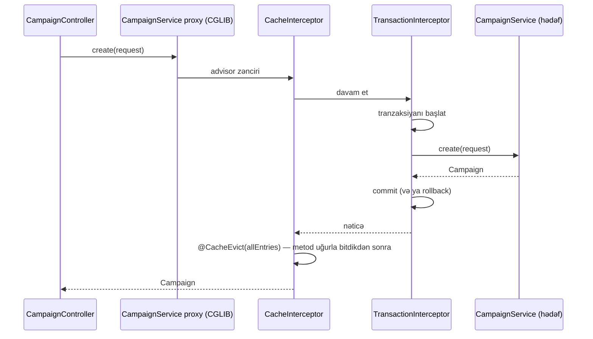

# 4. Java 25 və Spring Boot 4 təməlləri — layihə üzərində təzələmə

Bu fəsil Spring-in əsas mexanizmlərini abstrakt lüğət kimi deyil, **bu repozitoriyadakı konkret siniflər** üzərində
təzələyir. Məqsəd: hər annotasiyanı gördükdə "bu nəyi dəyişir, nə vaxt işləmir, hansı runtime obyekti yaradır"
suallarına cavab verə bilmək.

## 4.1 Problem: tətbiq özünü necə yığır?

`CampaignService` dörd asılılığa ehtiyac duyur: iki repository, bir mapper və bir `KafkaTemplate`. Heç bir yerdə
`new CampaignService(...)` yazılmayıb, lakin servis işləyir. Kim yaradır, kim asılılıqları ötürür, nə vaxt?
Cavab — **IoC konteyneri** (`ApplicationContext`). Spring Boot startup-da:

1. `@SpringBootApplication` sinfindən başlayaraq **komponent skanı** aparır və bean təriflərini (BeanDefinition)
   toplayır;
2. **auto-configuration** siniflərini yükləyir və onların **şərtlərini** (`@ConditionalOn...`) qiymətləndirir;
3. bean-ləri asılılıq qrafına görə yaradır, asılılıqları **konstruktor vasitəsilə** ötürür;
4. **BeanPostProcessor**-lar bean-ləri lazım gəldikdə **proxy**-yə bükür (`@Transactional`, `@Cacheable`, `@Async`,
   `@PreAuthorize`, Resilience4j annotasiyaları);
5. web server-i (Tomcat və ya Netty), Kafka listener konteynerlərini, gRPC server-i başladır.

## 4.2 Dependency Injection: konstruktor injeksiyası standartdır

Layihədə bütün servislər **konstruktor injeksiyası** istifadə edir [FAKT]
(`CampaignService.java:40-52`):

<!-- src: campaign-service/src/main/java/com/casestudy/insurancecampaign/campaign/service/CampaignService.java:40-52 -->
```java
public CampaignService(
        CampaignRepository campaignRepository,
        CampaignStatusHistoryRepository historyRepository,
        CampaignMapper campaignMapper,
        KafkaTemplate<String, Object> kafkaTemplate,
        @Value("${app.kafka.topics.campaign-events:campaign-events}") String campaignEventsTopic
) {
    this.campaignRepository = campaignRepository;
    this.historyRepository = historyRepository;
    this.campaignMapper = campaignMapper;
    this.kafkaTemplate = kafkaTemplate;
    this.campaignEventsTopic = campaignEventsTopic;
}
```

Yada salınacaq qaydalar:

- Sinifdə **tək konstruktor** varsa, `@Autowired` lazım deyil — Spring onu avtomatik istifadə edir.
- Sahələr `final`-dır: obyekt tam qurulmuş vəziyyətdə yaranır, dəyişməzdir, thread-safe-dir.
- Konfiqurasiya dəyəri də konstruktor parametri kimi gəlir (`@Value(... :campaign-events)` — iki nöqtədən sonrakı
  hissə standart dəyərdir).
- **Testlənə bilmə**: `CampaignServiceTest` Spring konteksti olmadan obyekti birbaşa yaradır
  (`CampaignServiceTest.java:37`): `new CampaignService(campaignRepository, historyRepository, campaignMapper,
  kafkaTemplate, "campaign-events")`.

### İstisna: `@GrpcClient` sahə injeksiyası

dashboard-service-də gRPC stub sahəyə inject olunur [FAKT] (`CampaignGrpcClient.java:31-32`):

<!-- src: dashboard-service/src/main/java/com/casestudy/insurancecampaign/dashboard/client/CampaignGrpcClient.java:31-32 -->
```java
@GrpcClient("campaign-service")
private CampaignGrpcServiceGrpc.CampaignGrpcServiceBlockingStub campaignStub;
```

`@GrpcClient` net.devh kitabxanasının öz `BeanPostProcessor`-u tərəfindən emal olunur; stub Spring bean-i deyil, hər
injeksiya nöqtəsi üçün kanal üzərində yaradılır. Nəticə: unit testdə sahəni əl ilə doldurmaq lazım gəlir — test bunu
`ReflectionTestUtils.setField` ilə edir (`CampaignGrpcClientTest.java:35-41`). [NƏTİCƏ] Sahə injeksiyası
testlənməni çətinləşdirir; net.devh həm də `@GrpcClient`-in metod/konstruktor parametrində istifadəsini və ya
`GrpcChannelFactory` ilə stub-u `@Bean` kimi yaratmağı dəstəkləyir.

## 4.3 Stereotiplər və `@Configuration` / `@Bean`

| Annotasiya | Layihədə harada | Mənası |
|---|---|---|
| `@Component` | `CampaignMapper`, `CampaignGrpcClient`, `SlowRequestLoggingFilter`, `JwtAuthenticationFilter`, gateway filtrləri | Ümumi bean |
| `@Service` | `CampaignService`, `AuthService`, `AuthAuditService`, `JwtTokenService`, `SlowRequestLogConsumer` | Semantik olaraq servis qatı; texniki olaraq `@Component` |
| `@RestController` | bütün controller-lər | `@Controller` + `@ResponseBody` |
| `@RestControllerAdvice` | `GlobalExceptionHandler` | Bütün controller-lər üçün mərkəzi `@ExceptionHandler`-lər |
| `@Repository` | **istifadə olunmayıb** | Spring Data interfeysləri annotasiyasız aşkarlanır; istisna tərcüməsi repository proxy-si tərəfindən edilir |
| `@Configuration` + `@Bean` | `KafkaJsonConfiguration`, `AuthConfiguration`, `KafkaDlqConfiguration`, gateway konfiqurasiyaları | Üçüncü tərəf obyektlərinin (və ya xüsusi qurulmuş obyektlərin) bean kimi qeydiyyatı |
| `@GrpcService` | `CampaignGrpcEndpoint` | net.devh: bean + gRPC server-ə servis kimi qeydiyyat |
| `@Mapper(componentModel = "spring")` | `AuthMapper` | MapStruct generasiya etdiyi implementasiyanı `@Component` edir |

### `@Configuration` və `proxyBeanMethods`

`@Configuration` sinfi standart olaraq **CGLIB proxy**-yə çevrilir ki, bir `@Bean` metodundan digərini çağırdıqda
yeni obyekt deyil, konteynerdəki singleton qaytarılsın. Layihədə `KafkaJsonConfiguration` bu problemi düzgün həll
edir: `kafkaTemplate` bean-i `producerFactory()`-ni birbaşa çağırmır, **parametr kimi alır** [FAKT]
(`KafkaJsonConfiguration.java:57-60`):

<!-- src: common/src/main/java/com/casestudy/insurancecampaign/common/config/KafkaJsonConfiguration.java:57-60 -->
```java
@Bean
public KafkaTemplate<String, Object> kafkaTemplate(ProducerFactory<String, Object> producerFactory) {
    return new KafkaTemplate<>(producerFactory);
}
```

Parametr injeksiyası ilə proxy-yə ehtiyac qalmır. `LogServiceHttpClientConfiguration` isə bunu açıq bildirir:
`@Configuration(proxyBeanMethods = false)` (`LogServiceHttpClientConfiguration.java:18`) — bu, startup-u bir az
sürətləndirir və GraalVM native image üçün tövsiyə olunan formadır.

## 4.4 Komponent skanı və paylaşılan modullar

Bütün biznes servisləri və gateway skan bazasını kök paketə genişləndirir [FAKT]:

<!-- src: auth-service/src/main/java/com/casestudy/insurancecampaign/auth/AuthServiceApplication.java:17-20 -->
```java
@SpringBootApplication(scanBasePackages = "com.casestudy.insurancecampaign")
@EnableDiscoveryClient
@ImportHttpServices(group = "log-service", types = LogServiceHttpClient.class)
public class AuthServiceApplication {
```

Bu o deməkdir ki, `common` və `security` jar-larındakı bütün `@Component`/`@Configuration` sinifləri istisnasız
yüklənir. Nəticələr:

- [FAKT] Hər servis eyni `GlobalExceptionHandler`, `ServiceSecurityConfiguration`, `JwtAuthenticationFilter`-i alır.
  auth-service də daxil olmaqla — auth-service-də `/api/v1/auth/**` `permitAll` olduğu üçün problem yaranmır.
- [NƏTİCƏ] Servis "bu ortaq bean-i istəmirəm" deyə bilmir (yalnız `@ComponentScan(excludeFilters=...)` ilə). Öz
  auto-configuration-unuzu yazsaydınız, istifadəçi `@SpringBootApplication(exclude = ...)` və ya
  `@ConditionalOnMissingBean` ilə əvəzləyə bilərdi.
- `@EnableDiscoveryClient` müasir Spring Cloud-da məcburi deyil — classpath-də Eureka client olduqda qeydiyyat
  avtomatikdir. Annotasiya zərərsizdir.
- config-server və discovery-server skanı genişləndirmir (`ConfigServerApplication.java`,
  `DiscoveryServerApplication.java` — sadə `@SpringBootApplication`), onlar `common`-dan asılı da deyil.

## 4.5 Auto-configuration və şərtlər

Auto-configuration — classpath-ə və mövcud bean-lərə baxıb "ağlabatan standart" bean-lər yaradan
`@AutoConfiguration` sinifləridir. Onları idarə edən əsas şərtlər:

| Şərt | Nə yoxlayır | Layihədə nümunə |
|---|---|---|
| `@ConditionalOnClass` | Sinif classpath-dədirmi | `KafkaJsonConfiguration.java:24-26`, `SlowRequestLoggingFilter.java:31-33` |
| `@ConditionalOnProperty` | Xassənin dəyəri | `VirtualThreadConfiguration.java:22-25` |
| `@ConditionalOnMissingBean` | Eyni tipdə bean yoxdursa | Boot-un `KafkaAutoConfiguration`-u (`KafkaTemplate`, `ProducerFactory`) |
| `@ConditionalOnBean` | Bean varsa | net.devh `GrpcServerSecurityAutoConfiguration` (`AuthenticationManager` tələb edir) |

### Nümunə: kimin `KafkaTemplate`-i qalib gəlir?

<!-- src: common/src/main/java/com/casestudy/insurancecampaign/common/config/KafkaJsonConfiguration.java:24-49 -->
```java
@Configuration
@ConditionalOnClass(name = "org.springframework.kafka.core.KafkaTemplate")
public class KafkaJsonConfiguration {
    // ... (buraxılıb: Javadoc)
    @Bean
    public ProducerFactory<String, Object> producerFactory(@Value("${spring.kafka.bootstrap-servers:localhost:9092}") String bootstrapServers) {
        Map<String, Object> props = new HashMap<>();
        props.put(ProducerConfig.BOOTSTRAP_SERVERS_CONFIG, bootstrapServers);
        props.put(ProducerConfig.KEY_SERIALIZER_CLASS_CONFIG, StringSerializer.class);
        props.put(ProducerConfig.VALUE_SERIALIZER_CLASS_CONFIG, JsonSerializer.class);
        props.put(JsonSerializer.ADD_TYPE_INFO_HEADERS, false);
        return new DefaultKafkaProducerFactory<>(props);
    }
```

1. `@ConditionalOnClass(name = "...")` — sinif adı **sətir** kimi verilib, `KafkaTemplate.class` kimi yox. Səbəb:
   şərt annotasiyaları ASM ilə, sinif yüklənmədən oxunur; sinif literalı istifadə olunsaydı və classpath-də Kafka
   olmasaydı, annotasiyanın metadata-sı oxunarkən problem yarana bilərdi. Sətir forması təhlükəsizdir.
2. Bu sinif **istifadəçi konfiqurasiyası** kimi (komponent skanı ilə) yüklənir. Spring Boot auto-configuration-ları
   istifadəçi bean-lərindən **sonra** emal edir. log-service-də Boot-un `KafkaAutoConfiguration`-u
   `@ConditionalOnMissingBean(KafkaTemplate.class)` və `@ConditionalOnMissingBean(ProducerFactory.class)` ilə qorunur
   [FAKT] (spring-boot-kafka 4.1.0 mənbəsi), buna görə `common`-dakı bean-lər qalib gəlir və Boot-unkular yaradılmır.
3. campaign-service-də `spring-boot-kafka` yoxdur, ona görə Boot Kafka auto-configuration-u ümumiyyətlə yoxdur;
   `spring.kafka.bootstrap-servers` xassəsi yalnız `@Value` ilə oxunur.

[NƏTİCƏ] Dərs: `@ConditionalOnMissingBean`-i **istifadəçi** `@Configuration`-unda istifadə etmək risklidir, çünki
qiymətləndirmə anında digər istifadəçi bean-ləri hələ qeydiyyatdan keçməmiş ola bilər. Bu şərt auto-configuration
sinifləri üçün nəzərdə tutulub.

### `@ConditionalOnProperty` və `@EnableAsync`

<!-- src: common/src/main/java/com/casestudy/insurancecampaign/common/config/VirtualThreadConfiguration.java:22-38 -->
```java
@Configuration
@EnableAsync
@ConditionalOnProperty(name = "spring.threads.virtual.enabled", havingValue = "true")
public class VirtualThreadConfiguration {
    // ... (buraxılıb: Javadoc)
    @Bean(name = "applicationTaskExecutor")
    public AsyncTaskExecutor applicationTaskExecutor() {
        return new TaskExecutorAdapter(Executors.newVirtualThreadPerTaskExecutor());
    }
```

Diqqət çəkən nəticə [NƏTİCƏ]: `@EnableAsync` yalnız bu sinif aktiv olduqda qüvvəyə minir. Bütün servislərdə
`spring.threads.virtual.enabled: true` olduğu üçün (məs. `auth-service/src/main/resources/application.yml:18-20`)
auth-service-dəki `@Async` audit metodları həqiqətən asinxron işləyir. Kimsə bu xassəni `false` etsə, `@EnableAsync`
də yox olar və `AuthAuditService`-in bütün `@Async` metodları **sinxron** icra olunar — login cavabı log-service-in
cavabını (və Retry gözləmələrini) gözləyər. Bu, iki müstəqil narahatlığın (virtual thread-lər və asinxronluq) bir
şərtə bağlanmasının nümunəsidir.

Bean adı `applicationTaskExecutor` Boot-un standart executor-unun adıdır; eyni adlı bean olduğu üçün Boot-un
auto-configuration-u öz executor-unu yaratmır və `@Async` bu bean-i istifadə edir.

## 4.6 Konfiqurasiya xassələri və mənbələrin prioriteti

### `@ConfigurationProperties` record-larla

<!-- src: security/src/main/java/com/casestudy/insurancecampaign/security/JwtProperties.java:35-44 -->
```java
@ConfigurationProperties(prefix = "app.jwt")
public record JwtProperties(
        String secret,
        long expirationMinutes,
        String issuer,
        String publicKey,
        String privateKey,
        String publicKeyLocation,
        String privateKeyLocation
) {
```

- Record konstruktor bağlaması (constructor binding) ilə doldurulur: `app.jwt.public-key-location` →
  `publicKeyLocation` (relaxed binding: kebab-case, camelCase, `APP_JWT_PUBLIC_KEY_LOCATION` mühit dəyişəni hamısı
  eyni xassədir).
- Qeydiyyat `@EnableConfigurationProperties(JwtProperties.class)` ilə edilir və bu annotasiya `JwtTokenService`
  sinfinin üzərindədir (`JwtTokenService.java:36-38`). Bu işləyir, çünki `@EnableConfigurationProperties` istənilən
  bean sinfində emal olunur, lakin adətən `@Configuration` sinfinə qoyulur.
- Record-un öz metodu ola bilər: `rsaEnabled()` (`JwtProperties.java:56-58`) — konfiqurasiya əsasında rejim seçir.

### `@Value` standart dəyərlərlə

`SlowRequestLoggingFilter` üç dəyəri `@Value` ilə standart dəyərlərlə alır (`SlowRequestLoggingFilter.java:48-58`):
`${app.slow-request-threshold-ms:5}`, `${app.kafka.topics.log-events:log-events}`,
`${spring.application.name:unknown-service}`. Standart dəyər xassə heç bir mənbədə tapılmadıqda istifadə olunur.

### Xassə mənbələri və prioritet

Bu layihədə bir xassə bir neçə mənbədən gələ bilər. Prioritet (yuxarıdakı qalib gəlir) [NƏTİCƏ, Spring Boot və
Spring Cloud Config-in standart davranışı]:

1. Test xassələri (`@DynamicPropertySource`, `@TestPropertySource`) — yalnız testlərdə;
2. Komanda sətri arqumentləri;
3. Əməliyyat sistemi mühit dəyişənləri (Compose-dakı `environment:` bölməsi);
4. **Config Server-dən gələn xassələr** (`spring.config.import: optional:configserver:...`) — standart olaraq lokal
   `application.yml`-i üstələyir;
5. Jar daxilindəki `application.yml`;
6. `@Value` daxilindəki standart dəyərlər.

Konkret nümunə: `spring.kafka.consumer.auto-offset-reset: earliest` yalnız Config Server-in paylandığı faylda var
(`config-server/src/main/resources/config/application.yml:7-8`). [NƏTİCƏ] Config Server əlçatmaz olduqda
(`optional:`) log-service bu dəyəri almır və Kafka-nın standart `latest` dəyəri ilə başlayır — yeni consumer group
mövcud mesajları atlayar (tapıntı F32). Bu, "mərkəzi konfiqurasiya optional olduqda davranış sakitcə dəyişir"
riskinin nümunəsidir.

**Profillər.** Layihə Spring profillərindən demək olar ki, istifadə etmir: yalnız config-server `native` profili
ilə işləyir (`config-server/src/main/resources/application.yml:6-7`) və Compose discovery-server üçün
`SPRING_PROFILES_ACTIVE: docker` təyin edir (`docker-compose.yml:11`), lakin `application-docker.yml` faylı yoxdur
[FAKT]. Mühit fərqləri profillərlə deyil, `${ENV_VAR:default}` yer tutanları ilə idarə olunur.

## 4.7 Bean həyat dövrü və "fail-fast" başlanğıc

Bean həyat dövrü: instansiya (konstruktor) → asılılıqların ötürülməsi → `Aware` callback-ləri →
`BeanPostProcessor.postProcessBeforeInitialization` → `@PostConstruct` / `InitializingBean` →
`postProcessAfterInitialization` (proxy-lər burada yaranır) → istifadə → `@PreDestroy`.

`JwtTokenService` açarları **konstruktorda** yükləyir [FAKT] (`JwtTokenService.java:59-73`). Açar faylı yoxdursa və ya
PEM formatı səhvdirsə, `IllegalStateException` atılır və **tətbiq başlamır**. Bu, düzgün "fail-fast" davranışıdır:
konfiqurasiya xətası ilk sorğuda deyil, deploy zamanı aşkarlanır.

### `ObjectProvider`: opsional və tənbəl (lazy) asılılıq

`SlowRequestLoggingFilter` `KafkaTemplate`-i birbaşa deyil, `ObjectProvider` vasitəsilə alır
(`SlowRequestLoggingFilter.java:35`, `113-117`):

<!-- src: common/src/main/java/com/casestudy/insurancecampaign/common/web/SlowRequestLoggingFilter.java:113-117 -->
```java
KafkaTemplate<String, Object> kafkaTemplate = kafkaTemplateProvider.getIfAvailable();

if (kafkaTemplate != null) {
    kafkaTemplate.send(topicName, request.getRequestURI(), event);
}
```

`ObjectProvider` bean-in olmamasına dözümlüdür (`getIfAvailable()` `null` qaytarır) və onu yalnız lazım olduqda
axtarır. Konstruktorun Javadoc-u bunu "allows the filter to work even if Kafka is unavailable" kimi izah edir.
[NƏTİCƏ] Qeyd: bu, **bean-in** olmamasına qarşı qorumadır, Kafka **brokerinin** əlçatmaz olmasına qarşı deyil —
broker düşdükdə bean var, `send` isə metadata gözləyərək bloklaya bilər (fəsil 11, tapıntı F10).

## 4.8 Proxy-lər və AOP: annotasiyalar necə "işləyir"

`@Transactional`, `@Cacheable`, `@CacheEvict`, `@Async`, `@PreAuthorize`, `@CircuitBreaker`, `@Retry`, `@Bulkhead` —
hamısı eyni mexanizmə əsaslanır: Spring bean-i **proxy** obyekti ilə bükür, proxy metod çağırışını tutub (intercept)
əlavə məntiq icra edir, sonra əsl metodu çağırır.



Diaqramdakı interceptor sırası **illüstrativdir**: [NƏTİCƏ] `@EnableCaching` və tranzaksiya idarəetməsinin
advisor-ları standart olaraq eyni sıra dəyərinə (`Ordered.LOWEST_PRECEDENCE`) malikdir, layihə sıranı açıq təyin
etmir; buna görə eviction-un commit-dən əvvəl və ya sonra baş verməsi zəmanətli deyil (fəsil 15, tapıntı F13).

### Proxy-lərin əsas tələləri

| Tələ | İzah | Layihədə vəziyyət |
|---|---|---|
| Öz-özünə çağırış (self-invocation) | `this.metod()` proxy-dən keçmir, annotasiya işləmir | `CampaignService.changeStatus` private-dir və annotasiyasızdır — problem yoxdur. `AuthService` `AuthAuditService`-in `@Async` metodlarını **başqa bean** üzərindən çağırır — düzgündür |
| `private`/`final` metodlar | CGLIB onları override edə bilmir | Annotasiyalı metodların hamısı `public`-dir |
| Proxy növü | Interfeys varsa JDK dynamic proxy mümkündür, Spring Boot standart olaraq CGLIB (`proxyTargetClass=true`) istifadə edir | Servislər interfeyssiz siniflərdir — CGLIB |
| Advisor sırası | Bir neçə aspekt eyni metodda olduqda sıra vacibdir | Resilience4j: Retry(CircuitBreaker(Bulkhead(çağırış))) — fəsil 14 |
| Proxy-ni "görməyən" obyektlər | `new` ilə yaradılan obyektə aspekt tətbiq olunmur | Unit testlər servisləri `new` ilə yaradır — `@Async`, `@Transactional` testdə işləmir; bu qəsdəndir |

### Layihədəki proxy əsaslı annotasiyalar

| Annotasiya | Yer | Kim emal edir | Əlavə qeyd |
|---|---|---|---|
| `@Transactional` | `CampaignService` (7 metod), `AuthService` (6 metod) | `TransactionInterceptor` | Fəsil 7 |
| `@Cacheable`, `@CacheEvict` | `CampaignService` | `CacheInterceptor` (`@EnableCaching` — `CampaignServiceApplication.java:10`) | Fəsil 15 |
| `@Async` | `AuthAuditService` (8 metod) | `AsyncAnnotationBeanPostProcessor` (`@EnableAsync`) | Fəsil 14 |
| `@PreAuthorize` | controller metodları | `AuthorizationManagerBeforeMethodInterceptor` (`@EnableMethodSecurity`) | Fəsil 10 |
| `@CircuitBreaker`, `@Retry`, `@Bulkhead` | `LogServiceHttpClient` interfeys metodu | Resilience4j aspektləri (AspectJ annotasiya üslubu, Spring AOP) | Fəsil 14 |

## 4.9 Java 25 xüsusiyyətləri layihədə

| Xüsusiyyət | Nümunə | Qeyd |
|---|---|---|
| **Record** | DTO-lar (`CreateCampaignRequest`), domen (`Campaign`), hadisələr (`SlowRequestLogEvent`), konfiqurasiya (`JwtProperties`), zərflər (`ApiResponse<T>`) | Dəyişməz data daşıyıcıları; `equals/hashCode/toString` avtomatik. JPA entity-lər record **deyil** — JPA dəyişkən, no-arg konstruktorlu siniflər tələb edir |
| **Switch ifadəsi** | `CampaignService.java:133-138`, `GlobalExceptionHandler.java:38-43` | Enum üzrə `switch` ifadəsində bütün hallar örtülübsə `default` lazım deyil; yeni enum dəyəri əlavə olunsa kompilyator xəbərdarlıq edir |
| **Pattern matching `instanceof`** | `HttpServerObservationConfiguration.java:117-120` | `if (requestUri instanceof String value)` — yoxlama + cast bir addımda |
| **`String.formatted`** | `CampaignService.java:152-155` | `"...%s".formatted(...)` |
| **`Stream.toList()`** | `JwtAuthenticationFilter.java:76-78` | Dəyişməz siyahı qaytarır |
| **`SequencedCollection.getFirst()`** | `CampaignGrpcClientTest.java:166` | Java 21 |
| **`HexFormat`** | `TokenHashUtils.java:60` | Java 17 |
| **Virtual thread-lər** | `spring.threads.virtual.enabled: true` + `Executors.newVirtualThreadPerTaskExecutor()` | Aşağıda |

### Virtual thread-lər — qısa nəzəriyyə

Platform thread-i OS thread-inə 1:1 bağlıdır; bloklayan I/O zamanı OS thread-i boş gözləyir. **Virtual thread**
JVM tərəfindən idarə olunan yüngül thread-dir: bloklayan əməliyyatda (socket oxu, `Thread.sleep`, JDBC) virtual
thread daşıyıcı (carrier) platform thread-indən "ayrılır" və daşıyıcı başqa virtual thread-i icra edir. Nəticə: hər
sorğuya bir thread modeli saxlanılır, lakin minlərlə eyni vaxtlı bloklayan sorğu ucuz olur.

Layihədə:
- `spring.threads.virtual.enabled: true` (bütün servislər) — [NƏTİCƏ] Spring Boot bu halda Tomcat sorğu emalı və
  Boot-un öz executor-ları üçün virtual thread-lərdən istifadə edir.
- `VirtualThreadConfiguration` `@Async` üçün hər tapşırığa yeni virtual thread yaradır.

Diqqət ediləcək məqamlar [NƏTİCƏ]:
- Virtual thread-lər **CPU-intensiv** işi sürətləndirmir.
- `newVirtualThreadPerTaskExecutor()` **məhdudiyyətsizdir** — paralellik başqa vasitə ilə məhdudlaşdırılmalıdır. Bu
  layihədə auditi Resilience4j `Bulkhead` (maks. 10) məhdudlaşdırır (fəsil 14).
- `ThreadLocal`-a əsaslanan kontekstlər (MDC, `SecurityContextHolder`, tracing) yeni thread-ə avtomatik keçmir. Boot-un
  öz executor-u `TaskDecorator`/context propagation tətbiq edə bilir, lakin bu xüsusi executor-da decorator yoxdur
  (tapıntı F34).
- Java 24-dən etibarən `synchronized` bloklarında virtual thread-in daşıyıcıya "yapışması" (pinning) problemi əsasən
  aradan qaldırılıb (JEP 491); Java 25-də bu daha az narahatlıq yaradır.

## 4.10 Thread-safety və singleton bean-lər

Spring bean-ləri standart olaraq **singleton**-dur: bütün sorğular eyni obyekti paylaşır. Layihədəki bean-lər
vəziyyətsizdir (stateless): sahələr yalnız `final` asılılıqlar və konfiqurasiyadır. Bir neçə maraqlı hal:

- `TokenHashUtils.SECURE_RANDOM` statik `SecureRandom`-dur (`TokenHashUtils.java:21`) — `SecureRandom` thread-safe-dir.
- `JwtAuthenticationFilter` autentifikasiyanı `SecurityContextHolder`-a yazır (`JwtAuthenticationFilter.java:81`).
  Kontekst standart olaraq `ThreadLocal`-dır; Spring Security sorğu sonunda onu təmizləyir. Virtual thread-lərdə
  də hər sorğu öz thread-indədir — model eyni qalır.
- `GatewayRateLimitErrorResponseFilter` hər sorğu üçün yeni `ServerHttpResponseDecorator` yaradır — reaktiv mühitdə
  paylaşılan dəyişkən vəziyyət yoxdur.

## 4.11 Yeni layihədə tətbiq: qısa yoxlama siyahısı

1. Konstruktor injeksiyası, `final` sahələr; sahə injeksiyasından yalnız framework tələb etdikdə istifadə edin.
2. Konfiqurasiyanı `@ConfigurationProperties` record-ları ilə qruplaşdırın; `@Validated` əlavə edib startup-da
   doğrulayın (bu layihədə yoxdur — məsələn, `issuer` boş olsa yalnız ilk sorğuda aşkarlanar).
3. Paylaşılan konfiqurasiyanı auto-configuration kimi paketləyin; şərtləri açıq yazın.
4. Proxy əsaslı annotasiyaların self-invocation və sıra tələlərini bilin; sıra vacibdirsə `@Order`/`order` atributları
   ilə açıq təyin edin (`@EnableTransactionManagement(order = ...)`, `@EnableCaching(order = ...)`).
5. Bir-birindən müstəqil narahatlıqları ayrı şərtlərə bağlayın (`@EnableAsync` virtual thread şərtinə bağlı olmasın).

## 4.12 Alternativlər

| Mövzu | Layihədəki seçim | Alternativ | Nə vaxt alternativi seçərdim |
|---|---|---|---|
| DI konteyneri | Spring (runtime refleksiya, proxy-lər) | Quarkus / Micronaut (kompilyasiya zamanı DI), Dagger, Guice | Çox sürətli başlanğıc və aşağı yaddaş lazım olanda (serverless, CLI); GraalVM native image |
| Konfiqurasiya | `@ConfigurationProperties` record-lar + `@Value` | Yalnız `@ConfigurationProperties` (validasiya ilə `@Validated`) | Həmişə: `@Value` səpələnmiş açarları bir yerdə toplamır və tip yoxlaması zəifdir |
| Asinxronluq | Virtual thread-lər + bloklayan kod | Reaktiv stek (WebFlux, Reactor) | Çox yüksək paralellikdə backpressure və streaming lazım olanda; gateway artıq reaktivdir |
| Boilerplate | auth-service-də Lombok, digərlərində record və əl ilə yazılmış getter-lər | Yalnız Java record-ları | DTO və dəyər obyektləri üçün record kifayətdir; JPA entity-ləri record ola bilməz |
| Paylaşılan konfiqurasiya | `common` modulunun komponent skanı ilə daxil olması | Öz `@AutoConfiguration` modulu + `AutoConfiguration.imports` | Bir neçə komanda eyni modulu istifadə edəndə — davranış açıq şərtlərlə idarə olunur (fəsil 21.9) |
| AOP | Spring proxy-ləri (JDK/CGLIB) | AspectJ compile/load-time weaving | Self-invocation və `private` metodlarda da aspekt lazım olanda (nadir hal) |

## 4.13 Uğursuzluq ssenariləri

Spring tətbiqinin əksər "sirli" xətaları başlanğıcda və ya proxy səviyyəsində yaranır. Bu layihədə ehtimal olunan
hallar [NƏTİCƏ]:

| Simptom | Səbəb | Bu layihədə harada | Necə tapmaq |
|---|---|---|---|
| `NoSuchBeanDefinitionException: ObjectMapper` | Jackson 2 bean-i yalnız Eureka asılılığı ilə gəlir; asılılıq çıxarılsa kontekst qalxmır | F20 (fəsil 3.7) | Başlanğıc logu; `mvn dependency:tree` |
| `NoUniqueBeanDefinitionException` | Eyni tipdən iki bean (məs. iki `KafkaTemplate`) | `KafkaJsonConfiguration` Boot-un template-ni əvəz edir (4.5) | `/actuator/conditions` (lokal açıq olsa), `/actuator/beans` |
| `@Async` metod sinxron işləyir | `@EnableAsync` şərti konfiqurasiyadadır: `spring.threads.virtual.enabled=false` olsa, aktiv olmur | `VirtualThreadConfiguration` (4.5) | Thread adı və ya cavab gecikməsi |
| `@Transactional` / `@Cacheable` işləmir | Self-invocation və ya `private` metod | Hazırda yoxdur, lakin yeni kodda asan yaranır (4.8) | SQL logu, cache metrikləri |
| `BeanCurrentlyInCreationException` | Dövri asılılıq | Konstruktor injeksiyası bunu erkən göstərir | Başlanğıc logu |
| Tətbiq başlamır, `--enable-preview` xətası | Preview ilə kompilyasiya olunmuş siniflər bayraqsız işə salınıb | Dockerfile və surefire bayrağı (3.9) | `UnsupportedClassVersionError` mesajı |
| Konfiqurasiya dəyəri gözləniləndən fərqlidir | Mənbə prioriteti: env dəyişəni > Config Server > lokal yml | F32, 4.6 | `/actuator/env` (lokal açıq olsa) |
| Virtual thread "ilişir" | `synchronized` daxilində bloklayan I/O (pinning) — JDK 24+-da əsasən aradan qalxıb | Layihə kodunda yoxdur; kitabxanalarda ola bilər | JFR `jdk.VirtualThreadPinned` hadisəsi |

## 4.14 Praktiki tapşırıqlar

Tapşırıqları öz fork-unuzda, ayrıca branch-da edin. Çətinlik: ★ — 30 dəqiqəyə qədər, ★★ — bir neçə saat, ★★★ — təxminən bir gün. "Gözlənilən nəticə" koddan çıxardığım proqnozdur; sizdə fərqli çıxarsa, səbəbini tapmaq tapşırığın ən dəyərli hissəsidir.

**T1 ★ — Auto-configuration hesabatı.** Yalnız lokal mühitdə campaign-service üçün
`management.endpoints.web.exposure.include`-ə `conditions,beans` əlavə edin və `/actuator/conditions`-u açın.
**Yoxlama:** `KafkaJsonConfiguration` və `VirtualThreadConfiguration`-ın hansı şərtlə uyğun gəldiyini tapın. Bu
endpoint-ləri istehsalda açmayın (F40).

**T2 ★★ — `@EnableAsync`-in şərtə bağlı olduğunu sübut edin.** auth-service-də `spring.threads.virtual.enabled: false`
edin, log-service-i dayandırın və login müddətini ölçün; sonra `true`-ya qaytarıb təkrarlayın. **Gözlənilən nəticə:**
`false` halında audit çağırışı sorğu thread-ində işləyir və login retry gecikmələri (3 × 500 ms) qədər yavaşlayır.

**T3 ★★ — Self-invocation tələsi.** `CampaignService`-ə müvəqqəti metod əlavə edin:
`public Map<String, Long> statsTwice() { getStatistics(); return getStatistics(); }`, onu controller-dən çağırın və
`logging.level.org.hibernate.SQL: DEBUG` ilə SQL-ə baxın. **Gözlənilən nəticə:** iki `GROUP BY` sorğusu — cache
proxy-dən keçilmədiyi üçün işləmir. Dəyişikliyi geri qaytarın.

**T4 ★★★ — Şərti konfiqurasiyanı test edin.** `ApplicationContextRunner` ilə `VirtualThreadConfiguration` üçün test
yazın: xassə `true` olanda `applicationTaskExecutor` bean-i var, `false` olanda yoxdur. **Yoxlama:** test Spring
Boot-un tam kontekstini qaldırmadan, millisaniyələrlə işləyir.

## 4.15 Müsahibə sualları

**S1. Tək konstruktorlu sinifdə niyə `@Autowired` lazım deyil?**
Cavab: Spring 4.3-dən bəri yeganə konstruktor avtomatik injeksiya nöqtəsi sayılır. Bir neçə konstruktor varsa,
hansının istifadə olunacağını `@Autowired` ilə göstərmək lazımdır.

**S2. `@ConditionalOnMissingBean` niyə istifadəçi konfiqurasiyasında təhlükəlidir?**
Cavab: Şərt bean tərifinin qeydiyyatı anında, o vaxta qədər qeydiyyatdan keçmiş tərifələrə görə qiymətləndirilir.
İstifadəçi konfiqurasiyalarının emal sırası zəmanətli olmadığı üçün nəticə təsadüfi ola bilər. Auto-configuration-lar
istifadəçi bean-lərindən sonra emal olunduğu üçün orada etibarlıdır.

**S3. `@Async` metodunu eyni sinifdən çağırsanız nə olar?**
Cavab: Çağırış proxy-dən keçmir, metod sinxron icra olunur. Bu layihədə `AuthService` `AuthAuditService`-i ayrıca bean
kimi inject etdiyi üçün problem yoxdur.

**S4. Bu layihədə `spring.threads.virtual.enabled=false` etsək hansı gözlənilməz dəyişiklik baş verər?**
Cavab: `VirtualThreadConfiguration` şərti yerinə yetirilmir, onunla birlikdə `@EnableAsync` da itir. `AuthAuditService`
metodları sinxron işləyir — login, qeydiyyat və s. log-service çağırışını (Retry gözləmələri ilə birlikdə) gözləyir.

**S5. Config Server xassələri ilə lokal `application.yml` toqquşduqda hansı qalib gəlir?**
Cavab: Standart olaraq Config Server (remote) xassələri lokal fayldakılardan üstündür; mühit dəyişənləri isə hər
ikisindən üstündür. Config Server `optional:` idxal olunubsa və əlçatmazdırsa, yalnız lokal dəyərlər qalır.

**S6. Virtual thread-lər hansı problemləri həll etmir?**
Cavab: CPU-intensiv işi sürətləndirmir, aşağı axın sistemlərinin (DB pool, xarici API) tutumunu artırmır və
paralelliyi özü məhdudlaşdırmır. Connection pool-un ölçüsü kimi resurslar yenə də darboğaz olaraq qalır;
`ThreadLocal` kontekstləri yeni thread-lərə avtomatik ötürülmür.

## 4.16 Xülasə

- Konteyner bean-ləri skan + auto-configuration + şərtlər əsasında yaradır, asılılıqları konstruktorla ötürür.
- `scanBasePackages` paylaşılan modulları hər servisə qoşur.
- Kafka bean-lərinin seçimi `@ConditionalOnClass` (common) və `@ConditionalOnMissingBean` (Boot) qarşılıqlı
  təsirindən asılıdır.
- `@EnableAsync` virtual thread xassəsinə bağlıdır — vacib incəlik.
- Proxy əsaslı annotasiyalar (`@Transactional`, `@Cacheable`, `@Async`, `@PreAuthorize`, Resilience4j) eyni AOP
  mexanizmini paylaşır; sıra və self-invocation tələlərini bilmək lazımdır.
- Növbəti fəsil HTTP/REST qatını və təbəqəli dizaynı təzələyir.
