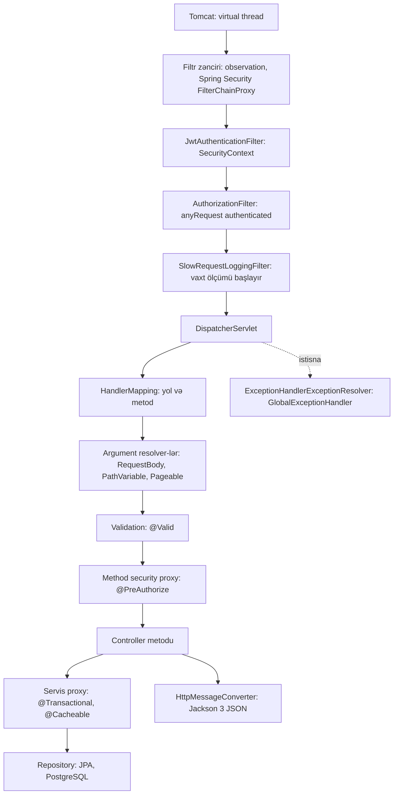

# 5. HTTP, REST və təbəqəli dizayn

## 5.1 Problem: API-ni necə dizayn etməli ki, həm klient, həm də kod sağlam qalsın

Kampaniya yaratmaq üçün klientə nə lazımdır? URL, HTTP metodu, gövdə formatı, uğur və xəta cavablarının forması,
autentifikasiya. Server tərəfində isə HTTP detallarının biznes məntiqinə sızmaması, biznes qaydalarının bir yerdə
olması və persistence modelinin xarici kontrakta çevrilməməsi lazımdır. Bu fəsil həm HTTP/REST əsaslarını, həm də
layihədə tətbiq olunan **controller → service → repository** təbəqələrini və **DTO → domen → entity** modellərini
izah edir.

## 5.2 HTTP və REST əsasları (təzələmə)

**REST** arxitektura üslubudur (protokol deyil): resurslar URI ilə ünvanlanır, standart HTTP metodları ilə
manipulyasiya olunur, server tərəfində sessiya vəziyyəti saxlanmır (stateless), cavablar özünü təsvir edir.

| Metod | Semantika | Təhlükəsiz (safe) | İdempotent | Layihədə |
|---|---|---|---|---|
| GET | Oxumaq | Bəli | Bəli | Siyahı, detal, tarixçə, statistika, yavaş sorğular |
| POST | Yaratmaq / prosesi işə salmaq | Xeyr | Xeyr | Kampaniya yaratmaq, bütün auth əməliyyatları, audit yazmaq |
| PUT | Resursu tam əvəzləmək | Xeyr | Bəli | İstifadə olunmur |
| PATCH | Qismən dəyişiklik | Xeyr | Zəmanətli deyil | `approve`, `deactivate` |
| DELETE | Silmək | Xeyr | Bəli | İstifadə olunmur |

**İdempotentlik** — eyni sorğunun bir neçə dəfə göndərilməsi serverdə bir dəfə göndərilmiş kimi nəticə verir.
Şəbəkə xətalarında klient və ya proxy sorğunu təkrarlaya bildiyi üçün vacibdir. Layihədə [NƏTİCƏ]:
- `PATCH /{id}/approve` ikinci dəfə çağırıldıqda kampaniya artıq `ACTIVE` olduğu üçün `409
  INVALID_STATUS_TRANSITION` qaytarır (`CampaignService.java:96-98`). Vəziyyət dəyişmir, lakin cavab fərqlidir.
  Bu "effekt baxımından idempotent, cavab baxımından deyil" haldır.
- `POST /api/v1/campaigns` ikinci dəfə eyni gövdə ilə göndərildikdə `409 DUPLICATE_CAMPAIGN` qaytarır — dublikat
  qaydası təsadüfən POST-u da effekt baxımından idempotent edir. Bu, idempotency key mexanizminin əvəzi deyil:
  fərqli məlumatla iki ayrı sorğu yenə iki kampaniya yaradır.

**Status kodları layihədə** [FAKT] (`GlobalExceptionHandler.java`, `ServiceSecurityConfiguration.java`,
`CampaignController.java:45`):

| Kod | Nə vaxt |
|---|---|
| 200 OK | Uğurlu oxu və dəyişikliklər (`approve`, `deactivate`, auth əməliyyatları) |
| 201 Created | `POST /api/v1/campaigns` (`@ResponseStatus(HttpStatus.CREATED)`) |
| 400 Bad Request | `@Valid` pozuntusu (`VALIDATION_ERROR`) |
| 401 Unauthorized | Token yoxdur (security entry point), yanlış login (`BusinessException(UNAUTHORIZED)`) |
| 403 Forbidden | Rol çatmır (`@PreAuthorize` → `AccessDeniedException`) |
| 404 Not Found | `ResourceNotFoundException` |
| 409 Conflict | Dublikat, yanlış status keçidi, biznes qaydası pozuntusu (məs. mövcud username) |
| 429 Too Many Requests | Gateway rate limit |
| 500 Internal Server Error | Gözlənilməz xəta **və** (defekt F07) bir sıra əslində 4xx olmalı xətalar |

## 5.3 Layihənin REST resurs modeli

[FAKT] (`CampaignController.java:30-93`, `DashboardController.java:19-59`, `AuthController.java:25-118`,
log-service controller-ləri):

| Resurs | Metod və yol | Rol |
|---|---|---|
| Kampaniyalar kolleksiyası | `GET /api/v1/campaigns?page&size&sort`, `POST /api/v1/campaigns` | USER/ADMIN; yaratmaq ADMIN |
| Bir kampaniya | `GET /api/v1/campaigns/{id}` | USER/ADMIN |
| Status əməliyyatları | `PATCH /api/v1/campaigns/{id}/approve`, `PATCH /api/v1/campaigns/{id}/deactivate` | ADMIN |
| Alt-resurs: tarixçə | `GET /api/v1/campaigns/{id}/history` | ADMIN |
| Hesablanmış resurs | `GET /api/v1/campaigns/statistics` | ADMIN |
| Dashboard | `GET /api/v1/dashboard/classifieds/statistics`, `GET /api/v1/dashboard/campaigns/{campaignId}/history` | ADMIN |
| Auth əməliyyatları | `POST /api/v1/auth/{register,login,refresh-token,forgot-password,reset-password,logout}` | Hamı |
| Jurnallar | `POST /api/v1/logs/auth-audit` (INTERNAL_SERVICE), `GET /api/v1/logs/slow-requests` (ADMIN) | — |

Dizayn müzakirəsi:

- **Versiya URL-də** (`/api/v1`) — sadə və keşləmə üçün şəffaf; alternativ header və ya media type versiyalamasıdır.
- **Status əməliyyatları "action" endpoint-ləridir** (`/approve`, `/deactivate`). Saf REST yanaşması bunu
  `PATCH /campaigns/{id}` + `{"status":"ACTIVE"}` kimi modelləşdirərdi. [NƏTİCƏ] Action endpoint-ləri burada daha
  yaxşıdır: hər keçidin ayrıca icazəsi, ayrıca biznes qaydası və ayrıca tarixçə səbəbi ("Campaign approved") var;
  ümumi PATCH bu qaydaları bir metodda `if/else` ilə yoxlamağa məcbur edərdi.
- **`/statistics` və `/{id}` toqquşmur**: Spring MVC literal seqmentli `/statistics` nümunəsini dəyişənli `/{id}`
  nümunəsindən daha spesifik sayır və ona üstünlük verir. Əks halda `"statistics"` sətri `UUID`-ə çevrilməyə
  çalışılardı.
- **"classifieds"** sözü (`/api/v1/dashboard/classifieds/statistics`) biznes domeninə (kampaniyalar) uyğun deyil.
  [NAMƏLUM] Adın mənşəyi koddan müəyyən edilmir; README də eyni yolu istifadə edir. Kontraktı dəyişmək klientləri
  sındıracağı üçün belə adlar adətən versiya dəyişikliyində düzəldilir.
- **Yaratma cavabında `Location` başlığı yoxdur.** REST konvensiyası `201` ilə yeni resursun URI-sini `Location`
  başlığında qaytarmağı tövsiyə edir; burada id cavab gövdəsindədir.

## 5.4 Controller: sorğu bağlama və cavab

<!-- src: campaign-service/src/main/java/com/casestudy/insurancecampaign/campaign/controller/CampaignController.java:30-64 -->
```java
@RestController
@RequestMapping("/api/v1/campaigns")
public class CampaignController {

    private final CampaignService campaignService;
    private final CampaignMapper campaignMapper;

    public CampaignController(CampaignService campaignService, CampaignMapper campaignMapper) {
        this.campaignService = campaignService;
        this.campaignMapper = campaignMapper;
    }

    @Operation(summary = "Create insurance campaign. ROLE_ADMIN only.")
    @PostMapping
    @PreAuthorize("hasRole('ADMIN')")
    @ResponseStatus(HttpStatus.CREATED)
    public ApiResponse<CampaignResponse> create(@Valid @RequestBody CreateCampaignRequest request) {
        return ApiResponse.success(campaignMapper.toResponse(campaignService.create(request)));
    }

    @Operation(summary = "Get campaign by id. ROLE_USER and ROLE_ADMIN are allowed.")
    @GetMapping("/{id}")
    @PreAuthorize("hasAnyRole('USER', 'ADMIN')")
    public ApiResponse<CampaignResponse> getById(@PathVariable UUID id) {
        return ApiResponse.success(campaignMapper.toResponse(campaignService.getById(id)));
    }

    @Operation(summary = "List all campaigns with pagination and sorting. ROLE_USER and ROLE_ADMIN are allowed.")
    @GetMapping
    @PreAuthorize("hasAnyRole('USER', 'ADMIN')")
    public ApiResponse<CampaignPageResponse> getAll(
            @PageableDefault(size = 10, sort = "createdAt", direction = Sort.Direction.DESC) Pageable pageable
    ) {
        return ApiResponse.success(CampaignPageResponse.from(campaignService.getAll(pageable).map(campaignMapper::toResponse)));
    }
```

Hər annotasiyanın real təsiri:

| Element | Runtime təsiri |
|---|---|
| `@RestController` | Metodun qaytardığı obyekt `HttpMessageConverter` (Jackson 3) ilə gövdəyə yazılır |
| `@RequestMapping("/api/v1/campaigns")` | Sinif səviyyəli prefiks; `RequestMappingHandlerMapping` startup-da xəritəni qurur |
| `@PostMapping` / `@GetMapping("/{id}")` | Metod + yol nümunəsi |
| `@PreAuthorize("hasRole('ADMIN')")` | Metod çağırılmazdan əvvəl `ROLE_ADMIN` authority-si yoxlanılır; yoxdursa `AccessDeniedException` (fəsil 10) |
| `@ResponseStatus(CREATED)` | Uğurlu cavab statusu 201 |
| `@Valid @RequestBody` | Gövdə JSON-dan record-a deserializə olunur, sonra Bean Validation işləyir; pozuntu → `MethodArgumentNotValidException` (fəsil 8) |
| `@PathVariable UUID id` | Yol seqmenti `String → UUID` çevrilir; səhv format → `MethodArgumentTypeMismatchException` |
| `@PageableDefault(...) Pageable` | `PageableHandlerMethodArgumentResolver` `page`, `size`, `sort` parametrlərini oxuyur; yoxdursa `size=10, sort=createdAt,desc` |
| `@Operation` | Yalnız OpenAPI sənədi üçün (springdoc) |

**Controller-in işi yalnız tərcümədir**: HTTP → servis çağırışı → domen obyekti → cavab DTO-su. Biznes qaydası
controller-də yoxdur. Bu, təbəqəli dizaynın əsas prinsipidir.

### Sorğunun Spring MVC daxilində yolu



[NƏTİCƏ] Filtr sırası: Spring Security-nin `FilterChainProxy`-si servlet konteynerində `-100` sıra ilə qeydiyyatdan
keçir; `SlowRequestLoggingFilter` isə adi `@Component` filtr kimi sırasız (ən aşağı prioritet) qeydiyyata düşür. Ona
görə yavaş sorğu filtri security-dən **sonra** işləyir: security-nin rədd etdiyi (401) sorğular ölçülmür və ölçülən
müddətə JWT doğrulaması daxil deyil. `@Valid` doğrulaması `@PreAuthorize`-dan **əvvəl** baş verir (argument
resolver-lər metod proxy-sindən əvvəl işləyir), yəni `ROLE_USER` səhv gövdə göndərərsə 403 əvəzinə 400 alar.

## 5.5 Cavab zərfi: `ApiResponse` və `ApiError`

Bütün uğurlu cavablar vahid zərfdədir [FAKT] (`ApiResponse.java:16-31`):

<!-- src: common/src/main/java/com/casestudy/insurancecampaign/common/api/ApiResponse.java:16-33 -->
```java
public record ApiResponse<T>(
        boolean success,
        T data,
        Instant timestamp
) {

    // ... (buraxılıb: Javadoc)
    public static <T> ApiResponse<T> success(T data) {
        return new ApiResponse<>(true, data, Instant.now());
    }

}
```

Xətalar isə ayrı struktura malikdir [FAKT] (`ApiError.java:20-56`): `code`, `message`, `status`, `path`,
`validationErrors`, `timestamp`. Nümunə cavablar:

```json
{ "success": true,
  "data": { "id": "…", "title": "TSS Kampanya 2026", "category": "TSS",
            "status": "PENDING_APPROVAL", "duplicateOf": null,
            "createdAt": "2026-07-25T14:00:00Z", "updatedAt": "2026-07-25T14:00:00Z" },
  "timestamp": "2026-07-25T14:00:00.123Z" }
```

```json
{ "code": "VALIDATION_ERROR", "message": "Request validation failed", "status": 400,
  "path": "/api/v1/campaigns",
  "validationErrors": { "title": "size must be between 10 and 50" },
  "timestamp": "…" }
```

[NƏTİCƏ] `success` sahəsi uğurlu cavabda həmişə `true`-dur; xəta cavabında isə ümumiyyətlə yoxdur (fərqli record).
Klient uğur/xətanı HTTP statusundan müəyyən etməlidir — bu düzgündür. Zərfin dəyəri: vahid `timestamp` və gələcəkdə
`meta`/`traceId` əlavə etmək imkanı. Mənfi tərəfi: hər cavab bir səviyyə dərinləşir (`$.data.id`).

**Alternativ: RFC 9457 Problem Details.** Spring 6+ `ProblemDetail` tipini və `spring.mvc.problemdetails.enabled`
xassəsini dəstəkləyir: standart `type`, `title`, `status`, `detail`, `instance` sahələri, `application/problem+json`
media tipi. Xüsusi `ApiError` əvəzinə standartdan istifadə klient kitabxanaları və gateway-lər üçün daha
interoperabeldir. Layihə xüsusi formatı seçib; gateway də 429 üçün eyni formatı təkrarlayır
(`GatewayRateLimitErrorResponseFilter.java:78-85`), bu da sistem daxilində ardıcıllığı qoruyur.

## 5.6 Üç model: DTO, domen, entity

Campaign-service-də bir kampaniya üç fərqli tiplə təmsil olunur [FAKT]:

| Tip | Sinif | Qat | Məqsəd |
|---|---|---|---|
| Sorğu DTO | `CreateCampaignRequest` (record) | Web | Yalnız klientin göndərə biləcəyi sahələr + validasiya annotasiyaları |
| Entity | `CampaignEntity` (JPA sinfi) | Persistence | Cədvəl sütunlarının xəritəsi, `@PrePersist` vaxt damğaları, dəyişkən vəziyyət |
| Domen | `Campaign` (record) | Servis | Servisin xaricə qaytardığı dəyişməz təsvir |
| Cavab DTO | `CampaignResponse` (record) | Web | Klientə gedən kontrakt |

Axın: `CreateCampaignRequest → CampaignEntity → Campaign → CampaignResponse` (README də bunu "DTO flow" kimi
göstərir). Mapper əl ilə yazılıb [FAKT] (`CampaignMapper.java:10-41`):

<!-- src: campaign-service/src/main/java/com/casestudy/insurancecampaign/campaign/mapper/CampaignMapper.java:10-24 -->
```java
@Component
public class CampaignMapper {
    public Campaign toDomain(CampaignEntity entity) {
        return new Campaign(
                entity.getId(),
                entity.getTitle(),
                entity.getDescription(),
                entity.getCategory(),
                entity.getStatus(),
                entity.getDuplicateOf(),
                entity.getCreatedAt(),
                entity.getUpdatedAt()
        );
    }
```

**Niyə entity-ni birbaşa qaytarmırıq?**
1. **Kontrakt sabitliyi** — sütun adı dəyişəndə API dəyişməməlidir.
2. **Lazy loading tələsi** — `open-in-view: false` olduğu üçün (`campaign-service/src/main/resources/application.yml:15`)
   tranzaksiyadan kənarda lazy əlaqəyə toxunmaq `LazyInitializationException` verər. Domen record-u tranzaksiya
   daxilində tam doldurulur.
3. **Təhlükəsizlik** — entity-də klientə göstərilməməli sahələr ola bilər (auth-service-də `password` hash-i).
4. **Dəyişməzlik** — record-lar thread-safe və proqnozlaşdırıla biləndir.

**Layihədəki istisna** [FAKT]: tarixçə üçün servis entity qaytarır — `CampaignService.getHistory` `List<CampaignStatusHistoryEntity>`
(`CampaignService.java:113-119`), və həm controller (`CampaignController.java:83-85`), həm gRPC endpoint
(`CampaignGrpcEndpoint.java:37-44`) entity ilə işləyir. [NƏTİCƏ] Entity-də lazy əlaqə olmadığı üçün texniki problem
yoxdur, lakin persistence tipi servis sərhədini keçir — ardıcıllıq üçün domen record-u daha yaxşı olardı.

**`duplicateOf` sahəsi** kontraktda qalıb, lakin həmişə `null`-dur (heç bir kod onu təyin etmir). Jackson 3 standart
olaraq `null` sahələri də yazır, buna görə klient `"duplicateOf": null` görür.

### Auth-service: MapStruct və istifadə olunmayan domen modelləri

auth-service-də `AuthMapper` MapStruct interfeysidir (`AuthMapper.java:16-83`); kompilyator `AuthMapperImpl`
yaradır. Default metod (`toEntity`) əl ilə yazılıb, qalanları generasiya olunur. `@Mapping(target = "status",
expression = "java(entity.getStatus().name())")` enum-u sətrə çevirir.

[FAKT] `AppUser`, `RefreshToken`, `PasswordResetToken` domen record-ları yalnız mapper-də və onun testində
istifadə olunur; `AuthService` entity-lərlə birbaşa işləyir və nəticəni `RegisteredUserResponse`/`TokenResponse`
DTO-larına çevirir. [NƏTİCƏ] Bu modellər hazırda ölü koddur (və ya gələcək refaktorinq üçün hazırlıq) — müsahibədə
"YAGNI" nümunəsi kimi müzakirə oluna bilər.

**Əl ilə mapper və MapStruct müqayisəsi:**

| | Əl ilə (`CampaignMapper`) | MapStruct (`AuthMapper`) |
|---|---|---|
| Şəffaflıq | Tam görünür, debug asandır | Generasiya olunmuş kod `target/generated-sources`-dadır |
| Sahə əlavə edildikdə | Unutmaq mümkündür | `unmappedTargetPolicy` ilə kompilyasiya xətası/xəbərdarlığı mümkündür |
| Asılılıq | Yoxdur | Annotation processor, Lombok binding |
| Performans | Eyni (MapStruct da sadə getter/setter kodu yaradır) | Eyni |

## 5.7 Səhifələmə (pagination) və sıralama

`getAll` `Pageable` qəbul edir, `Page<Campaign>` qaytarır, controller isə öz DTO-suna çevirir [FAKT]
(`CampaignPageResponse.java:7-31`):

<!-- src: campaign-service/src/main/java/com/casestudy/insurancecampaign/campaign/dto/CampaignPageResponse.java:17-31 -->
```java
public static CampaignPageResponse from(Page<CampaignResponse> page) {
    List<String> sortOrders = page.getSort().stream()
            .map(order -> order.getProperty() + "," + order.getDirection().name().toLowerCase())
            .toList();
    return new CampaignPageResponse(
            page.getContent(),
            page.getNumber(),
            page.getSize(),
            page.getTotalElements(),
            page.getTotalPages(),
            page.isFirst(),
            page.isLast(),
            sortOrders
    );
}
```

Niyə `Page`-i birbaşa qaytarmırıq? `PageImpl`-in JSON forması Spring Data-nın daxili detalıdır və versiyalar arasında
sabit deyil; Spring Data 3.3+ bunu birbaşa serializə etdikdə xəbərdarlıq verir və DTO və ya
`@EnableSpringDataWebSupport(pageSerializationMode = VIA_DTO)` tövsiyə edir. [FAKT] log-service məhz bunu edir —
`ApiResponse<Page<SlowRequestDocument>>` (`SlowRequestLogController.java:38-43`) — və testlər `$.data.content`
strukturuna bağlıdır (`SlowRequestLogControllerTest.java:58`). Bu, iki servis arasında uyğunsuzluqdur (tapıntı F26).

Sıralama riskləri [NƏTİCƏ]:
- `sort` parametri istənilən entity xassəsini qəbul edir. Mövcud olmayan xassə (`sort=foo`) Spring Data-da
  `PropertyReferenceException` yaradır; layihənin catch-all handler-i bunu 500-ə çevirir (F07). Ağ siyahı
  (`createdAt`, `title`, `status`) daha təhlükəsizdir.
- İndekssiz sütunlar üzrə sıralama (`title`, `createdAt`) böyük cədvəllərdə tam skan + sort deməkdir (fəsil 7).
- Offset səhifələmə (`LIMIT/OFFSET`) dərin səhifələrdə yavaşlayır; böyük datada keyset (cursor) səhifələmə tövsiyə olunur.
- `size` üçün yuxarı hədd Spring Data-nın standart `max-page-size` dəyəridir (2000) — layihə bunu dəyişməyib.

## 5.8 Təbəqələr və məsuliyyətlər

| Qat | Campaign-service | Məsuliyyət | Nə etməməlidir |
|---|---|---|---|
| Web | `CampaignController`, DTO-lar | HTTP ↔ Java tərcüməsi, validasiya tetiklənməsi, icazə annotasiyaları | Biznes qaydaları, SQL |
| Servis | `CampaignService` | Biznes qaydaları, tranzaksiya sərhədləri, yan təsirlər (tarixçə, hadisə, cache) | HTTP tipləri (`HttpServletRequest`) |
| Persistence | `CampaignRepository`, entity-lər | Saxlama və sorğular | Biznes qərarları |
| İnteqrasiya | `CampaignGrpcEndpoint`, `KafkaTemplate` | Digər protokollar | — |

`CampaignGrpcEndpoint` də eyni `CampaignService`-i çağırır — biznes məntiqi iki giriş protokolu (REST və gRPC) arasında
təkrarlanmır. Bu, servis qatının ayrılmasının birbaşa faydasıdır.

## 5.9 Yeni layihədə tətbiq

İllüstrativ nümunə (repozitoriyada yoxdur) — `201` + `Location` və ağ siyahılı sıralama:

```java
@PostMapping
@PreAuthorize("hasRole('ADMIN')")
public ResponseEntity<ApiResponse<CampaignResponse>> create(@Valid @RequestBody CreateCampaignRequest request,
                                                            UriComponentsBuilder uri) {
    CampaignResponse body = mapper.toResponse(service.create(request));
    URI location = uri.path("/api/v1/campaigns/{id}").buildAndExpand(body.id()).toUri();
    return ResponseEntity.created(location).body(ApiResponse.success(body));
}

private static final Set<String> SORTABLE = Set.of("createdAt", "title", "status");

private Pageable sanitize(Pageable p) {
    p.getSort().forEach(o -> {
        if (!SORTABLE.contains(o.getProperty())) {
            throw new BusinessException(ErrorCode.VALIDATION_ERROR, "Unsupported sort: " + o.getProperty());
        }
    });
    return p;
}
```

Yoxlama siyahısı: resurs adları cəm halda; versiya; hər endpoint üçün rol; uğur və xəta cavablarının sənədləşdirilməsi
(OpenAPI); səhifələmə DTO-su; sıralama ağ siyahısı; `Location`; standart xəta formatı (Problem Details və ya öz
formatınız, lakin hər yerdə eyni).

## 5.10 Praktiki tapşırıqlar

Tapşırıqları öz fork-unuzda, ayrıca branch-da edin. Çətinlik: ★ — 30 dəqiqəyə qədər, ★★ — bir neçə saat, ★★★ — təxminən bir gün. "Gözlənilən nəticə" koddan çıxardığım proqnozdur; sizdə fərqli çıxarsa, səbəbini tapmaq tapşırığın ən dəyərli hissəsidir.

**T1 ★ — Səhifələmənin sərhədləri.** `GET /api/v1/campaigns?page=0&size=2&sort=createdAt,desc`, sonra `size=5000`
çağırın. **Yoxlama:** ikinci sorğuda neçə element qayıtdığını və bunun hansı Spring Data xassəsi ilə məhdudlaşdığını
(`spring.data.web.pageable.max-page-size`) tapın; layihə üçün ağlabatan limit təklif edin.

**T2 ★ — Səhv sıralama sahəsi.** `?sort=nonexistent` göndərin. **Gözlənilən nəticə:** 500 (F07). Düzəliş:
`PropertyReferenceException` üçün 400 qaytaran handler və onu yoxlayan MockMvc testi.

**T3 ★★ — Status filtri əlavə edin.** `GET /api/v1/campaigns?status=ACTIVE` dəstəyi: repository-də
`Page<CampaignEntity> findByStatus(CampaignStatus status, Pageable pageable)`, controller-də opsional parametr.
**Yoxlama:** filtrsiz sorğu əvvəlki kimi işləyir; səhv status dəyəri 400 qaytarır.

**T4 ★★ — Cavab zərfinin miqrasiya planı.** `ApiResponse`/`ApiError`-dan RFC 9457 `ProblemDetail`-ə keçidin planını
yazın: hansı klientlər təsirlənir, keçid dövründə iki formatı necə saxlamaq olar (`Accept` başlığı, versiyalanmış yol).

## 5.11 Müsahibə sualları

**S1. PUT və PATCH fərqi nədir, `approve` üçün hansı daha uyğundur?**
Cavab: PUT resursu tam əvəzləyir və idempotentdir; PATCH qismən dəyişiklikdir. `approve` resursun vəziyyətini qayda
əsasında dəyişən əməliyyatdır, tam əvəzləmə deyil; PATCH və ya POST (`/approvals` alt-resursu) uyğundur. Layihə PATCH
action endpoint-i seçib.

**S2. Entity-ni controller-dən birbaşa qaytarmağın riskləri nələrdir?**
Cavab: Kontrakt persistence sxeminə bağlanır, həssas sahələr sızır, lazy əlaqələr `open-in-view=false` olduqda
xəta verir və ya `true` olduqda gizli N+1 sorğuları yaradır, iki istiqamətli əlaqələr sonsuz rekursiya yarada bilər.

**S3. Niyə `@Valid` səhv sorğuda `@PreAuthorize`-dan əvvəl işləyir və bu nə vaxt problemdir?**
Cavab: Metod arqumentləri (deserializasiya + validasiya) handler metodunu çağırmazdan əvvəl hazırlanır; `@PreAuthorize`
isə controller bean-inin proxy-sində, metod çağırışı zamanı yoxlanılır. Nəticədə icazəsiz istifadəçi validasiya
mesajlarını görə bilir — bu, kiçik informasiya sızmasıdır. URL səviyyəli (`authorizeHttpRequests`) qaydalar filtrdə,
validasiyadan əvvəl işləyir.

**S4. Offset və keyset səhifələmə fərqi?**
Cavab: Offset `LIMIT n OFFSET m` istifadə edir — sadədir, istənilən səhifəyə keçid mümkündür, lakin böyük `m`
dəyərlərində DB bütün əvvəlki sətirləri keçir və paralel insertlər səhifələrdə sürüşmə yaradır. Keyset son görülən
açardan (`WHERE (created_at, id) < (?, ?)`) davam edir — sabit performans, lakin ixtiyari səhifəyə keçid yoxdur.

**S5. Cavab zərfinin (envelope) üstünlük və çatışmazlıqları?**
Cavab: Üstünlük — vahid struktur, metadata üçün yer. Çatışmazlıq — HTTP semantikasını təkrarlayır (`success`
statusdan məlumdur), klient kodunu dərinləşdirir, standart alətlərlə (Problem Details) uyğunluğu azaldır.

## 5.12 Xülasə

- REST resursları: kampaniya kolleksiyası, alt-resurs tarixçə, hesablanmış statistika, status action endpoint-ləri.
- Controller yalnız tərcümə edir; qaydalar servisdədir; entity-lər xaricə çıxmır (tarixçə istisnası ilə).
- `ApiResponse`/`ApiError` vahid formatı təmin edir; Problem Details standart alternativdir.
- Səhifələmə DTO ilə edilir (campaign), log-service isə `Page`-i birbaşa qaytarır.
- Növbəti fəsil campaign-service-in biznes məntiqinə dərindən baxır.
