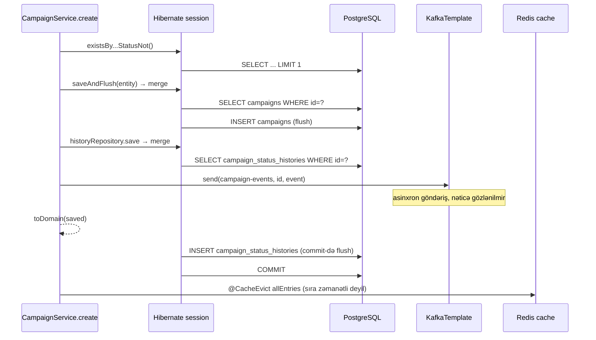

# 6. Campaign Service — biznes nüvəsi dərindən

campaign-service sistemin biznes mərkəzidir: kampaniya qaydaları burada yaşayır, digər servislər (dashboard,
log-service) yalnız onun nəticələrindən istifadə edir. Bu fəsil servisi sinif-sinif deyil, **əməliyyat-əməliyyat**
izah edir; persistence detalları 7-ci, Kafka 11-ci, gRPC 13-cü, cache 15-ci fəsildə dərinləşdirilir.

## 6.1 Məsuliyyətlər və sərhədlər

| Məsuliyyət | Harada |
|---|---|
| Kampaniya yaratmaq, ilkin statusu təyin etmək, dublikatı rədd etmək | `CampaignService.create` |
| Oxumaq (id üzrə, səhifələnmiş siyahı) | `getById`, `getAll` |
| Status keçidləri (təsdiq, deaktivasiya) | `approve`, `deactivate`, `changeStatus` |
| Status tarixçəsi | `saveHistory`, `getHistory` |
| Statusa görə statistika (cache ilə) | `getStatistics` |
| Status hadisələrini nəşr etmək | `publishStatusChange` → Kafka `campaign-events` |
| REST API | `CampaignController` |
| gRPC API (dashboard üçün) | `CampaignGrpcEndpoint` |

Data sahibliyi: `campaign_db` PostgreSQL bazası (`campaigns`, `campaign_status_histories`) və Redis-dəki
`campaign-statistics` cache-i.

Paket quruluşu [FAKT] (`campaign-service/src/main/java/com/casestudy/insurancecampaign/campaign/`):

```text
campaign/
├── CampaignServiceApplication.java   @SpringBootApplication, @EnableCaching
├── controller/CampaignController.java
├── domain/        Campaign (record), CampaignCategory, CampaignStatus
├── dto/           CreateCampaignRequest, CampaignResponse, CampaignPageResponse,
│                  CampaignHistoryResponse, CampaignStatisticsResponse
├── entity/        CampaignEntity, CampaignStatusHistoryEntity
├── grpc/          CampaignGrpcEndpoint
├── mapper/        CampaignMapper
├── repository/    CampaignRepository, CampaignStatusHistoryRepository
└── service/       CampaignService
```

Bu, **texniki qatlara görə** (layered) paketləşdirmədir. Alternativ — **feature-a görə** paketləşdirmə
(`campaign/create`, `campaign/approval` ...) böyük servislərdə kohesiyanı artırır; bu ölçüdə servis üçün qat
paketləri tamamilə qəbuledilir.

## 6.2 Domen modeli

<!-- src: campaign-service/src/main/java/com/casestudy/insurancecampaign/campaign/domain/Campaign.java:6-15 -->
```java
public record Campaign(
        UUID id,
        String title,
        String description,
        CampaignCategory category,
        CampaignStatus status,
        UUID duplicateOf,
        Instant createdAt,
        Instant updatedAt
) { }
```

`Campaign` dəyişməz record-dur; biznes qaydaları burada deyil, servisdədir. Status dəyişikliyi entity-nin
`changeStatus` metodu ilə edilir, o da heç bir yoxlama aparmır [FAKT] (`CampaignEntity.java:79-81`):

```java
public void changeStatus(CampaignStatus status) {
    this.status = status;
}
```

[NƏTİCƏ] Bu, **anemik domen modeli** (anemic domain model) yanaşmasıdır: entity yalnız data daşıyır, qaydalar
servis metodlarındadır. Kiçik servis üçün sadə və oxunaqlıdır. Mənfi tərəfi: qayda yalnız servis vasitəsilə
qorunur — başqa kod `entity.changeStatus(ACTIVE)` çağırsa, keçid yoxlanmadan dəyişər. "Zəngin domen modeli"
alternativi aşağıda (6.9) göstərilir.

### `DUPLICATE` statusu və `duplicate_of` sütunu: köhnə dizaynın izi

[FAKT]
- `CampaignStatus.DUPLICATE` mövcuddur (`CampaignStatus.java:3-8`);
- `campaigns.duplicate_of` sütunu yaradılıb (`campaign-service/src/main/resources/db/changelog/db.changelog-master.yml:35-37`);
- dublikat yoxlaması `StatusNot(DUPLICATE)` şərti ilə aparılır (`CampaignService.java:140-150`);
- partial unique indeks `WHERE status <> 'DUPLICATE'` şərtinə malikdir (`campaign-service/src/main/resources/db/changelog/db.changelog-master.yml:101-113`);
- `ensureNotDuplicate` `DUPLICATE` statuslu kampaniyanın yenilənməsini qadağan edir (`CampaignService.java:171-175`);
- lakin **heç bir kod yolu** kampaniyanı `DUPLICATE` statusu ilə yaratmır və ya ona keçirmir; `duplicateOf` həmişə
  `null` ötürülür (`CampaignService.java:60-67`).

[NƏTİCƏ] İlkin dizaynda təkrar sorğu ayrıca sətir kimi `DUPLICATE` statusu və orijinala istinadla
(`duplicate_of`) saxlanılırdı; sonra qayda "dublikatı rədd et (409)" kimi dəyişdirilib (README: "no duplicate
campaign row is inserted"). Partial indeksin `WHERE status <> 'DUPLICATE'` şərti də məhz köhnə modeli dəstəkləyirdi:
dublikat sətirlər unikallıq qaydasından kənarda qalmalı idi. Hazırda bu elementlər zərərsiz, lakin çaşdırıcı ölü
koddur. Statistika endpoint-i `DUPLICATE: 0` qaytarır (aşağıda), dashboard isə onu süzgəcdən keçirir.

## 6.3 Kampaniya yaratmaq: `create`

<!-- src: campaign-service/src/main/java/com/casestudy/insurancecampaign/campaign/service/CampaignService.java:54-77 -->
```java
@Transactional
@CacheEvict(value = "campaign-statistics", allEntries = true)
public Campaign create(CreateCampaignRequest request) {
    rejectIfDuplicateExists(request);

    CampaignStatus status = resolveInitialStatus(request.category());
    CampaignEntity entity = new CampaignEntity(
            UUID.randomUUID(),
            request.title(),
            request.description(),
            request.category(),
            status,
            null
    );

    try {
        CampaignEntity saved = campaignRepository.saveAndFlush(entity);
        saveHistory(saved.getId(), null, saved.getStatus(), "Campaign created");
        publishStatusChange(saved.getId(), saved.getCategory(), null, saved.getStatus(), "CREATED");
        return campaignMapper.toDomain(saved);
    } catch (DataIntegrityViolationException exception) {
        throw new DuplicateCampaignException(duplicateMessage(request));
    }
}
```

Addım-addım:

1. **`@Transactional`** — metod bir DB tranzaksiyasında icra olunur; runtime istisna atılarsa rollback.
2. **`@CacheEvict(allEntries = true)`** — metod uğurla bitdikdən sonra `campaign-statistics` cache-i tam təmizlənir,
   çünki yeni kampaniya sayları dəyişdirir.
3. **Dublikat yoxlaması (tətbiq səviyyəsi)** — `existsByCategoryAndTitleAndDescriptionAndStatusNot(...)` Spring Data
   **törəmə sorğusu** (derived query): metod adından `select ... where category=? and title=? and description=? and
   status<>? limit 1` qurulur [FAKT] (`CampaignRepository.java:13-18`, `CampaignService.java:140-150`). Varsa —
   `DuplicateCampaignException` → `409 DUPLICATE_CAMPAIGN`.
4. **İlkin status** — Java switch ifadəsi [FAKT] (`CampaignService.java:133-138`):

   <!-- src: campaign-service/src/main/java/com/casestudy/insurancecampaign/campaign/service/CampaignService.java:133-138 -->
   ```java
   private CampaignStatus resolveInitialStatus(CampaignCategory category) {
       return switch (category) {
           case LIFE -> CampaignStatus.ACTIVE;
           case TSS, OSS, OTHER -> CampaignStatus.PENDING_APPROVAL;
       };
   }
   ```

   `default` yoxdur — bütün enum dəyərləri əhatə olunub. [NƏTİCƏ] Yeni kateqoriya əlavə edilsə, bu `switch`
   kompilyasiya xətası verəcək (enum üzrə switch ifadəsi tam olmalıdır) — bu, qaydanın unudulmamasını təmin edən
   faydalı xüsusiyyətdir.
5. **Entity yaratmaq** — id tətbiqdə `UUID.randomUUID()` ilə yaradılır, `duplicateOf = null`.
6. **`saveAndFlush`** — INSERT dərhal DB-yə göndərilir (flush). Məqsəd: unikal indeks pozuntusu tranzaksiyanın
   sonunda deyil, **burada, `try` blokunun içində** baş versin ki, `catch` onu tuta bilsin.
7. **İkinci müdafiə xətti (DB səviyyəsi)** — iki paralel sorğu eyni anda 3-cü addımı keçə bilər (hər ikisi "yoxdur"
   görür). Belə halda ikinci INSERT partial unique indeks `uk_campaign_unique_non_duplicate`-i pozur
   (changelog `003-prevent-duplicate-campaigns`), Spring bunu `DataIntegrityViolationException`-a tərcümə edir və
   kod onu `DuplicateCampaignException`-a çevirir. Bu, **"check-then-act" yarışının (race condition) DB constraint-i
   ilə bağlanmasının** klassik nümunəsidir — tətbiq yoxlaması yalnız gözəl xəta mesajı üçündür, həqiqi zəmanəti DB
   verir.
8. **Tarixçə** — `previousStatus = null`, səbəb "Campaign created".
9. **Hadisə** — `CampaignStatusChangedEvent` Kafka-ya, açar `campaignId` (fəsil 11).
10. **Nəticə** — `saved` (merge-in qaytardığı **idarə olunan** nüsxə) domen record-una çevrilir.

### Gizli detal: niyə `saved`, niyə `entity` deyil?

[NƏTİCƏ] `CampaignEntity`-nin id-si əl ilə təyin olunur və `@Version` sahəsi yoxdur. Spring Data JPA
`SimpleJpaRepository.save()` entity-nin "yeni" olub-olmadığını id-nin `null` olmasına görə müəyyən edir; id artıq
təyin olunduğu üçün entity "köhnə" sayılır və `persist` əvəzinə **`merge`** çağırılır. `merge`:
- əvvəlcə `SELECT ... FROM campaigns WHERE id = ?` icra edir (sətir yoxdur),
- sonra ötürülən obyektin vəziyyətini **yeni idarə olunan nüsxəyə** kopyalayır və onu persist edir (`@PrePersist`
  bu nüsxədə işləyir, `createdAt/updatedAt` orada təyin olunur),
- **həmin nüsxəni qaytarır**; ötürülən `entity` obyekti idarə olunmayan (detached) qalır və onun `createdAt`-ı `null`-dur.

Kod `saved.getCreatedAt()`-dan istifadə etdiyi üçün düzgün işləyir. `entity`-dən istifadə etsəydi, cavabda
`createdAt: null` olardı. Dərs: **`save()`-in qaytardığı dəyəri həmişə istifadə edin.** Əlavə SELECT-dən qaçmaq
üçün entity `Persistable<UUID>` implementasiya edib `isNew()`-i özü idarə edə bilər, və ya `@Version` sahəsi əlavə
oluna bilər (fəsil 7, tapıntı F14).

### `create` zamanı DB və Kafka əməliyyatlarının sırası



Bu diaqramdan çıxan vacib nəticə [NƏTİCƏ]: **Kafka hadisəsi tarixçə sətri DB-yə yazılmazdan və tranzaksiya commit
olunmazdan əvvəl göndərilir.** Commit uğursuz olsa (məsələn, DB bağlantısı kəsilsə), hadisə artıq yolda ola bilər
və mövcud olmayan kampaniyadan xəbər verər. Bu, **dual-write** problemidir (tapıntı F09, fəsil 11-də Transactional
Outbox ilə həlli).

## 6.4 Oxu əməliyyatları: `getById`, `getAll`

<!-- src: campaign-service/src/main/java/com/casestudy/insurancecampaign/campaign/service/CampaignService.java:79-89 -->
```java
@Transactional(readOnly = true)
public Campaign getById(UUID id) {
    return campaignRepository.findById(id)
            .map(campaignMapper::toDomain)
            .orElseThrow(() -> new ResourceNotFoundException("Campaign not found: " + id));
}

@Transactional(readOnly = true)
public Page<Campaign> getAll(Pageable pageable) {
    return campaignRepository.findAll(pageable).map(campaignMapper::toDomain);
}
```

- `readOnly = true` — [NƏTİCƏ] Spring Hibernate session-un flush rejimini `MANUAL` edir (dirty checking snapshot-ları
  üçün iş azalır) və JDBC bağlantısına read-only işarəsi ötürür; PostgreSQL drayveri bunu `SET TRANSACTION READ ONLY`
  kimi tətbiq edə bilər. Replika marşrutlaşdırması (read replica routing) qurulubsa, bu işarə ondan istifadə üçün də
  əsasdır. Bu layihədə replika yoxdur.
- `findAll(pageable)` iki sorğu icra edir: məlumat (`ORDER BY ... LIMIT ? OFFSET ?`) və cəmi say (`SELECT count(*)`).
- Mapping tranzaksiya daxilində edilir — `open-in-view: false` şəraitində doğru yerdir.

## 6.5 Status keçidləri: `approve`, `deactivate`, `changeStatus`

<!-- src: campaign-service/src/main/java/com/casestudy/insurancecampaign/campaign/service/CampaignService.java:91-111 -->
```java
@Transactional
@CacheEvict(value = "campaign-statistics", allEntries = true)
public Campaign approve(UUID id) {
    CampaignEntity entity = findEntity(id);
    ensureNotDuplicate(entity);
    if (entity.getStatus() != CampaignStatus.PENDING_APPROVAL) {
        throw new InvalidStatusTransitionException("Only PENDING_APPROVAL campaigns can be approved");
    }
    return changeStatus(entity, CampaignStatus.ACTIVE, "Campaign approved");
}

@Transactional
@CacheEvict(value = "campaign-statistics", allEntries = true)
public Campaign deactivate(UUID id) {
    CampaignEntity entity = findEntity(id);
    ensureNotDuplicate(entity);
    if (entity.getStatus() != CampaignStatus.ACTIVE && entity.getStatus() != CampaignStatus.PENDING_APPROVAL) {
        throw new InvalidStatusTransitionException("Only ACTIVE or PENDING_APPROVAL campaigns can be deactivated");
    }
    return changeStatus(entity, CampaignStatus.DEACTIVE, "Campaign deactivated");
}
```

<!-- src: campaign-service/src/main/java/com/casestudy/insurancecampaign/campaign/service/CampaignService.java:162-169 -->
```java
private Campaign changeStatus(CampaignEntity entity, CampaignStatus targetStatus, String reason) {
    CampaignStatus previousStatus = entity.getStatus();
    entity.changeStatus(targetStatus);
    CampaignEntity saved = campaignRepository.save(entity);
    saveHistory(saved.getId(), previousStatus, targetStatus, reason);
    publishStatusChange(saved.getId(), saved.getCategory(), previousStatus, targetStatus, reason);
    return campaignMapper.toDomain(saved);
}
```

Qaydalar cədvəli [FAKT]:

| Cari status | `approve` | `deactivate` |
|---|---|---|
| `PENDING_APPROVAL` | → `ACTIVE` | → `DEACTIVE` |
| `ACTIVE` | 409 `INVALID_STATUS_TRANSITION` | → `DEACTIVE` |
| `DEACTIVE` | 409 | 409 |
| `DUPLICATE` (praktikada yoxdur) | 409 `DUPLICATE_CAMPAIGN` | 409 `DUPLICATE_CAMPAIGN` |
| kampaniya yoxdur | 404 `RESOURCE_NOT_FOUND` | 404 |

### Dirty checking və `save()`-in rolu

`findEntity` entity-ni cari tranzaksiyanın **persistence context**-inə yükləyir; entity "idarə olunan" (managed)
vəziyyətdədir. `entity.changeStatus(...)` yalnız Java sahəsini dəyişir; Hibernate commit zamanı yüklənmə anındakı
snapshot ilə müqayisə edib `UPDATE` yaradır (**dirty checking**). Buna görə `campaignRepository.save(entity)` burada
texniki olaraq lazımsızdır — idarə olunan entity üçün `merge` eyni instansı qaytarır. [NƏTİCƏ] Zərərsizdir və bəzən
"niyyəti açıq göstərmək" üçün yazılır, lakin JPA-nın işləmə modelini gizlədir.

### Defekt: cavabdakı `updatedAt` köhnədir (F36)

[NƏTİCƏ, yüksək ehtimal] `CampaignEntity.preUpdate()` `@PreUpdate` ilə işarələnib (`CampaignEntity.java:65-68`).
JPA spesifikasiyasına görə `@PreUpdate` callback-i **flush zamanı**, UPDATE SQL-i yaradılarkən çağırılır.
`changeStatus` daxilində flush baş vermir (`save` idarə olunan entity üçün flush etmir, tarixçə entity-sinin
`merge`-i id üzrə yükləmədir və auto-flush yaratmır). Nəticədə `campaignMapper.toDomain(saved)` hələ köhnə
`updatedAt` dəyərini oxuyur; yeni dəyər yalnız commit zamanı entity-yə və DB-yə yazılır. Klient `approve` cavabında
`status: ACTIVE`, lakin **dəyişməmiş `updatedAt`** görür; sonrakı `GET` isə yeni vaxtı göstərir. Servis testləri
`approve/deactivate`-i əhatə etmədiyi üçün bu aşkarlanmayıb. Həll variantları: `saveAndFlush` istifadə etmək,
`updatedAt`-ı `changeStatus` daxilində açıq təyin etmək, və ya Hibernate `@UpdateTimestamp` (yenə flush-a bağlıdır).

### Paralellik: lost update riski (F37)

[NƏTİCƏ] PostgreSQL-in standart izolyasiya səviyyəsi **READ COMMITTED**-dir. İki admin eyni `PENDING_APPROVAL`
kampaniyasını eyni anda biri təsdiq, digəri deaktiv etsə:

| Zaman | Tranzaksiya A (approve) | Tranzaksiya B (deactivate) |
|---|---|---|
| t1 | SELECT → `PENDING_APPROVAL` | |
| t2 | | SELECT → `PENDING_APPROVAL` |
| t3 | yoxlama keçir, status=ACTIVE, tarixçə, hadisə | |
| t4 | | yoxlama keçir, status=DEACTIVE, tarixçə, hadisə |
| t5 | COMMIT | |
| t6 | | UPDATE A-nın sətir kilidini gözləyir, sonra COMMIT (son yazan qalib) |

Nəticə: son status `DEACTIVE`, tarixçədə isə həm `PENDING_APPROVAL→ACTIVE`, həm `PENDING_APPROVAL→DEACTIVE` var;
Kafka-ya iki ziddiyyətli hadisə gedib. Həllər:
- **Optimistik kilid** — `@Version private long version;` əlavə etmək: B-nin UPDATE-i `WHERE id=? AND version=?` ilə
  0 sətir yeniləyər və `OptimisticLockException` (Spring: `ObjectOptimisticLockingFailureException`) atılar → 409.
- **Pessimistik kilid** — `@Lock(LockModeType.PESSIMISTIC_WRITE)` ilə `SELECT ... FOR UPDATE`.
- **Şərti UPDATE** — `UPDATE campaigns SET status='ACTIVE' WHERE id=? AND status='PENDING_APPROVAL'` və təsirlənən
  sətir sayını yoxlamaq.

## 6.6 Tarixçə: `saveHistory`, `getHistory`

<!-- src: campaign-service/src/main/java/com/casestudy/insurancecampaign/campaign/service/CampaignService.java:113-119 -->
```java
@Transactional(readOnly = true)
public List<CampaignStatusHistoryEntity> getHistory(UUID id) {
    if (!campaignRepository.existsById(id)) {
        throw new ResourceNotFoundException("Campaign not found: " + id);
    }
    return historyRepository.findByCampaignIdOrderByChangedAtAsc(id);
}
```

- Mövcud olmayan kampaniya üçün boş siyahı deyil, 404 qaytarılır — "kampaniya var, tarixçəsi boşdur" ilə
  "kampaniya yoxdur" fərqləndirilir. Bu, düzgün API dizaynıdır.
- `findByCampaignIdOrderByChangedAtAsc` törəmə sorğudur (`CampaignStatusHistoryRepository.java:9-11`).
  [NƏTİCƏ] `campaign_id` üzrə indeks yoxdur (FK constraint PostgreSQL-də avtomatik indeks yaratmır) — tarixçə cədvəli
  böyüdükcə bu sorğu tam skana çevrilir (tapıntı F15, fəsil 7).
- `changedAt` tətbiqdə `Instant.now()` ilə təyin olunur (`CampaignStatusHistoryEntity.java:40-47`). Eyni
  millisaniyədə iki qeyd olarsa sıra qeyri-müəyyəndir; `id` ikinci sıralama açarı kimi əlavə oluna bilərdi.

## 6.7 Statistika: `getStatistics`

<!-- src: campaign-service/src/main/java/com/casestudy/insurancecampaign/campaign/service/CampaignService.java:121-131 -->
```java
@Transactional(readOnly = true)
@Cacheable("campaign-statistics")
public Map<String, Long> getStatistics() {
    Map<CampaignStatus, Long> result = new EnumMap<>(CampaignStatus.class);
    for (CampaignStatus status : CampaignStatus.values()) {
        result.put(status, 0L);
    }
    campaignRepository.countByStatus().forEach(item -> result.put(item.getStatus(), item.getCount()));
    return result.entrySet().stream()
            .collect(java.util.stream.Collectors.toMap(entry -> entry.getKey().name(), Map.Entry::getValue));
}
```

- **Sıfırla əvvəlcədən doldurma** — `GROUP BY` yalnız mövcud statusları qaytarır; əvvəlcədən 0 yazmaq bütün
  statusların cavabda olmasını təmin edir (o cümlədən `DUPLICATE: 0`).
- **JPQL proyeksiyası** [FAKT] (`CampaignRepository.java:20-26`):
  `select c.status as status, count(c.id) as count from CampaignEntity c group by c.status` — nəticə
  `CampaignStatusCountProjection` interfeys proyeksiyasına (alias-lar getter adlarına uyğun gəlir) xəritələnir.
- **Cache** — `@Cacheable("campaign-statistics")` parametrsiz metod üçün açar `SimpleKey.EMPTY`-dir; Redis-də açar
  `campaign-statistics::SimpleKey []` formasındadır. Dəyər `HashMap` (Collectors.toMap) — JDK serializasiyası ilə
  saxlanılır (fəsil 15).
- `EnumMap`-dan `String` açarlı xəritəyə çevirmə həm JSON (REST), həm gRPC (`setStatus(String)`) üçün rahatdır.

## 6.8 Konfiqurasiya

[FAKT] (`campaign-service/src/main/resources/application.yml`):

| Xassə | Dəyər | Təsiri |
|---|---|---|
| `server.port` | 8082 | REST |
| `grpc.server.port` | `${CAMPAIGN_GRPC_PORT:9090}` | gRPC (sətir 29-31) |
| `spring.datasource.*` | `${CAMPAIGN_DB_URL:jdbc:postgresql://localhost:5434/campaign_db}` | DB (sətir 8-11) |
| `spring.jpa.hibernate.ddl-auto` | `validate` | Sxemi Liquibase yaradır, Hibernate yalnız yoxlayır (sətir 12-15) |
| `spring.jpa.open-in-view` | `false` | Lazy yükləmə controller/view-da işləmir (sətir 15) |
| `spring.liquibase.change-log` | `classpath:/db/changelog/db.changelog-master.yml` | Miqrasiyalar (sətir 16-17) |
| `spring.cache.type` | `redis` | `RedisCacheManager` (sətir 22-23) |
| `spring.kafka.bootstrap-servers` | `${KAFKA_BOOTSTRAP_SERVERS:localhost:9092}` | `KafkaJsonConfiguration` tərəfindən oxunur (sətir 24-25) |
| `app.slow-request-threshold-ms` | 5 | Yavaş sorğu filtri (sətir 78) |
| `app.kafka.topics.*` | `log-events`, `campaign-events` | Mövzu adları (sətir 79-82) |
| `app.jwt.public-key-location` | `classpath:keys/public.pem` | Token doğrulaması (sətir 83-86) |

## 6.9 Yeni layihədə tətbiq: zəngin domen modeli ilə status maşını

İllüstrativ nümunə (repozitoriyada yoxdur) — keçid qaydalarını entity-yə və enum-a köçürmək:

```java
public enum CampaignStatus {
    PENDING_APPROVAL, ACTIVE, DEACTIVE;

    private static final Map<CampaignStatus, Set<CampaignStatus>> ALLOWED = Map.of(
            PENDING_APPROVAL, EnumSet.of(ACTIVE, DEACTIVE),
            ACTIVE, EnumSet.of(DEACTIVE),
            DEACTIVE, EnumSet.noneOf(CampaignStatus.class));

    public boolean canMoveTo(CampaignStatus target) {
        return ALLOWED.get(this).contains(target);
    }
}

@Entity
public class CampaignEntity {
    @Version private long version;               // lost update qorunması
    // ...
    public CampaignStatus transitionTo(CampaignStatus target) {
        if (!status.canMoveTo(target)) {
            throw new InvalidStatusTransitionException(status + " -> " + target + " is not allowed");
        }
        CampaignStatus previous = status;
        status = target;
        updatedAt = Instant.now();               // flush-dan asılı olmayan vaxt damğası
        return previous;
    }
}
```

Bu variantda servis yalnız orkestrasiya edir (yüklə → `transitionTo` → tarixçə → outbox), qayda isə bir yerdə və
unit test ilə asanlıqla yoxlanılan formadadır.

## 6.10 Uğursuzluq ssenariləri

| Ssenari | Mərhələ | Nəticə | Təkrar etmək təhlükəsizdirmi? |
|---|---|---|---|
| Səhv gövdə (qısa başlıq) | Validasiya | 400 `VALIDATION_ERROR` | Bəli, düzəldib |
| Yanlış `category` dəyəri (`"XYZ"`) | JSON deserializasiyası | `HttpMessageNotReadableException` → **500** (F07) | Bəli |
| Səhv UUID formatı (`/campaigns/abc`) | Path variable çevrilməsi | **500** (F07) | — |
| Dublikat | Servis / DB unique indeks | 409 `DUPLICATE_CAMPAIGN` | Effekt yoxdur |
| Yanlış status keçidi | Servis | 409 `INVALID_STATUS_TRANSITION` | Effekt yoxdur |
| DB əlçatmaz | Repository | 500 (mesajda daxili detal ola bilər) | Bəli (yaratma dublikat qaydası sayəsində təhlükəsizdir) |
| Kafka əlçatmaz | `kafkaTemplate.send` | Sorğu `max.block.ms` (60 s) qədər gecikə bilər, sonra hadisə itir (log) — F10 | — |
| Redis əlçatmaz | `@CacheEvict` / `@Cacheable` | [NƏTİCƏ] Standart `CacheErrorHandler` xətanı yenidən atır → 500; `create`-də commit artıq baş vermiş ola bilər | Dublikat qaydası sayəsində təkrar 409 verə bilər |
| Paralel approve/deactivate | Servis | Hər ikisi uğurlu (F37) | — |

## 6.11 Praktiki tapşırıqlar

Tapşırıqları öz fork-unuzda, ayrıca branch-da edin. Çətinlik: ★ — 30 dəqiqəyə qədər, ★★ — bir neçə saat, ★★★ — təxminən bir gün. "Gözlənilən nəticə" koddan çıxardığım proqnozdur; sizdə fərqli çıxarsa, səbəbini tapmaq tapşırığın ən dəyərli hissəsidir.

**T1 ★★ — Keçid cədvəlini testlə örtün.** 20.4-dəki cədvəlin hər xanası (4 status × 2 əməliyyat) üçün
`CampaignServiceTest`-ə test yazın. **Yoxlama:** səkkiz test; hər uğursuz keçid düzgün istisnanı atır.

**T2 ★★ — Qaydaları enum-a köçürün.** `CampaignStatus.canTransitionTo` metodunu yazın (21.9-dakı nümunə) və
`approve`/`deactivate`-i onunla sadələşdirin. **Yoxlama:** T1-dəki testlər dəyişmədən yaşıl qalır.

**T3 ★★ — F36-nı reproduksiya edin.** İnteqrasiya testində kampaniyanı approve edin, cavabdakı `updatedAt`-i sonrakı
`GET` cavabı ilə müqayisə edin. **Gözlənilən nəticə:** dəyərlər fərqlidir. Sonra düzəldin (`saveAndFlush` və ya
vaxtı `Clock` ilə servisdə təyin etmək) və testin keçdiyini göstərin.

**T4 ★★★ — Optimistik kilid (F37).** Liquibase changeset ilə `version` sütunu, entity-də `@Version`, handler-də
`ObjectOptimisticLockingFailureException → 409`. İki thread eyni anda approve və deactivate etsin. **Yoxlama:**
əməliyyatlardan biri 409 alır, tarixçədə yalnız bir keçid qalır.

## 6.12 Müsahibə sualları

**S1. Dublikat yoxlamasını niyə həm tətbiqdə, həm DB-də edirsiniz?**
Cavab: Tətbiq yoxlaması aydın xəta mesajı və DB-yə yazmadan rədd etmək üçündür, lakin iki paralel sorğu arasında
yarış (check-then-act) var. Yalnız DB constraint-i atomik zəmanət verir. `saveAndFlush` constraint pozuntusunun
`try` daxilində baş verməsini təmin edir ki, `DataIntegrityViolationException` 409-a çevrilsin.

**S2. `save()`-in qaytardığı obyektdən istifadə etməmək nə vaxt səhvə səbəb olur?**
Cavab: Entity yeni olmadıqda (`isNew()==false`, məs. əl ilə təyin olunmuş id) `merge` çağırılır və o, **başqa** idarə
olunan nüsxə qaytarır. Callback-lər (`@PrePersist`) və generasiya olunan dəyərlər həmin nüsxədə olur. Ötürülən obyekt
detached qalır.

**S3. `approve` cavabında `updatedAt` niyə dəyişməyə bilər?**
Cavab: `@PreUpdate` flush zamanı çağırılır. Mapping commit-dən (flush-dan) əvvəl edildiyi üçün köhnə dəyər oxunur.
Həll: `saveAndFlush`, açıq vaxt təyini və ya mapping-i flush-dan sonra etmək.

**S4. İki admin eyni anda təsdiq və deaktivasiya etsə nə olar, necə qarşısını alarsınız?**
Cavab: Optimistik kilid olmadığı üçün hər ikisi uğurlu olar, son commit qalib gəlir, tarixçə və hadisələr ziddiyyətli
olar. `@Version` ilə optimistik kilid (konflikt nadirdirsə ən yaxşı seçim), pessimistik `SELECT FOR UPDATE` və ya
şərti UPDATE.

**S5. Status qaydalarını servisdə və ya entity-də saxlamağın fərqi nədir?**
Cavab: Servisdə — sadə, lakin qayda yalnız həmin servis metodları ilə qorunur (anemik model). Entity/enum-da — qayda
invariant kimi obyektin özündədir, hər çağırış yolu onu keçmək məcburiyyətindədir və asan unit test olunur.

## 6.13 Xülasə

- campaign-service kampaniya qaydalarının yeganə sahibidir; REST və gRPC eyni servis qatından istifadə edir.
- Yaratma: tətbiq səviyyəli dublikat yoxlaması + DB partial unique indeks; `saveAndFlush` + `catch`.
- Status keçidləri servis metodlarında yoxlanılır; tarixçə və Kafka hadisəsi hər keçiddə yazılır.
- Gizli incəliklər: `merge` səbəbindən əlavə SELECT, `@PreUpdate` səbəbindən köhnə `updatedAt`, optimistik kilidin
  olmaması, hadisənin commit-dən əvvəl göndərilməsi.
- Növbəti fəsil bu davranışların altındakı persistence mexanizmlərini (JPA, Hibernate, Liquibase) izah edir.
