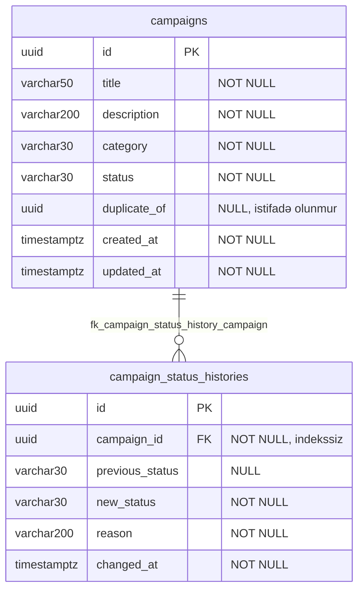
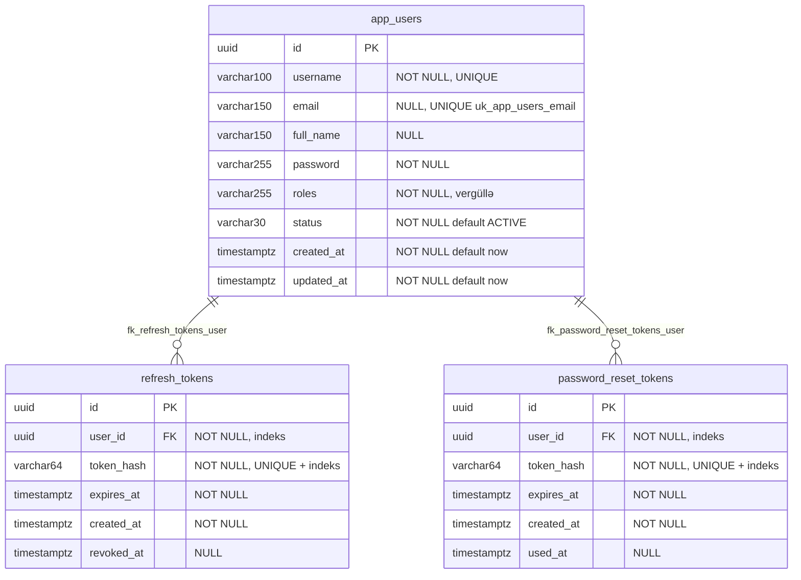
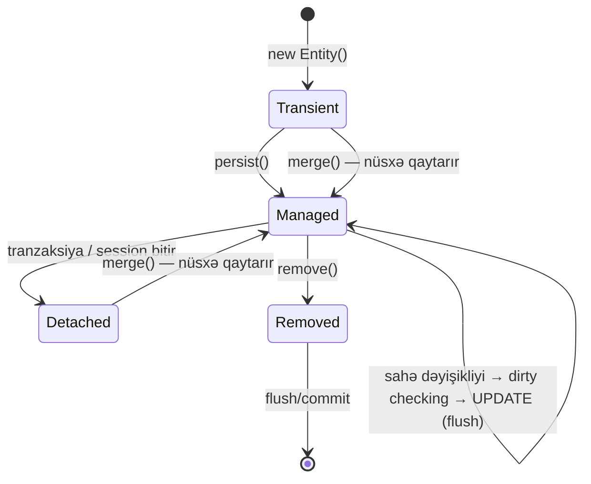

# 7. Persistence: PostgreSQL, JPA/Hibernate və Liquibase

## 7.1 Problem: obyektlər, cədvəllər və zaman

Persistence qatı üç fərqli problemi həll edir: (1) **sxemin** zamanla idarə olunan şəkildə dəyişməsi (miqrasiya),
(2) **obyekt ↔ sətir** xəritələnməsi (ORM), (3) **tranzaksiya** və paralellik altında datanın düzgünlüyü. Layihədə
bunlar uyğun olaraq Liquibase, JPA/Hibernate 7.4 və Spring `@Transactional` ilə həll olunur. Bu fəsil hər birini
əvvəl nəzəri, sonra repozitoriyadakı real nümunələrlə izah edir.

## 7.2 Data modeli

İki müstəqil PostgreSQL bazası var; aralarında FK yoxdur və ola bilməz (fərqli serverlər).





Diqqət çəkən dizayn qərarları:

- **UUID primary key-lər tətbiqdə yaradılır** (`UUID.randomUUID()`, versiya 4). Üstünlük: id DB-yə getmədən
  məlumdur (hadisələrdə, tarixçədə dərhal istifadə olunur), servislər arası unikaldır, ardıcıl id-lərin sızması yoxdur.
  Mənfi: təsadüfi UUID-lər B-tree indeksdə təsadüfi yerlərə yazılır (səhifə bölünmələri, cache lokallığının azalması);
  zamanla sıralanan **UUIDv7** bu problemi azaldır.
- **Enum-lar `varchar` kimi saxlanılır** (`@Enumerated(EnumType.STRING)`) — enum sırası dəyişəndə data pozulmur
  (`ORDINAL`-ın əsas təhlükəsi). DB tərəfində `CHECK` constraint yoxdur; yalnız Java enum-u dəyərləri məhdudlaşdırır.
- **Rollar vergüllə ayrılmış sətirdir** (`app_users.roles = 'ROLE_USER,ROLE_ADMIN'`). Sadədir, lakin normallaşdırılmamış:
  "bütün adminləri tap" sorğusu `LIKE '%ROLE_ADMIN%'` tələb edir, rol adının dəyişdirilməsi hər sətri yeniləmək
  deməkdir. Alternativ: `user_roles(user_id, role)` cədvəli və ya `@ElementCollection`.
- **Tarixçə kampaniyaya id ilə istinad edir, `@ManyToOne` ilə yox** — `CampaignStatusHistoryEntity.campaignId` sadə
  `UUID` sahəsidir (`CampaignStatusHistoryEntity.java:20-21`), DB-də isə FK var. Bu, DDD-dəki "aqreqatlara id ilə
  istinad" prinsipinə uyğundur: tarixçəni yükləmək kampaniyanı yükləmir, lazy proxy problemləri yoxdur.

## 7.3 Liquibase: nəzəriyyə

**Liquibase** sxem dəyişikliklərini versiya nəzarəti altında saxlayan miqrasiya alətidir. Əsas anlayışlar:

| Anlayış | İzah |
|---|---|
| Changelog | Dəyişikliklərin siyahısı (YAML/XML/JSON/SQL). Layihədə hər servisdə bir `db.changelog-master.yml` |
| ChangeSet | Atomik dəyişiklik vahidi; identifikasiyası `id + author + changelog yolu` üçlüyüdür |
| `DATABASECHANGELOG` | Liquibase-in yaratdığı cədvəl: hansı changeSet nə vaxt icra olunub, MD5 checksum |
| `DATABASECHANGELOGLOCK` | Eyni anda iki prosesin miqrasiya etməsinin qarşısını alan kilid |
| Checksum | ChangeSet məzmununun hash-i; icra olunmuş changeSet sonradan dəyişdirilərsə növbəti startup `ValidationFailedException` ilə dayanır |
| Rollback | `createTable`, `addColumn`, `createIndex` kimi əməliyyatlar üçün avtomatik; `sql`, `insert`, `update` üçün əl ilə yazılmalıdır |

Spring Boot inteqrasiyası: `spring-boot-liquibase` (və `liquibase-core`) classpath-də olduqda `SpringLiquibase` bean-i
tətbiq başlayarkən — JPA `EntityManagerFactory`-dən **əvvəl** — changelog-u icra edir [FAKT]
(`campaign-service/pom.xml:91-99`, `campaign-service/src/main/resources/application.yml:16-17`). Bu sıra vacibdir:
Hibernate `ddl-auto: validate` ilə sxemi yoxlayanda cədvəllər artıq mövcud olmalıdır.

## 7.4 campaign-service changelog-u

| ChangeSet | Nə edir | Mənbə |
|---|---|---|
| `001-create-campaigns` | `campaigns` cədvəli; `idx_campaign_duplicate_lookup (category, title, description)` adi indeks | `campaign-service/src/main/resources/db/changelog/db.changelog-master.yml:2-57` |
| `002-create-campaign-status-histories` | Tarixçə cədvəli; FK `campaign_id → campaigns.id` | `campaign-service/src/main/resources/db/changelog/db.changelog-master.yml:58-99` |
| `003-prevent-duplicate-campaigns` | Raw SQL ilə **partial unique index**; açıq rollback | `campaign-service/src/main/resources/db/changelog/db.changelog-master.yml:101-113` |

<!-- src: campaign-service/src/main/resources/db/changelog/db.changelog-master.yml:101-113 -->
```yaml
- changeSet:
    id: 003-prevent-duplicate-campaigns
    author: casestudy
    changes:
      - sql:
          splitStatements: false
          sql: |
            CREATE UNIQUE INDEX IF NOT EXISTS uk_campaign_unique_non_duplicate
            ON campaigns (category, title, description)
            WHERE status <> 'DUPLICATE';
    rollback:
      - sql:
          sql: DROP INDEX IF EXISTS uk_campaign_unique_non_duplicate;
```

- **Partial (şərti) indeks** PostgreSQL xüsusiyyətidir: indeks yalnız `WHERE` şərtini ödəyən sətirləri əhatə edir.
  Liquibase-in ümumi `createIndex` əməliyyatı bunu ifadə etmədiyi üçün raw SQL istifadə olunub — DB-yə xas xüsusiyyət
  lazım olanda bu, qəbul olunmuş yanaşmadır.
- `IF NOT EXISTS` — changeSet-i təkrar icraya qarşı dözümlü edir (məsələn, indeks əl ilə yaradılıbsa).
- Açıq `rollback` bloku — raw SQL üçün Liquibase əks əməliyyatı bilmir.

[RİSK] İndeks dizaynı (tapıntı F15):
- `idx_campaign_duplicate_lookup` (001) və `uk_campaign_unique_non_duplicate` (003) eyni üç sütunu əhatə edir.
  Statuslar heç vaxt `DUPLICATE` olmadığı üçün partial indeks praktiki olaraq bütün sətirləri əhatə edir və dublikat
  yoxlama sorğusu üçün də istifadə oluna bilər. Adi indeks artıqdır: hər INSERT/UPDATE iki indeksi yeniləyir.
- `campaign_status_histories.campaign_id` üzrə indeks yoxdur. PostgreSQL FK üçün avtomatik indeks yaratmır. Nəticə:
  `findByCampaignIdOrderByChangedAtAsc` tam skan edir; həmçinin `campaigns`-dan sətir silmək (gələcəkdə) FK yoxlaması
  üçün bütün tarixçəni skan edər. Tövsiyə: `CREATE INDEX ON campaign_status_histories (campaign_id, changed_at)`.
- `getAll` standart olaraq `created_at DESC` sıralayır; bu sütunda indeks yoxdur.

## 7.5 auth-service changelog-u: sxem təkamülünün real nümunəsi

auth-service changelog-u sxemin **zamanla necə dəyişdiyini** göstərir — tarixçəyə hörmət edən miqrasiyanın
dərsliyi kimi oxunur:

| ChangeSet | Nə edir | Mənbə |
|---|---|---|
| `001-create-app-users` | `app_users (id, username UNIQUE, password, roles)`; `demo` istifadəçisini `{noop}<redaktə>` formatlı açıq şifrə ilə əlavə edir | `auth-service/src/main/resources/db/changelog/db.changelog-master.yml:2-37` |
| `002-extend-app-users-for-self-contained-auth` | `email`, `full_name`, `status (default ACTIVE)`, `created_at`, `updated_at (default CURRENT_TIMESTAMP)` əlavə edir; `demo`-nu yeniləyir; `uk_app_users_email`; `admin` istifadəçisini əlavə edir | `auth-service/src/main/resources/db/changelog/db.changelog-master.yml:39-89` |
| `003-create-refresh-tokens` | Cədvəl, FK, `user_id` və `token_hash` indeksləri | `auth-service/src/main/resources/db/changelog/db.changelog-master.yml:91-145` |
| `004-create-password-reset-tokens` | Eyni struktur | `auth-service/src/main/resources/db/changelog/db.changelog-master.yml:147-201` |
| `005-insert-default-role-user` | `user` istifadəçisi | `auth-service/src/main/resources/db/changelog/db.changelog-master.yml:203-216` |

Öyrənmə nöqtələri [NƏTİCƏ]:

1. **NOT NULL sütunun mövcud cədvələ əlavə edilməsi.** 002-də `status` `nullable: false` ilə əlavə olunur. Cədvəldə
   artıq `demo` sətri var; `defaultValue: ACTIVE` olmasaydı, PostgreSQL mövcud sətirlər üçün NULL ilə NOT NULL
   constraint-ini pozduğu üçün əməliyyatı rədd edərdi. Default dəyər bu problemi həll edir.
2. **Data miqrasiyası sxem miqrasiyası ilə birlikdə.** `update ... where username = 'demo'` mövcud sətri yeni
   sütunlarla doldurur. Bu, "expand → migrate data" mərhələsidir.
3. **Seed data miqrasiyada.** Demo istifadəçilər changeSet-lərə yazılıb; bu, **hər mühitdə** (istehsal da daxil)
   `password` şifrəli admin yaradır. [RİSK] İstehsal üçün seed-lər `context: dev` kimi kontekstlərə bağlanmalı və ya
   ayrıca idarə olunmalıdır.
4. **`{noop}` prefiksi** — `DelegatingPasswordEncoder` hash alqoritmini prefiksdən müəyyən edir; `{noop}` "şifrə
   açıq mətndir" deməkdir. Seed istifadəçilərinin şifrəsi DB-də açıq saxlanılır; qeydiyyatdan keçən istifadəçilərin
   şifrəsi isə `{bcrypt}...` olur (fəsil 9).
5. **Artıq indekslər** (F16): `token_hash` sütunu `unique: true` ilə yaradılır — PostgreSQL unique constraint üçün
   avtomatik unikal indeks yaradır. Sonra ayrıca `idx_refresh_tokens_token_hash` də yaradılır. İki indeks eyni sütunda;
   ikincisi lazımsızdır.

### Liquibase ilə bağlı əməliyyat riskləri

| Risk | Mexanizm | Simptom | Həll |
|---|---|---|---|
| İcra olunmuş changeSet-in redaktəsi | Checksum uyğunsuzluğu | Startup `ValidationFailedException` | Yeni changeSet yazın; zəruri halda `validCheckSum` |
| Yarımçıq miqrasiya və ya çökmüş pod | `DATABASECHANGELOGLOCK` `LOCKED=true` qalır | Yeni instans "Waiting for changelog lock" | Kilidi əl ilə buraxmaq (`liquibase release-locks`) |
| Çox instansın eyni anda başlaması | Kilid sayəsində ardıcıllaşır | Startup gecikir | Miqrasiyanı ayrıca job kimi icra etmək |
| Uzun sürən DDL (böyük cədvəldə indeks) | Cədvəl kilidlənir | Downtime | PostgreSQL-də `CREATE INDEX CONCURRENTLY` (tranzaksiyadan kənarda, `runInTransaction: false`) |
| Geri dönüş | `sql`/`insert` üçün avtomatik rollback yoxdur | Rollback mümkün olmur | Hər riskli changeSet-ə açıq `rollback`; daha yaxşısı — geriyə uyğun (backward-compatible) "expand/contract" miqrasiyaları |

## 7.6 JPA entity xəritələnməsi

<!-- src: campaign-service/src/main/java/com/casestudy/insurancecampaign/campaign/entity/CampaignEntity.java:17-68 -->
```java
@Entity
@Table(name = "campaigns")
public class CampaignEntity {
    @Id
    private UUID id;

    @Column(nullable = false, length = 50)
    private String title;

    @Column(nullable = false, length = 200)
    private String description;

    @Enumerated(EnumType.STRING)
    @Column(nullable = false, length = 30)
    private CampaignCategory category;

    @Enumerated(EnumType.STRING)
    @Column(nullable = false, length = 30)
    private CampaignStatus status;

    @Column(name = "duplicate_of")
    private UUID duplicateOf;

    @Column(name = "created_at", nullable = false)
    private Instant createdAt;

    @Column(name = "updated_at", nullable = false)
    private Instant updatedAt;

    protected CampaignEntity() {
    }
    // ... (buraxılıb: public konstruktor)
    @PrePersist
    void prePersist() {
        Instant now = Instant.now();
        createdAt = now;
        updatedAt = now;
    }

    @PreUpdate
    void preUpdate() {
        updatedAt = Instant.now();
    }
```

| Element | Mənası və praktik nəticəsi |
|---|---|
| `@Id` (generator yoxdur) | Id tətbiq tərəfindən təyin olunur → `save` = `merge` → əlavə SELECT (F14) |
| `@Column(nullable=false, length=50)` | Yalnız DDL generasiyası (`create`) üçün metadata. `ddl-auto: validate` [NƏTİCƏ] sütunun mövcudluğunu və tip uyğunluğunu yoxlayır, uzunluq və nullability uyğunsuzluğunu adətən yoxlamır. Həqiqi qayda DB-dədir |
| `@Enumerated(STRING)` | `varchar` sütunda enum adı |
| `Instant` ↔ `timestamp with time zone` | Hibernate 6+ `Instant`-i UTC ilə `timestamptz`-yə xəritələyir |
| `protected` no-arg konstruktor | JPA tələbi (proxy və refleksiya ilə yaratma); `protected` biznes kodunda istifadəni əngəlləyir |
| `@PrePersist`/`@PreUpdate` | Persist/flush zamanı callback-lər; `@PreUpdate`-in flush zamanı işləməsi F36-ya səbəb olur |
| Setter yoxdur, `changeStatus` metodu var | İnkapsulyasiya; Hibernate sahələrə birbaşa çatır (field access, çünki `@Id` sahədədir) |

auth-service entity-ləri Lombok istifadə edir [FAKT] (`AppUserEntity.java:22-26`):

<!-- src: auth-service/src/main/java/com/casestudy/insurancecampaign/auth/model/entity/AppUserEntity.java:22-26 -->
```java
@Getter
@Entity
@Table(name = "app_users")
@NoArgsConstructor(access = AccessLevel.PROTECTED)
public class AppUserEntity {
```

`getRoles()` Lombok getter-ini **əl ilə əvəzləyir** və sətri siyahıya çevirir (`AppUserEntity.java:134-139`) — sahə
`String`, getter `List<String>` qaytarır. Bu, MapStruct-un `AppUser.roles` (List) sahəsinə xəritələməsini də
mümkün edir.

### Əlaqələr (association) və lazy yükləmə

<!-- src: auth-service/src/main/java/com/casestudy/insurancecampaign/auth/model/entity/RefreshTokenEntity.java:34-36 -->
```java
@ManyToOne(fetch = FetchType.LAZY, optional = false)
@JoinColumn(name = "user_id", nullable = false)
private AppUserEntity user;
```

- `@ManyToOne`-un JPA standartı **EAGER**-dir; açıq `LAZY` yazmaq vacib praktikadır. LAZY olduqda `user` sahəsi
  Hibernate proxy-si olur və ilk metod çağırışında (`getUser().isActive()`) ayrıca `SELECT` icra olunur.
- `optional = false` Hibernate-ə əlaqənin həmişə mövcud olduğunu deyir (inner join, null yoxlaması lazım deyil).
- `AuthService.refreshToken` daxilində (`AuthService.java:175-190`) `refreshToken.getUser()` tranzaksiya daxilində
  çağırılır — proxy initsializasiyası uğurludur. Eyni çağırış tranzaksiyadan kənarda olsaydı və `open-in-view=false`
  olduğu üçün `LazyInitializationException` atılardı.

### N+1 problemi

N+1 — N elementli siyahı üçün 1 sorğu + hər element üçün lazy əlaqəni yükləmək üçün N sorğu. Bu layihədə siyahı
qaytaran yerlərdə lazy əlaqəyə toxunulmur: kampaniya siyahısı əlaqəsizdir, tarixçə id ilə istinad edir, token-lər
tək-tək işlənir. [NƏTİCƏ] Hazırda N+1 riski yoxdur. Gələcəkdə "istifadəçinin bütün aktiv sessiyaları + istifadəçi
adı" kimi siyahı lazım olsa, həll yolları: `JOIN FETCH` JPQL, `@EntityGraph(attributePaths = "user")`, Hibernate
`@BatchSize` və ya DTO proyeksiyası. Aşkarlama: `spring.jpa.properties.hibernate.generate_statistics=true`, SQL log-u,
testdə sorğu sayını yoxlamaq.

## 7.7 Persistence context, entity vəziyyətləri və dirty checking



**Persistence context** (Hibernate `Session`) tranzaksiya boyunca yüklənmiş entity-lərin "birinci səviyyə cache"-i
və dəyişiklik izləyicisidir. Layihədə dirty checking-in ən aydın nümunəsi `resetPassword`-dur [FAKT]
(`AuthService.java:244-260`):

<!-- src: auth-service/src/main/java/com/casestudy/insurancecampaign/auth/service/AuthService.java:244-260 -->
```java
@Transactional
public LogoutResponse resetPassword(ResetPasswordRequest request) {
    PasswordResetTokenEntity resetToken = passwordResetTokenRepository.findByTokenHash(TokenHashUtils.sha256(request.resetToken()))
            .orElseThrow(() -> new BusinessException(ErrorCode.UNAUTHORIZED, "Invalid password reset token"));

    if (resetToken.isUsed() || resetToken.isExpired()) {
        throw new BusinessException(ErrorCode.UNAUTHORIZED, "Password reset token is expired or already used");
    }

    AppUserEntity user = resetToken.getUser();
    user.changePassword(passwordEncoder.encode(request.newPassword()));
    resetToken.markUsed();
    refreshTokenRepository.revokeAllActiveTokensForUser(user.getId(), Instant.now());
    authAuditService.publishResetPasswordAuditAsync(user.getUsername());

    return new LogoutResponse("Password was reset successfully. Active refresh tokens were revoked.");
}
```

Burada **heç bir `save()` çağırışı yoxdur**, lakin iki UPDATE baş verir:
1. `user.changePassword(...)` — `app_users.password` yenilənir (lazy proxy initsializasiya olunur, sonra dəyişir);
2. `resetToken.markUsed()` — `password_reset_tokens.used_at` yenilənir.

Hər ikisi idarə olunan entity olduğu üçün commit zamanı Hibernate snapshot-larla müqayisə edib UPDATE yaradır.

**Bulk update və persistence context.** `revokeAllActiveTokensForUser` `@Modifying` JPQL UPDATE-dir [FAKT]
(`RefreshTokenRepository.java:40-42`):

```java
@Modifying
@Query("update RefreshTokenEntity token set token.revokedAt = :revokedAt where token.user.id = :userId and token.revokedAt is null")
void revokeAllActiveTokensForUser(@Param("userId") UUID userId, @Param("revokedAt") Instant revokedAt);
```

[NƏTİCƏ] Bulk əməliyyatlar birbaşa DB-də işləyir, persistence context-dəki entity-ləri yeniləmir. Bu metoddan əvvəl
`RefreshTokenEntity` yüklənsəydi, onun yaddaşdakı `revokedAt`-ı köhnə qalardı. `resetPassword`-da belə entity
yüklənmədiyi üçün problem yoxdur. Ümumi qorunma: `@Modifying(clearAutomatically = true, flushAutomatically = true)`.
Həmçinin Hibernate bulk UPDATE-dən əvvəl müvafiq cədvələ təsir edən gözləyən dəyişiklikləri auto-flush edir.

**`refreshToken` metodunda rotasiya** da dirty checking-dir: `refreshToken.revoke()` (`AuthService.java:187`) — save
yoxdur, UPDATE commit-də.

## 7.8 Tranzaksiyalar

`@Transactional` standart parametrləri: `propagation = REQUIRED` (mövcud tranzaksiyaya qoşul, yoxdursa yarat),
izolyasiya — DB standartı (PostgreSQL: READ COMMITTED), **rollback yalnız `RuntimeException` və `Error` üçün**.

| Metod | Tranzaksiya | Yazılar | Rollback halları |
|---|---|---|---|
| `CampaignService.create` | RW | campaigns, history | `DuplicateCampaignException`, DB xətaları |
| `approve`/`deactivate` | RW | UPDATE campaigns, INSERT history | `ResourceNotFound`, `InvalidStatusTransition` (heç nə yazılmamış olur) |
| `getById`/`getAll`/`getHistory`/`getStatistics` | RO | — | — |
| `AuthService.register` | RW | app_users | `BusinessException` (mövcud username/email) |
| `AuthService.login` | RW | refresh_tokens | `BusinessException(UNAUTHORIZED)` |
| `refreshToken` | RW | UPDATE köhnə token, INSERT yeni | — |
| `forgotPassword` | RW | password_reset_tokens | `ResourceNotFound`, `BusinessException` |
| `resetPassword` | RW | app_users, reset token, bulk refresh_tokens | `BusinessException` |
| `logout` | RW | UPDATE refresh_tokens | `BusinessException` |

**`BusinessException` `RuntimeException`-dır** (`BusinessException.java:9`), buna görə biznes xətası tranzaksiyanı
geri qaytarır. Checked exception-lar standart olaraq rollback etmir — Spring-in ən çox unudulan qaydalarından biri.

**`create` daxilində tutulan istisna.** `saveAndFlush` `DataIntegrityViolationException` atdıqda repository-nin öz
tranzaksiya proxy-si (`SimpleJpaRepository` metodları `@Transactional`-dır) mövcud tranzaksiyaya qoşulub və istisna
onun sərhədindən keçdiyi üçün tranzaksiyanı **rollback-only** kimi işarələyir [NƏTİCƏ]. Kod istisnanı tutub yeni
`DuplicateCampaignException` atır; xarici tranzaksiya da runtime istisna ilə bitdiyi üçün rollback olunur.
Kod istisnanı tutub uğurlu nəticə qaytarsaydı, commit cəhdi `UnexpectedRollbackException` verərdi.

**Tranzaksiya və asinxron yan təsirlər.** `register`, `login` və digər auth metodları `@Async` audit metodunu
tranzaksiya **daxilində** çağırır (məs. `AuthService.java:123-125`). Audit virtual thread-də dərhal başlaya bilər —
commit-dən əvvəl. [NƏTİCƏ] Commit uğursuz olsa, log-service "User registered successfully" qeydini saxlayacaq, istifadəçi
isə yaranmayacaq. Düzgün yanaşma: hadisəni `@TransactionalEventListener(phase = AFTER_COMMIT)` ilə commit-dən sonra
nəşr etmək.

**`open-in-view: false`** (hər iki servis) — Spring Boot standart olaraq OSIV-i aktiv saxlayır və xəbərdarlıq verir.
Söndürülməsi düzgündür: DB bağlantısı HTTP cavabı yazılana qədər tutulmur, lazy yükləmə səhvləri gizlənmir.

### Bağlantı hovuzu (connection pool) və virtual thread-lər

[NƏTİCƏ] Spring Boot HikariCP-ni standart `maximumPoolSize = 10` ilə konfiqurasiya edir; layihə bunu dəyişmir.
Virtual thread-lər minlərlə eyni vaxtlı sorğunu ucuz edir, lakin DB bağlantısı hələ də 10-dur — 11-ci tranzaksiya
`connectionTimeout` (standart 30 s) qədər gözləyir. Xüsusilə təhlükəli kombinasiya: `create`/`approve` tranzaksiya
daxilində `kafkaTemplate.send` çağırır; Kafka əlçatmaz olduqda send `max.block.ms`-ə (60 s) qədər bloklaya bilər
(F10) və bu müddətdə **DB bağlantısı tutulur**. 10 belə sorğu hovuzu tükəndirir və bütün DB əməliyyatları (oxular
daxil) dayanır. Bu, "bir asılılığın uğursuzluğunun başqasına yayılması" (cascading failure) nümunəsidir.

## 7.9 Sorğu növləri

| Növ | Nümunə | Qeyd |
|---|---|---|
| Törəmə (derived) | `existsByCategoryAndTitleAndDescriptionAndStatusNot`, `findByUsername`, `findByTokenHash`, `findByCampaignIdOrderByChangedAtAsc` | Metod adından JPQL; startup-da yoxlanılır (səhv xassə adı → başlanğıc xətası) |
| JPQL `@Query` + proyeksiya | `countByStatus` (`CampaignRepository.java:20-26`) | Alias-lar interfeys getter-lərinə xəritələnir |
| `@Modifying` bulk | `revokeAllActiveTokensForUser` | Persistence context-dən yan keçir |
| CRUD | `findById`, `existsById`, `save`, `saveAndFlush`, `findAll(Pageable)` | `JpaRepository` |

## 7.10 Sxem validasiyası və testlər arasındakı boşluq

İstehsal konfiqurasiyası: Liquibase sxemi yaradır, Hibernate `validate` edir. Testlərdə isə [FAKT]
(`campaign-service/src/test/java/com/casestudy/insurancecampaign/campaign/base/AbstractTestContainerConfiguration.java:32-33`):

```java
registry.add("spring.jpa.hibernate.ddl-auto", () -> "create-drop");
registry.add("spring.liquibase.enabled", () -> false);
```

Nəticə [RİSK] (F27): testlərdəki sxem Hibernate-in entity annotasiyalarından yaratdığı sxemdir. Partial unique
indeks, `idx_*` indeksləri, `defaultValue`-lar, seed istifadəçilər testdə **yoxdur**. Changelog-dakı səhv (məsələn,
YAML sintaksis xətası və ya entity ilə uyğunsuz tip) testlərdə aşkarlanmaz, yalnız deploy zamanı aşkarlanar. Tövsiyə:
ən azı bir inteqrasiya testi Liquibase aktiv və `ddl-auto=validate` ilə işləsin; dublikat yaradılması DB constraint-i
səviyyəsində sınansın.

## 7.11 Yeni layihədə tətbiq

1. Miqrasiya alətini (Liquibase və ya Flyway) birinci gündən istifadə edin, `ddl-auto=validate`.
2. Hər biznes invariantını mümkün qədər DB constraint-i ilə də qoruyun (unique, FK, CHECK).
3. Entity-lərdə `@Version`, LAZY əlaqələr, setter-siz metodlar; `save()` nəticəsini istifadə edin və ya `Persistable`.
4. FK sütunlarına indeks əlavə edin; sorğu planlarını `EXPLAIN ANALYZE` ilə yoxlayın.
5. Testlərdə real DB (Testcontainers) **və real miqrasiyalar**; Testcontainers image versiyasını istehsalla eyniləşdirin.
6. Yan təsirləri (hadisə, audit) commit-dən sonra və ya outbox ilə nəşr edin.

**Liquibase və Flyway müqayisəsi:**

| | Liquibase | Flyway |
|---|---|---|
| Format | YAML/XML/JSON/SQL, DB-dən asılı olmayan abstraksiya | Əsasən SQL (və Java miqrasiyaları) |
| Rollback | Bir çox əməliyyat üçün avtomatik | Pulsuz versiyada "undo" yoxdur; irəli miqrasiya yanaşması |
| Öyrənmə əyrisi | Daha çox anlayış | Sadə |
| DB-yə xas xüsusiyyət | `sql` changeSet-i ilə | Təbii |

## 7.12 Uğursuzluq ssenariləri və diaqnostika

| Ssenari | Simptom | Diaqnostika | Həll |
|---|---|---|---|
| DB əlçatmaz startup-da | Liquibase bağlantı xətası, tətbiq başlamır | Log, `pg_isready` | DB-ni qaldırmaq; Compose-da `condition: service_healthy` (campaign-service-də yoxdur, F29) |
| Sxem entity ilə uyğun deyil | `SchemaManagementException` (validate) | Startup log | Yeni changeSet |
| Checksum uyğunsuzluğu | `ValidationFailedException` | `DATABASECHANGELOG.MD5SUM` | Redaktəni geri qaytarmaq, yeni changeSet |
| Unique pozuntu | `DataIntegrityViolationException` | Log, constraint adı | campaign-də 409; auth qeydiyyatında tutulmur → 500 (F18) |
| Hovuz tükənməsi | `SQLTransientConnectionException: Connection is not available` | Hikari metrikləri (`hikaricp_connections_pending`) | Uzun tranzaksiyaları qısaltmaq, xarici I/O-nu tranzaksiyadan çıxarmaq |
| Lost update | Ziddiyyətli tarixçə | Tarixçə cədvəli | `@Version` |

## 7.13 Müsahibə sualları

**S1. `persist` və `merge` fərqi nədir və Spring Data hansını nə vaxt çağırır?**
Cavab: `persist` transient obyekti idarə olunan edir (eyni instans); `merge` obyektin vəziyyətini idarə olunan
nüsxəyə kopyalayır və nüsxəni qaytarır, yoxdursa əvvəlcə SELECT edir. `SimpleJpaRepository.save` `isNew()` true olduqda
persist, əks halda merge çağırır; `isNew()` id-nin null olmasına (və ya `@Version`-a) baxır.

**S2. Dirty checking nədir? `resetPassword`-da niyə `save` yoxdur?**
Cavab: İdarə olunan entity-lərin vəziyyəti flush zamanı yüklənmə snapshot-u ilə müqayisə olunur və dəyişən sahələr
üçün UPDATE yaradılır. `resetPassword`-dakı entity-lər tranzaksiya daxilində yüklənib, ona görə dəyişikliklər avtomatik
yazılır.

**S3. Niyə checked exception tranzaksiyanı rollback etmir?**
Cavab: Spring EJB konvensiyasını izləyir: checked exception "gözlənilən biznes nəticəsi" sayılır. Rollback üçün
`@Transactional(rollbackFor = Exception.class)` lazımdır. Bu layihədə bütün biznes istisnaları runtime-dır.

**S4. Partial unique index nədir və burada nə üçündür?**
Cavab: Yalnız `WHERE` şərtini ödəyən sətirlərə tətbiq olunan unikal indeks. Burada `status <> 'DUPLICATE'` sətirləri
üçün `(category, title, description)` unikallığını təmin edir — köhnə dizaynda dublikat sətirlərin saxlanmasına icazə
vermək üçün idi; indi isə paralel yaratma yarışını bağlayan son müdafiədir.

**S5. Testlərdə `ddl-auto=create-drop` istifadə etməyin riski?**
Cavab: Test sxemi istehsal sxemindən fərqlidir: miqrasiyalar, partial indekslər, default-lar, trigger-lər yoxdur.
DB constraint-lərinə əsaslanan davranış test edilmir, changelog xətaları gec aşkarlanır.

**S6. Virtual thread-lər DB-yə nə qədər eyni vaxtlı sorğu göndərə bilər?**
Cavab: Hovuzun ölçüsü qədər (standart 10). Qalanları bağlantı gözləyir. Virtual thread-lər bloklanmanı ucuzlaşdırır,
lakin DB tutumunu artırmır; tranzaksiya daxilində xarici I/O hovuzu tez tükəndirir.

## 7.14 Xülasə

- İki baza, hər servis öz sxeminə sahibdir; sxem Liquibase ilə, xəritələmə JPA ilə.
- campaign changelog-u partial unique indeks ilə dublikat yarışını bağlayır; indeks dizaynında artıq və çatışmayan
  indekslər var.
- auth changelog-u sxem təkamülünü (NOT NULL + default, data update, seed) göstərir; seed-lər istehsala da düşür.
- Dirty checking, merge/persist, bulk update, lazy yükləmə — layihədə real nümunələri var.
- Tranzaksiya daxilində xarici çağırışlar (Kafka, async audit) həm ardıcıllıq, həm hovuz tükənməsi riski yaradır.
- Növbəti fəsil validasiya və istisna emalını bütün servislər üzrə izləyir.
