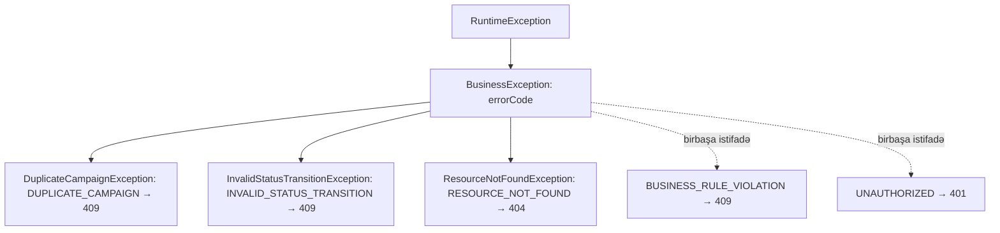

# 8. Validasiya və istisnaların idarə edilməsi

## 8.1 Problem: səhv məlumat sistemə harada daxil olur, harada dayandırılır?

Hər sorğu bir neçə "süzgəcdən" keçir: JSON formatı, tip çevrilməsi, sahə qaydaları, icazələr, biznes qaydaları,
DB constraint-ləri. Hər süzgəcin öz xəta tipi və öz HTTP statusu var. Yaxşı dizaynda: (1) hər qayda **bir yerdə**
və **ən uyğun qatda** yoxlanılır, (2) hər xəta klientə **proqnozlaşdırıla bilən formatda** qaytarılır, (3) heç bir
daxili detal sızmır, (4) gözlənilməz xətalar **loglanır**. Bu fəsil repozitoriyadakı bütün validasiya qaydalarını və
xəta yollarını inventarlaşdırır və bu dörd meyara görə qiymətləndirir.

## 8.2 Bean Validation: qısa nəzəriyyə

**Jakarta Bean Validation 3** spesifikasiya, **Hibernate Validator** onun implementasiyasıdır
(`spring-boot-starter-validation`). Constraint annotasiyaları (`@NotBlank`, `@Size`, `@Pattern`, `@Email`,
`@NotNull`) sahələrə, metod parametrlərinə və ya sinfə qoyulur; `Validator` obyektləri yoxlayıb
`ConstraintViolation` dəstini qaytarır.

Validasiyanı **kim və nə vaxt** işə salır — ən çox səhv başa düşülən hissə:

| Tetikləyici | Mexanizm | Xəta tipi |
|---|---|---|
| `@Valid @RequestBody` (MVC) | `RequestResponseBodyMethodProcessor` deserializasiyadan sonra | `MethodArgumentNotValidException` |
| `@Validated` sinif + constraint-li metod parametrləri | `MethodValidationPostProcessor` proxy-si | `ConstraintViolationException` |
| Spring 6.1+ MVC daxili metod validasiyası | Controller parametrlərində birbaşa constraint olduqda | `HandlerMethodValidationException` |
| JPA `@PrePersist` (Hibernate Validator classpath-dədirsə) | Bean Validation inteqrasiyası | `ConstraintViolationException` |

**Annotasiya varsa, işləyir — yanlış təsəvvürdür.** Constraint yalnız yuxarıdakı tetikləyicilərdən biri olduqda
yoxlanılır. Layihədə **yeganə tetikləyici `@Valid @RequestBody`-dir** [FAKT] — `@Validated` heç yerdə istifadə
olunmur (grep nəticəsi: `@Valid` yalnız `CampaignController.java:46` və `AuthController.java`-dakı 6 metodda).

**Record-larda constraint-lər.** Record komponentinə qoyulan annotasiya, `@Target`-inə uyğun olaraq, sahəyə, accessor
metoduna və kanonik konstruktor parametrinə yayılır. [NƏTİCƏ] Hibernate Validator getter constraint-lərini yalnız
JavaBeans adlandırmasına (`getX`/`isX`) uyğun metodlarda axtarır; record accessor-ları (`title()`) bu formada deyil,
ona görə qaydalar sahə səviyyəsində bir dəfə yoxlanılır — dublikat pozuntu yaranmır.

## 8.3 Validasiya qaydalarının tam inventarı

### campaign-service

<!-- src: campaign-service/src/main/java/com/casestudy/insurancecampaign/campaign/dto/CreateCampaignRequest.java:9-21 -->
```java
public record CreateCampaignRequest(
        @NotBlank
        @Size(min = 10, max = 50)
        @Pattern(regexp = "^[\\p{L}\\d].*", message = "title must start with a Turkish letter, another letter, or a digit")
        String title,

        @NotBlank
        @Size(min = 20, max = 200)
        String description,

        @NotNull
        CampaignCategory category
) { }
```

| # | Qayda | Harada təyin olunub | Kim icra edir | Mərhələ | Xəta / status | Təkrarlanırmı | Yerləşmə uyğundurmu |
|---|---|---|---|---|---|---|---|
| C1 | `title` boş deyil | `CreateCampaignRequest.java:10` | Hibernate Validator | `@Valid` | 400 `VALIDATION_ERROR` | DB `NOT NULL` | Bəli |
| C2 | `title` 10–50 simvol | `:11` | HV | `@Valid` | 400 | DB `varchar(50)` (yalnız yuxarı hədd) | Bəli |
| C3 | `title` hərf və ya rəqəmlə başlayır | `:12` | HV (`Pattern`) | `@Valid` | 400, xüsusi mesaj | Yox | Bəli |
| C4 | `description` boş deyil, 20–200 | `:15-16` | HV | `@Valid` | 400 | DB `varchar(200)` | Bəli |
| C5 | `category` null deyil | `:19` | HV | `@Valid` | 400 | DB `NOT NULL` | Bəli |
| C6 | `category` mövcud enum dəyəridir | Jackson enum deserializasiyası | Jackson 3 | Deserializasiya | `HttpMessageNotReadableException` → **500** (F07) | Yox | Mərhələ düzgün, status səhv |
| C7 | `id` UUID formatıdır | `@PathVariable UUID` | `ConversionService` | Arqument həlli | `MethodArgumentTypeMismatchException` → **500** (F07) | Yox | Mərhələ düzgün, status səhv |
| C8 | Dublikat yoxdur | `CampaignService.java:140-150` + partial unique indeks | Servis + PostgreSQL | Servis / flush | 409 `DUPLICATE_CAMPAIGN` | **Bəli (qəsdən)**: tətbiq + DB | Bəli — DB son zəmanətdir |
| C9 | Kampaniya mövcuddur | `CampaignService.java:157-160`, `115-117` | Servis | Servis | 404 | Yox | Bəli |
| C10 | Status keçidinə icazə var | `CampaignService.java:96-98`, `107-109` | Servis | Servis | 409 `INVALID_STATUS_TRANSITION` | Yox | Servis — bəli; domen obyektində daha yaxşı olardı |
| C11 | `DUPLICATE` statuslu yenilənmir | `CampaignService.java:171-175` | Servis | Servis | 409 `DUPLICATE_CAMPAIGN` | Yox | Ölü qayda (status heç vaxt təyin olunmur) |
| C12 | `sort` xassəsi mövcuddur | Spring Data | Repository | Sorğu qurulması | `PropertyReferenceException` → **500** | Yox | Controller-də ağ siyahı daha yaxşıdır |
| C13 | Rol: ADMIN / USER | `@PreAuthorize` | Method security | Controller proxy | 403 `FORBIDDEN` | Gateway rolları yoxlamır | Bəli |

[NƏTİCƏ] C3 — Java regex-də `.` sətir sonu simvollarını (`\n`) tutmur və Bean Validation `Matcher.matches()` (bütün
sətrə uyğunluq) istifadə edir. Ona görə daxilində yeni sətir olan başlıq (`"Kampaniya\n2026 yay"`) `@Pattern`-dən
keçmir. `\d` yalnız ASCII rəqəmləri tutur. `\p{L}` isə bütün Unicode hərflərini (ç, ğ, ı, İ, ö, ş, ü, ə) tutur — README-dəki
"Turkish letter" tələbi ödənilir.

### auth-service

<!-- src: auth-service/src/main/java/com/casestudy/insurancecampaign/auth/model/dto/request/RegisterRequest.java:18-24 -->
```java
public record RegisterRequest(
        @NotBlank @Size(min = 3, max = 100) String username,
        @NotBlank @Email @Size(max = 150) String email,
        @NotBlank @Size(min = 8, max = 100) String password,
        @NotBlank @Size(min = 2, max = 150) String fullName,
        @NotNull UserRole role
) { }
```

| # | Qayda | Harada | Kim / mərhələ | Xəta | Qeyd |
|---|---|---|---|---|---|
| A1 | `username` 3–100, boş deyil | `RegisterRequest.java:19` | HV / `@Valid` | 400 | DB `varchar(100) UNIQUE` |
| A2 | `email` formatı, ≤150 | `:20` | HV | 400 | DB `varchar(150)`, `uk_app_users_email` |
| A3 | `password` 8–100 | `:21` | HV | 400 | Mürəkkəblik qaydası yoxdur |
| A4 | `fullName` 2–150 | `:22` | HV | 400 | — |
| A5 | `role` null deyil, enum | `:23` | HV + Jackson | 400 / yanlış dəyər → 500 | [RİSK] F01: `ROLE_ADMIN` qəbul olunur |
| A6 | `username`/`email` unikaldır | `AuthService.java:108-113` + DB unique | Servis + DB | 409 `BUSINESS_RULE_VIOLATION`; yarışda 500 (F18) | Normallaşdırmadan sonra yoxlanılır |
| A7 | Login sahələri boş deyil | `LoginRequest.java:11-14` | HV | 400 | — |
| A8 | İstifadəçi mövcud, aktiv, şifrə uyğundur | `AuthService.java:142-157` | Servis | 401 `UNAUTHORIZED` | Mesajlar fərqlidir → enumerasiya (F03) |
| A9 | Refresh token mövcud, ləğv olunmayıb, vaxtı keçməyib, istifadəçi aktivdir | `AuthService.java:177-185` | Servis | 401 | — |
| A10 | Reset token mövcud, istifadə olunmayıb, vaxtı keçməyib | `AuthService.java:246-251` | Servis | 401 | — |
| A11 | `newPassword` 8–100 | `ResetPasswordRequest.java:12-15` | HV | 400 | Qeydiyyat qaydası ilə eynidir (təkrar, lakin uyğun) |
| A12 | Forgot: istifadəçi mövcud və aktivdir | `AuthService.java:207-212` | Servis | 404 / 401 | 404 enumerasiyanı asanlaşdırır (F03) |

**Normallaşdırma validasiyadan sonra baş verir.** `username` və `email` servisdə `trim().toLowerCase(Locale.ROOT)` olunur
(`StringUtils.java:36-38`, `AuthService.java:105-106`). `@Size(min = 3)` trim-dən əvvəl yoxlanılır: `"  ab "` (5 simvol)
keçir, normallaşdırmadan sonra `"ab"` (2 simvol) saxlanılır. [NƏTİCƏ] Kiçik uyğunsuzluq; həll — normallaşdırmanı
deserializasiyada (custom deserializer) və ya kanonik konstruktorda etmək, ya da validasiyanı normallaşdırılmış dəyər üzərində
təkrarlamaq.

`Locale.ROOT` ilə kiçik hərfə çevirmə vacib detaldır: türk lokalında `"I".toLowerCase()` nöqtəsiz `ı` verir; `ROOT`
lokalı bu "Turkish I problem"-ini aradan qaldırır. Layihənin türk dilli kontekstini nəzərə alsaq, bu, düzgün seçimdir.

### log-service

[FAKT] (`AuthAuditLogController.java:30-35`, `AuthAuditLogRequest.java:15-22`): audit sorğusunda **heç bir validasiya
yoxdur** — nə `@Valid`, nə constraint. `null` sahələr birbaşa Elasticsearch-ə yazılır. Endpoint yalnız
`ROLE_INTERNAL_SERVICE` üçün açıq olduğu üçün risk aşağıdır, lakin "daxili klientə etibar" müdafiə qatını azaldır
(F39). `GET /slow-requests` `page` və `size` üçün mənfi/sıfır dəyərləri yoxlamır: `PageRequest.of(-1, 20)`
`IllegalArgumentException` atır → catch-all → 500.

### Təhlükəsizlik və DB qatı

| Qayda | Harada | Nəticə |
|---|---|---|
| JWT imzası, issuer, vaxtı | `JwtTokenService.parseClaims` (`JwtTokenService.java:128-133`) | Filtrdə istisna (F08) |
| Token mövcudluğu (qorunan yollar) | `ServiceSecurityConfiguration` | 401 JSON |
| NOT NULL, uzunluq, unique, FK | Liquibase changelog-ları | `DataIntegrityViolationException` |

## 8.4 İstisna iyerarxiyası və xəta kodları



<!-- src: common/src/main/java/com/casestudy/insurancecampaign/common/exception/GlobalExceptionHandler.java:36-52 -->
```java
@ExceptionHandler(BusinessException.class)
public ResponseEntity<ApiError> handleBusinessException(BusinessException exception, HttpServletRequest request) {
    HttpStatus status = switch (exception.getErrorCode()) {
        case RESOURCE_NOT_FOUND -> HttpStatus.NOT_FOUND;
        case DUPLICATE_CAMPAIGN, INVALID_STATUS_TRANSITION, BUSINESS_RULE_VIOLATION -> HttpStatus.CONFLICT;
        case UNAUTHORIZED -> HttpStatus.UNAUTHORIZED;
        default -> HttpStatus.BAD_REQUEST;
    };

    return ResponseEntity.status(status)
            .body(ApiError.of(
                    exception.getErrorCode().name(),
                    exception.getMessage(),
                    status.value(),
                    request.getRequestURI()
            ));
}
```

`ErrorCode` enum-unda 8 dəyər var (`ErrorCode.java:10-52`). Xəritə [FAKT]:

| `ErrorCode` | HTTP | Kim atır |
|---|---|---|
| `RESOURCE_NOT_FOUND` | 404 | `ResourceNotFoundException` (campaign, auth forgot-password) |
| `DUPLICATE_CAMPAIGN` | 409 | `DuplicateCampaignException` |
| `INVALID_STATUS_TRANSITION` | 409 | `InvalidStatusTransitionException` |
| `BUSINESS_RULE_VIOLATION` | 409 | `AuthService.register` (username/email mövcuddur) |
| `UNAUTHORIZED` | 401 | `AuthService` (login, token yoxlamaları) |
| `VALIDATION_ERROR` | 400 (`default`) | Birbaşa atılmır; `ApiError.validation(...)` sabit kodu |
| `FORBIDDEN` | 400 (`default`) | Biznes istisnası kimi atılmır; yalnız security handler-lərində kod kimi |
| `INTERNAL_SERVER_ERROR` | 400 (`default`) | Biznes istisnası kimi atılmır; catch-all handler-də kod |

[NƏTİCƏ] `default -> BAD_REQUEST` hələ istifadə olunmayan kodlar üçün səhv ehtiyat dəyərdir: gələcəkdə kimsə
`new BusinessException(ErrorCode.FORBIDDEN, ...)` atsa, 403 deyil, 400 qaytarılacaq. Switch-dən `default`-u çıxarıb
hər halı açıq yazmaq kompilyatoru yeni enum dəyərlərində xəbərdarlıq etməyə məcbur edərdi.

## 8.5 `GlobalExceptionHandler`: hansı istisna hansı handler-ə düşür

`@RestControllerAdvice` (`GlobalExceptionHandler.java:23`) bütün controller-lər üçün `@ExceptionHandler` metodlarını
qeydiyyatdan keçirir. Spring `ExceptionHandlerExceptionResolver` atılan istisna üçün **ən yaxın** (iyerarxiyada ən
spesifik) tipi olan handler-i seçir (`ExceptionDepthComparator`).

| Handler | Tutur | Status | Mənbə |
|---|---|---|---|
| `handleBusinessException` | `BusinessException` və alt sinifləri | `ErrorCode`-a görə | `:36-52` |
| `handleAccessDenied` | `AccessDeniedException` (o cümlədən `@PreAuthorize`-ın `AuthorizationDeniedException`-ı) | 403 | `:64-73` |
| `handleAuthentication` | `AuthenticationException` | 401 | `:84-93` |
| `handleValidation` | `MethodArgumentNotValidException` | 400 + sahə xətaları | `:105-119` |
| `handleUnexpected` | `Exception` — **qalan hər şey** | 500 | `:130-139` |

<!-- src: common/src/main/java/com/casestudy/insurancecampaign/common/exception/GlobalExceptionHandler.java:105-139 -->
```java
@ExceptionHandler(MethodArgumentNotValidException.class)
public ResponseEntity<ApiError> handleValidation(MethodArgumentNotValidException exception, HttpServletRequest request) {
    Map<String, String> errors = new LinkedHashMap<>();

    exception.getBindingResult().getFieldErrors()
            .forEach(error -> errors.put(error.getField(), error.getDefaultMessage()));

    return ResponseEntity.badRequest()
            .body(ApiError.validation(
                    "Request validation failed",
                    HttpStatus.BAD_REQUEST.value(),
                    request.getRequestURI(),
                    errors
            ));
}
// ... (buraxılıb: Javadoc)
@ExceptionHandler(Exception.class)
public ResponseEntity<ApiError> handleUnexpected(Exception exception, HttpServletRequest request) {
    return ResponseEntity.internalServerError()
            .body(ApiError.of(
                    ErrorCode.INTERNAL_SERVER_ERROR.name(),
                    exception.getMessage(),
                    HttpStatus.INTERNAL_SERVER_ERROR.value(),
                    request.getRequestURI()
            ));
}
```

Detallar:
- `validationErrors` `Map<String,String>`-dir: bir sahədə bir neçə pozuntu olarsa (`title` həm qısa, həm `Pattern`-ə
  uyğun deyil), `put` sonuncunu saxlayır — klient yalnız bir mesaj görür. `Map<String, List<String>>` daha
  məlumatlıdır. Sinif səviyyəli (global) xətalar (`getGlobalErrors()`) ümumiyyətlə daxil edilmir.
- Mesajlar Hibernate Validator-un standart ingilis mesajlarıdır (`"size must be between 10 and 50"`), yalnız `@Pattern`
  xüsusi mesaja malikdir.

### Catch-all handler-in yan təsirləri (F07, F38)

[NƏTİCƏ] Spring MVC-də istisna resolver-lərinin sırası: `ExceptionHandlerExceptionResolver` (sizin `@ExceptionHandler`-lər)
→ `ResponseStatusExceptionResolver` → `DefaultHandlerExceptionResolver`. `@ExceptionHandler(Exception.class)` olduqda
birinci resolver **hər** istisnanı tutur və Spring-in standart 4xx xəritələnməsi heç vaxt işə düşmür:

| İstisna | Standart Spring statusu | Layihədə | Tipik səbəb |
|---|---|---|---|
| `HttpMessageNotReadableException` | 400 | **500** | Səhv JSON, yanlış enum (`"category":"XYZ"`) |
| `MethodArgumentTypeMismatchException` | 400 | **500** | `/campaigns/not-a-uuid` |
| `MissingServletRequestParameterException` | 400 | **500** | Məcburi parametr yoxdur |
| `HttpRequestMethodNotSupportedException` | 405 | **500** | `DELETE /api/v1/campaigns/{id}` |
| `HttpMediaTypeNotSupportedException` | 415 | **500** | `Content-Type: text/plain` |
| `NoResourceFoundException` | 404 | **500** | Mövcud olmayan yol (autentifikasiyalı istifadəçi üçün) |
| `PropertyReferenceException` | — (500) | 500 | `sort=foo` — əslində 400 olmalıdır |
| `DataIntegrityViolationException` | — (500) | 500 | auth qeydiyyat yarışı (F18) |
| `IllegalArgumentException` | — (500) | 500 | `page=-1` (log-service) |

Əlavə problemlər:
1. **Məlumat sızması** — `exception.getMessage()` klientə qaytarılır. Jackson xətası JSON strukturunu və sinif
   adlarını, `DataIntegrityViolationException` SQL mətnini və constraint adını ehtiva edə bilər.
2. **Loglama yoxdur** — sinifdə logger yoxdur. İstisna `@ExceptionHandler` tərəfindən emal olunduqda
   `DispatcherServlet` onu error səviyyəsində loglamır. Nəticə: istehsalda 500 cavabları **stack trace-siz** olur;
   yeganə iz klientin gördüyü mesaj və trace-dəki xəta statusudur (F38).

İllüstrativ nümunə (repozitoriyada yoxdur) — düzgün variant:

```java
@RestControllerAdvice
public class GlobalExceptionHandler extends ResponseEntityExceptionHandler { // Spring-in 4xx xəritəsini saxlayır
    private static final Logger log = LoggerFactory.getLogger(GlobalExceptionHandler.class);

    @ExceptionHandler(DataIntegrityViolationException.class)
    ResponseEntity<ApiError> conflict(DataIntegrityViolationException ex, HttpServletRequest req) {
        log.warn("Constraint violation at {}", req.getRequestURI(), ex);
        return ResponseEntity.status(409).body(ApiError.of("CONFLICT", "Resource state conflict", 409, req.getRequestURI()));
    }

    @ExceptionHandler(Exception.class)
    ResponseEntity<ApiError> unexpected(Exception ex, HttpServletRequest req) {
        log.error("Unhandled exception at {}", req.getRequestURI(), ex);           // stack trace log-da
        return ResponseEntity.internalServerError()
                .body(ApiError.of("INTERNAL_SERVER_ERROR", "Unexpected error", 500, req.getRequestURI())); // detal yoxdur
    }
    // handleMethodArgumentNotValid(...) override edilərək ApiError formatı saxlanılır
}
```

## 8.6 Təhlükəsizlik qatında xətalar

Security xətaları MVC-dən **əvvəl**, filtrlərdə baş verir və `@RestControllerAdvice` onları görmür. Buna görə
`ServiceSecurityConfiguration` öz handler-lərini təyin edir [FAKT] (`ServiceSecurityConfiguration.java:80-95`,
`121-134`):

<!-- src: security/src/main/java/com/casestudy/insurancecampaign/security/ServiceSecurityConfiguration.java:80-95 -->
```java
.exceptionHandling(exception -> exception
        .authenticationEntryPoint((request, response, authException) -> writeError(
                request,
                response,
                HttpStatus.UNAUTHORIZED,
                ErrorCode.UNAUTHORIZED.name(),
                "Authentication is required"
        ))
        .accessDeniedHandler((request, response, accessDeniedException) -> writeError(
                request,
                response,
                HttpStatus.FORBIDDEN,
                ErrorCode.FORBIDDEN.name(),
                "Access denied"
        ))
)
```

İki fərqli 403 yolu var və hər ikisi eyni formatı verir:
1. URL səviyyəli qayda filtrdə rədd edirsə → `accessDeniedHandler` (bu layihədə URL qaydaları yalnız
   `authenticated()`-dir, ona görə praktikada 401 olur).
2. `@PreAuthorize` metod səviyyəsində rədd edirsə → istisna `DispatcherServlet` daxilində atılır →
   `GlobalExceptionHandler.handleAccessDenied` → 403 `FORBIDDEN`. Testlər bunu yoxlayır (məs.
   `CampaignControllerTest.java:97-120`).

### Etibarsız JWT (F08)

`JwtAuthenticationFilter` `parseClaims`-in atdığı `JwtException`-ı tutmur (`JwtAuthenticationFilter.java:70-83`).
[NƏTİCƏ] İstisna `FilterChainProxy`-dən çıxır; `ExceptionTranslationFilter` yalnız `AuthenticationException` və
`AccessDeniedException`-ı tanıdığı üçün (və JWT filtri ondan əvvəl yerləşdiyi üçün) emal etmir. İstisna servlet
konteynerinə çatır, Spring Boot onu `/error`-a ERROR dispatch kimi yönləndirir. Bu dispatch də Spring Security-dən
keçir; JWT filtri (OncePerRequestFilter) ERROR dispatch-də standart olaraq işləmir, kontekst anonimdir və `/error`
`permitAll` siyahısında deyil — nəticə çox güman ki, entry point-in 401 cavabıdır, lakin bu, framework-un bir neçə
qatlı davranışına bağlıdır və repozitoriyada test edilməyib. MockMvc testlərində (ERROR dispatch yoxdur) istisna testə
qədər yayılardı. Düzgün dizayn: filtrdə `JwtException`-ı tutmaq, kontekst qurmadan zənciri davam etdirmək və ya
`AuthenticationEntryPoint`-ə açıq ötürmək; ən yaxşısı Spring Security-nin `oauth2ResourceServer().jwt()`
mexanizmindən istifadə etmək (fəsil 10).

## 8.7 Gateway, uzaq servislər və asinxron emalda xətalar

| Mənbə | Xəta | Klientin gördüyü |
|---|---|---|
| Gateway JWT filtri | Token yoxdur / etibarsızdır | **401, boş gövdə** (`GatewayJwtAuthenticationFilter.java:82-94`) — `ApiError` formatı deyil |
| Gateway rate limit | Limit aşılıb | 429 + `ApiError`-a bənzər JSON + `Retry-After: 5` |
| Gateway, servis instansı yoxdur | `lb://` həll olunmur | [NƏTİCƏ] 503 Spring WebFlux-un standart xəta formatında |
| Dashboard → campaign gRPC | `StatusRuntimeException` (`UNAVAILABLE`, `UNKNOWN`, `DEADLINE_EXCEEDED`) | Catch-all → 500, mesaj məs. `"UNAVAILABLE: io exception"` (F19) |
| campaign gRPC endpoint daxilində istisna | `ResourceNotFoundException`, `IllegalArgumentException` (səhv UUID) | gRPC `UNKNOWN` (net.devh-də `@GrpcAdvice` yoxdur) → dashboard 500 |
| Auth → log-service | HTTP xətası, timeout, CB açıq, bulkhead dolu | Tutulur və `WARN` loglanır (`AuthAuditService.java:155-179`); klient təsirlənmir |
| Kafka producer | Göndərmə uğursuz | `KafkaTemplate`-in standart `LoggingProducerListener`-i [NƏTİCƏ] xətanı loglayır; HTTP cavabı uğurlu qalır |
| Kafka consumer | Listener istisnası | `DefaultErrorHandler`: 3 təkrar (1 s), sonra DLQ (fəsil 11) |
| Kafka deserializasiya | Səhv JSON | DLQ-ya getmir; consumer eyni offseti təkrar oxuyur (F11) |
| `@Async` metod | İstisna | `publishAudit` hər şeyi tutur; tutulmasaydı `AsyncUncaughtExceptionHandler` (standart: log) |

**Xəta formatlarının sistem üzrə vahidliyi.** Servislər `ApiError`, gateway 429 üçün `ApiError`-a bənzər format, gateway
401 üçün boş gövdə, WebFlux standart xətaları üçün isə fərqli JSON qaytarır. [NƏTİCƏ] Klient üçün dörd fərqli forma
var. Təkmilləşdirmə: gateway-də `ErrorWebExceptionHandler` ilə vahid format, JWT filtrində JSON gövdə.

## 8.8 Persistence xətaları və rollback

- Biznes istisnaları `RuntimeException` olduğu üçün tranzaksiya rollback olur (fəsil 7).
- `DataIntegrityViolationException` campaign-də 409-a çevrilir, auth-da 500 qalır (F18).
- DB bağlantı xətaları (`CannotCreateTransactionException`, `DataAccessResourceFailureException`) catch-all ilə 500.
- Optimistik kilid olmadığı üçün `ObjectOptimisticLockingFailureException` heç vaxt yaranmır — paralel yeniləmələr
  sakitcə bir-birini əvəzləyir (F37).

## 8.9 Uğurlu və uğursuz sorğunun izlənməsi

**Uğurlu:** `POST /api/v1/campaigns` `{"title":"TSS Kampanya 2026","description":"Tamamlayıcı sağlık sigortası için özel kampanya açıklaması","category":"TSS"}`, admin token:
1. Security: JWT etibarlıdır, `ROLE_ADMIN` authority-si qurulur.
2. Jackson 3: JSON → `CreateCampaignRequest`; `"TSS"` → `CampaignCategory.TSS`.
3. `@Valid`: başlıq 17 simvol, hərflə başlayır; təsvir 54 simvol; kateqoriya var — keçir.
4. `@PreAuthorize("hasRole('ADMIN')")` keçir.
5. `CampaignService.create` → 201 + `ApiResponse`.

**Uğursuz — qısa başlıq** (`"title":"TSS"`):
1–2. Eyni.
3. `@Size(min = 10)` pozulur → `MethodArgumentNotValidException`.
4. `GlobalExceptionHandler.handleValidation` → 400, `{"code":"VALIDATION_ERROR","validationErrors":{"title":"size must be between 10 and 50"}}`.
5. `@PreAuthorize` heç vaxt yoxlanılmır, servis çağırılmır.

**Uğursuz — yanlış kateqoriya** (`"category":"HEALTH"`):
2. Jackson `HttpMessageNotReadableException` (enum dəyəri tapılmadı) atır.
3. `handleUnexpected` → **500** `INTERNAL_SERVER_ERROR`, mesajda Jackson-un daxili izahı; heç nə loglanmır.

## 8.10 Yeni layihədə tətbiq

**Xüsusi constraint (illüstrativ nümunə, repozitoriyada yoxdur)** — trim-dən sonra uzunluğu yoxlayan annotasiya:

```java
@Target({FIELD, PARAMETER, RECORD_COMPONENT})
@Retention(RUNTIME)
@Constraint(validatedBy = TrimmedSizeValidator.class)
public @interface TrimmedSize {
    int min() default 0;
    int max() default Integer.MAX_VALUE;
    String message() default "length after trimming must be between {min} and {max}";
    Class<?>[] groups() default {};
    Class<? extends Payload>[] payload() default {};
}

public class TrimmedSizeValidator implements ConstraintValidator<TrimmedSize, String> {
    private int min, max;
    @Override public void initialize(TrimmedSize a) { min = a.min(); max = a.max(); }
    @Override public boolean isValid(String v, ConstraintValidatorContext ctx) {
        if (v == null) return true;                 // null-u @NotNull/@NotBlank yoxlasın
        int len = v.trim().length();
        return len >= min && len <= max;
    }
}
```

**Validasiya qrupları** — eyni DTO müxtəlif əməliyyatlarda fərqli qaydalara tabe olduqda (`OnCreate`, `OnUpdate`
interfeysləri, `@Validated(OnCreate.class)`). Bu layihədə hər əməliyyatın öz DTO-su olduğu üçün qruplara ehtiyac
yoxdur — bu, qruplardan daha sadə və tövsiyə olunan yanaşmadır.

**Qaydaların yerləşdirilməsi prinsipi:**
- Format və sintaksis (uzunluq, regex, null) → DTO, Bean Validation.
- Biznes qaydası (status keçidi, unikallıq məntiqi) → domen/servis.
- Atomik invariant (unikallıq, referensial bütövlük) → **həm də** DB constraint-i.
- İcazə → security (URL və ya metod səviyyəsi).

## 8.11 Müsahibə sualları

**S1. `@Valid` və `@Validated` fərqi nədir?**
Cavab: `@Valid` Jakarta standartıdır, kaskad (iç-içə obyekt) validasiyasını və MVC arqument validasiyasını işə salır.
`@Validated` Spring annotasiyasıdır: validasiya qruplarını dəstəkləyir və sinif üzərində qoyulduqda metod səviyyəli
validasiya üçün proxy yaradır.

**S2. Niyə bu layihədə yanlış enum dəyəri 500 qaytarır?**
Cavab: Jackson deserializasiyası `HttpMessageNotReadableException` atır. Spring bunu standart olaraq 400-ə çevirərdi,
lakin `@ExceptionHandler(Exception.class)` hər şeyi tutduğu üçün `DefaultHandlerExceptionResolver`-ə növbə çatmır.

**S3. Security filtrlərində yaranan xətalar niyə `@RestControllerAdvice`-ə çatmır?**
Cavab: Advice `DispatcherServlet` daxilində işləyir; filtrlər isə ondan əvvəl, servlet konteyneri səviyyəsində işləyir.
Filtr xətaları `AuthenticationEntryPoint`/`AccessDeniedHandler` və ya `HandlerExceptionResolver`-i filtrə inject
etməklə emal olunmalıdır.

**S4. Validasiya nə vaxt servis qatında olmalıdır?**
Cavab: Qayda başqa dataya (DB-dəki mövcud vəziyyət) və ya bir neçə sahənin biznes mənasına bağlıdırsa — məsələn, status
keçidi, unikallıq. Format qaydaları DTO-da, kontekst tələb edən qaydalar servisdə/domendə.

**S5. 500 cavabında `exception.getMessage()` qaytarmağın riski?**
Cavab: Daxili detalların (SQL, sinif adları, fayl yolları, bəzən şəxsi məlumat) sızması və hücumçu üçün kəşfiyyat
imkanı. Klientə ümumi mesaj və korrelyasiya id-si (traceId), detallar isə yalnız log-a.

**S6. Eyni qayda həm tətbiqdə, həm DB-də olarsa, bu təkrar (duplication) pisdirmi?**
Cavab: Yarış şəraitində yalnız DB atomik zəmanət verir; tətbiq yoxlaması isə yaxşı xəta mesajı və erkən rədd üçündür.
Bu "müdafiə dərinliyi"dir, mənasız təkrar deyil — şərt odur ki, DB pozuntusu da düzgün xətaya çevrilsin.

## 8.12 Xülasə

- Validasiyanın yeganə tetikləyicisi `@Valid @RequestBody`-dir; `@Validated` istifadə olunmur.
- campaign və auth DTO-larında qaydalar DB sütun ölçüləri ilə uyğundur; log-service audit sorğusu validasiyasızdır.
- Biznes istisnaları `ErrorCode` ilə HTTP-yə xəritələnir; catch-all handler Spring-in standart 4xx-lərini 500-ə
  çevirir, daxili mesajları sızdırır və loglamır.
- Security xətaları ayrıca handler-lərlə eyni formatda qaytarılır; etibarsız JWT yolu test edilməyib.
- Növbəti fəsil auth-service-in istifadəçi və token həyat dövrünü izah edir.
