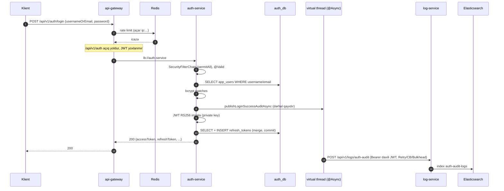

# 9. Auth Service — istifadəçi və token həyat dövrü

## 9.1 Məsuliyyət və sərhəd

auth-service sistemin **identifikasiya mərkəzidir** (identity provider rolu): istifadəçiləri saxlayır, şifrələri
yoxlayır, **access token** (JWT) və **refresh token** buraxır, şifrə bərpasını idarə edir. README-yə görə servis
"fully self-contained"-dir: ayrıca user-service yoxdur [FAKT] (`AuthServiceApplication.java`, repozitoriyada başqa
istifadəçi servisi yoxdur).

Digər servislər auth-service-ə **runtime-da müraciət etmir**: token-i public key ilə özləri yoxlayırlar (fəsil 10).
Bu, mühüm arxitektura xüsusiyyətidir — auth-service düşsə belə, artıq verilmiş access token-lər vaxtı bitənə qədər
işləməyə davam edir.

| Endpoint | Metod | Servis metodu | Tranzaksiya | Audit hadisəsi |
|---|---|---|---|---|
| `/api/v1/auth/register` | POST | `register` | RW | `REGISTER` |
| `/api/v1/auth/login` | POST | `login` | RW | `LOGIN_SUCCESS` / `LOGIN_FAILURE` |
| `/api/v1/auth/refresh-token` | POST | `refreshToken` | RW | `REFRESH_TOKEN` |
| `/api/v1/auth/forgot-password` | POST | `forgotPassword` | RW | `FORGOT_PASSWORD` |
| `/api/v1/auth/reset-password` | POST | `resetPassword` | RW | `RESET_PASSWORD` |
| `/api/v1/auth/logout` | POST | `logout` | RW | `LOGOUT` |

Bütün endpoint-lər `permitAll`-dur (`ServiceSecurityConfiguration.java:96-106`) və gateway-də JWT yoxlamasından azaddır
(`GatewayJwtAuthenticationFilter.java:39-50`), lakin gateway rate limit-inə tabedir.

## 9.2 Şifrələrin saxlanması: `DelegatingPasswordEncoder`

<!-- src: auth-service/src/main/java/com/casestudy/insurancecampaign/auth/config/AuthConfiguration.java:30-33 -->
```java
@Bean
public PasswordEncoder passwordEncoder() {
    return PasswordEncoderFactories.createDelegatingPasswordEncoder();
}
```

**Nəzəriyyə.** Şifrələr heç vaxt açıq və ya geri qaytarıla bilən formada saxlanmamalıdır. Bunun üçün **yavaş, duzlu
(salted) hash** funksiyaları (BCrypt, Argon2, scrypt, PBKDF2) istifadə olunur: yavaşlıq brute-force-u bahalaşdırır,
təsadüfi duz eyni şifrələrin eyni hash verməsinin və rainbow table-ların qarşısını alır.

`DelegatingPasswordEncoder` hash-in əvvəlinə alqoritm id-si yazır: `{bcrypt}$2a$10$...`. `matches()` prefiksi oxuyub
uyğun encoder-i seçir. Standart yeni hash alqoritmi **bcrypt**-dir (cost 10). Bu dizayn alqoritmi gələcəkdə dəyişməyə
imkan verir: köhnə hash-lər köhnə alqoritmlə yoxlanılır, yeniləri yeni alqoritmlə yaradılır.

Layihədə [FAKT]:
- Seed istifadəçilərin şifrəsi `{noop}<redaktə>` formatında saxlanılır (changelog) — `NoOpPasswordEncoder`, açıq mətn.
- Qeydiyyat `passwordEncoder.encode(...)` istifadə edir (`AuthService.java:120`) → `{bcrypt}...`.
- Reset `passwordEncoder.encode(...)` istifadə edir (`AuthService.java:254`).

[NƏTİCƏ] `PasswordEncoder.upgradeEncoding()` istifadə olunmur. Spring Security-nin standart `DaoAuthenticationProvider`-i
login zamanı köhnə formatlı hash-i avtomatik yeniləyə bilər (`UserDetailsPasswordService`); bu layihədə autentifikasiya
əl ilə yazıldığı üçün `{noop}` seed şifrələri heç vaxt avtomatik hash-ə çevrilmir.

[NƏTİCƏ] BCrypt cost 10 təxminən onlarla millisaniyə CPU vaxtı aparır. Virtual thread-lər bunu sürətləndirmir; çox
sayda paralel login CPU-nu doldura bilər. Gateway rate limit-i (5 saniyədə 1 sorğu / IP) bu baxımdan da qoruyucudur
(fəsil 15).

## 9.3 Qeydiyyat (`register`)

<!-- src: auth-service/src/main/java/com/casestudy/insurancecampaign/auth/service/AuthService.java:103-126 -->
```java
@Transactional
public RegisteredUserResponse register(RegisterRequest request) {
    String username = StringUtils.normalize(request.username());
    String email = StringUtils.normalize(request.email());

    if (appUserRepository.existsByUsername(username)) {
        throw new BusinessException(ErrorCode.BUSINESS_RULE_VIOLATION, "Username already exists");
    }
    if (appUserRepository.existsByEmail(email)) {
        throw new BusinessException(ErrorCode.BUSINESS_RULE_VIOLATION, "Email already exists");
    }

    AppUserEntity user = authMapper.toEntity(
            UUID.randomUUID(),
            username,
            email,
            request.fullName().trim(),
            passwordEncoder.encode(request.password()),
            request.role().name()
    );
    AppUserEntity savedUser = appUserRepository.save(user);
    authAuditService.publishRegisterAuditAsync(username, email, request.role().name());
    return authMapper.toRegisteredUserResponse(savedUser);
}
```

Addımlar: normallaşdırma (trim + kiçik hərf, `Locale.ROOT`) → unikallıq yoxlamaları (409) → bcrypt hash → entity
(rol enum adı sətir kimi) → `save` (merge, F14) → asinxron audit → cavab DTO-su (şifrə daxil deyil).

### Təhlükəsizlik defekti: özünü admin təyin etmə (F01)

[FAKT] `RegisterRequest.role` `UserRole` tipindədir və `UserRole` `ROLE_USER` və `ROLE_ADMIN` dəyərlərinə malikdir
(`UserRole.java:10-22`). Endpoint anonimdir. README də bunu xüsusiyyət kimi təqdim edir: "Register `ROLE_USER` or
`ROLE_ADMIN`". [RİSK] Nəticə: istənilən şəxs `{"role":"ROLE_ADMIN"}` ilə qeydiyyatdan keçib dərhal kampaniya yarada,
təsdiqləyə, statistika və yavaş sorğu jurnallarını oxuya bilər. Bu, **imtiyaz eskalasiyası** (privilege escalation)
zəifliyidir; case study üçün test rahatlığı ola bilər, istehsalda isə qəbuledilməzdir.

Həll variantları:
1. İctimai qeydiyyat həmişə `ROLE_USER` versin; rol sahəsini DTO-dan çıxarmaq.
2. Admin yaratma ayrıca, `ROLE_ADMIN` tələb edən endpoint-də (`POST /api/v1/admin/users`).
3. İlk admin-i miqrasiya/konfiqurasiya ilə və ya bootstrap əmri ilə yaratmaq.

### Paralel qeydiyyat yarışı (F18)

İki sorğu eyni username ilə eyni anda gəlsə, hər ikisi `existsByUsername = false` görə bilər. İkinci INSERT
`app_users.username` unikallığını pozur. [NƏTİCƏ] `save()` merge olduğu üçün INSERT commit zamanı flush olunur; xəta
`DataIntegrityViolationException` kimi tranzaksiya commit-ində yaranır, servis onu tutmur, `GlobalExceptionHandler`
catch-all ilə 500 və SQL mesajı qaytarır. campaign-service-in `saveAndFlush` + `catch` nümunəsi burada da tətbiq
oluna bilərdi.

## 9.4 Login (`login`) və token buraxılması

<!-- src: auth-service/src/main/java/com/casestudy/insurancecampaign/auth/service/AuthService.java:140-161 -->
```java
@Transactional
public TokenResponse login(LoginRequest request) {
    Optional<AppUserEntity> optionalUser = findByUsernameOrEmail(request.usernameOrEmail());
    if (optionalUser.isEmpty()) {
        authAuditService.publishLoginFailureAuditAsync(request.usernameOrEmail(), "Invalid username/email or password");
        throw new BusinessException(ErrorCode.UNAUTHORIZED, "Invalid username/email or password");
    }

    AppUserEntity user = optionalUser.get();

    if (!user.isActive()) {
        authAuditService.publishLoginFailureAuditAsync(request.usernameOrEmail(), "User is not active");
        throw new BusinessException(ErrorCode.UNAUTHORIZED, "User is not active");
    }
    if (!passwordEncoder.matches(request.password(), user.getPassword())) {
        authAuditService.publishLoginFailureAuditAsync(request.usernameOrEmail(), "Invalid username/email or password");
        throw new BusinessException(ErrorCode.UNAUTHORIZED, "Invalid username/email or password");
    }

    authAuditService.publishLoginSuccessAuditAsync(request.usernameOrEmail());
    return createTokenResponse(user);
}
```

`findByUsernameOrEmail` dəyərdə `@` olub-olmamasına görə email və ya username üzrə axtarır (`AuthService.java:328-334`).

### `createTokenResponse`: iki fərqli token

<!-- src: auth-service/src/main/java/com/casestudy/insurancecampaign/auth/service/AuthService.java:292-315 -->
```java
private TokenResponse createTokenResponse(AppUserEntity user) {
    Instant issuedAt = Instant.now();
    Instant accessTokenExpiresAt = issuedAt.plusSeconds(jwtProperties.expirationMinutes() * 60);
    Instant refreshTokenExpiresAt = issuedAt.plusSeconds(refreshTokenExpirationDays * 24 * 60 * 60);

    String accessToken = jwtTokenService.generateToken(user.getUsername(), user.getRoles());
    String refreshToken = TokenHashUtils.randomToken();
    refreshTokenRepository.save(new RefreshTokenEntity(
            UUID.randomUUID(),
            user,
            TokenHashUtils.sha256(refreshToken),
            refreshTokenExpiresAt
    ));

    return new TokenResponse(
            accessToken,
            refreshToken,
            "Bearer",
            issuedAt,
            accessTokenExpiresAt,
            refreshTokenExpiresAt,
            user.getRoles()
    );
}
```

| | Access token | Refresh token |
|---|---|---|
| Format | JWT (RS256 imzalı), özünü təsvir edən | Təsadüfi 48 bayt, Base64URL (`TokenHashUtils.java:39-43`) |
| Ömür | 120 dəqiqə (`app.jwt.expiration-minutes`) | 7 gün (`app.auth.refresh-token-expiration-days`) |
| Harada yoxlanılır | Hər servisdə, lokal olaraq (public key) | Yalnız auth-service-də, DB üzrə |
| Server tərəfdə saxlanılırmı | Xeyr (stateless) | Bəli, yalnız SHA-256 hash-i |
| Ləğv edilə bilərmi | Xeyr (vaxtı bitənə qədər) | Bəli (`revoked_at`) |

**Kiçik incəlik** [NƏTİCƏ]: `accessTokenExpiresAt` burada ayrıca `Instant.now()` ilə hesablanır, JWT-nin daxilindəki
`exp` isə `JwtTokenService.generateToken`-də ayrıca `Instant.now()` ilə (`JwtTokenService.java:95-103`). Ölçülər eynidir,
lakin bir neçə millisaniyəlik fərq ola bilər — klient üçün əhəmiyyətsizdir.

### Niyə refresh token SHA-256 ilə, bcrypt ilə yox?

[NƏTİCƏ] Refresh token 384 bit təsadüfilik daşıyır — onu brute-force etmək mümkün deyil, ona görə yavaş hash lazım
deyil. Sürətli deterministik hash iki üstünlük verir: (1) token-i **hash üzrə indeksdə axtarmaq** olur
(`findByTokenHash`) — bcrypt-in duzu buna imkan verməzdi; (2) DB sızsa belə, hash-lərdən istifadə oluna bilən token
əldə edilmir. Şifrələr isə aşağı entropiyalıdır və yavaş hash tələb edir. Bu fərq müsahibədə tez-tez soruşulur.

### İstifadəçi enumerasiyası və timing (F03)

[RİSK]
- "User is not active" mesajı yalnız mövcud istifadəçi üçün qaytarılır → hesabın mövcudluğu sızır.
- İstifadəçi tapılmadıqda bcrypt `matches` çağırılmır → cavab nəzərəçarpacaq dərəcədə **sürətli** olur; tapıldıqda
  bcrypt hesablanır. Vaxt fərqi ilə mövcud istifadəçi adlarını aşkar etmək mümkündür.
- Həll: bütün hallarda eyni mesaj; istifadəçi tapılmadıqda da saxta hash ilə `matches` çağırmaq (sabit vaxt).

## 9.5 Refresh token rotasiyası (`refreshToken`)

<!-- src: auth-service/src/main/java/com/casestudy/insurancecampaign/auth/service/AuthService.java:175-190 -->
```java
@Transactional
public TokenResponse refreshToken(RefreshTokenRequest request) {
    RefreshTokenEntity refreshToken = refreshTokenRepository.findByTokenHash(TokenHashUtils.sha256(request.refreshToken()))
            .orElseThrow(() -> new BusinessException(ErrorCode.UNAUTHORIZED, "Invalid refresh token"));

    if (refreshToken.isRevoked() || refreshToken.isExpired()) {
        throw new BusinessException(ErrorCode.UNAUTHORIZED, "Refresh token is expired or revoked");
    }
    if (!refreshToken.getUser().isActive()) {
        throw new BusinessException(ErrorCode.UNAUTHORIZED, "User is not active");
    }

    refreshToken.revoke();
    authAuditService.publishRefreshTokenAuditAsync(refreshToken.getUser().getUsername());
    return createTokenResponse(refreshToken.getUser());
}
```

**Rotasiya** — hər istifadədə köhnə refresh token ləğv olunur və yenisi verilir. Faydası: oğurlanmış refresh token-in
istifadə pəncərəsi daralır.

[RİSK] İki çatışmazlıq:
1. **Təkrar istifadə aşkarlanması yoxdur** (reuse detection). OAuth 2.0 Security BCP tövsiyəsinə görə, artıq ləğv
   olunmuş refresh token yenidən təqdim olunarsa, bu oğurluq əlamətidir və həmin "token ailəsinin" bütün token-ləri
   ləğv edilməlidir. Burada sadəcə 401 qaytarılır, hücumçunun aldığı yeni token işləməyə davam edir.
2. **Yarış (F17)** — `RefreshTokenEntity`-də `@Version` yoxdur. Eyni token ilə iki paralel sorğu hər ikisi
   `isRevoked() == false` görə bilər və hər ikisi yeni token cütü alar. Optimistik kilid və ya şərti UPDATE
   (`UPDATE refresh_tokens SET revoked_at = now() WHERE id = ? AND revoked_at IS NULL` + təsirlənən sətir sayı) həll edir.

## 9.6 Şifrə bərpası (`forgotPassword`, `resetPassword`)

<!-- src: auth-service/src/main/java/com/casestudy/insurancecampaign/auth/service/AuthService.java:205-230 -->
```java
@Transactional
public ForgotPasswordResponse forgotPassword(ForgotPasswordRequest request) {
    AppUserEntity user = findByUsernameOrEmail(request.usernameOrEmail())
            .orElseThrow(() -> new ResourceNotFoundException("User not found"));

    if (!user.isActive()) {
        throw new BusinessException(ErrorCode.UNAUTHORIZED, "User is not active");
    }

    String resetToken = TokenHashUtils.randomToken();
    Instant expiresAt = Instant.now().plusSeconds(passwordResetTokenExpirationMinutes * 60);
    PasswordResetTokenEntity entity = new PasswordResetTokenEntity(
            UUID.randomUUID(),
            user,
            TokenHashUtils.sha256(resetToken),
            expiresAt
    );
    passwordResetTokenRepository.save(entity);
    authAuditService.publishForgotPasswordAuditAsync(request.usernameOrEmail());

    return new ForgotPasswordResponse(
            "Password reset token was generated. In a production system this token should be sent by email.",
            resetToken,
            expiresAt
    );
}
```

### Kritik defekt: reset token-in cavabda qaytarılması (F02)

[FAKT] Endpoint anonimdir və cavab xam `resetToken`-i ehtiva edir. Kodun öz mesajı bunu etiraf edir: "In a production
system this token should be sent by email." [RİSK] Nəticə: hədəfin istifadəçi adını və ya emailini bilən hər kəs
`forgot-password` → cavabdakı token → `reset-password` ilə **istənilən hesabın şifrəsini dəyişə bilər** (hesabın ələ
keçirilməsi, account takeover). Seed `admin` istifadəçisi də daxil olmaqla. Demo üçün qəbuledilə bilən, istehsalda
mütləq aradan qaldırılmalı davranışdır. Düzgün axın:

1. `forgot-password` istifadəçinin mövcudluğundan asılı olmayaraq həmişə eyni cavabı qaytarır (`202 Accepted`,
   "Əgər hesab varsa, email göndərildi").
2. Token yalnız istifadəçinin email-inə (yan kanal) göndərilir.
3. Token tək istifadəlik, qısa ömürlü (burada 15 dəq — düzgündür), hash-lənmiş saxlanılır (düzgündür).
4. Yeni token yarandıqda köhnə aktiv reset token-ləri ləğv edilir (burada edilmir: eyni istifadəçi üçün bir neçə
   aktiv reset token ola bilər).

`resetPassword` (`AuthService.java:244-260`) özü düzgün qurulub: token tək istifadəlik (`markUsed`), vaxt yoxlanılır,
şifrə bcrypt ilə yenilənir, istifadəçinin **bütün aktiv refresh token-ləri bulk UPDATE ilə ləğv edilir**. [NƏTİCƏ]
Lakin artıq verilmiş access token-lər (120 dəq) işləməyə davam edir (F35) — şifrəni hücumçudan qorumaq üçün
dəyişdirən istifadəçi bu müddətdə qorunmur. Həll: qısa ömürlü access token (5–15 dəq), token-də `pwd_changed_at`/
versiya claim-i və ya revocation siyahısı.

## 9.7 Logout

<!-- src: auth-service/src/main/java/com/casestudy/insurancecampaign/auth/service/AuthService.java:269-279 -->
```java
@Transactional
public LogoutResponse logout(LogoutRequest request) {
    RefreshTokenEntity refreshToken = refreshTokenRepository.findByTokenHash(TokenHashUtils.sha256(request.refreshToken()))
            .orElseThrow(() -> new BusinessException(ErrorCode.UNAUTHORIZED, "Invalid refresh token"));

    if (!refreshToken.isRevoked()) {
        refreshToken.revoke();
    }
    authAuditService.publishLogoutAuditAsync(refreshToken.getUser().getUsername());
    return new LogoutResponse("Logout completed successfully");
}
```

- Artıq ləğv olunmuş token ilə təkrar logout uğurludur — **idempotent** davranış (test:
  `AuthServiceTest.shouldLogoutWhenRefreshTokenIsAlreadyRevoked`, `AuthServiceTest.java:689-719`).
- Access token ləğv olunmur (stateless JWT-nin təbii məhdudiyyəti).
- Logout autentifikasiya tələb etmir: refresh token-ə sahib olan hər kəs onu ləğv edə bilər — refresh token özü
  sahiblik sübutudur, bu qəbuledilir.

## 9.8 Login axını — ardıcıllıq diaqramı



## 9.9 Audit inteqrasiyası

`AuthAuditService` hər hadisə üçün `@Async` metod təqdim edir (`AuthAuditService.java:51-135`) və hamısı
`publishAudit`-ə (`:137-180`) yönəlir. `publishAudit` `LogServiceHttpClient.sendAuthAuditLog`-u çağırır və bütün
istisnaları (circuit breaker açıq, bulkhead dolu, digər) tutub `WARN` loglayır. Mexanizmin detalları (HTTP Interface
client, daxili JWT, Resilience4j) 14-cü fəsildədir.

Müşahidələr [FAKT/NƏTİCƏ]:
- `publishLoginAuditAsync` "backward compatibility" üçün saxlanılıb, `AuthService`-də istifadə olunmur
  (`AuthAuditService.java:71-74`).
- Audit mesajlarında email və username açıq yazılır (`"User registered successfully. email=..."`) və həm auth-service
  log faylına, həm Elasticsearch-ə düşür. [RİSK] Şəxsi məlumatın (PII) loglanması məlumatların qorunması qaydaları
  (GDPR və s.) baxımından məhdudlaşdırılmalı, saxlanma müddəti təyin edilməlidir.
- Uğursuz login cəhdi ilə istifadəçinin daxil etdiyi xam `usernameOrEmail` auditə yazılır — səhvən şifrəni username
  sahəsinə yazan istifadəçinin şifrəsi log-a düşə bilər. Bu, praktikada rast gəlinən bir riskdir.

## 9.10 Konfiqurasiya

[FAKT] (`auth-service/src/main/resources/application.yml`):

| Xassə | Dəyər | İstifadə yeri |
|---|---|---|
| `app.jwt.issuer` | `allianz-campaign-api` | JWT `iss`, bütün servislərdə yoxlanılır |
| `app.jwt.expiration-minutes` | 120 | Access token ömrü |
| `app.jwt.private-key-location` | `${JWT_PRIVATE_KEY_LOCATION:classpath:keys/private.pem}` | Yalnız auth-service-də — imzalama |
| `app.jwt.public-key-location` | `${JWT_PUBLIC_KEY_LOCATION:classpath:keys/public.pem}` | RSA rejimini aktivləşdirir |
| `app.auth.refresh-token-expiration-days` | 7 | `AuthService` konstruktoru `@Value` |
| `app.auth.password-reset-token-expiration-minutes` | 15 | Eyni |
| `spring.http.serviceclient.log-service.base-url` | `${LOG_SERVICE_URL:http://localhost:8084}` | `@ImportHttpServices(group = "log-service")` |
| `resilience4j.*.logServiceHttpClient` | CB, Retry, Bulkhead | Fəsil 14 |

[RİSK] (F22) Private key `auth-service/src/main/resources/keys/private.pem` repozitoriyada və jar daxilindədir; Compose
da `classpath:keys/private.pem` istifadə edir. Repozitoriyaya çıxışı olan hər kəs etibarlı `ROLE_ADMIN` token-i imzalaya
bilər. README bunu "demo keys" kimi qeyd edir və istehsal üçün `file:/run/secrets/...` təklif edir — düzgün yanaşma:
açar secret manager-dən (Vault, Kubernetes Secret) gəlməli, repozitoriyada heç vaxt olmamalıdır.

## 9.11 Uğursuzluq ssenariləri

| Ssenari | Nəticə | Qeyd |
|---|---|---|
| auth_db düşüb | Bütün auth əməliyyatları 500 | Digər servislərin token yoxlaması işləyir |
| log-service düşüb | Audit itir, WARN log; login işləyir | Retry 3 × 500 ms virtual thread-də — cavabı gecikdirmir |
| Private key yoxdur / səhvdir | Tətbiq başlamır (`IllegalStateException`) | Fail-fast (`JwtTokenService.java:59-73`) |
| Public/private key cütü uyğun deyil | Token-lər imzalanır, digər servislər imzanı rədd edir | Startup-da aşkarlanmır — smoke test lazımdır |
| Saat sürüşməsi (clock skew) servislər arasında | `exp`/`iat` yoxlamaları səhv nəticə verə bilər | JJWT `clockSkewSeconds` təyin edilməyib |
| Paralel refresh | İki token cütü (F17) | — |

## 9.12 Yeni layihədə tətbiq və alternativlər

**Öz auth-service-ini yazmaq** layihədəki kimi tam nəzarət verir, lakin məsuliyyət də böyükdür: şifrə siyasəti, hesab
kilidlənməsi (brute-force), MFA, email doğrulaması, token ailələri, açar rotasiyası (JWKS), audit, PII. Alternativlər:

| Seçim | Nə vaxt |
|---|---|
| **Keycloak / Auth0 / Okta / Entra ID** | İstehsal, SSO, MFA, sosial login lazımdırsa; servislər yalnız resource server olur |
| **Spring Authorization Server** | OAuth 2.1/OIDC uyğun öz serverinizi Spring ilə qurmaq |
| **Öz servisi (bu layihə)** | Öyrənmə, sadə daxili sistemlər, xüsusi tələblər |

Öz servisinizi yazırsınızsa, minimum yoxlama siyahısı: ictimai qeydiyyat yalnız minimal rol; reset token yalnız
email-ə; vahid xəta mesajları və sabit vaxt; uğursuz cəhdlərin sayılması və kilid; qısa access token (5–15 dəq);
refresh token rotasiyası + reuse detection; JWKS endpoint ilə açar rotasiyası; private key secret store-da.

## 9.13 Praktiki tapşırıqlar

Tapşırıqları öz fork-unuzda, ayrıca branch-da edin. Çətinlik: ★ — 30 dəqiqəyə qədər, ★★ — bir neçə saat, ★★★ — təxminən bir gün. "Gözlənilən nəticə" koddan çıxardığım proqnozdur; sizdə fərqli çıxarsa, səbəbini tapmaq tapşırığın ən dəyərli hissəsidir.

**T1 ★★ — F01-i bağlayın.** `RegisterRequest`-dən `role`-u çıxarın, qeydiyyat həmişə `ROLE_USER` versin; testləri
yeniləyin və "qeydiyyat admin yarada bilməz" testini əlavə edin. **Yoxlama:** `role: ROLE_ADMIN` göndərilən sorğu ya
400, ya da `ROLE_USER` ilə nəticələnir — hansını seçdiyinizi əsaslandırın.

**T2 ★★ — F02 və F03.** `forgot-password` istifadəçinin olub-olmamasından asılı olmayaraq eyni cavabı (məs. 202)
qaytarsın, token cavabda olmasın. Token-i göndərmək üçün `PasswordResetNotifier` interfeysi yaradın; lokal profil üçün
onu yalnız log-a yazan implementasiya verin. **Yoxlama:** mövcud və mövcud olmayan istifadəçi üçün cavablar eynidir.

**T3 ★★★ — Refresh yarışını reproduksiya edin (F17).** Testcontainers DB ilə iki thread eyni refresh token-i
`CountDownLatch` ilə eyni anda göndərsin. **Gözlənilən nəticə:** hər ikisi uğurlu olur. Düzəliş:
`update RefreshTokenEntity r set r.revokedAt = :now where r.id = :id and r.revokedAt is null` şərti yeniləməsi;
yenilənən sətir sayı 0-dırsa 401. **Yoxlama:** yalnız bir thread uğurlu olur.

**T4 ★★ — Audit-i commit-dən sonraya keçirin (F46).** `ApplicationEventPublisher` + `@TransactionalEventListener(phase =
AFTER_COMMIT)` + `@Async`. **Yoxlama:** rollback olunan qeydiyyat üçün audit sorğusu göndərilmir.

## 9.14 Müsahibə sualları

**S1. Access token və refresh token-i niyə ayırırıq?**
Cavab: Access token tez-tez göndərilir və hər servisdə lokal yoxlanılır — stateless və qısa ömürlü olmalıdır, çünki
ləğv etmək çətindir. Refresh token nadir göndərilir, yalnız auth-service-ə gedir, server tərəfdə saxlanılır və ləğv
edilə bilər. Bu ayrılıq performansı (lokal yoxlama) və nəzarəti (ləğv imkanı) birləşdirir.

**S2. Refresh token-ləri niyə hash-lənmiş saxlayırsınız və niyə bcrypt deyil?**
Cavab: DB sızsa token-lər istifadə oluna bilməsin deyə. Token yüksək entropiyalıdır, brute-force qeyri-mümkündür, ona
görə sürətli SHA-256 kifayətdir və indeks üzrə axtarışa imkan verir; bcrypt-in təsadüfi duzu axtarışı mümkünsüz
edərdi.

**S3. Bu auth-service-də ən ciddi iki problem nədir?**
Cavab: (1) Anonim qeydiyyatda `ROLE_ADMIN` seçmək mümkündür — imtiyaz eskalasiyası. (2) `forgot-password` reset
token-i cavabda qaytarır — istifadəçi adını bilən hər kəs hesabı ələ keçirə bilər. Hər ikisi demo rahatlığı üçündür,
istehsalda kritik zəiflikdir.

**S4. Refresh token reuse detection nədir?**
Cavab: Rotasiyada hər token bir "ailəyə" aiddir. Artıq istifadə olunmuş (ləğv olunmuş) token yenidən gəlsə, bu,
token-in oğurlandığını göstərir: server bütün ailəni ləğv edir və istifadəçini yenidən login etməyə məcbur edir.

**S5. Şifrə dəyişdikdən sonra köhnə access token-lər niyə hələ işləyir və nə etmək olar?**
Cavab: JWT stateless-dir, resource server-lər yalnız imza və `exp`-i yoxlayır. Variantlar: qısa ömür; token-də
istifadəçi "security version" claim-i və servislərin onu yoxlaması (state tələb edir); revocation siyahısı/cache;
introspection.

**S6. Login zamanı istifadəçi tapılmadıqda bcrypt-i niyə yenə də çağırmaq lazımdır?**
Cavab: Cavab vaxtının mövcud və mövcud olmayan istifadəçi üçün eyni olması üçün; əks halda timing hücumu ilə mövcud
hesablar aşkarlanır.

## 9.15 Xülasə

- auth-service istifadəçiləri, şifrələri (bcrypt), access (JWT RS256) və refresh (təsadüfi, SHA-256 hash-li) token-ləri
  idarə edir; digər servislər ondan runtime-da asılı deyil.
- Rotasiya, tək istifadəlik reset token, logout idempotentliyi, PII-dən başqa hash-lənmiş saxlanma — düzgün
  qurulub.
- Kritik təhlükəsizlik problemləri: özünü admin qeydiyyatı (F01), reset token-in cavabda qaytarılması (F02),
  enumerasiya (F03), repozitoriyadakı private key (F22); etibarlılıq: refresh yarışı (F17), qeydiyyat yarışı (F18).
- Növbəti fəsil token-in bütün sistem üzrə necə yoxlandığını (Spring Security, gateway) izah edir.
