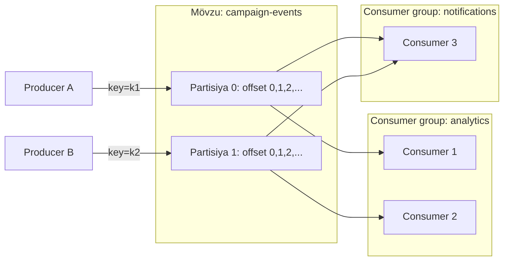
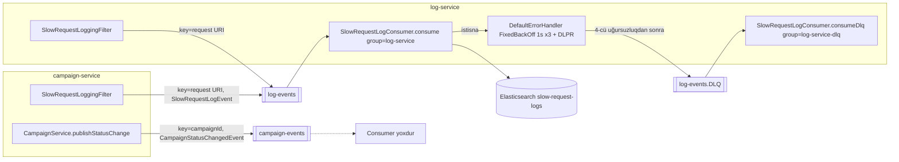
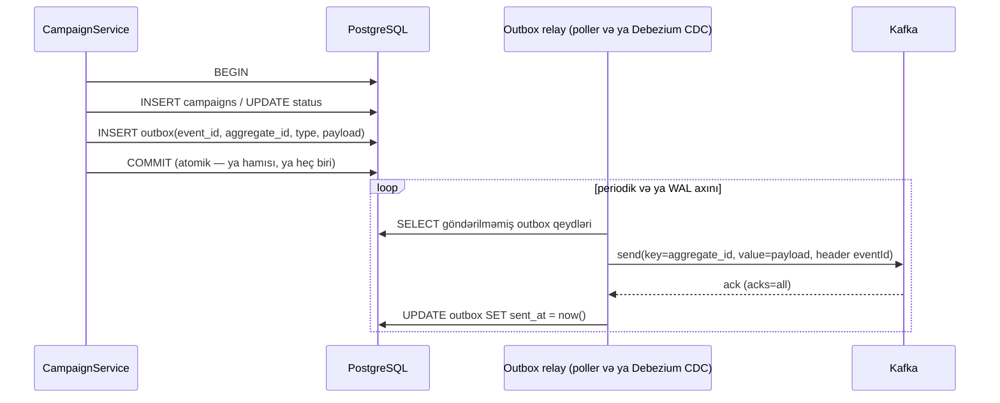

# 11. Apache Kafka — hadisə axını və asinxron mesajlaşma

Bu fəsil əvvəlcə Kafka-nı layihədən asılı olmadan öyrədir, sonra repozitoriyadakı hər Kafka inteqrasiyasını tam
izləyir, sonda yeni servisdə düzgün Kafka inteqrasiyasının necə qurulacağını göstərir.

## 11.1 Motivasiya: niyə mesaj brokeri?

campaign-service kampaniyanı yaradanda iki növ iş var: **əsas iş** (kampaniyanı saxlamaq) və **yan təsirlər**
(dashboard-un, analitikanın, bildiriş sisteminin bundan xəbər tutması; yavaş sorğuların jurnallaşdırılması). Yan
təsirləri sinxron HTTP ilə etsək:

- hər yeni maraqlanan servis campaign-service-də kod dəyişikliyi tələb edir (sıx bağlılıq);
- istehlakçı servis yavaşdırsa, kampaniya yaratma da yavaşlayır; düşürsə, ya xəta verir, ya da məlumat itir;
- yük pikləri birbaşa istehlakçıya ötürülür.

**Mesaj brokeri** producer-i consumer-dən ayırır: producer hadisəni davamlı (durable) jurnala yazır, consumer-lər öz
sürətləri ilə oxuyur. Kafka bunu **paylanmış, replikasiya olunan, yalnız sona yazılan jurnal** (distributed
append-only log) modeli ilə edir.

## 11.2 Əsas anlayışlar



| Anlayış | İzah |
|---|---|
| **Broker** | Kafka server prosesi; partisiyaları diskdə saxlayır və xidmət edir |
| **Cluster** | Brokerlər qrupu. Metadata-nı **KRaft** (Kafka Raft) controller-ləri idarə edir; Kafka 4.x-də ZooKeeper yoxdur |
| **Topic (mövzu)** | Məntiqi hadisə kateqoriyası, məs. `log-events` |
| **Partition** | Mövzunun sıralı, dəyişməz jurnal hissəsi. Paralelliyin və sıranın vahidi |
| **Offset** | Partisiya daxilində qeydin ardıcıl nömrəsi |
| **Replica** | Partisiyanın başqa brokerdəki nüsxəsi. Bir **leader** yazı/oxuya xidmət edir, **follower**-lər kopyalayır; sinxron olanlar **ISR** (in-sync replicas) |
| **Producer** | Qeyd (record) yazan klient |
| **Consumer** | Qeyd oxuyan klient |
| **Consumer group** | Eyni `group.id`-li consumer-lər; hər partisiya qrup daxilində **yalnız bir** consumer-ə təyin olunur. Fərqli qruplar eyni datanı müstəqil oxuyur |
| **Committed offset** | Qrupun partisiya üzrə "burada qaldım" işarəsi; `__consumer_offsets` daxili mövzusunda saxlanılır |
| **Retention** | Qeydlər oxunandan sonra silinmir; vaxt/ölçü siyasətinə görə saxlanılır — replay mümkündür |

**Sıra zəmanəti yalnız partisiya daxilindədir.** Eyni açarlı qeydlər (standart partitioner `murmur2(key) % partitions`
istifadə edir) eyni partisiyaya düşür və yazıldığı sırada oxunur. Mövzu səviyyəsində qlobal sıra yoxdur. Partisiya sayı
artırılarsa, açar → partisiya xəritəsi dəyişir və köhnə/yeni qeydlər üçün sıra pozula bilər.

## 11.3 Qeydin yazılması (producer daxilində)

Qeyd (record): **key**, **value**, **headers**, **timestamp**, hədəf mövzu (və istəyə görə partisiya).

Producer daxili axını: `send()` → serializer-lər → partitioner → yaddaşdakı partisiya üzrə **batch** (`batch.size`,
`linger.ms`) → fon `Sender` thread-i batch-ları brokerə göndərir → broker cavabı (`acks`) → callback/future.

| Parametr | Mənası | Kafka 4.x klient standartı [NƏTİCƏ] |
|---|---|---|
| `acks` | `0` gözləmə yox, `1` yalnız leader, `all` bütün ISR | `all` |
| `enable.idempotence` | Təkrar göndərmələrdə broker dublikatı aradan qaldırır (producer id + ardıcıllıq nömrəsi) | `true` |
| `retries`, `delivery.timeout.ms` | Müvəqqəti xətalarda təkrar; ümumi çatdırılma vaxt limiti | `Integer.MAX_VALUE`, 120 s |
| `linger.ms` | Batch dolması üçün gözləmə | 5 ms (Kafka 4.0-dan) |
| `max.block.ms` | `send()`-in metadata/bufer üçün **çağıran thread-də** bloklana biləcəyi maksimum vaxt | 60 s |
| `buffer.memory` | Göndərilməmiş qeydlər üçün yaddaş | 32 MB |

`max.block.ms` bu layihə üçün xüsusilə vacibdir (11.8-ə baxın).

**İdempotent producer** yalnız **bir producer sessiyası daxilində, şəbəkə təkrarlarından** yaranan dublikatları aradan
qaldırır. Tətbiq `send()`-i iki dəfə çağırarsa (məs. HTTP sorğusu təkrarlanarsa), iki ayrı qeyd yaranır.

**Tranzaksional producer** (`transactional.id`) bir neçə mövzuya yazmanı və consumer offset commit-ini atomik edir
(read-process-write). Consumer tərəfdə `isolation.level=read_committed` lazımdır. Bu, **Kafka daxilində**
exactly-once verir; xarici sistemə (PostgreSQL, Elasticsearch) yazma bu zəmanətə daxil deyil.

## 11.4 Qeydin oxunması (consumer daxilində)

Consumer `poll()` döngüsündə işləyir: brokerdən qeyd partiyası alır, emal edir, offset-i commit edir.

- **Qrup koordinasiyası və rebalans**: consumer qoşulanda/çıxanda və ya `max.poll.interval.ms` (standart 5 dəq) ərzində
  `poll()` çağırmadıqda qrup koordinatoru partisiyaları yenidən paylayır. Rebalans zamanı emal dayanır; commit olunmamış
  qeydlər yeni sahibinə yenidən verilir.
- **Offset commit**: avtomatik (`enable.auto.commit=true`, periodik) və ya manual. Spring Kafka konteyneri
  `enable.auto.commit`-i açıq təyin olunmayıbsa `false` edir və offset-i özü commit edir [FAKT] (spring-kafka 4.1.0
  `KafkaMessageListenerContainer`). Standart `AckMode.BATCH`: `poll()`-dan gələn bütün qeydlər listener tərəfindən emal
  olunduqdan sonra commit.
- **`auto.offset.reset`**: qrupun commit olunmuş offset-i yoxdursa haradan başlamalı — `latest` (standart, yalnız yeni
  qeydlər) və ya `earliest` (əvvəldən).

### Çatdırılma semantikası

| Semantika | Necə alınır | Nəticə |
|---|---|---|
| At-most-once | Emaldan **əvvəl** commit | Çökmədə qeyd itə bilər, dublikat yoxdur |
| At-least-once | Emaldan **sonra** commit (Spring standartı) | İtki yoxdur, çökmə/rebalans zamanı **dublikat** mümkündür |
| Exactly-once (Kafka daxilində) | Tranzaksional producer + `read_committed` | Yalnız Kafka→Kafka axınları üçün |
| Effektiv exactly-once (xarici sistemlə) | At-least-once + **idempotent consumer** | Tətbiq dizaynı ilə |

Praktiki qayda: **xarici yan təsiri olan consumer-lər idempotent olmalıdır** — eyni hadisəni iki dəfə emal etmək bir
dəfə emal etmək kimi nəticə verməlidir (təbii idempotent əməliyyat, deterministik id ilə upsert, emal olunmuş hadisə
id-lərinin cədvəli).

### Xətalar, təkrarlar, DLQ, "zəhərli" mesajlar

- **Müvəqqəti xəta** (DB düşüb): bir neçə dəfə backoff ilə təkrar.
- **Daimi xəta** (səhv data): təkrar mənasızdır — qeydi **dead-letter** mövzusuna köçürüb davam etmək.
- **Zəhərli mesaj (poison pill)**: deserializasiya oluna bilməyən qeyd. Əgər consumer onu keçə bilmirsə, partisiya
  tamamilə dayanır — çünki offset irəliləmir.
- **Sıra və təkrarlar**: bloklayan təkrar (eyni thread-də gözləmək) sıranı qoruyur, lakin partisiyanı saxlayır;
  bloklamayan təkrar (retry mövzuları) partisiyanı azad edir, sıranı pozur.

### Sxem uyğunluğu

Hadisə formatı producer-consumer kontraktıdır. Sahə əlavə etmək (consumer tanımadığı sahəni nəzərə almırsa) geriyə
uyğundur; sahənin adını dəyişmək və ya silmək deyil. Böyük sistemlərdə **Schema Registry** (Avro/Protobuf/JSON Schema)
uyğunluğu yazma anında yoxlayır. Bu layihədə sxem yalnız paylaşılan Java record-larıdır (`common/event`).

## 11.5 Spring Kafka komponentləri

| Komponent | Rolu |
|---|---|
| `ProducerFactory` / `DefaultKafkaProducerFactory` | Producer konfiqurasiyası, paylaşılan thread-safe `KafkaProducer` instansı |
| `KafkaTemplate` | `send(topic, key, value)` → `CompletableFuture<SendResult>` |
| `ConsumerFactory` | Consumer konfiqurasiyası |
| `@KafkaListener` | Metodu listener kimi qeydiyyatdan keçirir; `@EnableKafka` emal edir |
| `ConcurrentKafkaListenerContainerFactory` | Listener konteynerlərini (poll döngüsü, thread-lər, commit, xəta emalı) qurur |
| `DefaultErrorHandler` | Listener istisnasında qeydi yenidən emal üçün "seek" edir, backoff, sonra recoverer |
| `DeadLetterPublishingRecoverer` | Uğursuz qeydi DLT/DLQ mövzusuna istisna başlıqları ilə göndərir |
| `ErrorHandlingDeserializer` | Deserializasiya xətasını tutub qeydə əlavə edir ki, xəta handler-i onu emal edə bilsin |
| `JsonSerializer`/`JsonDeserializer` | Jackson 2 əsaslı JSON; spring-kafka 4.0-dan `@Deprecated(forRemoval = true)` — yerinə `JacksonJsonSerializer`/`JacksonJsonDeserializer` (Jackson 3) |

## 11.6 Layihədəki Kafka xəritəsi



| Mövzu | Producer | Açar | Dəyər | Consumer | Sübut |
|---|---|---|---|---|---|
| `campaign-events` | campaign-service | `campaignId.toString()` | `CampaignStatusChangedEvent` | **yoxdur** | `CampaignService.java:181-191` |
| `log-events` | campaign-service, log-service (filtr) | `request.getRequestURI()` | `SlowRequestLogEvent` | log-service, group `log-service` | `SlowRequestLoggingFilter.java:113-117`, `SlowRequestLogConsumer.java:35-47` |
| `log-events.DLQ` | `DeadLetterPublishingRecoverer` | orijinal açar | orijinal dəyər + istisna başlıqları | log-service, group `log-service-dlq` | `KafkaDlqConfiguration.java:26-33`, `SlowRequestLogConsumer.java:54-65` |

Mövzular kodda yaradılmır (`NewTopic` bean-i yoxdur); broker `KAFKA_AUTO_CREATE_TOPICS_ENABLE: 'true'` və
`KAFKA_NUM_PARTITIONS: 1` ilə avtomatik yaradır [FAKT] (`docker-compose.yml:322-323`). Deməli hər mövzunun 1
partisiyası və replication factor 1 var.

## 11.7 Producer tərəfi: `KafkaJsonConfiguration`

Fəsil 4-də şərti konfiqurasiya baxımından baxdıq; indi Kafka baxımından [FAKT]
(`KafkaJsonConfiguration.java:41-49`):

- Yalnız 4 parametr təyin olunur: `bootstrap.servers`, `StringSerializer` açar, `JsonSerializer` dəyər,
  `spring.json.add.type.headers=false`.
- Qalan hər şey Kafka klientinin standartlarıdır: `acks=all`, idempotentlik açıq, `max.block.ms=60000` və s.
- **Tip başlıqları söndürülüb**: `JsonSerializer` standart olaraq `__TypeId__` başlığına Java sinif adını yazır;
  consumer onu deserializasiya üçün istifadə edir. Söndürmək producer və consumer-i Java sinif adlarından ayırır (dil
  müstəqilliyi, paket adının dəyişməsinə dözümlülük), lakin consumer **standart tipi** bilməlidir — log-service bunu
  `spring.json.value.default.type` ilə edir.
- [NƏTİCƏ] `JsonSerializer` öz `ObjectMapper`-ini (`JacksonUtils.enhancedObjectMapper()`) yaradır: Java Time modulu
  qeydiyyatdan keçir, lakin `WRITE_DATES_AS_TIMESTAMPS` söndürülmür. Ona görə `Instant occurredAt` JSON-da ədədi
  epoch dəyəri kimi (`1767000000.123456789`) yazılır, HTTP API-lərdəki ISO sətrindən fərqli. Hər iki tərəf eyni
  kitabxanadan istifadə etdiyi üçün uyğundur; başqa dildə consumer üçün bu sənədləşdirilməlidir.
  `common/pom.xml:32-35`-dəki `jackson-datatype-jsr310` asılılığı məhz bu modulun classpath-də olması üçündür.
- Spring Boot-un Kafka auto-configuration-u campaign-service-də yoxdur, log-service-də isə `KafkaTemplate`/`ProducerFactory`
  üçün geri çəkilir. [NƏTİCƏ] Nəticədə producer-də Micrometer metrikləri (`MicrometerProducerListener`) və observation
  (trace başlıqları) aktiv deyil; trace əlaqəsi əvəzinə `SlowRequestLogEvent.traceId` sahəsi payload-da ötürülür.

### `campaign-events` — biznes hadisəsi

<!-- src: campaign-service/src/main/java/com/casestudy/insurancecampaign/campaign/service/CampaignService.java:181-191 -->
```java
private void publishStatusChange(UUID campaignId, CampaignCategory category, CampaignStatus previousStatus, CampaignStatus newStatus, String reason) {
    CampaignStatusChangedEvent event = new CampaignStatusChangedEvent(
            campaignId,
            category.name(),
            previousStatus == null ? null : previousStatus.name(),
            newStatus.name(),
            reason,
            Instant.now()
    );
    kafkaTemplate.send(campaignEventsTopic, campaignId.toString(), event);
}
```

- **Açar = kampaniya id-si** — doğru seçimdir: bir kampaniyanın bütün hadisələri eyni partisiyaya düşür və sıra ilə
  oxunur (`CREATED → Campaign approved → Campaign deactivated`).
- **Hadisədə `eventId` yoxdur** — istehlakçı dublikatı aşkar edə bilmir (idempotentlik üçün `campaignId + newStatus`
  istifadə oluna bilər, çünki keçidlər təkrarlanmır, lakin bu, kontraktda açıq yazılmayıb).
- **`reason` sahəsi qeyri-ardıcıldır** [FAKT]: yaratmada `"CREATED"`, keçidlərdə `"Campaign approved"` kimi insan
  oxuyacağı mətn (`CampaignService.java:72` və `:99`, `:110`). Hadisə kontraktında maşın tərəfindən oxunan `eventType`
  (`CAMPAIGN_CREATED`, `CAMPAIGN_APPROVED`) daha yaxşı olardı.
- **Nəticə yoxlanmır** — `send()` `CompletableFuture` qaytarır, kod onu nəzərə almır (fire-and-forget). Xəta yalnız
  `KafkaTemplate`-in standart `LoggingProducerListener`-i ilə loglanır.
- **Consumer yoxdur** (F12) — [NAMƏLUM] gələcək və ya repozitoriyadan kənar istehlakçı nəzərdə tutula bilər.

### `log-events` — yavaş sorğu jurnalı

<!-- src: common/src/main/java/com/casestudy/insurancecampaign/common/web/SlowRequestLoggingFilter.java:88-120 -->
```java
@Override
protected void doFilterInternal(HttpServletRequest request, HttpServletResponse response, FilterChain filterChain)
        throws ServletException, IOException {
    long start = System.nanoTime();

    try {
        filterChain.doFilter(request, response);
    } finally {
        long durationMs = (System.nanoTime() - start) / 1_000_000;

        if (durationMs > thresholdMs) {
            SlowRequestLogEvent event = new SlowRequestLogEvent(
                    applicationName,
                    request.getMethod(),
                    request.getRequestURI(),
                    response.getStatus(),
                    durationMs,
                    Optional.ofNullable(MDC.get("traceId")).orElse("N/A"),
                    Map.of(
                            "user-agent", Optional.ofNullable(request.getHeader("User-Agent")).orElse("N/A"),
                            "x-forwarded-for", Optional.ofNullable(request.getHeader("X-Forwarded-For")).orElse("N/A")
                    ),
                    Instant.now()
            );

            KafkaTemplate<String, Object> kafkaTemplate = kafkaTemplateProvider.getIfAvailable();

            if (kafkaTemplate != null) {
                kafkaTemplate.send(topicName, request.getRequestURI(), event);
            }
        }
    }
}
```

- `System.nanoTime()` monoton saatdır — müddət ölçmək üçün düzgün seçim (`currentTimeMillis` saat düzəlişlərindən
  təsirlənir).
- `finally` — istisna olsa belə ölçülür.
- `shouldNotFilter` actuator, Swagger və OpenAPI yollarını istisna edir (`:67-74`) — Prometheus scrape-ləri Kafka-ya
  yazılmır.
- Həd 5 ms-dir (F25) — praktikada demək olar ki, hər sorğu "yavaş" sayılır və Kafka-ya gedir. Bu, case study-də Kafka
  axınını göstərmək üçündür; istehsalda həd p95/p99 gecikmə əsasında (məs. 500 ms–1 s) seçilməlidir.
- Açar sorğu yoludur. 1 partisiyada fərq etmir; çox partisiyada populyar yollar (`/api/v1/campaigns`) "isti
  partisiya" (hot partition) yarada bilər.
- `traceId` MDC-dən oxunur — Micrometer Tracing bu açarı MDC-yə yazır; log faylı, Tempo trace-i və Elasticsearch
  qeydi bu id ilə əlaqələndirilə bilər.

## 11.8 Producer uğursuzluq ssenariləri (F09, F10)

**Kafka brokeri əlçatmazdır** [NƏTİCƏ, Kafka producer semantikasına əsasən]:
1. `send()` mövzu metadata-sı olmadan partisiya seçə bilmir və metadata üçün çağıran thread-də `max.block.ms`
   (60 s) qədər gözləyir.
2. `SlowRequestLoggingFilter` bunu `finally` blokunda, cavab klientə tam ötürülməmiş ola bilən anda edir — klient
   gecikmə görür.
3. `CampaignService.create/approve/deactivate` bunu **açıq DB tranzaksiyası daxilində** edir: DB bağlantısı və sətir
   kilidləri 60 s tutulur; HikariCP hovuzu (10) tez tükənir (fəsil 7.8).
4. 60 s sonra göndəriş uğursuz future ilə bitir, hadisə **itir**, yalnız log qalır; DB tranzaksiyası isə commit olunur.

**Commit uğursuz olur, hadisə artıq göndərilib** — fəsil 6.3: hadisə tarixçə INSERT-indən və commit-dən əvvəl
göndərilir. Consumer mövcud olmayan vəziyyət haqqında hadisə alar.

Bu iki ssenari birlikdə **dual-write problemi**dir: iki müstəqil sistemə (DB və Kafka) atomik yazmaq mümkün deyil.

### Həll: Transactional Outbox



Outbox at-least-once verir (relay göndərib commit etməzdən əvvəl çöksə, təkrar göndərər), ona görə consumer-lər
`eventId` ilə idempotent olmalıdır. Daha yüngül alternativ: `@TransactionalEventListener(phase = AFTER_COMMIT)` ilə
hadisəni commit-dən sonra göndərmək — commit olunmamış hadisə problemini həll edir, lakin commit-dən sonra proses
çökərsə hadisə itir.

## 11.9 Consumer tərəfi: log-service

### Konfiqurasiya

<!-- src: log-service/src/main/resources/application.yml:8-16 -->
```yaml
kafka:
  bootstrap-servers: ${KAFKA_BOOTSTRAP_SERVERS:localhost:9092}
  consumer:
    group-id: log-service
    key-deserializer: org.apache.kafka.common.serialization.StringDeserializer
    value-deserializer: org.springframework.kafka.support.serializer.JsonDeserializer
    properties:
      spring.json.trusted.packages: com.casestudy.insurancecampaign.*
      spring.json.value.default.type: com.casestudy.insurancecampaign.common.event.SlowRequestLogEvent
```

- `spring.json.trusted.packages` — `JsonDeserializer` tip başlığından gələn sinfi yalnız etibarlı paketlərdən yaradır
  (ixtiyari sinfin deserializasiyası təhlükəsizlik riskidir). Burada tip başlığı yoxdur, standart tip istifadə olunur.
- `spring.json.value.default.type` — bütün qeydlər `SlowRequestLogEvent` kimi oxunur. [NƏTİCƏ] Bu o deməkdir ki, eyni
  consumer factory ilə başqa tipli mövzu oxumaq olmaz; DLQ listener-i də eyni tipi alır.
- `auto-offset-reset` lokal faylda yoxdur; Config Server-in paylaşılan faylında `earliest`-dir (F32).

### Listener-lər

<!-- src: log-service/src/main/java/com/casestudy/insurancecampaign/log/service/SlowRequestLogConsumer.java:35-65 -->
```java
@KafkaListener(topics = "${app.kafka.topics.log-events:log-events}", groupId = "log-service")
public void consume(SlowRequestLogEvent event) {
    repository.save(new SlowRequestDocument(
            event.serviceName(),
            event.method(),
            event.path(),
            event.status(),
            event.durationMs(),
            event.traceId(),
            event.headers(),
            event.occurredAt()
    ));
}

// ... (buraxılıb: Javadoc)
@KafkaListener(topics = "${app.kafka.topics.log-events:log-events}.DLQ", groupId = "log-service-dlq")
public void consumeDlq(ConsumerRecord<String, Object> record) {
    log.error(
            "DLQ message received. topic={}, partition={}, offset={}, key={}, value={}, headers={}",
            record.topic(),
            record.partition(),
            record.offset(),
            record.key(),
            record.value(),
            headersAsString(record)
    );
}
```

- Mövzu adı property placeholder ilə həll olunur; DLQ mövzusu `${...}.DLQ` — sətir birləşməsi ilə.
- `groupId` annotasiyada açıq verilib, yml-dəki `group-id`-ni üstələyir. Testlərdə `spring.kafka.consumer.group-id=log-service-test`
  təyin edilir, lakin annotasiya bunu əvəzləyir — test listener-ləri onsuz da `auto-startup=false`-dur.
- DLQ consumer-i **ayrı qrupdadır** — DLQ oxunması əsas axının offset-lərinə təsir etmir.
- **Consumer idempotent deyil** [FAKT/NƏTİCƏ]: `SlowRequestDocument` hər dəfə yeni `UUID.randomUUID()` id alır
  (`SlowRequestDocument.java:31-41`). Eyni Kafka qeydi təkrar çatdırılarsa (rebalans, çökmə, retry), Elasticsearch-də
  dublikat sənəd yaranır. Düzəliş: deterministik id, məs. `topic-partition-offset` və ya hadisədə `eventId`.

### Xəta emalı və DLQ

<!-- src: log-service/src/main/java/com/casestudy/insurancecampaign/log/config/KafkaDlqConfiguration.java:26-51 -->
```java
@Bean
public DefaultErrorHandler defaultErrorHandler(KafkaTemplate<String, Object> kafkaTemplate) {
    DeadLetterPublishingRecoverer recoverer = new DeadLetterPublishingRecoverer(
            kafkaTemplate,
            (ConsumerRecord<?, ?> record, Exception exception) -> new TopicPartition(record.topic() + ".DLQ", record.partition())
    );
    return new DefaultErrorHandler(recoverer, new FixedBackOff(1_000L, 3));
}

// ... (buraxılıb: Javadoc)
@Bean
public ConcurrentKafkaListenerContainerFactory<String, Object> kafkaListenerContainerFactory(
        ConsumerFactory<String, Object> consumerFactory,
        DefaultErrorHandler defaultErrorHandler
) {
    ConcurrentKafkaListenerContainerFactory<String, Object> factory = new ConcurrentKafkaListenerContainerFactory<>();
    factory.setConsumerFactory(consumerFactory);
    factory.setCommonErrorHandler(defaultErrorHandler);
    return factory;
}
```

Davranış addım-addım [NƏTİCƏ, spring-kafka semantikası]:

1. Listener istisna atır (məs. Elasticsearch əlçatmazdır → `DataAccessResourceFailureException`).
2. `DefaultErrorHandler` uğursuz qeydin offsetinə (və qalan qeydlərin offsetlərinə) **seek** edir və backoff qədər
   (1 s) consumer thread-ini gözlədir; növbəti `poll()` eyni qeydi yenidən verir.
3. `FixedBackOff(1000, 3)`: **3 təkrar** — cəmi 4 cəhd (ilkin + 3), təxminən 3 s gözləmə.
4. Son cəhd də uğursuzdursa, `DeadLetterPublishingRecoverer` qeydi `log-events.DLQ` mövzusunun **eyni nömrəli
   partisiyasına** göndərir və başlıqlara orijinal mövzu/partisiya/offset, istisna sinfi, mesaj və stack trace əlavə edir;
   sonra offset irəliləyir.
5. DLQ consumer-i qeydi ERROR səviyyəsində loglayır (yenidən emal etmir).

Kompromislər:
- **Bloklayan retry** — 4 cəhd ərzində partisiya dayanır, sıra qorunur. 3 s qısa olduğu üçün `max.poll.interval.ms`
  problemi yoxdur.
- **DLQ partisiya sayı** — destination resolver orijinal partisiya nömrəsini istifadə edir; DLQ mövzusunun partisiyası
  azdırsa, göndəriş uğursuz olar. Avtomatik yaradılmış hər iki mövzunun 1 partisiyası var — işləyir, lakin mövzular
  açıq yaradılsa bu asılılıq yadda saxlanmalıdır.
- **Bütün istisnalar təkrar olunur** — `IllegalArgumentException` kimi daimi xətalar da 3 dəfə təkrarlanır.
  `defaultErrorHandler.addNotRetryableExceptions(...)` ilə ayırmaq olar.
- **Xüsusi konteyner factory-si Boot-un konfiqurasiyasını əvəzləyir** — `spring.kafka.listener.*` xassələri
  (concurrency, ack-mode, observation) bu factory-yə tətbiq olunmur, çünki Boot-un `ConcurrentKafkaListenerContainerFactoryConfigurer`-i
  istifadə edilmir. [NƏTİCƏ] `spring.kafka.listener.auto-startup=false` (testlərdə) da buna görə tətbiq olunmaya bilər;
  testlərin heç biri listener-in işləməsindən asılı deyil.

### Deserializasiya xətası — ən təhlükəli boşluq (F11)

`JsonDeserializer` birbaşa value deserializer kimi konfiqurasiya olunub, `ErrorHandlingDeserializer` ilə bükülməyib.
[FAKT, spring-kafka 4.1.0 mənbəsi] Səhv JSON gəldikdə:
- istisna listener-də deyil, `KafkaConsumer.poll()` daxilində yaranır (`RecordDeserializationException`, `SerializationException`-ın alt sinfi);
- konteyner onu `CommonErrorHandler.handleOtherException`-a ötürür;
- `DefaultErrorHandler.handleOtherException` `SerializationException` üçün `IllegalStateException("This error handler
  cannot process 'SerializationException's directly; please consider configuring an 'ErrorHandlingDeserializer'...")` atır;
- `KafkaMessageListenerContainer.handleConsumerException` bunu "Consumer exception" kimi loglayır və döngü davam edir;
- növbəti `poll()` **eyni offsetdən** başlayır → eyni xəta → sonsuz döngü. Partisiya bloklanır, log daşır, DLQ boş qalır.

Düzəliş:

```yaml
spring.kafka.consumer:
  value-deserializer: org.springframework.kafka.support.serializer.ErrorHandlingDeserializer
  properties:
    spring.deserializer.value.delegate.class: org.springframework.kafka.support.serializer.JacksonJsonDeserializer
```

Bu halda xəta qeydə "əlavə edilir", listener çağırılmadan `DefaultErrorHandler` onu dərhal (deserializasiya xətası
standart olaraq təkrarlanmayan sayılır) DLQ-ya göndərir.

## 11.10 Broker konfiqurasiyası (Docker Compose)

[FAKT] (`docker-compose.yml:300-335`):

| Parametr | Dəyər | Mənası |
|---|---|---|
| `KAFKA_PROCESS_ROLES` | `broker,controller` | KRaft "combined" rejimi — bir proses həm broker, həm controller (yalnız dev üçün) |
| `KAFKA_LISTENERS` | `CONTROLLER://:9093, PLAINTEXT_HOST://:9092, PLAINTEXT://:19092` | Üç dinləyici |
| `KAFKA_ADVERTISED_LISTENERS` | `PLAINTEXT_HOST://localhost:9092, PLAINTEXT://kafka:19092` | Klientlərə qaytarılan ünvanlar |
| `KAFKA_INTER_BROKER_LISTENER_NAME` | `PLAINTEXT` | Brokerlər arası trafik |
| `*_REPLICATION_FACTOR`, `*_MIN_ISR` | 1 | Tək broker |
| `KAFKA_AUTO_CREATE_TOPICS_ENABLE` | true | İlk istifadədə mövzu yaranır |
| `KAFKA_NUM_PARTITIONS` | 1 | Avtomatik mövzuların partisiya sayı |

**Niyə iki dinləyici?** Klient əvvəlcə `bootstrap.servers` ilə qoşulur, sonra broker ona **advertised** ünvanı
qaytarır və klient sonrakı bütün bağlantıları həmin ünvana açır. Host-dakı IDE üçün bu `localhost:9092`, konteynerlər
üçün `kafka:19092` olmalıdır (konteyner daxilində `localhost` konteynerin özüdür). Buna görə Compose servisləri
`KAFKA_BOOTSTRAP_SERVERS: kafka:19092` istifadə edir. Bu, Docker-də Kafka ilə ən çox rast gəlinən səhvin həllidir.

**Kafka UI** (`kafbat/kafka-ui`, 8090) mövzuları, mesajları, consumer group-ları və lag-ı göstərir.

## 11.11 Konfiqurasiyanın mənbədən istehlakçıya izlənməsi

| Dəyər | Mənbə | İstehlakçı |
|---|---|---|
| `KAFKA_BOOTSTRAP_SERVERS=kafka:19092` | Compose env | `spring.kafka.bootstrap-servers` → campaign: `KafkaJsonConfiguration.producerFactory` (`@Value`); log: Boot `KafkaProperties` (consumer) + `KafkaJsonConfiguration` (producer) |
| `app.kafka.topics.campaign-events` | `campaign-service/src/main/resources/application.yml:82` | `CampaignService` konstruktoru (`@Value`) |
| `app.kafka.topics.log-events` | `application.yml` (campaign, log, config-server) | `SlowRequestLoggingFilter` (`@Value`), `@KafkaListener(topics = "${...}")` |
| `spring.kafka.consumer.*` | `log-service/src/main/resources/application.yml:10-16` | Boot `DefaultKafkaConsumerFactory` |
| `spring.kafka.consumer.auto-offset-reset=earliest` | Config Server paylaşılan fayl | log-service consumer (yalnız Config Server əlçatan olduqda) |

## 11.12 Yeni servisdə Kafka inteqrasiyası: tövsiyə olunan şablon

İllüstrativ nümunə (repozitoriyada yoxdur):

```java
// 1) Mövzuları açıq elan edin (partisiya, replika, saxlama)
@Bean NewTopic campaignEvents() {
    return TopicBuilder.name("campaign-events").partitions(6).replicas(3)
            .config(TopicConfig.MIN_IN_SYNC_REPLICAS_CONFIG, "2").build();
}

// 2) Hadisə zərfi: eventId, type, version, occurredAt, payload
public record EventEnvelope<T>(UUID eventId, String type, int version, Instant occurredAt, T payload) {}

// 3) Producer: idempotent, acks=all (standart), qısa max.block.ms, outbox relay-dən göndəriş
spring.kafka.producer.properties.max.block.ms: 5000

// 4) Consumer: ErrorHandlingDeserializer + JacksonJsonDeserializer, idempotent emal
@KafkaListener(topics = "campaign-events", groupId = "dashboard-read-model")
@Transactional
public void on(EventEnvelope<CampaignStatusChanged> e) {
    if (processedEvents.existsById(e.eventId())) return;          // dublikat
    readModel.apply(e.payload());
    processedEvents.save(new ProcessedEvent(e.eventId()));         // eyni DB tranzaksiyası
}

// 5) Xəta emalı: eksponensial backoff, təkrarlanmayan istisnalar, DLT
@Bean DefaultErrorHandler errorHandler(KafkaOperations<Object, Object> template) {
    var handler = new DefaultErrorHandler(new DeadLetterPublishingRecoverer(template),
            new ExponentialBackOffWithMaxRetries(5));
    handler.addNotRetryableExceptions(IllegalArgumentException.class, ValidationException.class);
    return handler;
}
```

Test: Testcontainers Kafka + Awaitility ilə "hadisə göndər → consumer nəticəsini gözlə"; DLQ ssenarisi üçün səhv
mesaj göndərib DLQ mövzusunu oxumaq. Bu layihədə belə test yoxdur (fəsil 19).

## 11.13 Troubleshooting

| Simptom | Ehtimal olunan səbəb | Diaqnostika | Həll |
|---|---|---|---|
| Servis sorğuları ~60 s gecikir | Kafka əlçatmaz, `send()` metadata gözləyir | Log: `TimeoutException ... not present in metadata after 60000 ms` | Brokeri qaldırmaq; `max.block.ms`-i azaltmaq; göndərişi request thread-indən çıxarmaq |
| log-service eyni xətanı sonsuz loglayır | Poison pill + `ErrorHandlingDeserializer` yoxdur | Log: "cannot process 'SerializationException's" | `ErrorHandlingDeserializer`; offset-i əl ilə keçmək (`kafka-consumer-groups.sh --reset-offsets --shift-by 1`) |
| Elasticsearch-də dublikat sənədlər | Təkrar çatdırılma + random id | Eyni `traceId`/`occurredAt` ilə iki sənəd | Deterministik id |
| Consumer lag böyüyür | Yavaş emal, ES gecikməsi | `kafka-consumer-groups.sh --describe --group log-service`, Kafka UI | Partisiya + concurrency artırmaq, batch listener, bulk indexing |
| Yeni consumer group köhnə mesajları oxumur | `auto-offset-reset=latest` (Config Server əlçatmaz) | Startup log-da effektiv `auto.offset.reset` | Lokal konfiqurasiyada açıq təyin etmək |
| IDE-dən qoşulanda `kafka:19092` tapılmır | Səhv advertised listener | `kafka-broker-api-versions.sh` | `localhost:9092` istifadə |
| DLQ-ya göndəriş uğursuz | DLQ-da partisiya çatmır | Producer xətası | DLQ mövzusunu eyni partisiya sayı ilə yaratmaq |

## 11.14 Praktiki tapşırıqlar

Tapşırıqları öz fork-unuzda, ayrıca branch-da edin. Çətinlik: ★ — 30 dəqiqəyə qədər, ★★ — bir neçə saat, ★★★ — təxminən bir gün. "Gözlənilən nəticə" koddan çıxardığım proqnozdur; sizdə fərqli çıxarsa, səbəbini tapmaq tapşırığın ən dəyərli hissəsidir.

**T1 ★ — Hadisələri canlı izləyin.** `kafka-console-consumer.sh --bootstrap-server localhost:9092 --topic campaign-events
--from-beginning --property print.key=true` işlədin və kampaniya yaradıb approve edin. **Yoxlama:** hər əməliyyat üçün
açarı kampaniya id-si olan bir JSON hadisəsi görünür.

**T2 ★★ — Poison pill (F11).** Yalnız lokal mühitdə `kafka-console-producer.sh --topic log-events` ilə `not-json`
göndərin; log-service loglarına və `kafka-consumer-groups.sh --describe --group log-service` lag-ına baxın.
**Gözlənilən nəticə:** təkrarlanan deserializasiya xətası, artan lag, boş DLQ. Sonra 11.9-dakı `ErrorHandlingDeserializer`
konfiqurasiyasını tətbiq edib təkrarlayın — mesaj `log-events.DLQ`-a düşməlidir.

**T3 ★★ — Bloklanmanı ölçün (F10).** `docker compose stop kafka`, sonra birbaşa campaign-service-ə (8082, rate limit-siz)
kampaniya yaradın və müddəti ölçün. **Gözlənilən nəticə:** təxminən 60 saniyə. `KafkaJsonConfiguration`-da
`ProducerConfig.MAX_BLOCK_MS_CONFIG` = 2000 verib təkrarlayın.

**T4 ★★★ — Outbox.** `campaign-events` üçün outbox cədvəli və relay yazın (22.6). **Yoxlama:** rollback olunan
əməliyyat hadisə yaratmır; commit olunan əməliyyat tam bir hadisə yaradır; Kafka dayananda yazılar bloklanmır.

## 11.15 Müsahibə sualları

**S1. Kafka-da sıra zəmanəti haradadır və açar seçimi niyə vacibdir?**
Cavab: Yalnız partisiya daxilində. Eyni açarlı qeydlər eyni partisiyaya düşür, ona görə bir obyektin hadisələrini
sıralı saxlamaq üçün açar həmin obyektin id-si olmalıdır — layihədə `campaignId`. Partisiya sayının dəyişməsi açar
xəritəsini dəyişir.

**S2. At-least-once nə deməkdir və consumer-dən nə tələb edir?**
Cavab: Hər qeyd ən azı bir dəfə emal olunur; çökmə və rebalans zamanı təkrar ola bilər, çünki offset emaldan sonra
commit olunur. Consumer idempotent olmalıdır. log-service-in consumer-i idempotent deyil — dublikat ES sənədləri
yaranır.

**S3. Bu layihədə `kafkaTemplate.send()`-in tranzaksiya daxilində çağırılmasının iki riskini deyin.**
Cavab: (1) Hadisə commit-dən əvvəl göndərilir — commit uğursuz olsa, mövcud olmayan dəyişiklik haqqında hadisə
yayılır; send uğursuz olsa, DB dəyişikliyi qalır, hadisə itir (dual-write). (2) Kafka əlçatmaz olduqda `send()`
`max.block.ms` qədər bloklayır, DB bağlantısını və kilidləri tutur, bağlantı hovuzunu tükəndirir.

**S4. Transactional Outbox necə işləyir?**
Cavab: Biznes dəyişikliyi və hadisə qeydi eyni DB tranzaksiyasında `outbox` cədvəlinə yazılır. Ayrı relay (poller və ya
CDC, məs. Debezium) commit olunmuş qeydləri Kafka-ya göndərir və işarələyir. Atomiklik DB tranzaksiyası ilə təmin olunur;
çatdırılma at-least-once-dir, consumer-lər `eventId` ilə idempotent olur.

**S5. Poison pill nədir və bu layihədə nə baş verər?**
Cavab: Consumer-in heç vaxt emal edə bilmədiyi mesaj. Burada deserializasiya xətası `ErrorHandlingDeserializer`
olmadan poll səviyyəsində baş verir; `DefaultErrorHandler` onu emal edə bilmir, konteyner eyni offseti təkrar oxuyur
və partisiya dayanır. DLQ işə düşmür.

**S6. `FixedBackOff(1000, 3)` neçə cəhd deməkdir?**
Cavab: İlkin cəhd + 3 təkrar = 4 cəhd, aralarında 1 s. Sonra recoverer (DLQ).

**S7. Consumer group-un iki fərqli istifadəsini nümunə ilə izah edin.**
Cavab: Eyni qrupda bir neçə instans — yükün bölüşdürülməsi (hər partisiya bir instansa). Fərqli qruplar — eyni
hadisələrin müstəqil istehlakı (log-service əsas mövzunu `log-service` qrupu ilə, DLQ-nu `log-service-dlq` qrupu ilə
oxuyur; gələcəkdə `campaign-events`-i analitika və dashboard ayrı qruplarla oxuya bilər).

**S8. Exactly-once Kafka-da nə vaxt həqiqətən mümkündür?**
Cavab: Kafka-dan oxuyub Kafka-ya yazan axınlarda, tranzaksional producer və `read_committed` consumer ilə. Xarici
sistemə yazma (DB, ES, HTTP) üçün exactly-once zəmanəti yoxdur — at-least-once + idempotentlik və ya outbox/inbox
nümunələri ilə "effektiv bir dəfə" əldə edilir.

**S9. `ADD_TYPE_INFO_HEADERS=false`-ın üstünlüyü və bədəli?**
Cavab: Producer Java sinif adlarını mesaja yazmır — kontrakt dil və paketdən asılı olmur, refaktorinq consumer-i
sındırmır. Bədəli: consumer hədəf tipi özü bilməlidir (`value.default.type`), bir mövzuda bir neçə hadisə tipi
saxlamaq çətinləşir.

## 11.16 Xülasə

- Kafka paylanmış jurnaldır: mövzu → partisiya → offset; sıra partisiya daxilindədir; consumer group-lar yükü bölür və
  müstəqil istehlak edir.
- Layihədə üç mövzu: `campaign-events` (consumer-siz biznes hadisəsi), `log-events` (yavaş sorğular → Elasticsearch),
  `log-events.DLQ`.
- Producer: JSON, tip başlıqsız, fire-and-forget, tranzaksiya daxilində — dual-write və bloklanma riskləri.
- Consumer: at-least-once, 4 cəhd + DLQ; `ErrorHandlingDeserializer` yoxdur (poison pill), idempotent deyil.
- Növbəti fəsil yavaş sorğu və audit qeydlərinin saxlandığı Elasticsearch-i öyrədir.
