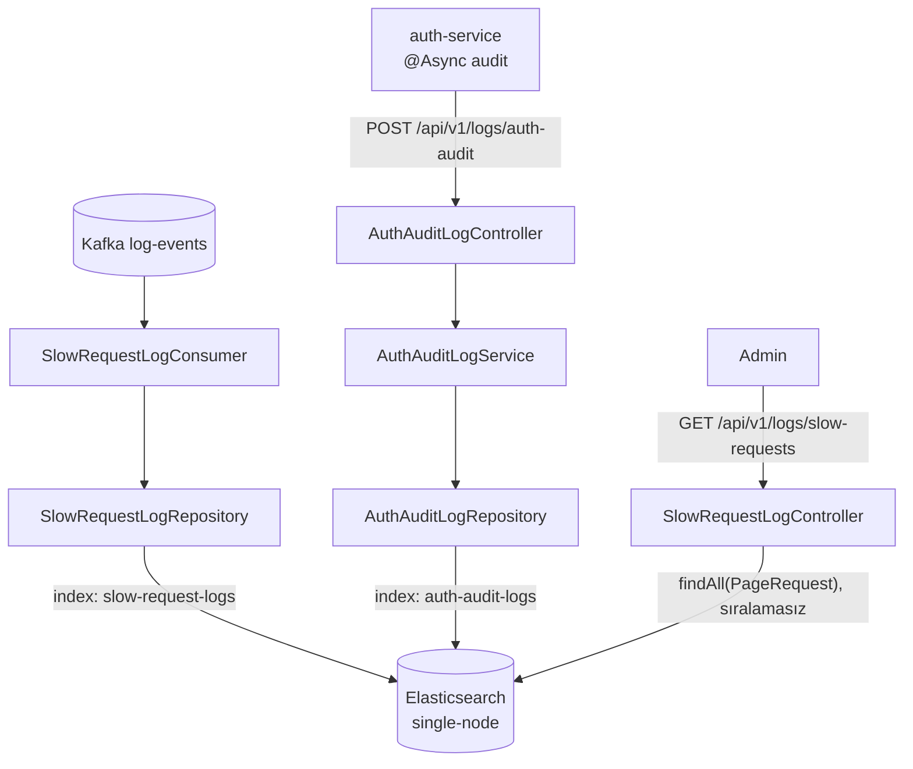

# 12. Elasticsearch — axtarış yönümlü saxlama

## 12.1 Motivasiya: niyə relyasiya bazası deyil?

Yavaş sorğu və audit qeydləri **çox yazılan, nadir dəyişən, zamanla sıralanan, sərbəst mətnlə və müxtəlif sahələrlə
axtarılan** datadır: "son bir saatda campaign-service-də 500 ms-dən uzun POST sorğuları", "demo istifadəçisinin
uğursuz login cəhdləri", "mesajında 'expired' sözü olan audit qeydləri". Relyasiya bazası bunu edə bilər, lakin:

- sərbəst mətn axtarışı (`LIKE '%...%'`) indeks istifadə etmir və relevansa görə sıralamır;
- hər yeni axtarış ölçüsü üçün yeni indeks lazımdır;
- milyonlarla jurnal qeydinin üfüqi miqyaslanması çətindir.

**Elasticsearch** (Apache Lucene üzərində qurulmuş paylanmış axtarış və analitika mühərriki) sənəd (JSON) saxlayır,
hər sahəni avtomatik indeksləyir, tam mətn axtarışı, filtrləmə, aqreqasiya və üfüqi miqyaslanma verir. Bədəli:
tranzaksiyalar, join-lər və güclü ardıcıllıq yoxdur; yeni yazılan sənəd dərhal deyil, **refresh**-dən sonra görünür.

## 12.2 Əsas anlayışlar

| Anlayış | İzah | Relyasiya analoqu (təqribi) |
|---|---|---|
| Cluster / node | Serverlər qrupu / bir server | DB serveri |
| Index | Sənədlər kolleksiyası + mapping + parametrlər | Cədvəl |
| Document | JSON obyekti, `_id` ilə | Sətir |
| Mapping | Sahələrin tipləri və analiz qaydaları | Sxem |
| Shard | İndeksin hissəsi (Lucene indeksi); primary + replica | Partisiya |
| Refresh | Yazılanların axtarışa açıq olması (standart ~1 s) | — |
| `_source` | Orijinal JSON-un saxlanılan nüsxəsi | — |

### İnverted index və analiz

Lucene-in əsası **inverted index**-dir: hər **term** (söz) üçün onu ehtiva edən sənədlərin siyahısı.

```text
Sənəd 1: "Login completed successfully"
Sənəd 2: "Invalid username/email or password"

Analiz (standard analyzer): tokenizer sözlərə bölür, lowercase filtri kiçik hərfə çevirir
  1 → [login, completed, successfully]
  2 → [invalid, username, email, or, password]

Inverted index:
  completed → [1]     email → [2]     invalid → [2]     login → [1]
  or → [2]            password → [2]  successfully → [1] username → [2]
```

`"password"` axtarışı lüğətdə term-i tapır və sənəd siyahısını dərhal qaytarır — cədvəli skan etmir.

**Sahə tipləri:**

| Tip | Analiz | Nə üçün | Sıralama/aqreqasiya |
|---|---|---|---|
| `text` | Bəli (tokenize, lowercase) | Tam mətn axtarışı | Xeyr (fielddata olmadan) |
| `keyword` | Xeyr, dəyər olduğu kimi | Dəqiq uyğunluq, filtr, sıralama, aqreqasiya | Bəli (doc_values) |
| `date` | — | Vaxt aralığı sorğuları | Bəli |
| `long`, `integer` | — | Rəqəm, aralıq | Bəli |
| `object` | — | İç-içə sahələr (hər alt sahə ayrı sahədir) | — |

**Dinamik mapping**: mapping-də olmayan sahə ilk dəfə gəldikdə ES tipini təxmin edir. Sətir üçün standart nəticə:
`text` + `keyword` alt sahəsi (`field.keyword`, `ignore_above: 256`); tam ədəd → `long`; JSON obyekti → `object` və
onun hər açarı ayrıca sahə. Rahatdır, lakin səhv tip təxmini və **mapping partlaması** (çoxlu fərqli açar → çoxlu sahə)
riski var.

### Sorğular

- **Query context** — "nə qədər uyğundur?" — relevans balı (**BM25**: term tezliyi, tərs sənəd tezliyi, sahə uzunluğu).
- **Filter context** — "uyğundurmu, bəli/xeyr?" — bal hesablanmır, nəticə cache-lənir. `bool.filter`, `term`, `range`.
- Tipik jurnal axtarışı: `bool { filter: [term serviceName, range occurredAt, range durationMs] }` + `sort: occurredAt desc`.

**Səhifələmə**: `from/size` sadədir, lakin `from + size ≤ index.max_result_window` (standart 10 000). Dərin səhifələmə
üçün `search_after` (+ Point-in-Time).

**İndeks həyat dövrü**: jurnal datası üçün vaxt əsaslı indekslər və ya **data stream**-lər, **ILM** (hot → warm →
delete), **rollover**. Mapping dəyişikliyi (sahə tipini dəyişmək) mövcud indeksdə mümkün deyil — yeni indeks yaradılıb
**reindex** edilir, **alias** ilə klientlər yeni indeksə keçirilir.

## 12.3 Spring Data Elasticsearch və klient

[FAKT] Asılılıq ağacı: `spring-boot-starter-data-elasticsearch` → Spring Data Elasticsearch **6.1.0** → rəsmi
**Elasticsearch Java Client 9.4.2** (`co.elastic.clients:elasticsearch-java`). Bu klient HTTP/JSON üzərindən ES REST
API-si ilə danışır (köhnə `RestHighLevelClient` artıq istifadə olunmur). Server image-i də 9.4.2-dir
(`docker-compose.yml:353`).

Spring Data qatları:
- `@Document(indexName = ...)` — sinfi indeksə bağlayır. Repository işə düşəndə indeks yoxdursa, Spring Data onu
  annotasiyalardan qurulan mapping ilə **yaradır** (`createIndex` standart olaraq `true`) [NƏTİCƏ].
- `@Field(type = ...)` — açıq mapping. `@Field` olmayan sahələr yaradılan mapping-ə daxil edilmir və ES-in dinamik
  mapping-inə qalır [NƏTİCƏ].
- `ElasticsearchRepository<T, ID>` — CRUD, səhifələmə, törəmə sorğular (`findByServiceName...`).
- `ElasticsearchOperations` — aşağı səviyyəli API (`NativeQuery`, `CriteriaQuery`).

## 12.4 Repozitoriyadakı implementasiya

### Sənəd modelləri

<!-- src: log-service/src/main/java/com/casestudy/insurancecampaign/log/model/document/AuthAuditLogDocument.java:15-37 -->
```java
@Document(indexName = "auth-audit-logs")
public class AuthAuditLogDocument {

    @Id
    private String id;

    @Field(type = FieldType.Keyword)
    private String serviceName;

    @Field(type = FieldType.Keyword)
    private String eventType;

    @Field(type = FieldType.Keyword)
    private String usernameOrEmail;

    @Field(type = FieldType.Keyword)
    private String status;

    @Field(type = FieldType.Text)
    private String message;

    @Field(type = FieldType.Date, format = DateFormat.date_time)
    private Instant occurredAt;
```

Bu, **yaxşı mapping dizaynı**dır: filtrlənən/aqreqasiya olunan sahələr `keyword` (`eventType = LOGIN_FAILURE`,
`status = FAILED`), sərbəst mətn `text`, vaxt `date`. "Son bir gündə istifadəçi üzrə uğursuz login sayı" kimi
aqreqasiya birbaşa mümkündür.

<!-- src: log-service/src/main/java/com/casestudy/insurancecampaign/log/model/document/SlowRequestDocument.java:13-26 -->
```java
@Document(indexName = "slow-request-logs")
public class SlowRequestDocument {
    @Id
    private String id;
    private String serviceName;
    private String method;
    private String path;
    private int status;
    private long durationMs;
    private String traceId;
    private Map<String, String> headers;

    @Field(type = FieldType.Date, format = DateFormat.date_time)
    private Instant occurredAt;
```

[NƏTİCƏ] Burada yalnız `occurredAt` açıq mapping-ə malikdir. Qalan sahələr ilk sənəd indekslənəndə dinamik mapping
ilə yaranır: `serviceName`, `method`, `path`, `traceId` → `text` + `.keyword`; `status`, `durationMs` → `long`;
`headers` → `object` (`headers.user-agent`, `headers.x-forwarded-for` ayrıca sahələr). Nəticələr:
- `path` üzrə dəqiq filtr üçün `path.keyword` istifadə edilməlidir; `path` (`text`) `/api/v1/campaigns`-ı `api`, `v1`,
  `campaigns` tokenlərinə bölür.
- `headers` hər yeni başlıq açarı üçün yeni sahə yaradır. Filtr yalnız iki sabit açar yazdığı üçün hazırda təhlükəsizdir;
  ixtiyari başlıqlar yazılsaydı, mapping partlaması riski yaranardı (ES-də `index.mapping.total_fields.limit` = 1000).
  Belə map-lər üçün `flattened` tipi daha uyğundur.
- İki sənəd sinfi arasında üslub fərqi var — biri açıq, digəri dinamik mapping (F42).

**Id strategiyası.** Hər iki sənəd konstruktorda `UUID.randomUUID().toString()` id alır
(`AuthAuditLogDocument.java:42-57`, `SlowRequestDocument.java:31-41`). Eyni hadisə iki dəfə indekslənərsə (Kafka
təkrar çatdırılması, HTTP retry), iki sənəd yaranır. Deterministik id (`eventId`, `topic-partition-offset`) yazmanı
**idempotent upsert** edərdi: eyni `_id` ilə ikinci yazı birincini əvəzləyir.

### Yazma yolları

1. **Kafka → ES**: `SlowRequestLogConsumer.consume` → `SlowRequestLogRepository.save` (fəsil 11).
2. **HTTP → ES**: `AuthAuditLogController.writeAuthAudit` → `AuthAuditLogService.save` → `AuthAuditLogRepository.save`
   [FAKT] (`AuthAuditLogService.java:25-36`).

`save()` ES-in index API-sini (`PUT /<index>/_doc/<id>`) çağırır; sənəd primary shard-a yazılır, replikalara (burada
yoxdur) kopyalanır. [NƏTİCƏ] Axtarışa görünmə refresh intervalından (standart 1 s) asılıdır; yazıdan dərhal sonra
`GET /slow-requests` yeni qeydi göstərməyə bilər — bu, ES-in **near real-time** təbiətidir.



### Oxuma yolu

<!-- src: log-service/src/main/java/com/casestudy/insurancecampaign/log/controller/SlowRequestLogController.java:35-43 -->
```java
@Operation(summary = "List slow requests logged because they exceeded 5 ms")
@GetMapping("/slow-requests")
@PreAuthorize("hasRole('ADMIN')")
public ApiResponse<Page<SlowRequestDocument>> getSlowRequests(
        @RequestParam(defaultValue = "0") int page,
        @RequestParam(defaultValue = "20") int size
) {
    return ApiResponse.success(repository.findAll(PageRequest.of(page, size)));
}
```

- Servis qatı yoxdur — controller repository-ni birbaşa çağırır. Sadə oxuma üçün qəbuledilir, lakin qatların ardıcıllığı
  pozulur.
- [NƏTİCƏ] `findAll(PageRequest.of(page, size))` sıralamasız `match_all` axtarışıdır; nəticələrin sırası
  `occurredAt`-ə görə deyil, ES-in daxili sırasıdır — istifadəçi ən son yavaş sorğuları görmür (F42). Düzəliş:
  `PageRequest.of(page, size, Sort.by(DESC, "occurredAt"))`.
- `page * size + size > 10 000` olduqda ES `max_result_window` xətası verir → catch-all → 500.
- Yalnız siyahı var; servis, yol, müddət, vaxt aralığı üzrə filtr yoxdur. [NƏTİCƏ] ES burada əsasən **sənəd anbarı**
  kimi istifadə olunur; onun əsas gücü (axtarış və aqreqasiya) API-də istifadə edilmir. Kibana (və ya ES API) ilə
  birbaşa sorğu mümkündür.
- Audit qeydləri üçün **oxuma endpoint-i yoxdur** — onlar yalnız ES-də birbaşa sorğu ilə görünür.

## 12.5 Konfiqurasiya

[FAKT] (`log-service/src/main/resources/application.yml:17-20`):

```yaml
elasticsearch:
  uris: ${ELASTICSEARCH_URIS:http://localhost:9200}
  connection-timeout: ${SPRING_ELASTICSEARCH_CONNECTION_TIMEOUT:10s}
  socket-timeout: ${SPRING_ELASTICSEARCH_SOCKET_TIMEOUT:30s}
```

- `connection-timeout` — TCP bağlantısının qurulması; `socket-timeout` — cavab gözləmə. 30 s jurnal yazısı üçün
  uzundur: ES "donduqda" consumer thread-i hər cəhddə 30 s gözləyə bilər; 4 cəhd ~2 dəqiqəyə yaxın partisiyanı saxlayar,
  bu da `max.poll.interval.ms` (5 dəq) həddinə yaxınlaşır.

Compose [FAKT] (`docker-compose.yml:352-373`): `discovery.type: single-node`, `xpack.security.enabled: 'false'`
(autentifikasiya və TLS yoxdur — yalnız lokal), `ES_JAVA_OPTS: -Xms512m -Xmx512m`, healthcheck klaster statusunun ən
azı `yellow` olmasını gözləyir. log-service `depends_on: elasticsearch: condition: service_healthy` və `restart:
on-failure:5` ilə qurulub (`docker-compose.yml:271-280`). [NƏTİCƏ] Bu birləşmə məntiqlidir: Spring Data ES repository
işə düşərkən indeks yaratmağa çalışır və ES əlçatmazdırsa kontekst başlamaya bilər — restart siyasəti bunu yumşaldır.

## 12.6 Əsas DB və ES: məsuliyyətlərin bölgüsü

Bu layihədə ES **yeganə** saxlama yeridir (jurnal datası üçün) — sinxronizasiya problemi yoxdur. Əgər gələcəkdə
kampaniyalar üçün tam mətn axtarışı lazım olsa (ES ikinci dərəcəli indeks olaraq), klassik problemlər yaranar:

| Yanaşma | Necə | Ardıcıllıq | Risk |
|---|---|---|---|
| Dual write (servis həm DB-yə, həm ES-ə yazır) | Sinxron | Zəif | Biri uğursuz olsa — uyğunsuzluq |
| Hadisə əsaslı (campaign-events → indeksləyici consumer) | Asinxron | Son ardıcıllıq | Gecikmə, sıra, dublikat — açar və idempotent upsert ilə həll |
| CDC (Debezium → Kafka → ES) | Asinxron | Son ardıcıllıq | Əlavə infrastruktur |
| Periodik tam reindex | Batch | Gecikmiş | Böyük yük |

[NƏTİCƏ] `campaign-events` mövzusu (açar = `campaignId`, consumer-siz) məhz ikinci variant üçün hazır mənbədir.

## 12.7 Yeni layihədə tətbiq

İllüstrativ nümunə (repozitoriyada yoxdur):

```java
@Document(indexName = "slow-request-logs")
@Setting(refreshInterval = "5s")                                   // jurnal üçün daha az tez refresh
public class SlowRequestDocument {
    @Id private String id;                                         // deterministik: topic-partition-offset
    @Field(type = FieldType.Keyword) private String serviceName;
    @Field(type = FieldType.Keyword) private String method;
    @Field(type = FieldType.Keyword) private String path;
    @Field(type = FieldType.Integer) private int status;
    @Field(type = FieldType.Long) private long durationMs;
    @Field(type = FieldType.Keyword) private String traceId;
    @Field(type = FieldType.Flattened) private Map<String, String> headers;
    @Field(type = FieldType.Date, format = DateFormat.date_time) private Instant occurredAt;
}

public interface SlowRequestLogRepository extends ElasticsearchRepository<SlowRequestDocument, String> {
    Page<SlowRequestDocument> findByServiceNameAndDurationMsGreaterThanEqual(
            String serviceName, long minDuration, Pageable pageable);   // törəmə sorğu → bool filter
}
```

Əlavə praktikalar: index template və ya data stream + ILM (məs. 7 gün saxla, sonra sil) (F43); bulk indexing
(`saveAll` və ya `BulkIngester`) yüksək həcmdə; Testcontainers ES ilə mapping və sorğu testləri; təhlükəsizlik
(TLS + API key) istehsalda.

## 12.8 Uğursuzluq ssenariləri və troubleshooting

| Ssenari | Mərhələ | Nəticə | Diaqnostika |
|---|---|---|---|
| ES startup-da əlçatmaz | Repository initsializasiyası (indeks yaratma) | log-service başlamaya bilər; Compose restart edir | log-service log-u, `curl :9200/_cluster/health` |
| ES runtime-da əlçatmaz | `repository.save` | Consumer: 4 cəhd → DLQ; audit POST: 500 → auth-service Retry/CB → WARN | DLQ mesajları, auth-service WARN log-ları |
| Mapping konflikti (məs. sahə əvvəl `long`, indi sətir) | Indexing | `mapper_parsing_exception` → consumer DLQ | DLQ başlığı `kafka_dlt-exception-message` |
| Disk dolur | ES flood-stage watermark | İndekslər `read_only_allow_delete` olur, yazılar rədd edilir | `_cat/allocation`, `_cluster/settings` |
| Dərin səhifə (`page=600&size=20`) | Axtarış | `max_result_window` xətası → 500 | ES xəta mesajı |
| Yeni yazılan qeyd görünmür | Refresh | Bir saniyəyə qədər gecikmə | `?refresh=wait_for` və ya gözləmə |

## 12.9 Müsahibə sualları

**S1. `text` və `keyword` fərqi nədir? `eventType` hansı olmalıdır?**
Cavab: `text` analiz olunur (tokenlərə bölünür, kiçik hərfə çevrilir) — tam mətn axtarışı üçün; `keyword` olduğu kimi
saxlanılır — dəqiq uyğunluq, filtr, sıralama və aqreqasiya üçün. `eventType` sabit dəyərlər toplusudur → `keyword`.

**S2. Inverted index nədir?**
Cavab: Term → sənəd siyahısı xəritəsi. Axtarış term-i lüğətdə tapır və uyğun sənədləri dərhal alır; cədvəl skanı
olmur. Analiz prosesi indeksləmə və axtarış zamanı eyni olmalıdır ki, termlər uyğun gəlsin.

**S3. ES-də yazdığınız sənəd niyə dərhal axtarışda görünmür?**
Cavab: Yazılar əvvəlcə yaddaş buferinə və translog-a düşür; refresh (standart 1 s) yeni Lucene seqmenti açır və sənədi
axtarışa görünən edir. Bu, near real-time modelidir. Lazım olduqda `refresh=wait_for`.

**S4. Dinamik mapping-in riskləri?**
Cavab: Səhv tip təxmini (rəqəm sətir kimi gələrsə), lazımsız `text` analizləri, map-lərdən mapping partlaması, və ilk
gələn sənədin tipi "dondurması" — sonrakı fərqli tiplər rədd edilir.

**S5. 10 000-dən çox nəticəni necə səhifələmək olar?**
Cavab: `search_after` (son sənədin sıralama dəyərləri ilə) + Point-in-Time; ixrac üçün scroll (köhnəlmiş). `from/size`
`max_result_window` ilə məhdudlaşır.

**S6. Kafka consumer-i ES-ə yazırsa, dublikatları necə önləyərsiniz?**
Cavab: Sənəd id-sini deterministik edərək (hadisə id-si və ya `topic-partition-offset`) — ikinci yazı birincini
əvəzləyir (idempotent upsert). Random UUID dublikat yaradır.

## 12.10 Xülasə

- ES tam mətn axtarışı və analitika üçün inverted index əsaslı paylanmış mühərrikdir; near real-time, tranzaksiyasız.
- log-service iki indeksə yazır: `auth-audit-logs` (açıq, düzgün mapping) və `slow-request-logs` (əsasən dinamik mapping).
- Yazma: Kafka consumer və HTTP audit; oxuma: yalnız sıralamasız səhifələnmiş siyahı.
- Təkmilləşdirmələr: deterministik id, açıq mapping, sıralama və filtrlər, ILM/saxlama siyasəti.
- Növbəti fəsil dashboard ↔ campaign arasındakı gRPC kanalını öyrədir.
