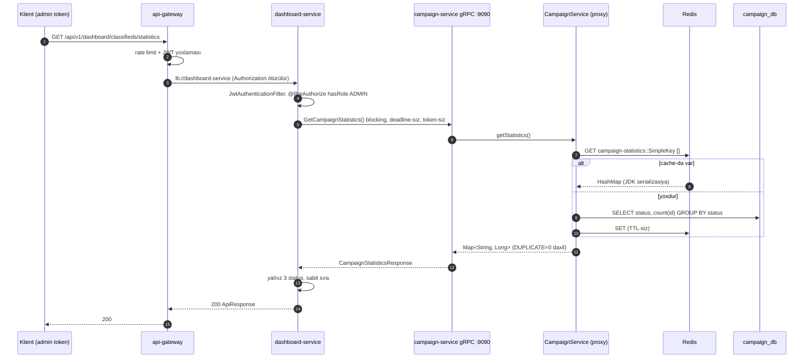

# 13. gRPC və Protocol Buffers

## 13.1 Motivasiya: servislərarası sinxron çağırışda kontrakt

dashboard-service-ə campaign-service-dən iki şey lazımdır: statuslar üzrə saylar və bir kampaniyanın tarixçəsi. REST ilə
də etmək olardı; layihə bunun üçün **gRPC** seçib. gRPC-nin təklif etdikləri:

- **Kontrakt-öncəlikli (contract-first) dizayn** — servis və mesajlar `.proto` faylında təsvir olunur, klient və server kodu
  ondan generasiya olunur; tip uyğunsuzluğu kompilyasiya zamanı aşkarlanır.
- **Binary serializasiya (Protobuf)** — JSON-dan kiçik və sürətli.
- **HTTP/2** — bir TCP bağlantısında çoxlu paralel axın (multiplexing), başlıq sıxılması, axın (streaming).
- **Zəngin semantika** — deadline, ləğv (cancellation), standart status kodları, metadata.

Bədəli: brauzerdən birbaşa istifadə çətindir (gRPC-Web proxy lazımdır), insan oxuya bilən deyil (curl əvəzinə
`grpcurl`), HTTP cache/CDN infrastrukturu tətbiq olunmur, debugging üçün əlavə alətlər tələb edir.

## 13.2 Protocol Buffers

Layihənin kontraktı [FAKT] (`grpc-contract/src/main/proto/campaign.proto:1-36`):

<!-- src: grpc-contract/src/main/proto/campaign.proto:1-36 -->
```protobuf
syntax = "proto3";

option java_multiple_files = true;
option java_package = "com.casestudy.insurancecampaign.grpc";
option java_outer_classname = "CampaignProto";

service CampaignGrpcService {
  rpc GetCampaignStatistics(CampaignStatisticsRequest) returns (CampaignStatisticsResponse);
  rpc GetCampaignHistory(CampaignHistoryRequest) returns (CampaignHistoryResponse);
}

message CampaignStatisticsRequest {}

message CampaignStatisticsResponse {
  repeated CampaignStatusCount counts = 1;
}

message CampaignStatusCount {
  string status = 1;
  int64 count = 2;
}

message CampaignHistoryRequest {
  string campaignId = 1;
}

message CampaignHistoryResponse {
  repeated CampaignHistoryItem items = 1;
}

message CampaignHistoryItem {
  string previousStatus = 1;
  string newStatus = 2;
  string reason = 3;
  string changedAt = 4;
}
```

### Sintaksis və semantika

| Element | Mənası |
|---|---|
| `syntax = "proto3"` | Protobuf 3 sintaksisi: sahələr standart olaraq opsionaldır, `required` yoxdur |
| `java_multiple_files = true` | Hər mesaj ayrıca Java faylı/sinfi olur (bir böyük xarici sinif yerinə) |
| `java_package` | Generasiya olunan paket |
| `service` + `rpc` | Uzaqdan çağırıla bilən metodlar; hər biri bir sorğu və bir cavab mesajı (unary) |
| `repeated` | Siyahı |
| `= 1`, `= 2` | **Sahə nömrəsi** — wire formatında sahənin identifikasiyası; adı deyil |
| Boş mesaj `CampaignStatisticsRequest {}` | Parametrsiz sorğu; gələcəkdə sahə (məs. filtr) əlavə etmək üçün yer saxlayır — boş mesaj yerinə `google.protobuf.Empty` istifadə etməkdən daha genişləndirilə biləndir |

**Wire formatı** (qısa): hər sahə `tag = (sahə_nömrəsi << 3) | wire_type` ilə kodlanır, ardınca dəyər (varint, uzunluq
prefiksli bayt və s.). Sahə adları wire-a yazılmır. Buna görə:

- sahənin **adını** dəyişmək wire baxımından təhlükəsizdir (JSON transkodlamada isə yox);
- **nömrəni** dəyişmək və ya köhnə nömrəni yeni məna ilə təkrar istifadə etmək köhnə klientləri sındırır — silinən
  sahələrin nömrəsi `reserved` elan edilməlidir;
- yeni sahə əlavə etmək geriyə və irəliyə uyğundur: köhnə klient tanımadığı sahəni ötürür (unknown fields), yeni klient
  çatışmayan sahə üçün standart dəyər görür;
- tipi dəyişmək (`int64` → `string`) uyğun deyil.

### proto3-də "null" yoxdur

Skalyar sahələrin standart dəyəri var: `string` → `""`, `int64` → `0`. "Dəyər yoxdur" ilə "boş sətir" fərqlənmir
(`optional` açar sözü və ya wrapper tipləri istifadə edilmədikcə). Layihədə məhz bu problem həll olunur [FAKT]:

- server `previousStatus == null` olduqda `""` yazır (`CampaignGrpcEndpoint.java:39`);
- klient boş sətri yenidən `null`-a çevirir (`CampaignGrpcClient.java:60`, `95-97`).

Bu, **sərhəddə konvensiya**dır və hər iki tərəfdə yazılmalıdır. `optional string previousStatus = 1;` (proto3
`optional`) `hasPreviousStatus()` metodunu verərdi və konvensiyaya ehtiyac qalmazdı.

### Kontrakt dizayn qeydləri [NƏTİCƏ]

- **Vaxt sətir kimi** (`changedAt` — ISO-8601 `Instant.toString()`). Protobuf-un standart `google.protobuf.Timestamp`
  tipi daha tipli və dildən asılı olmayan seçimdir.
- **Status sətir kimi** — `enum CampaignStatus { ... }` kompilyasiya zamanı yoxlanılan dəyərlər verərdi; lakin enum
  dəyişiklikləri (yeni status) köhnə klientlərdə tanınmayan dəyər kimi gələr. Sətir daha çevikdir, daha az tiplidir.
- **Sahə adları camelCase** (`campaignId`) — Protobuf üslub bələdçisi `snake_case` (`campaign_id`) tövsiyə edir;
  generasiya olunan Java getter-i hər iki halda `getCampaignId()` olur. Üslub məsələsidir.
- **Versiya yoxdur** — paket (`package campaign.v1;`) təyin olunmayıb. Böyük dəyişiklik lazım olduqda `v2` paketi ilə
  paralel servis təqdim etmək praktikadır.

## 13.3 Generasiya olunan kod

`protobuf-maven-plugin` (fəsil 3.8) `com.casestudy.insurancecampaign.grpc` paketində yaradır:

| Generasiya olunan | Rolu |
|---|---|
| `CampaignStatisticsRequest`, `CampaignHistoryItem`, ... | Dəyişməz mesaj sinifləri + `Builder` (`newBuilder().setX(...).build()`) |
| `CampaignProto` | Fayl deskriptoru (reflection üçün) |
| `CampaignGrpcServiceGrpc.CampaignGrpcServiceImplBase` | Server tərəfi üçün abstrakt baza; metodlar override edilir |
| `CampaignGrpcServiceGrpc.CampaignGrpcServiceBlockingStub` | Sinxron klient stub-u |
| `CampaignGrpcServiceGrpc.CampaignGrpcServiceStub` | Asinxron (callback / `StreamObserver`) stub |
| `CampaignGrpcServiceGrpc.CampaignGrpcServiceFutureStub` | `ListenableFuture` qaytaran stub |

## 13.4 gRPC runtime anlayışları

| Anlayış | İzah |
|---|---|
| Channel (`ManagedChannel`) | Hədəfə məntiqi bağlantı; ad həlli, yük balansı, yenidən qoşulma; ağırdır — paylaşılmalıdır |
| Stub | Kanal üzərində yüngül klient obyekti; deadline/metadata konfiqurasiyası stub-a bağlanır |
| RPC növləri | **Unary** (1 sorğu → 1 cavab), **server streaming**, **client streaming**, **bidirectional streaming** |
| Deadline | Çağırışın mütləq son vaxtı; zəncir boyu ötürülür; keçərsə `DEADLINE_EXCEEDED` |
| Cancellation | Klient ləğv edərsə server `Context.isCancelled()` görür |
| Status kodu | `OK`, `INVALID_ARGUMENT`, `NOT_FOUND`, `ALREADY_EXISTS`, `PERMISSION_DENIED`, `UNAUTHENTICATED`, `UNAVAILABLE`, `DEADLINE_EXCEEDED`, `INTERNAL`, `UNKNOWN` və s. |
| Metadata | Açar-dəyər başlıqları (HTTP/2 headers): autentifikasiya token-i, trace konteksti |
| Interceptor | Server/klient tərəfli kəsişən narahatlıqlar (auth, logging, metrics, tracing) |
| Ad həlli | `static://host:port`, `dns:///host:port`, xüsusi resolver-lər (məs. `discovery:///service`) |

**Status kodlarının seçilməsi** — klientin reaksiyası koddan asılıdır: `UNAVAILABLE` təkrar edilə bilər, `INVALID_ARGUMENT`
və `NOT_FOUND` təkrar edilməməlidir, `UNKNOWN` heç bir məlumat vermir.

## 13.5 net.devh grpc-spring-boot-starter

Layihə **net.devh `grpc-server-spring-boot-starter` / `grpc-client-spring-boot-starter` 3.1.0.RELEASE** istifadə
edir (`pom.xml:37`). Bu, icma (community) layihəsidir. Rəsmi alternativ **Spring gRPC** (`spring-grpc`) layihəsidir.
[NAMƏLUM] net.devh 3.1.0-ın Spring Boot 4 ilə rəsmi uyğunluğu repozitoriyadan müəyyən edilə bilmir; layihə README-si
işlədiyini göstərir (gRPC versiya uyğunsuzluğu bölməsi), lakin mən bunu runtime-da yoxlamamışam.

Starter-in etdikləri [FAKT, kitabxana mənbəsi + layihə konfiqurasiyası]:

| Xüsusiyyət | Nə edir | Layihədə |
|---|---|---|
| `@GrpcService` | Bean-i Spring komponenti kimi qeydiyyatdan keçirir və gRPC server-ə servis kimi əlavə edir | `CampaignGrpcEndpoint` |
| `grpc.server.port` | Ayrı Netty (`grpc-netty-shaded`) server portu | 9090 |
| Health servisi | `grpc.health.v1.Health` — `grpc.server.health-service-enabled` (standart true) | Aktiv |
| Reflection servisi | Klientlər proto-nu serverdən soruşa bilir (`grpcurl list`) — `reflection-service-enabled` (standart true) | Aktiv |
| Tracing | `GrpcServerMicrometerTraceAutoConfiguration` — `ObservationRegistry` bean-i varsa | [NƏTİCƏ] Aktiv olmalıdır |
| Eureka metadata | `GrpcMetadataEurekaConfiguration` gRPC portunu Eureka metadata-sına yazır | Klient `discovery:///` istifadə etmir |
| Security | `AuthenticationManager` bean-i varsa | Aktiv deyil (F04) |
| `@GrpcAdvice` | Exception → `Status` xəritələnməsi | İstifadə olunmur |
| `@GrpcClient("name")` | `grpc.client.<name>.*` konfiqurasiyasından kanal + stub | `CampaignGrpcClient` |

## 13.6 Server: `CampaignGrpcEndpoint`

<!-- src: campaign-service/src/main/java/com/casestudy/insurancecampaign/campaign/grpc/CampaignGrpcEndpoint.java:16-48 -->
```java
@GrpcService
public class CampaignGrpcEndpoint extends CampaignGrpcServiceGrpc.CampaignGrpcServiceImplBase {
    private final CampaignService campaignService;

    public CampaignGrpcEndpoint(CampaignService campaignService) {
        this.campaignService = campaignService;
    }

    @Override
    public void getCampaignStatistics(CampaignStatisticsRequest request, StreamObserver<CampaignStatisticsResponse> responseObserver) {
        CampaignStatisticsResponse.Builder response = CampaignStatisticsResponse.newBuilder();
        campaignService.getStatistics().forEach((status, count) -> response.addCounts(
                CampaignStatusCount.newBuilder().setStatus(status).setCount(count).build()
        ));
        responseObserver.onNext(response.build());
        responseObserver.onCompleted();
    }

    @Override
    public void getCampaignHistory(CampaignHistoryRequest request, StreamObserver<CampaignHistoryResponse> responseObserver) {
        CampaignHistoryResponse.Builder response = CampaignHistoryResponse.newBuilder();
        campaignService.getHistory(UUID.fromString(request.getCampaignId())).forEach(history -> response.addItems(
                CampaignHistoryItem.newBuilder()
                        .setPreviousStatus(history.getPreviousStatus() == null ? "" : history.getPreviousStatus().name())
                        .setNewStatus(history.getNewStatus().name())
                        .setReason(history.getReason())
                        .setChangedAt(history.getChangedAt().toString())
                        .build()
        ));
        responseObserver.onNext(response.build());
        responseObserver.onCompleted();
    }
}
```

Mexanika:
- Server metodu `StreamObserver` ilə işləyir: unary üçün bir `onNext` + `onCompleted`; xəta üçün
  `onError(Status...asRuntimeException())`.
- Endpoint REST controller-in etdiyini edir — protokol tərcüməsi — və biznes məntiqini təkrarlamır: eyni
  `CampaignService` (`@Transactional`, `@Cacheable` daxil olmaqla) çağırılır. Statistika çağırışı Redis cache-dən
  qayıda bilər.
- Statistika xəritəsi `HashMap`-dır — `counts` siyahısının sırası qeyri-müəyyəndir; dashboard sıranı özü təyin edir.
- **Avtorizasiya yoxdur**: REST-də `/statistics` və `/history` yalnız ADMIN üçündür, gRPC-də isə hər kəs üçün.
  Eyni datanın iki fərqli giriş qaydası — **icazə modeli uyğunsuzluğu** (F04).

### Xəta yolları (F19)

[NƏTİCƏ, grpc-java və net.devh davranışı] Server metodu istisna atarsa və `@GrpcAdvice` yoxdursa, grpc-java çağırışı
`Status.UNKNOWN` ilə bağlayır. Layihədə:
- Mövcud olmayan kampaniya → `ResourceNotFoundException` → `UNKNOWN` (`NOT_FOUND` olmalı idi).
- Səhv UUID sətri → `IllegalArgumentException` (`UUID.fromString`) → `UNKNOWN` (`INVALID_ARGUMENT` olmalı idi). Dashboard
  path dəyişənini artıq `UUID` kimi qəbul etdiyi üçün bu yol praktikada yalnız birbaşa gRPC klientlərindən gələ bilər.
- DB xətası → `UNKNOWN`.

## 13.7 Klient: `CampaignGrpcClient`

<!-- src: dashboard-service/src/main/java/com/casestudy/insurancecampaign/dashboard/client/CampaignGrpcClient.java:22-68 -->
```java
@Component
public class CampaignGrpcClient {

    private static final List<String> DASHBOARD_VISIBLE_STATUSES = List.of(
            "PENDING_APPROVAL",
            "ACTIVE",
            "DEACTIVE"
    );

    @GrpcClient("campaign-service")
    private CampaignGrpcServiceGrpc.CampaignGrpcServiceBlockingStub campaignStub;

    // ... (buraxılıb: Javadoc)
    public DashboardStatisticsResponse getStatistics() {
        var response = campaignStub.getCampaignStatistics(CampaignStatisticsRequest.newBuilder().build());
        return toDashboardStatisticsResponse(response);
    }

    // ... (buraxılıb: Javadoc)
    public DashboardCampaignHistoryResponse getCampaignHistory(UUID campaignId) {
        var request = CampaignHistoryRequest.newBuilder()
                .setCampaignId(campaignId.toString())
                .build();

        var response = campaignStub.getCampaignHistory(request);

        List<DashboardCampaignHistoryItemResponse> items = response.getItemsList()
                .stream()
                .map(item -> new DashboardCampaignHistoryItemResponse(
                        blankToNull(item.getPreviousStatus()),
                        item.getNewStatus(),
                        item.getReason(),
                        Instant.parse(item.getChangedAt())
                ))
                .toList();

        return new DashboardCampaignHistoryResponse(items);
    }
```

- **Blocking stub** — çağıran thread cavabı gözləyir. Tomcat sorğusu virtual thread-də işlədiyi üçün bloklama ucuzdur.
- **Statusların süzgəcdən keçirilməsi** (`toDashboardStatisticsResponse`, `:76-87`) — yalnız 3 "real" status, sabit
  sırada (`LinkedHashMap`), çatışmayanlar 0. `DUPLICATE` gizlədilir. Bu, **anti-corruption layer** nümunəsidir:
  dashboard öz modelini campaign-in daxili enum-undan qoruyur.
- **Deadline yoxdur** (F19). [NƏTİCƏ] gRPC-də deadline standart olaraq sonsuzdur. campaign-service cavab vermədən
  "asılı" qalsa (DB kilidi, uzun GC), dashboard thread-i qeyri-müəyyən müddət gözləyir. Tövsiyə:
  `campaignStub.withDeadlineAfter(2, TimeUnit.SECONDS).getCampaignStatistics(...)` — hər çağırışda (stub-un özündə
  deadline mütləq vaxtdır, ona görə hər çağırış üçün yeni stub törədilməlidir).
- **Xətaların tərcüməsi yoxdur** — `StatusRuntimeException` birbaşa `GlobalExceptionHandler`-in catch-all-ına düşür →
  500 və mesaj `"UNKNOWN"`/`"UNAVAILABLE: io exception"`. Kampaniya tapılmadıqda klient 404 əvəzinə 500 alır.

### Konfiqurasiya

<!-- src: dashboard-service/src/main/resources/application.yml:11-15 -->
```yaml
grpc:
  client:
    campaign-service:
      address: ${CAMPAIGN_GRPC_ADDRESS:static://localhost:9090}
      negotiation-type: plaintext
```

- `campaign-service` — `@GrpcClient("campaign-service")` adı ilə uyğun gəlir.
- `static://` — sabit ünvan; Compose-da `static://campaign-service:9090` (`docker-compose.yml:225`). [NƏTİCƏ]
  campaign-service-in bir neçə instansı olsa, yük balansı olmaz. net.devh `discovery:///campaign-service` ünvanı ilə
  Eureka-dakı instansları və onların gRPC portunu (Eureka metadata) istifadə edə bilərdi; bunun üçün klient tərəfdə
  load-balancing siyasəti də (`round_robin`) seçilməlidir — gRPC standart olaraq `pick_first` istifadə edir.
- `negotiation-type: plaintext` — TLS yoxdur, HTTP/2 cleartext (h2c). Daxili şəbəkədə belə məlumat şifrəsiz gedir.

Server tərəfi: `grpc.server.port: ${CAMPAIGN_GRPC_PORT:9090}` (`campaign-service/src/main/resources/application.yml:29-31`);
testlərdə `grpc.server.port = -1` — net.devh-də bu, server-in başladılmamasıdır
(`campaign-service/src/test/java/com/casestudy/insurancecampaign/campaign/base/AbstractTestContainerConfiguration.java:41`).

## 13.8 İcra axını: dashboard statistikası



Uğursuzluq yolları: campaign-service düşüb → `UNAVAILABLE` → 500; campaign-service yavaşdır → dashboard sonsuz gözləyir;
Redis düşüb → `@Cacheable` xətası → `UNKNOWN` → 500.

## 13.9 Test

`CampaignGrpcClientTest` stub-u Mockito ilə mock edir və `ReflectionTestUtils` ilə sahəyə qoyur
(`CampaignGrpcClientTest.java:33-43`). Bu, mapping məntiqini (süzgəc, sıfır dəyərlər, `""` → `null`) yoxlayır, lakin real
gRPC serializasiyasını, status kodlarını, deadline-ı yoxlamır. Server endpoint-i (`CampaignGrpcEndpoint`) üçün test yoxdur.

İllüstrativ nümunə (repozitoriyada yoxdur) — in-process server ilə həqiqi kontrakt testi (`grpc-inprocess` starter-lə
classpath-dədir):

```java
String name = InProcessServerBuilder.generateName();
Server server = InProcessServerBuilder.forName(name).directExecutor()
        .addService(new CampaignGrpcEndpoint(campaignService)).build().start();
ManagedChannel channel = InProcessChannelBuilder.forName(name).directExecutor().build();
var stub = CampaignGrpcServiceGrpc.newBlockingStub(channel);

when(campaignService.getHistory(any())).thenThrow(new ResourceNotFoundException("x"));
assertThatThrownBy(() -> stub.getCampaignHistory(CampaignHistoryRequest.newBuilder()
        .setCampaignId(UUID.randomUUID().toString()).build()))
    .isInstanceOf(StatusRuntimeException.class)
    .extracting(e -> ((StatusRuntimeException) e).getStatus().getCode())
    .isEqualTo(Status.Code.UNKNOWN);   // @GrpcAdvice əlavə edildikdən sonra NOT_FOUND gözlənilməlidir
```

## 13.10 Yeni layihədə tətbiq

İllüstrativ nümunə (repozitoriyada yoxdur):

```protobuf
syntax = "proto3";
package campaign.v1;
import "google/protobuf/timestamp.proto";

service CampaignQueryService {
  rpc GetStatistics(GetStatisticsRequest) returns (GetStatisticsResponse);
  rpc GetHistory(GetHistoryRequest) returns (GetHistoryResponse);
}
message GetHistoryRequest { string campaign_id = 1; }
message HistoryItem {
  optional string previous_status = 1;          // "yoxdur" ≠ ""
  string new_status = 2;
  string reason = 3;
  google.protobuf.Timestamp changed_at = 4;
  reserved 5; reserved "legacy_field";          // silinmiş sahə
}
```

```java
@GrpcAdvice
class CampaignGrpcAdvice {
    @GrpcExceptionHandler(ResourceNotFoundException.class)
    Status notFound(ResourceNotFoundException e) { return Status.NOT_FOUND.withDescription(e.getMessage()); }

    @GrpcExceptionHandler(IllegalArgumentException.class)
    Status invalid(IllegalArgumentException e) { return Status.INVALID_ARGUMENT.withDescription(e.getMessage()); }
}

// Klient: hər çağırışda deadline, status → domen istisnası
try {
    return stub.withDeadlineAfter(2, TimeUnit.SECONDS).getHistory(request);
} catch (StatusRuntimeException e) {
    throw switch (e.getStatus().getCode()) {
        case NOT_FOUND -> new ResourceNotFoundException("Campaign not found: " + id);
        case UNAVAILABLE, DEADLINE_EXCEEDED -> new DownstreamUnavailableException("campaign-service", e); // 503
        default -> e;
    };
}
```

Əlavə: autentifikasiya üçün klient interceptor-u `authorization` metadata-sını ötürür, server interceptor-u yoxlayır;
TLS/mTLS; `discovery:///` + `round_robin`; Resilience4j CircuitBreaker gRPC klientini də əhatə edə bilər.

## 13.11 gRPC və REST müqayisəsi

| Meyar | gRPC | REST/JSON |
|---|---|---|
| Kontrakt | `.proto`, kod generasiyası, sərt tiplər | OpenAPI (opsional), çox vaxt sonradan |
| Format | Binary Protobuf | Mətn JSON |
| Nəqliyyat | HTTP/2 (məcburi) | HTTP/1.1 və ya HTTP/2 |
| Streaming | Doğma, 4 növ | SSE, WebSocket ilə ayrıca |
| Brauzer | gRPC-Web proxy tələb olunur | Doğma |
| Alətlər | `grpcurl`, Postman gRPC | curl, hər yerdə |
| Xəta modeli | Status kodları + detallar | HTTP statusları + gövdə |
| Uyğun ssenari | Daxili, yüksək həcmli, tipli servislərarası API | İctimai API, brauzer klientləri, sadə inteqrasiya |

[NƏTİCƏ] Bu layihədə yük kiçikdir; gRPC seçimi performansdan çox texnologiya nümayişi və kontrakt-öncəlikli dizayn üçün
məntiqlidir. Daxili API-nin brauzerdən istifadə edilməməsi və tipli kontrakt gRPC-ni uyğun seçim edir.

## 13.12 Müsahibə sualları

**S1. Protobuf-da sahə nömrələri niyə vacibdir və sahəni necə təhlükəsiz silmək olar?**
Cavab: Wire formatında sahə adı deyil, nömrəsi yazılır. Nömrəni dəyişmək və ya təkrar istifadə etmək köhnə klientləri
səhv deserializasiyaya aparır. Silinən sahənin nömrəsi və adı `reserved` elan edilməlidir.

**S2. proto3-də `null` necə ifadə olunur? Layihədə necə həll olunub?**
Cavab: Skalyarların standart dəyəri var və `null` yoxdur. `optional` (presence tracking) və ya wrapper tiplər
(`google.protobuf.StringValue`) istifadə olunur. Layihədə konvensiya: server `null`-u `""`, klient `""`-ni `null` edir.

**S3. gRPC deadline nədir və niyə həmişə təyin etməlisiniz?**
Cavab: Çağırışın mütləq son vaxtı; keçərsə klient `DEADLINE_EXCEEDED` alır, server ləğvdən xəbərdar olur və deadline
zəncir boyu ötürülür. Təyin edilməsə, asılı qalan server klientin thread-lərini və resurslarını qeyri-müəyyən müddət
tutur — kaskad uğursuzluq.

**S4. gRPC server metodu istisna atarsa klient nə görür?**
Cavab: Exception-ı statusa çevirən mexanizm (net.devh `@GrpcAdvice`, interceptor) yoxdursa, `Status.UNKNOWN`. Klient
səbəbi ayırd edə bilmir, təkrar etmək lazım olub-olmadığını bilmir.

**S5. Eyni datanı REST və gRPC ilə açmaqda hansı risk var?**
Cavab: İki giriş nöqtəsinin icazə, validasiya və xəta modellərinin ayrılması. Layihədə REST ADMIN tələb edir, gRPC isə
autentifikasiyasızdır. Qaydalar servis qatında və ya ortaq interceptor-larda olmalıdır.

**S6. gRPC-də yük balansı necə işləyir?**
Cavab: Uzunömürlü HTTP/2 bağlantısı səbəbindən L4 balanslayıcı bağlantıları balanslayır, sorğuları yox. Buna görə ya
klient tərəfli balans (ad həlli bütün ünvanları qaytarır + `round_robin` siyasəti), ya da L7 proxy (Envoy) istifadə
olunur. Layihədə static tək ünvan var — balans yoxdur.

## 13.13 Xülasə

- `campaign.proto` iki unary RPC təyin edir; kod Maven build-də generasiya olunur.
- Server endpoint REST ilə eyni servis qatını çağırır; klient blocking stub-dır və nəticəni dashboard modelinə tərcümə
  edir (süzgəc, `""` ↔ `null`).
- Boşluqlar: deadline yoxdur, exception → status xəritəsi yoxdur, autentifikasiya yoxdur, plaintext, static ünvan.
- Növbəti fəsil digər sinxron kanalı — auth → log HTTP Interface klientini və Resilience4j-ni öyrədir.
