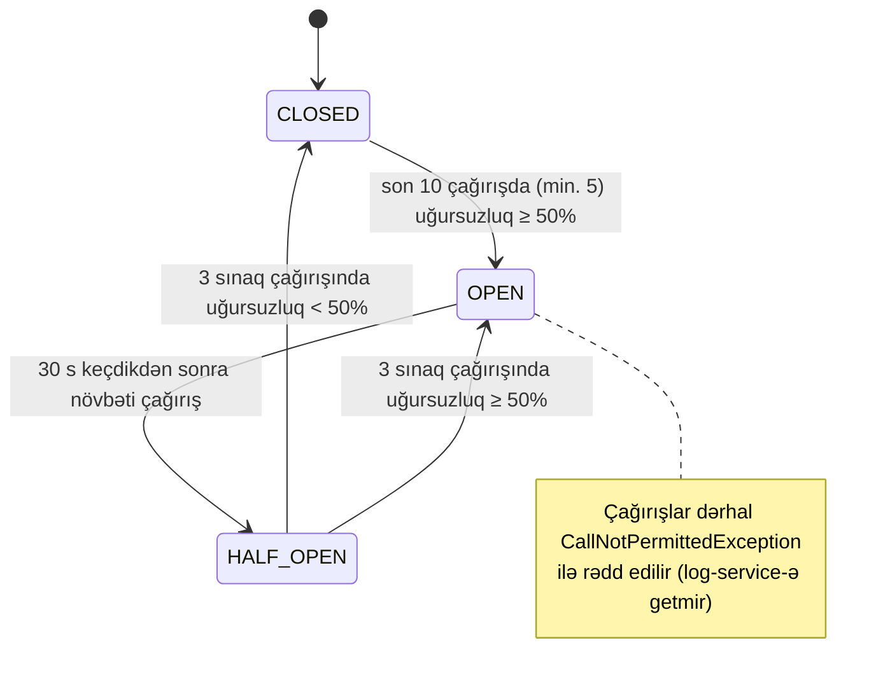

# 14. Servislərarası HTTP: HTTP Interface klientləri, Feign müqayisəsi və Resilience4j

## 14.1 Motivasiya: uzaq çağırış heç vaxt lokal çağırış deyil

Lokal metod çağırışı ya uğurlu olur, ya da istisna atır. Uzaq çağırışın daha çox nəticəsi var: uğur, xəta cavabı,
timeout (server işi edib-etmədiyi bilinmir), bağlantının rədd edilməsi, yavaş cavab, qismən uğursuzluq. "Paylanmış
sistemlərin yanlış fərziyyələri" (fallacies of distributed computing) — şəbəkə etibarlıdır, gecikmə sıfırdır və s. —
məhz bu fərqi unutmaqdan doğur.

Layihədə servislərarası sinxron HTTP çağırışı bir yerdə var: **auth-service → log-service** audit hadisəsi. Bu, ikinci
dərəcəli yan təsirdir: log-service düşsə belə login işləməlidir. Bu fəsil həmin çağırışın necə qurulduğunu və onu
qoruyan **Resilience4j** nümunələrini (circuit breaker, retry, bulkhead) öyrədir.

## 14.2 Spring-də HTTP klient seçimləri

| Klient | Model | Vəziyyət (Spring 7 / Boot 4) | Qeyd |
|---|---|---|---|
| `RestTemplate` | Sinxron, şablon | Saxlanılır, yeni inkişaf yoxdur | Köhnə kod |
| `RestClient` | Sinxron, fluent | Tövsiyə olunan sinxron klient (Spring 6.1+) | Virtual thread-lərlə ideal |
| `WebClient` | Reaktiv | WebFlux tətbiqləri üçün | Gateway `GatewayOpenApiController` istifadə edir |
| **HTTP Interface** (`@HttpExchange`) | Deklarativ interfeys, proxy | Spring Framework 6+, Spring 7-də **HTTP Service registry** (`@ImportHttpServices`) | **Bu layihədə auth → log** |
| **OpenFeign** (Spring Cloud OpenFeign) | Deklarativ interfeys | Spring Cloud layihəsi; "feature complete" elan edilib, yeni layihələr üçün HTTP Interface tövsiyə olunur | **Repozitoriyada yoxdur** |

[FAKT] Repozitoriyada Feign istifadə olunmur (heç bir `@FeignClient`, `spring-cloud-starter-openfeign` yoxdur). Feign
haqqında bölmə müqayisə üçündür.

**REST və Feign/HTTP Interface fərqi** — REST arxitektura üslubudur (resurslar, metodlar, statuslar); Feign və HTTP
Interface isə REST (və ya istənilən HTTP) API-ni **Java interfeysi kimi çağırmaq** üçün klient tərəfli abstraksiyadır.
Biri API dizaynı, digəri klient implementasiyası haqqındadır.

## 14.3 HTTP Interface + HTTP Service registry (Spring Framework 7)

<!-- src: auth-service/src/main/java/com/casestudy/insurancecampaign/auth/client/LogServiceHttpClient.java:14-33 -->
```java
@HttpExchange("/api/v1/logs")
public interface LogServiceHttpClient {

    // ... (buraxılıb: Javadoc)
    @PostExchange("/auth-audit")
    @CircuitBreaker(name = "logServiceHttpClient")
    @Retry(name = "logServiceHttpClient")
    @Bulkhead(name = "logServiceHttpClient", type = Bulkhead.Type.SEMAPHORE)
    void sendAuthAuditLog(@RequestBody AuthAuditLog request);

}
```

İnterfeysin bean-ə çevrilməsi [FAKT] (`AuthServiceApplication.java:19`):

```java
@ImportHttpServices(group = "log-service", types = LogServiceHttpClient.class)
```

Mexanizm [NƏTİCƏ, Spring Framework 7 / Boot 4 HTTP Service Client dəstəyi]:
1. `@ImportHttpServices` interfeysi `log-service` adlı **qrupa** qeydiyyatdan keçirir.
2. Boot (`spring-boot-starter-restclient`) hər qrup üçün bir `RestClient` qurur və onu
   `spring.http.serviceclient.<qrup>.*` xassələri ilə konfiqurasiya edir — burada `base-url`
   (`auth-service/src/main/resources/application.yml:21-24`).
3. `HttpServiceProxyFactory` interfeys üçün JDK dynamic proxy yaradır; metod çağırışı annotasiyalara görə HTTP sorğusuna
   çevrilir: `POST {base-url}/api/v1/logs/auth-audit`, gövdə = `AuthAuditLog` JSON.
4. `RestClientHttpServiceGroupConfigurer` bean-ləri qrupun `RestClient.Builder`-ini fərdiləşdirir — layihədə hər sorğuya
   daxili JWT əlavə olunur (`LogServiceHttpClientConfiguration.java:32-48`, fəsil 10.7).

Kontrakt uyğunluğu: auth-service `AuthAuditLog` record-unu göndərir (`AuthAuditLog.java:15-22`), log-service
`AuthAuditLogRequest` record-unu qəbul edir (`AuthAuditLogRequest.java:15-22`) — sahə adları və sıraları eynidir,
lakin **ayrı siniflərdir**. [NƏTİCƏ] Bu, servislərin kod səviyyəsində bir-birindən asılı olmamasını təmin edir (yaxşı),
lakin kontrakt sinxronluğu yalnız insan nəzarətinə qalır — sahə adı dəyişsə, səhv compile vaxtı deyil, runtime-da
(`null` sahə) üzə çıxar. Kafka hadisələri isə `common` modulundakı paylaşılan record-lardan istifadə edir. İki fərqli
yanaşmanın müqayisəsi müsahibə üçün yaxşı mövzudur.

**Timeout-lar konfiqurasiya olunmayıb.** [NƏTİCƏ] Nə `spring.http.clients.*`/`spring.http.serviceclient.log-service.*`
timeout xassələri, nə də Resilience4j `TimeLimiter` var. Klient kitabxanasının standart timeout-ları tətbiq olunur;
bəzi klientlərdə oxu timeout-u standart olaraq yoxdur. Asılı qalan log-service virtual thread-ləri və bulkhead
icazələrini qeyri-müəyyən müddət tuta bilər. **Hər uzaq çağırışın açıq connect və read timeout-u olmalıdır.**

**Kəşf istifadə olunmur** — `base-url` static-dir (`http://log-service:8084` Compose-da). log-service-in bir neçə
instansı olsa, yük balansı olmaz (F31).

## 14.4 Asinxron icra: `@Async` + virtual thread-lər

`AuthService` audit metodlarını tranzaksiya daxilində çağırır, lakin metodlar `@Async`-dir
(`AuthAuditService.java:51-135`) — çağırış dərhal qayıdır, iş `applicationTaskExecutor`-da (hər tapşırığa yeni virtual
thread, fəsil 4.5) icra olunur. Nəticələr:

- Login cavabı log-service-in cavabını gözləmir.
- Retry gözləmələri (3 × 500 ms) istifadəçiyə təsir etmir.
- Audit **at-most-once**-dır: JVM bu anda dayansa, yaddaşdakı tapşırıqlar itir; log-service əlçatmazdırsa, audit itir
  (yalnız WARN log). Davamlılıq (durability) yoxdur.
- Audit commit-dən əvvəl göndərilə bilər (fəsil 7.8).

[NƏTİCƏ] Dizayn uyğunsuzluğu: yavaş sorğu jurnalları **Kafka** ilə (davamlı, retry + DLQ), audit hadisələri isə
**HTTP** ilə (davamsız) gedir, halbuki audit, adətən, yavaş sorğu jurnalından daha vacib (təhlükəsizlik, uyğunluq)
datadır. Case study-də hər iki texnikanın nümayişi üçün başa düşüləndir; istehsalda audit üçün Kafka + outbox daha
uyğun olardı.

## 14.5 Resilience nümunələri: nəzəriyyə

| Nümunə | Problem | Mexanizm |
|---|---|---|
| **Timeout** | Yavaş/asılı asılılıq resursları tutur | Müəyyən vaxtdan sonra imtina |
| **Retry** | Müvəqqəti xətalar (şəbəkə titrəməsi, restart) | Backoff (və jitter) ilə təkrar; yalnız idempotent və ya təhlükəsiz əməliyyatlar üçün |
| **Circuit Breaker** | Düşmüş asılılığa davamlı çağırış həm onu, həm çağıranı yorur | Uğursuzluq nisbəti həddi aşanda "açılır" və çağırışları dərhal rədd edir; müəyyən vaxtdan sonra sınaq çağırışları ilə yoxlayır |
| **Bulkhead** | Bir asılılığın yavaşlığı bütün thread/resursları tutur | Eyni vaxtlı çağırışların sayını məhdudlaşdırmaq (semafor və ya ayrıca thread pool) |
| **Rate limiter** | Asılılığı həddindən çox yükləmək | Vaxt vahidində icazə sayı |
| **Fallback** | Uğursuzluqda alternativ cavab | Cache-dən, standart dəyər, sonra emal üçün növbə |

**Circuit breaker vəziyyət maşını:**



**Retry-ın qaranlıq tərəfi**: idempotent olmayan əməliyyatın təkrarı dublikat yaradır (audit təkrar göndərilsə, ES-də
iki qeyd — random id səbəbindən); çoxlu klientin eyni anda təkrarlaması düşən servisi "retry fırtınası" ilə boğa bilər —
eksponensial backoff + jitter və circuit breaker bunu yumşaldır.

## 14.6 Layihədəki Resilience4j konfiqurasiyası

<!-- src: auth-service/src/main/resources/application.yml:84-114 -->
```yaml
resilience4j:
  circuitbreaker:
    instances:
      logServiceHttpClient:
        failure-rate-threshold: ${LOG_SERVICE_CB_FAILURE_RATE_THRESHOLD:50}
        sliding-window-type: COUNT_BASED
        sliding-window-size: ${LOG_SERVICE_CB_SLIDING_WINDOW_SIZE:10}
        minimum-number-of-calls: ${LOG_SERVICE_CB_MINIMUM_NUMBER_OF_CALLS:5}
        permitted-number-of-calls-in-half-open-state: ${LOG_SERVICE_CB_PERMITTED_CALLS_IN_HALF_OPEN_STATE:3}
        wait-duration-in-open-state: ${LOG_SERVICE_CB_WAIT_DURATION_IN_OPEN_STATE:30s}
        record-exceptions:
          - java.lang.RuntimeException
        ignore-exceptions:
          - io.github.resilience4j.bulkhead.BulkheadFullException

  retry:
    instances:
      logServiceHttpClient:
        max-attempts: ${LOG_SERVICE_RETRY_MAX_ATTEMPTS:3}
        wait-duration: ${LOG_SERVICE_RETRY_WAIT_DURATION:500ms}
        retry-exceptions:
          - java.lang.RuntimeException
        ignore-exceptions:
          - io.github.resilience4j.circuitbreaker.CallNotPermittedException
          - io.github.resilience4j.bulkhead.BulkheadFullException

  bulkhead:
    instances:
      logServiceHttpClient:
        max-concurrent-calls: ${LOG_SERVICE_BULKHEAD_MAX_CONCURRENT_CALLS:10}
        max-wait-duration: ${LOG_SERVICE_BULKHEAD_MAX_WAIT_DURATION:0ms}
```

| Parametr | Dəyər | Mənası |
|---|---|---|
| `sliding-window-type/size` | COUNT_BASED / 10 | Son 10 çağırışın nəticəsi əsasında qiymətləndirmə |
| `minimum-number-of-calls` | 5 | 5 çağırışdan az olduqda CB qərar vermir |
| `failure-rate-threshold` | 50 | Uğursuzluq ≥ 50% → OPEN |
| `wait-duration-in-open-state` | 30 s | OPEN-də qalma müddəti |
| `permitted-number-of-calls-in-half-open-state` | 3 | Sınaq çağırışları |
| `record-exceptions` | `RuntimeException` | Bütün runtime xətaları (HTTP 4xx/5xx `RestClientResponseException` da daxil) uğursuzluq sayılır |
| `ignore-exceptions` (CB) | `BulkheadFullException` | Bulkhead rəddi log-service-in sağlamlığı haqqında deyil — sayılmır |
| `max-attempts` | 3 | **Cəmi** 3 cəhd (ilkin daxil) |
| `wait-duration` | 500 ms | Sabit gözləmə (backoff/jitter yoxdur) |
| `ignore-exceptions` (Retry) | `CallNotPermittedException`, `BulkheadFullException` | CB açıqdırsa və ya bulkhead doludursa təkrar etmə |
| `max-concurrent-calls` | 10 | Eyni vaxtda log-service-ə ən çox 10 audit |
| `max-wait-duration` | 0 ms | Yer yoxdursa dərhal rədd (`BulkheadFullException`) |

**Diqqət ediləcək nüans**: Resilience4j-də `max-attempts` cəmi cəhd sayıdır (3 = ilkin + 2 təkrar); spring-kafka-nın
`FixedBackOff(1000, 3)`-də isə 3 təkrar sayıdır (cəmi 4). Eyni "3" fərqli mənalar daşıyır.

### Aspektlərin sırası

[FAKT, resilience4j-spring6 2.3.0 mənbəsi] Standart aspekt sıraları: `Retry` = `LOWEST_PRECEDENCE - 5`,
`CircuitBreaker` = `LOWEST_PRECEDENCE - 4`, `RateLimiter` = `-3`, `TimeLimiter` = `-2`, `Bulkhead` = ən aşağı prioritet.
Daha kiçik dəyər daha xaricdə deməkdir, nəticədə:

```text
Retry( CircuitBreaker( Bulkhead( HTTP çağırışı ) ) )
```

Bunun nəticələri:
- Hər retry cəhdi **ayrıca CB çağırışı** kimi sayılır — bir audit 3 uğursuz cəhd ilə CB pəncərəsinə 3 uğursuzluq yazır.
- CB OPEN olduqda `CallNotPermittedException` Retry-a çatır; Retry onu ignore edir və təkrar etmir — düzgün.
- Bulkhead ən daxildədir: hər cəhd ayrıca icazə alır.

### Aspektlər interfeys proxy-sinə tətbiq olunurmu?

`LogServiceHttpClient` bean-i özü JDK proxy-sidir. Resilience4j aspektləri (`@annotation(circuitBreaker)` pointcut-ı)
Spring AOP auto-proxy mexanizmi ilə ona ikinci proxy kimi əlavə olunmalıdır. Asılılıq ağacında `aspectjweaver` var
(`auth-service`: `spring-boot-starter-data-jpa` → `spring-data-jpa` → `spring-aspects` → `aspectjweaver 1.9.25.1`; Spring Boot-un AOP auto-configuration-u bu sinif classpath-də olduqda AspectJ auto-proxy-ni aktivləşdirir), bu da AspectJ annotasiya üslublu aspektlər
üçün tələbdir. [NƏTİCƏ] Spring AOP pointcut uyğunluğunda JDK proxy hədəfləri üçün interfeys metodundakı annotasiyaya
baxmaq imkanı var, ona görə aspektlərin işləməsi gözlənilir. Lakin [FAKT] repozitoriyada bunu təsdiqləyən test yoxdur:
`AuthAuditServiceTest` servisi `new` ilə yaradır və istisnaları mock ilə **simulyasiya edir**
(`AuthAuditServiceTest.java:229-264`) — real CB/Retry/Bulkhead davranışı yoxlanmır. Bu, "annotasiya var, deməli işləyir"
fərziyyəsinin sınanmamış qaldığı tipik haldır.

### Ssenari: log-service tamamilə düşüb

[NƏTİCƏ] Hər audit üçün:

| Audit # | Cəhdlər | CB pəncərəsi (uğursuz/cəmi) | CB vəziyyəti | Nəticə |
|---|---|---|---|---|
| 1 | 3 × uğursuz (500 ms ara) | 3/3 | CLOSED (min. 5 çatmayıb) | WARN "could not be sent" |
| 2 | 1-ci cəhd uğursuz → 4/4; 2-ci → 5/5 → həd aşıldı | 5/5 = 100% | **OPEN** | 3-cü cəhd `CallNotPermitted` → Retry dayanır → WARN "circuit breaker is open" |
| 3…N (30 s ərzində) | 0 real çağırış | — | OPEN | Dərhal WARN, log-service-ə yük yoxdur |
| 30 s sonra | 3 sınaq çağırışı | — | HALF_OPEN | Uğursuzdursa yenə OPEN |

Login gecikməsi: heç biri — hamısı virtual thread-dədir.

## 14.7 `AuthAuditService.publishAudit`: xətaların yerli emalı

<!-- src: auth-service/src/main/java/com/casestudy/insurancecampaign/auth/service/AuthAuditService.java:137-180 -->
```java
private void publishAudit(String eventType, String usernameOrEmail, String message, String status) {
    AuthAuditLog auditLog = new AuthAuditLog(
            SERVICE_NAME,
            eventType,
            usernameOrEmail,
            message,
            status,
            Instant.now()
    );

    try {
        logServiceHttpClient.sendAuthAuditLog(auditLog);
        log.info(
                "Auth audit sent to log-service. eventType={}, usernameOrEmail={}, status={}",
                eventType,
                usernameOrEmail,
                status
        );
    } catch (CallNotPermittedException exception) {
        log.warn(
                "Auth audit skipped because log-service circuit breaker is open. eventType={}, usernameOrEmail={}, status={}, reason={}",
                eventType,
                usernameOrEmail,
                status,
                exception.getMessage()
        );
    } catch (BulkheadFullException exception) {
        log.warn(
                "Auth audit skipped because log-service bulkhead is full. eventType={}, usernameOrEmail={}, status={}, reason={}",
                eventType,
                usernameOrEmail,
                status,
                exception.getMessage()
        );
    } catch (Exception exception) {
        log.warn(
                "Auth audit could not be sent to log-service. eventType={}, usernameOrEmail={}, status={}, reason={}",
                eventType,
                usernameOrEmail,
                status,
                exception.getMessage()
        );
    }
}
```

- `catch` blokları spesifikdən ümumiyə doğru düzülüb — Java bunu tələb edir.
- Hər hal ayrıca mesajla loglanır — əməliyyat zamanı "niyə audit yoxdur?" sualına log cavab verir.
- [NƏTİCƏ] Ümumi `Exception` hissəsində stack trace loglanmır (yalnız `getMessage()`) — xətanın səbəbini tapmaq çətinləşə
  bilər.
- `@Async` metodundan istisna qaçmır — `AsyncUncaughtExceptionHandler`-ə ehtiyac yoxdur.
- Resilience4j-nin **fallback** mexanizmi (`fallbackMethod`) əvəzinə try/catch seçilib: davranış eynidir, lakin
  fallback interfeys proxy-sində tətbiq oluna bilməzdi (fallback metodu eyni sinifdə olmalıdır), try/catch isə şəffafdır.

## 14.8 Uğursuzluq ssenariləri

| Ssenari | Mərhələ | Nəticə | Təkrar təhlükəsizdirmi | Dublikat? |
|---|---|---|---|---|
| log-service düşüb | HTTP bağlantısı | 3 cəhd, sonra CB OPEN; audit itir | Bəli (yazma) | Ola bilər: timeout-dan sonra server yazmış ola bilər |
| log-service 403 (token problemi) | HTTP 4xx | `RestClientResponseException` (RuntimeException) → 3 cəhd + CB sayır | Mənasız — daimi xəta | — |
| Elasticsearch düşüb | log-service 500 | Eyni kimi | — | — |
| Yavaş log-service | HTTP | Timeout yoxdur → virtual thread-lər və bulkhead icazələri tutulur → 11-ci audit `BulkheadFullException` | — | — |
| Audit sıçrayışı (>10 eyni vaxtda) | Bulkhead | Artıq auditlər dərhal atılır | — | — |
| auth-service restart | JVM | Gözləyən async tapşırıqlar itir | — | — |

[NƏTİCƏ] 4xx (məs. 400, 403) daimi xətalardır, retry mənasızdır. `retry-exceptions: RuntimeException` hamısını
təkrarlayır; düzgün variant — yalnız `ResourceAccessException` (I/O), `HttpServerErrorException` (5xx) və timeout-ları
təkrarlamaq.

## 14.9 Yeni layihədə tətbiq

İllüstrativ nümunə (repozitoriyada yoxdur) — HTTP Interface + açıq timeout-lar + seçici retry:

```yaml
spring:
  http:
    serviceclient:
      log-service:
        base-url: http://log-service:8084
        connect-timeout: 1s
        read-timeout: 2s
resilience4j:
  retry:
    instances:
      logServiceHttpClient:
        max-attempts: 3
        wait-duration: 200ms
        enable-exponential-backoff: true
        exponential-backoff-multiplier: 2
        enable-randomized-wait: true
        retry-exceptions:
          - org.springframework.web.client.ResourceAccessException
          - org.springframework.web.client.HttpServerErrorException
```

Feign ekvivalenti (müqayisə üçün):

```java
@FeignClient(name = "log-service", path = "/api/v1/logs", configuration = InternalAuthFeignConfig.class)
public interface LogServiceFeignClient {
    @PostMapping("/auth-audit")
    void sendAuthAuditLog(@RequestBody AuthAuditLog request);
}
// name = "log-service" Spring Cloud LoadBalancer ilə Eureka-dan həll olunur;
// RequestInterceptor daxili JWT-ni əlavə edir; ErrorDecoder statusları domen istisnalarına çevirir.
```

| | HTTP Interface (`@HttpExchange`) | OpenFeign |
|---|---|---|
| Mənbə | Spring Framework (core) | Spring Cloud |
| Əsas klient | `RestClient` / `WebClient` | Feign öz klienti (və ya Apache/OkHttp) |
| Reaktiv dəstək | Bəli (`WebClient` ilə) | Xeyr |
| Kəşf və balans | `@LoadBalanced` builder ilə | Doğma (`name` ilə) |
| Xəta dekodlaşdırma | `RestClient` status handler-ləri | `ErrorDecoder` |
| Gələcək | Spring-in tövsiyə etdiyi yol | Saxlanılır, yeni xüsusiyyət azdır |

Test strategiyası: **WireMock** (və ya MockWebServer) ilə real HTTP serverini simulyasiya edib Spring konteksti ilə test
— 503 cavablarında 3 cəhd edildiyini, 5 uğursuzluqdan sonra CB-nin açıldığını (`CircuitBreakerRegistry` ilə vəziyyəti
yoxlamaq), timeout-ları və başlıqda `Authorization`-un olduğunu yoxlamaq.

## 14.10 Praktiki tapşırıqlar

Tapşırıqları öz fork-unuzda, ayrıca branch-da edin. Çətinlik: ★ — 30 dəqiqəyə qədər, ★★ — bir neçə saat, ★★★ — təxminən bir gün. "Gözlənilən nəticə" koddan çıxardığım proqnozdur; sizdə fərqli çıxarsa, səbəbini tapmaq tapşırığın ən dəyərli hissəsidir.

**T1 ★ — Circuit breaker-i hərəkətdə görün.** log-service-i dayandırın, auth-service-ə birbaşa (8081) bir neçə dəfə
login olun və auth loglarına baxın; `/actuator/metrics/resilience4j.circuitbreaker.state` ilə vəziyyəti yoxlayın.
**Gözlənilən nəticə:** əvvəlcə "could not be sent" xəbərdarlıqları, minimum çağırış sayına çatandan sonra "circuit
breaker is open"; 30 saniyədən sonra half-open.

**T2 ★★ — Timeout-lar.** `spring.http.serviceclient.log-service.connect-timeout: 1s` və `read-timeout: 2s` əlavə edin
(xassə adları Boot 4.1 mənbəsindən yoxlanılıb, 22.6). `docker compose pause log-service` ilə sınayın. **Yoxlama:**
login təsirlənmir, audit thread-i iki saniyədən sonra azad olur.

**T3 ★★ — Retry-ı seçici edin.** `retry-exceptions`-u `ResourceAccessException` və `HttpServerErrorException` ilə
məhdudlaşdırın, 4xx-i retry etməyin. **Yoxlama:** log-service 403 qaytaranda (məs. səhv rol) yalnız bir cəhd edilir.

**T4 ★★ — Bulkhead.** 50 paralel login göndərin (məs. `xargs -P 50` ilə `curl`). **Gözlənilən nəticə:** eyni anda 10-dan
çox audit çağırışı olanda "bulkhead is full" xəbərdarlıqları görünür, login-lər isə uğurlu qalır.

## 14.11 Müsahibə sualları

**S1. Retry və circuit breaker birlikdə istifadə olunduqda sıra niyə vacibdir?**
Cavab: Retry xaricdədirsə, hər cəhd CB-dən keçir və sayılır; CB açılanda retry dayanmalıdır (CallNotPermitted ignore).
CB xaricdə olsaydı, bütün retry seriyası bir CB çağırışı sayılardı və CB gec açılardı. Resilience4j standartı:
Retry(CircuitBreaker(RateLimiter(TimeLimiter(Bulkhead(fn))))).

**S2. Semaphore bulkhead və thread-pool bulkhead fərqi?**
Cavab: Semaphore çağıranın thread-ində eyni vaxtlı çağırış sayını məhdudlaşdırır (ucuz, virtual thread-lərlə uyğundur);
thread-pool bulkhead çağırışı ayrı, məhdud pool-da icra edir (çağıranı tamamilə təcrid edir, lakin thread keçidi və
`CompletableFuture` tələb edir). Layihə semaphore istifadə edir; çağırış onsuz da `@Async` virtual thread-dədir.

**S3. Hansı xətaları təkrar etmək olmaz?**
Cavab: Daimi xətaları (400, 401, 403, 404, 409, validasiya) və idempotent olmayan əməliyyatları (dublikat yarada
bilənləri) — idempotency key olmadıqda. Müvəqqəti xətalar (bağlantı, 503, timeout) təkrarlana bilər.

**S4. Niyə hər uzaq çağırışın timeout-u olmalıdır?**
Cavab: Timeout-suz çağırış asılılığın yavaşlığını çağırana ötürür: thread-lər, bağlantılar, bulkhead icazələri tutulur
və kaskad uğursuzluq yaranır. CB yalnız uğursuzluqları sayır — heç vaxt bitməyən çağırış onu açmaz (slow-call
konfiqurasiyası olmadıqda).

**S5. HTTP Interface ilə Feign arasında seçim edərkən nəyə baxarsınız?**
Cavab: Spring versiyası (Spring 6+ → HTTP Interface doğmadır), reaktiv ehtiyac, mövcud Spring Cloud infrastrukturu
(LoadBalancer/Eureka inteqrasiyası Feign-də hazırdır, HTTP Interface-də `@LoadBalanced` builder ilə qurulur), komanda
təcrübəsi, uzunmüddətli dəstək.

**S6. Audit üçün HTTP + `@Async` ilə Kafka + outbox arasında fərq nədir?**
Cavab: HTTP + async at-most-once-dır: alıcı düşəndə və ya proses dayananda audit itir. Outbox + Kafka davamlıdır və
at-least-once-dır: audit DB tranzaksiyası ilə atomik yazılır, sonra çatdırılır; consumer idempotent olmalıdır.

## 14.12 Xülasə

- auth → log çağırışı Spring 7-nin HTTP Interface + HTTP Service registry mexanizmi ilə deklarativ yazılıb; daxili JWT
  qrup konfiqurasiyası ilə əlavə olunur.
- Resilience4j: Retry(3) → CircuitBreaker(10/5/50%/30 s) → Bulkhead(10, 0 ms); xətalar `publishAudit`-də udulur; `@Async`
  istifadəçini gecikmədən qoruyur.
- Boşluqlar: timeout yoxdur, 4xx də təkrarlanır, aspekt davranışı test edilmir, audit at-most-once-dır.
- Feign repozitoriyada yoxdur; HTTP Interface müasir alternativdir.
- Növbəti fəsil Redis-in iki istifadəsini — cache və rate limiting — öyrədir.
