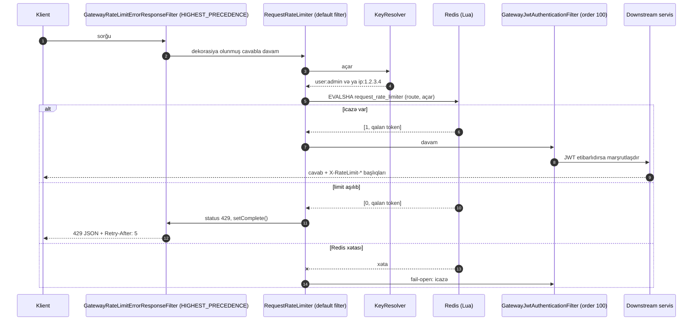

# 15. Redis: paylanmış cache və rate limiting

Redis layihədə iki tamamilə fərqli məqsədlə istifadə olunur: **campaign-service-də statistika cache-i** (Spring Cache
abstraksiyası) və **api-gateway-də sorğu limitləməsi** (Spring Cloud Gateway `RedisRateLimiter`). Hər iki istifadə
eyni Redis instansındadır (`docker-compose.yml:285-299`).

## 15.1 Redis əsasları

**Redis** yaddaşda işləyən açar-dəyər verilənlər strukturları serveridir:

| Struktur | Nümunə istifadə |
|---|---|
| String | Cache dəyəri, sayğac (`INCR`) |
| Hash | Obyekt sahələri |
| List | Növbə |
| Set / Sorted set | Unikal üzvlər; reytinq, vaxta görə sıralama (sliding window rate limit) |
| Stream | Hadisə jurnalı |

Əsas xüsusiyyətlər:
- **Əmrlər tək thread-də ardıcıl icra olunur** — hər əmr atomikdir; çox addımlı atomik əməliyyatlar üçün **Lua
  skriptləri** (`EVAL`) və ya `MULTI/EXEC` istifadə olunur.
- **TTL** — açarlara bitmə vaxtı (`EXPIRE`, `SETEX`).
- **Davamlılıq** — RDB snapshot və/və ya AOF jurnalı; lakin Redis əsas mənbə (source of truth) kimi deyil, adətən
  cache/köməkçi saxlama kimi istifadə olunur.
- **Yaddaş siyasəti** — `maxmemory` dolduqda `maxmemory-policy` (`allkeys-lru`, `volatile-ttl`, `noeviction`).
- **Yüksək əlçatanlıq** — replikasiya, Sentinel, Redis Cluster (açarlar 16384 hash slot üzrə bölünür).

Spring Boot standart olaraq **Lettuce** klientindən istifadə edir (asılılıq ağacı: `lettuce-core 7.5.2`): Netty əsaslı,
thread-safe, bir bağlantı üzərindən çoxlu paralel əmr (pipelining).

## 15.2 Caching nəzəriyyəsi

**Cache-aside** (layihədəki model): oxuyanda əvvəl cache-ə bax; yoxdursa mənbədən oxu və cache-ə yaz. Yazanda mənbəni
yenilə və cache-i **sil** (invalidate).

Əsas problemlər:

| Problem | İzah | Tipik həll |
|---|---|---|
| Köhnə data (staleness) | Mənbə dəyişib, cache yox | Yazıda eviction + TTL ehtiyat kimi |
| Eviction yarışı | Oxuyan köhnə dəyəri DB-dən oxuyub cache-ə yazır, arada yazan evict edib | Qısa TTL, versiyalı açarlar, evict-i commit-dən sonra etmək |
| Stampede (thundering herd) | Populyar açar silinəndə çoxlu sorğu eyni anda DB-yə gedir | `@Cacheable(sync = true)`, kilid, erkən yeniləmə |
| Serializasiya | Dəyərin formatı versiyalar arasında uyğun olmalıdır | JSON, sxem dəyişikliyində açar prefiksini dəyişmək |
| Cache-in düşməsi | Cache xətası əsas əməliyyatı dayandırmamalıdır | Fail-open `CacheErrorHandler` |

**Lokal və paylanmış cache.** Lokal (Caffeine, `ConcurrentMap`) ən sürətlidir, lakin hər instansın öz nüsxəsi olur və bir
instansdakı eviction digərlərinə çatmır. Paylanmış (Redis) cache şəbəkə gedişi tələb edir, lakin bütün instanslar eyni
dəyəri görür və eviction qlobaldır. campaign-service üçün Redis seçimi bu səbəbdən məntiqlidir.

## 15.3 Spring Cache abstraksiyası

| Element | Mənası |
|---|---|
| `@EnableCaching` | `CacheInterceptor` proxy-sini aktivləşdirir (`CampaignServiceApplication.java:10`) |
| `CacheManager` | `spring.cache.type: redis` → `RedisCacheManager` (`campaign-service/src/main/resources/application.yml:22-23`) |
| `@Cacheable("x")` | Açar üçün dəyər varsa metod çağırılmır; yoxdursa çağırılır və nəticə saxlanılır |
| `@CacheEvict(value="x", allEntries=true)` | Metoddan **sonra** (standart `beforeInvocation=false`) bütün `x` cache-i silinir; metod istisna atarsa eviction olmur |
| Açar | `SimpleKeyGenerator`: parametrsiz metod → `SimpleKey.EMPTY` |
| `CacheErrorHandler` | Standart `SimpleCacheErrorHandler` cache xətasını **yenidən atır** |

### Boot-un Redis cache standartları

[FAKT, spring-boot-cache 4.1.0 `RedisCacheConfiguration`] `spring.cache.redis.*` xassələri verilmədikdə:
- dəyər serializatoru `JdkSerializationRedisSerializer`-dir (Java serializasiyası);
- açar `<cacheName>::<key>` formasındadır, məs. `campaign-statistics::SimpleKey []`;
- **TTL yoxdur** — `entryTtl` yalnız `spring.cache.redis.time-to-live` təyin olunduqda tətbiq olunur;
- `RedisCacheManager` transaction-aware deyil.

## 15.4 Layihədə cache

<!-- src: campaign-service/src/main/java/com/casestudy/insurancecampaign/campaign/service/CampaignService.java:121-123 -->
```java
@Transactional(readOnly = true)
@Cacheable("campaign-statistics")
public Map<String, Long> getStatistics() {
```

Eviction üç yazı metodunda: `create`, `approve`, `deactivate` — hamısında
`@CacheEvict(value = "campaign-statistics", allEntries = true)` (`CampaignService.java:54-55`, `91-92`, `102-103`).

Qiymətləndirmə:
- **Doğru:** statistikanı dəyişən hər əməliyyat cache-i silir; cache paylanmışdır, ona görə bütün campaign
  instanslarında ardıcıldır; həm REST, həm gRPC eyni cache-dən yararlanır.
- **Dəyər tipi** `HashMap<String, Long>` — `Serializable`-dır, JDK serializasiyası işləyir. [NƏTİCƏ] JDK serializasiyası
  dildən asılıdır, Redis-də oxunmazdır və sinif dəyişikliklərinə həssasdır; `GenericJacksonJsonRedisSerializer` (JSON)
  daha şəffafdır.
- **Testlərdə Redis yoxdur** — `spring.cache.type=simple` (`campaign-service/src/test/java/com/casestudy/insurancecampaign/campaign/base/AbstractTestContainerConfiguration.java:35`):
  serializasiya, TTL, Redis xətası davranışı test edilmir.

### Riskli nöqtələr (F13)

**1. Evict və commit sırası.** `@Transactional` və `@CacheEvict` eyni metodda olduqda iki interceptor işləyir. [NƏTİCƏ]
Layihə onların sırasını açıq təyin etmir (`@EnableCaching(order=...)` yoxdur). Cache interceptor tranzaksiya
interceptor-undan **daxildə** olarsa, eviction commit-dən **əvvəl** baş verir və belə yarış mümkündür:

| Zaman | Yazan (approve) | Oxuyan (getStatistics) |
|---|---|---|
| t1 | UPDATE (commit olunmayıb) | |
| t2 | `@CacheEvict` — cache boşdur | |
| t3 | | cache yoxdur → DB-dən oxu (köhnə, commit olunmamış dəyişiklik görünmür) |
| t4 | | köhnə statistikanı cache-ə yaz |
| t5 | COMMIT | |

Nəticə: cache-də köhnə dəyər qalır və **TTL olmadığı üçün** növbəti yazı əməliyyatına qədər (saatlar, günlər) qalır.
Həllər: `spring.cache.redis.time-to-live` (məs. 60 s) ehtiyat tor kimi; `RedisCacheManager.builder(...).transactionAware()`
(evict commit-dən sonra icra olunur); və ya eviction-u `@TransactionalEventListener(AFTER_COMMIT)`-ə köçürmək.

**2. Redis xətası.** Standart `CacheErrorHandler` xətanı yenidən atır: Redis düşdükdə `getStatistics()` (REST və gRPC)
500/`UNKNOWN` verir; `create` isə metod uğurla bitdikdən sonra eviction xətası səbəbindən istisna ata bilər — DB-də
kampaniya yaranıb (commit-in eviction-dan əvvəl/sonra olmasından asılı olaraq), klient isə 500 görür və təkrar edərsə
409 alır. Cache ikinci dərəcəli komponentdir; onun düşməsi əsas funksiyanı dayandırmamalıdır. İllüstrativ həll
(repozitoriyada yoxdur):

```java
@Configuration
class CacheConfig implements CachingConfigurer {
    @Override
    public CacheErrorHandler errorHandler() {
        return new SimpleCacheErrorHandler() {
            @Override public void handleCacheGetError(RuntimeException e, Cache c, Object k) { log.warn("cache get failed", e); }
            @Override public void handleCachePutError(RuntimeException e, Cache c, Object k, Object v) { log.warn("cache put failed", e); }
            @Override public void handleCacheEvictError(RuntimeException e, Cache c, Object k) { log.warn("cache evict failed", e); }
            @Override public void handleCacheClearError(RuntimeException e, Cache c) { log.warn("cache clear failed", e); }
        };
    }
}
```

**3. Stampede** — statistika cache-i boşaldıqda paralel sorğular eyni anda `GROUP BY` icra edir. Kiçik cədvəldə əhəmiyyətsizdir;
`@Cacheable(value = "campaign-statistics", sync = true)` eyni instans daxilində bunu bir sorğuya endirir.

## 15.5 Rate limiting nəzəriyyəsi

| Alqoritm | İdeya | Üstünlük | Çatışmazlıq |
|---|---|---|---|
| Fixed window | Hər dəqiqə üçün sayğac | Sadə | Pəncərə sərhədində ikiqat sıçrayış |
| Sliding window log | Hər sorğunun vaxtı (sorted set) | Dəqiq | Yaddaş |
| Sliding window counter | İki pəncərənin çəkili cəmi | Yaxşı balans | Təqribi |
| **Token bucket** | Vedrə sabit sürətlə dolur, hər sorğu token xərcləyir | Burst-a icazə, ortalama sürət nəzarəti | Parametrləri başa düşmək |
| Leaky bucket | Sorğular sabit sürətlə "sızır" | Hamar çıxış | Burst yoxdur |

Paylanmış sistemdə limit vəziyyəti bütün gateway instansları arasında paylaşılmalıdır — Redis buna görə istifadə olunur;
atomiklik üçün Lua skripti.

## 15.6 Spring Cloud Gateway `RedisRateLimiter`

[FAKT, SCG 5.0.2 mənbəsi `META-INF/scripts/request_rate_limiter.lua`] Token bucket Lua skripti ilə həyata keçirilir:

```lua
local fill_time = capacity / rate
local ttl = math.floor(fill_time * 2)
local last_tokens = tonumber(redis.call("get", tokens_key)) or capacity
local last_refreshed = tonumber(redis.call("get", timestamp_key)) or 0
local delta = math.max(0, now-last_refreshed)
local filled_tokens = math.min(capacity, last_tokens+(delta*rate))
local allowed = filled_tokens >= requested
local new_tokens = allowed and filled_tokens - requested or filled_tokens
```

Açarlar: `request_rate_limiter.{<routeId>.<key>}.tokens` və `.timestamp` (fiqurlu mötərizə Redis Cluster hash tag-idir —
hər iki açar eyni slot-a düşür ki, skript atomik işləsin). Açarlar `2 × capacity/rate` saniyə TTL ilə saxlanılır.

**Vacib nəticə** [FAKT]: açarda **marşrut id-si** var. Deməli limit `(marşrut, istifadəçi/IP)` cütü üzrədir. README
"eyni istifadəçi 5 saniyədə 1 sorğu" deyir — bu, **hər marşrut üçün ayrıca** doğrudur: admin eyni anda
`campaign-service-api` və `dashboard-service-api` marşrutlarına bir sorğu göndərə bilər.

### Layihənin parametrləri

<!-- src: api-gateway/src/main/resources/application.yml:20-26 -->
```yaml
default-filters:
- name: RequestRateLimiter
  args:
    key-resolver: "#{@requestRateLimiterKeyResolver}"
    redis-rate-limiter.replenishRate: ${RATE_LIMITER_REPLENISH_RATE:1} # -> Redis adds 1 token per second
    redis-rate-limiter.burstCapacity: ${RATE_LIMITER_BURST_CAPACITY:5} # -> Bucket can hold max 5 tokens
    redis-rate-limiter.requestedTokens: ${RATE_LIMITER_REQUESTED_TOKENS:5} # -> Each request costs 5 tokens
```

- `replenishRate = 1` token/s, `burstCapacity = 5`, `requestedTokens = 5` → hər sorğu bütün vedrəni xərcləyir; vedrə 5
  saniyədə dolur → **5 saniyədə 1 sorğu, burst yoxdur**. Bu, demo üçün çox sərt limitdir (Swagger UI-dan ardıcıl iki
  klik 429 verir); istehsalda adətən `requestedTokens = 1` və daha böyük `burstCapacity` istifadə olunur.
- `default-filters` — bütün marşrutlara (auth, campaign, dashboard, logs, OpenAPI proxy marşrutları) eyni limit.
  [NƏTİCƏ] Fərqli endpoint-lərin fərqli riski var: login brute-force-a qarşı sərt, oxumalar üçün yumşaq limit daha
  uyğundur — marşrut səviyyəli `filters` ilə.
- `/openapi/**` (gateway-in öz controller-i) marşrut deyil — rate limit tətbiq olunmur.
- Cavab başlıqları: `X-RateLimit-Remaining`, `X-RateLimit-Replenish-Rate`, `X-RateLimit-Burst-Capacity`,
  `X-RateLimit-Requested-Tokens`.

### Açar resolver-i

<!-- src: api-gateway/src/main/java/com/casestudy/insurancecampaign/gateway/config/GatewayRateLimiterConfiguration.java:36-62 -->
```java
@Bean
public KeyResolver requestRateLimiterKeyResolver(GatewayJwtTokenService jwtTokenService) {
    return exchange -> Mono.just(resolveKey(exchange, jwtTokenService));
}

private String resolveKey(ServerWebExchange exchange, GatewayJwtTokenService jwtTokenService) {
    String authorization = exchange.getRequest()
            .getHeaders()
            .getFirst(HttpHeaders.AUTHORIZATION);

    if (authorization != null && authorization.startsWith(BEARER_PREFIX)) {
        String token = authorization.substring(BEARER_PREFIX.length());

        try {
            Claims claims = jwtTokenService.parseClaims(token);
            String subject = claims.getSubject();

            if (subject != null && !subject.isBlank()) {
                return "user:" + subject;
            }
        } catch (RuntimeException exception) {
            return "ip:" + resolveClientIp(exchange);
        }
    }

    return "ip:" + resolveClientIp(exchange);
}
```

- Autentifikasiyalı sorğu → `user:<subject>`; token-siz və ya etibarsız → `ip:<client ip>`. Etibarsız token-lə
  saxta `user:` açarı yaratmaq mümkün deyil, çünki imza yoxlanılır — düzgün dizayn.
- `resolveClientIp` əvvəlcə `X-Forwarded-For`-un ilk dəyərinə, sonra `X-Real-IP`-yə, sonra TCP ünvanına baxır
  (`GatewayRateLimiterConfiguration.java:64-92`).

[RİSK] (F05) Gateway kənar qatdır və başlıqları klient özü göndərir. Hücumçu hər sorğuda fərqli `X-Forwarded-For`
göndərərək hər dəfə yeni IP vedrəsi alır — anonim endpoint-lərdə (login, forgot-password) limit faktiki olaraq
söndürülür. Düzgün yanaşma: XFF-ə yalnız etibarlı proxy-lərdən gəldikdə inanmaq. SCG bunun üçün
`XForwardedRemoteAddressResolver.maxTrustedIndex(n)` təqdim edir — siyahının sağından etibarlı proxy sayı qədər
keçir. Həmçinin F01 səbəbindən hücumçu yeni hesablar yaradıb yeni `user:` vedrələri əldə edə bilər.

### 429 cavabının formalaşdırılması

`RequestRateLimiter` filtri limit aşıldıqda statusu 429 edib cavabı boş gövdə ilə tamamlayır. Layihə bunu JSON-a
çevirmək üçün cavabı "dekorasiya edən" qlobal filtr yazıb [FAKT] (`GatewayRateLimitErrorResponseFilter.java:54-68`):

<!-- src: api-gateway/src/main/java/com/casestudy/insurancecampaign/gateway/filter/GatewayRateLimitErrorResponseFilter.java:54-68 -->
```java
@Override
public Mono<Void> filter(ServerWebExchange exchange, GatewayFilterChain chain) {
    ServerHttpResponseDecorator decoratedResponse = new ServerHttpResponseDecorator(exchange.getResponse()) {
        @Override
        public Mono<Void> setComplete() {
            if (HttpStatus.TOO_MANY_REQUESTS.equals(getStatusCode()) && !isCommitted()) {
                return writeRateLimitError(exchange, this);
            }

            return super.setComplete();
        }
    };

    return chain.filter(exchange.mutate().response(decoratedResponse).build());
}
```

- Filtr `HIGHEST_PRECEDENCE` ilə ən əvvəl işləyir və zəncirin qalanına **dekorasiya olunmuş cavab** ötürür. Rate
  limiter `setComplete()` çağırdıqda dekorator onu tutur və gövdəli cavab yazır. Bu, reaktiv proqramlaşdırmada
  "cavabı sonradan dəyişdirmə" texnikasının yaxşı nümunəsidir.
- `Retry-After: 5` və mesaj "Please wait 5 seconds" **sabit kodlanıb** (`:32-34`). [NƏTİCƏ] Limit parametrləri mühit
  dəyişənləri ilə dəyişdirilsə, mesaj yanlış olacaq — dəyər `burstCapacity`/`replenishRate`-dən hesablanmalı idi.

### Fail-open (F06)

[FAKT, SCG mənbəsi] Redis əlçatmaz olduqda `RedisRateLimiter.isAllowed` xətanı loglayır və sorğuya **icazə verir**:

```java
return flux.onErrorResume(throwable -> {
    log.error("Error calling rate limiter lua", throwable);
    return Flux.just(Arrays.asList(1L, -1L));
})
```

Mənbədəki şərh bunu əsaslandırır: "We don't want a hard dependency on Redis to allow traffic." Bu, əlçatanlığı
təhlükəsizlikdən üstün tutan **şüurlu kompromisdir**: Redis düşsə API işləyir, lakin brute-force qorunması itir. Redis
xətalarına alert qurulmalıdır. Gateway-də `spring.data.redis.timeout: 2s` (`api-gateway/src/main/resources/application.yml:8-12`) —
Redis "donarsa", hər sorğu 2 s-yə qədər gözləyə bilər.

## 15.7 İcra axını: rate limit



## 15.8 Uğursuzluq ssenariləri

| Ssenari | Cache (campaign) | Rate limit (gateway) |
|---|---|---|
| Redis düşüb | Statistika 500 / gRPC `UNKNOWN`; yazılarda eviction xətası | Fail-open, ERROR log |
| Redis yavaş | Statistika sorğuları yavaşlayır | Hər sorğu Redis timeout-u (2 s) qədər gözləyə bilər |
| Redis yaddaşı dolur | `maxmemory-policy`-dən asılı: eviction və ya yazı xətası | Eyni |
| Köhnə cache dəyəri | TTL olmadığı üçün növbəti yazıya qədər qalır | — |
| Saxta XFF | — | Limit yan keçilir |

## 15.9 Yeni layihədə tətbiq və alternativlər

Cache üçün yoxlama siyahısı: TTL (həmişə, ehtiyat tor kimi); JSON serializator; fail-open `CacheErrorHandler`;
transaction-aware eviction; `sync = true` populyar açarlar üçün; açar adlarında versiya prefiksi; metrik (hit/miss —
`spring.cache.redis.enable-statistics`).

```yaml
spring:
  cache:
    type: redis
    redis:
      time-to-live: 60s
      enable-statistics: true
```

Rate limiting alternativləri: **Bucket4j** (JVM, Redis/Hazelcast backend), Resilience4j `RateLimiter` (lokal, instans
daxilində), NGINX/Envoy/API Management səviyyəsində limitlər, WAF. Çoxqatlı yanaşma tövsiyə olunur: kənar qatda IP
limitləri (etibarlı XFF ilə), gateway-də istifadəçi/marşrut limitləri, servisdə biznes limitləri (məs. "5 uğursuz
login → hesab müvəqqəti kilidi").

## 15.10 Praktiki tapşırıqlar

Tapşırıqları öz fork-unuzda, ayrıca branch-da edin. Çətinlik: ★ — 30 dəqiqəyə qədər, ★★ — bir neçə saat, ★★★ — təxminən bir gün. "Gözlənilən nəticə" koddan çıxardığım proqnozdur; sizdə fərqli çıxarsa, səbəbini tapmaq tapşırığın ən dəyərli hissəsidir.

**T1 ★ — Cache-i canlı izləyin.** `docker exec -it redis redis-cli MONITOR` açıq ikən statistikanı iki dəfə oxuyun,
sonra kampaniya yaradın. **Gözlənilən nəticə:** birinci oxuma `GET` + `SET`, ikinci yalnız `GET`, yaratma isə açarı
silir.

**T2 ★ — 429-u tutun.** Eyni token ilə gateway-ə ardıcıl iki sorğu göndərin. **Yoxlama:** ikinci cavab 429 və
`Retry-After: 5`; `redis-cli --scan --pattern 'request_rate_limiter*'` ilə açarları və onların `TTL`-ini görün.

**T3 ★★ — TTL əlavə edin.** `spring.cache.redis.time-to-live: 5m`. **Yoxlama:** statistika oxunduqdan sonra
`TTL "campaign-statistics::SimpleKey []"` təxminən 300 qaytarır.

**T4 ★★ — Fail-open cache.** `CachingConfigurer` ilə xətaları loglayıb davam edən `CacheErrorHandler` yazın. **Yoxlama:**
Redis dayananda statistika 500 deyil, DB-dən gəlir.

**T5 ★★★ — XFF hiyləsi (F05).** Token olmadan hər sorğuda fərqli `X-Forwarded-For` göndərin. **Gözlənilən nəticə:**
heç vaxt 429 gəlmir. Düzəliş: yalnız etibarlı proxy-dən gələn başlığa inanmaq; dəyişikliyi test ilə təsdiqləyin.

## 15.11 Müsahibə sualları

**S1. Token bucket alqoritmini izah edin; `replenishRate=1, burstCapacity=5, requestedTokens=5` nə deməkdir?**
Cavab: Vedrədə ən çox `burstCapacity` token olur, saniyədə `replenishRate` token əlavə olunur, hər sorğu
`requestedTokens` xərcləyir. Burada hər sorğu bütün 5 tokeni xərcləyir və vedrə 5 s-də dolur — 5 saniyədə 1 sorğu.

**S2. Rate limiter niyə Lua skripti istifadə edir?**
Cavab: "Oxu → hesabla → yaz" addımları atomik olmalıdır; ayrı əmrlərlə paralel sorğular eyni tokeni xərcləyə bilərdi.
Redis Lua skriptini atomik icra edir.

**S3. Redis düşəndə gateway nə edir və bu düzgündürmü?**
Cavab: Fail-open — sorğuları buraxır. Əlçatanlıq baxımından düzgündür (Redis-ə sərt asılılıq yoxdur), təhlükəsizlik
baxımından risklidir (brute-force qorunması itir). Bu, biznes qərarıdır; monitorinq və alert vacibdir.

**S4. `@CacheEvict` və `@Transactional` birlikdə olduqda hansı yarış yarana bilər?**
Cavab: Eviction commit-dən əvvəl baş verərsə, paralel oxuyan köhnə DB vəziyyətini cache-ə yaza bilər; TTL yoxdursa
köhnə dəyər uzun müddət qalır. Transaction-aware cache manager, AFTER_COMMIT eviction və TTL bunu həll edir.

**S5. X-Forwarded-For başlığına niyə ehtiyatla yanaşmaq lazımdır?**
Cavab: Klient onu istədiyi kimi göndərə bilər. Yalnız etibarlı proxy-lərin əlavə etdiyi hissəyə (siyahının sağından)
inanmaq lazımdır; əks halda IP əsaslı limitlər və audit qeydləri saxtalaşdırılır.

**S6. Lokal cache (Caffeine) əvəzinə Redis nə vaxt seçilir?**
Cavab: Bir neçə instans eyni dəyəri görməli və eviction qlobal olmalıdırsa; dəyər hesablanması bahalıdırsa və
instanslar arasında paylaşılması faydalıdırsa. Lokal cache daha sürətlidir, lakin instanslar arası ardıcıllıq problemi
var. İki səviyyəli (L1 lokal + L2 Redis) hibrid də mümkündür.

## 15.12 Xülasə

- campaign-service statistika üçün cache-aside modelini Spring Cache + Redis ilə həyata keçirir; eviction hər yazıda
  qlobaldır, lakin TTL yoxdur, sıra və xəta emalı riskləri var.
- Gateway SCG `RedisRateLimiter` (token bucket, Lua) istifadə edir; limit `(marşrut, istifadəçi/IP)` üzrədir, Redis
  düşəndə fail-open, XFF saxtalaşdırılmasına həssasdır.
- 429 cavabı reaktiv response decorator ilə JSON-a çevrilir.
- Növbəti fəsil gateway-in qalan hissəsini, Eureka-nı, Config Server-i və OpenAPI aqreqasiyasını izah edir.
