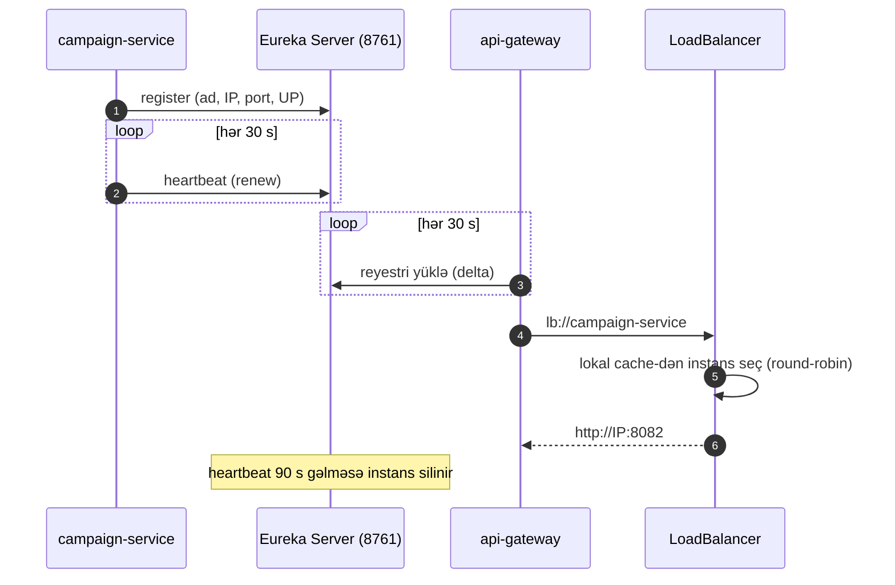

# 16. Spring Cloud platforması: Gateway, Eureka, LoadBalancer, Config Server və OpenAPI aqreqasiyası

## 16.1 Motivasiya

Bir neçə müstəqil servis olduqda dörd platforma problemi yaranır:

1. **Vahid giriş nöqtəsi** — klient 4 servisin ünvanını bilməməli; kəsişən narahatlıqlar (autentifikasiya, rate
   limiting, CORS, loglama) bir yerdə olmalıdır → **API Gateway**.
2. **Servis kəşfi** — instansların IP/portları dinamikdir; çağıran onları adla tapmalıdır → **Eureka**.
3. **Klient tərəfli yük balansı** — eyni servisin bir neçə instansı arasında sorğuları paylamaq → **Spring Cloud
   LoadBalancer**.
4. **Mərkəzi konfiqurasiya** — ortaq parametrləri bir yerdə saxlamaq → **Config Server**.

Bu fəsil hər birini nəzəri olaraq və layihədəki konfiqurasiya ilə izah edir; sonra gateway-in OpenAPI aqreqasiyasına
baxır.

## 16.2 Spring Cloud Gateway (WebFlux)

### Arxitektura

Layihə `spring-cloud-starter-gateway-server-webflux` (SCG 5.0.2) istifadə edir (`api-gateway/pom.xml:34-37`): reaktiv,
Netty üzərində işləyən gateway. (SCG-nin servlet əsaslı "Server MVC" variantı da mövcuddur.)

| Anlayış | İzah |
|---|---|
| **Route** | `id`, hədəf `uri`, `predicates` (nə vaxt uyğun gəlir), `filters` (sorğu/cavabı necə dəyişir) |
| **Predicate** | `Path`, `Method`, `Header`, `Host`, `Query`, ... |
| **GatewayFilter** | Marşruta bağlı filtr: `StripPrefix`, `RequestRateLimiter`, `RewritePath`, `Retry`, `CircuitBreaker` ... |
| **GlobalFilter** | Bütün marşrutlara tətbiq olunan filtr (layihədə JWT və 429 filtrləri) |
| **default-filters** | Konfiqurasiyada bütün marşrutlara əlavə olunan GatewayFilter-lər |

Sorğunun yolu: `RoutePredicateHandlerMapping` uyğun marşrutu tapır → `FilteringWebHandler` marşrut filtrlərini və qlobal
filtrləri **bir siyahıda `Ordered` dəyərinə görə** sıralayır → "pre" hissələr icra olunur → `ReactiveLoadBalancerClientFilter`
`lb://` URI-ni konkret instansa çevirir → `NettyRoutingFilter` downstream-ə HTTP sorğusu göndərir → "post" hissələr
əks sırada icra olunur.

**Konfiqurasiya ad fəzası.** SCG 5-də xassələr `spring.cloud.gateway.server.webflux.*` altındadır (köhnə
`spring.cloud.gateway.*` əvəzinə) — layihə yeni formadan istifadə edir (`api-gateway/src/main/resources/application.yml:17-19`).
Köhnə məqalələrdən götürülmüş konfiqurasiya bu versiyada işləməyə bilər.

### Layihənin marşrutları

[FAKT] (`api-gateway/src/main/resources/application.yml:27-67`):

| Route id | Predicate | Hədəf | Filtrlər |
|---|---|---|---|
| `auth-service-api` | `Path=/api/v1/auth/**` | `${AUTH_SERVICE_URI:lb://auth-service}` | default (rate limit) |
| `campaign-service-api` | `Path=/api/v1/campaigns/**` | `lb://campaign-service` | default |
| `dashboard-service-api` | `Path=/api/v1/dashboard/**` | `lb://dashboard-service` | default |
| `log-service-api` | `Path=/api/v1/logs/**` | `lb://log-service` | default |
| `auth-service-openapi` | `Path=/auth/v3/api-docs,/auth/v3/api-docs/**` | `lb://auth-service` | `StripPrefix=1` + default |
| `campaign-/dashboard-/log-service-openapi` | analoji | analoji | `StripPrefix=1` + default |

- `StripPrefix=1` birinci yol seqmentini atır: `/auth/v3/api-docs` → `/v3/api-docs`.
- `${AUTH_SERVICE_URI:lb://auth-service}` — README-yə görə lokal IDE-də `http://localhost:8081` kimi birbaşa URI
  verilə bilər (Eureka-sız); Compose-da `lb://` (`docker-compose.yml:62-65`).
- `/api/v1/logs/auth-audit` də gateway-dən keçir — lakin yalnız `ROLE_INTERNAL_SERVICE` token-i ilə işləyir; auth-service
  isə log-service-ə birbaşa müraciət edir.

### Filtrlərin tam sırası

| Sıra | Filtr | Növ |
|---|---|---|
| `HIGHEST_PRECEDENCE` | `GatewayRateLimitErrorResponseFilter` | Global (layihə) |
| 1 | `RequestRateLimiter` | Default filter (marşrut) |
| 2 | `StripPrefix` (yalnız OpenAPI marşrutları) | Marşrut |
| 100 | `GatewayJwtAuthenticationFilter` | Global (layihə) |
| SCG daxili | `ReactiveLoadBalancerClientFilter` (10150), `NettyRoutingFilter` (ən sonda) və s. | Global (SCG) |

[NƏTİCƏ] Konfiqurasiyadakı default və marşrut filtrləri SCG tərəfindən yazılış sırasına görə 1, 2, ... dəyərləri alır;
layihənin JWT filtrinin `getOrder()` şərhi (`GatewayJwtAuthenticationFilter.java:97-111`) "rate limiter-dən sonra"
işləmə niyyətini açıq ifadə edir.

### Başlıqlar və timeout-lar

- SCG standart olaraq `X-Forwarded-For`, `X-Forwarded-Proto`, `X-Forwarded-Host` başlıqlarını əlavə edir. [NƏTİCƏ]
  Downstream-dəki `SlowRequestLoggingFilter` `x-forwarded-for`-u Elasticsearch-ə yazır — klientin IP-si buradan gəlir.
- `Authorization` başlığı dəyişmədən ötürülür.
- **HTTP klient timeout-ları konfiqurasiya olunmayıb** (`spring.cloud.gateway.server.webflux.httpclient.connect-timeout`,
  `response-timeout`). [NƏTİCƏ] Standart cavab timeout-u yoxdur — asılı qalan servis gateway bağlantılarını tutur.
  Hər marşrut üçün `response-timeout` metadata-sı və ya qlobal dəyər tövsiyə olunur.
- `spring.cloud.loadbalancer.retry.enabled: true` (`api-gateway/src/main/resources/application.yml:13-16`) — [NƏTİCƏ] bu xassə Spring Cloud
  LoadBalancer-in **`@LoadBalanced` klientləri** (burada OpenAPI `WebClient`-i) üçün retry-ı aktivləşdirir; gateway
  marşrutları üçün təkrar `Retry` GatewayFilter-i ilə konfiqurasiya olunur və burada yoxdur.
- Marşrut səviyyəli `CircuitBreaker` filtri yoxdur.

## 16.3 Eureka: servis kəşfi

**Model**: hər servis başlanğıcda öz instans məlumatını (ad, IP, port, status, metadata) Eureka Server-ə **qeydiyyatdan
keçirir** və periodik **heartbeat** (standart 30 s) göndərir; klientlər reyestri periodik **yükləyir** (standart 30 s)
və lokal **cache**-dən istifadə edir. Heartbeat gəlməsə, instans lease müddətindən (standart 90 s) sonra silinir.



**Server** [FAKT] (`discovery-server/src/main/resources/application.yml:9-14`):

```yaml
eureka:
  client:
    register-with-eureka: false
    fetch-registry: false
  server:
    enable-self-preservation: false
```

- Tək node-lu server özünü qeydiyyatdan keçirmir və reyestri başqa yerdən almır.
- **Self-preservation** — şəbəkə problemi zamanı heartbeat-lərin kütləvi itməsini "instanslar ölüb" kimi deyil, "şəbəkə
  problemi" kimi qəbul edib instansları silməməkdir. Dev-də söndürülməsi ölü instansların tez silinməsi üçündür;
  istehsalda adətən aktiv saxlanılır.

**Klientlər** [FAKT] (məs. `campaign-service/src/main/resources/application.yml:32-40`):

| Xassə | Dəyər | Niyə |
|---|---|---|
| `service-url.defaultZone` | `${EUREKA_SERVER_URL:http://localhost:8761/eureka}` | Server ünvanı |
| `instance.prefer-ip-address` | `true` | Reyestrdə hostname əvəzinə IP |
| `instance.ip-address` | `${EUREKA_INSTANCE_IP_ADDRESS:127.0.0.1}` | Compose-da konteyner adı (`campaign-service`) — "IP" əvəzinə DNS adı yazılır |
| `instance.instance-id` | `${spring.application.name}:${server.port}` | Oxunaqlı instans id-si |

[NƏTİCƏ] `ip-address`-ə konteyner adını vermək Docker şəbəkəsində işləyən praktik hiylədir: gateway reyestrdən
`campaign-service:8082` alır və Docker DNS onu həll edir. Eyni servisin iki instansı eyni `instance-id`-ni alardı
(`campaign-service:8082`) — miqyaslanma üçün id unikal olmalıdır (məs. `${random.value}` əlavə etmək).

`eureka.client.healthcheck.enabled` təyin edilməyib: [NƏTİCƏ] instansın Eureka statusu actuator health-dən deyil, yalnız
heartbeat-dən asılıdır — DB-si düşmüş servis də `UP` görünür və trafik alır.

**Kim istifadə edir?** [FAKT] Yalnız api-gateway (marşrut `lb://` URI-ləri və OpenAPI `WebClient`-i). Qalan servislər
qeydiyyatdan keçir, lakin heç kimi kəşf etmir (F31).

## 16.4 Spring Cloud LoadBalancer

`lb://campaign-service` URI-si `ReactiveLoadBalancerClientFilter` tərəfindən həll olunur: `ServiceInstanceListSupplier`
(Eureka + caching) instans siyahısını verir, standart `RoundRobinLoadBalancer` birini seçir.

Gateway-in öz HTTP klienti üçün [FAKT] (`GatewayLoadBalancerConfiguration.java:26-30`):

```java
@Bean
@LoadBalanced
public WebClient.Builder loadBalancedWebClientBuilder() {
    return WebClient.builder();
}
```

`@LoadBalanced` qualifier-i bu builder-ə load-balancer exchange filter-i əlavə edir; nəticədə
`webClient.get().uri("lb://auth-service/v3/api-docs")` işləyir. [NƏTİCƏ] Diqqət: bu bean kontekstdə yeganə
`WebClient.Builder` olarsa, onu inject edən **hər** komponent load-balanced builder alır; xarici URL-lərə gedən klient
üçün ayrıca, `@LoadBalanced`-siz builder lazımdır.

## 16.5 Config Server

**Server** [FAKT] (`config-server/src/main/resources/application.yml:6-12`): `native` profil, `search-locations:
classpath:/config` — konfiqurasiya faylları Git-dən deyil, config-server jar-ının öz classpath-indən oxunur.
`config/application.yml` adı xüsusidir: **bütün** klient tətbiqlərinə paylanır (`/{application}/{profile}` sorğusunda
`application.yml` həmişə daxil edilir).

Paylaşılan məzmun [FAKT] (`config-server/src/main/resources/config/application.yml`): virtual thread-lər, Kafka bootstrap
və consumer parametrləri (`auto-offset-reset: earliest`, trusted packages), Eureka URL, `app.*` (yavaş sorğu həddi,
mövzular, JWT issuer/public key), management/tracing.

**Klientlər**: `spring.config.import: optional:configserver:${CONFIG_SERVER_URL:http://localhost:8888}`
(məs. `campaign-service/src/main/resources/application.yml:6-7`). Klient başlanğıcda `GET /campaign-service/default`
sorğusu ilə konfiqurasiyanı alır.

Qiymətləndirmə [NƏTİCƏ]:
- **Dəyər yaratmır, risk gətirir**: paylanan xassələrin demək olar ki, hamısı servislərin lokal `application.yml`-ində də
  var. Fərqli olan yeganə mühüm dəyər `auto-offset-reset: earliest`-dir və o da yalnız Config Server əlçatan olduqda
  tətbiq olunur (F32).
- **`native` + classpath** — konfiqurasiyanı dəyişmək üçün config-server-i yenidən build və deploy etmək lazımdır;
  Git backend (versiyalama, audit, PR baxışı) Config Server-in əsas üstünlüyüdür.
- **Refresh yoxdur** — `@RefreshScope`, `/actuator/refresh` və ya Spring Cloud Bus istifadə olunmur; dəyişiklik yalnız
  restart ilə tətbiq olunur.
- **Sirrlərin idarəsi yoxdur** — `{cipher}` şifrələmə və ya Vault inteqrasiyası yoxdur (sirrlər onsuz da Compose
  env-dədir).
- **Discovery-first deyil** — klientlər Config Server-i Eureka ilə deyil, sabit URL ilə tapır; config-server-in Eureka-da
  qeydiyyatı istifadə olunmur.
- README-də göstərilən `config-repository/` qovluğu repozitoriyada yoxdur.

## 16.6 OpenAPI aqreqasiyası

**Servislərdə**: `springdoc-openapi-starter-webmvc-ui` hər servisdə `/v3/api-docs` və `/swagger-ui.html` verir
(`campaign-service/pom.xml:133-137`); controller-lərdəki `@Operation` annotasiyaları sənədə düşür.

**Gateway-də**: `springdoc-openapi-starter-webflux-ui` Swagger UI-ı təqdim edir və onu dörd sənədə yönləndirir
[FAKT] (`api-gateway/src/main/resources/application.yml:68-83`): `/openapi/auth`, `/openapi/campaign`,
`/openapi/dashboard`, `/openapi/logs`. Bu URL-ləri gateway-in öz controller-i təqdim edir:

<!-- src: api-gateway/src/main/java/com/casestudy/insurancecampaign/gateway/openapi/GatewayOpenApiController.java:87-106 -->
```java
@GetMapping(value = "/{service}", produces = MediaType.APPLICATION_JSON_VALUE)
public Mono<ResponseEntity<String>> openApi(@PathVariable String service) {
    OpenApiTarget target = targets.get(service);
    if (target == null) {
        return Mono.just(ResponseEntity.status(HttpStatus.NOT_FOUND)
                .contentType(MediaType.APPLICATION_JSON)
                .body(json(Map.of(
                        "code", "OPENAPI_TARGET_NOT_FOUND",
                        "message", "Unknown OpenAPI target: " + service
                ))));
    }

    return webClient.get()
            .uri(target.upstreamUrl())
            .accept(MediaType.APPLICATION_JSON)
            .retrieve()
            .bodyToMono(String.class)
            .map(this::jsonResponse)
            .onErrorResume(exception -> Mono.just(jsonResponse(fallbackDocument(target, exception))));
}
```

- Reaktiv zəncir: `WebClient` → `Mono<String>` → `ResponseEntity`; heç bir thread bloklanmır.
- `onErrorResume` — servis əlçatmaz olduqda Swagger UI-ın boş qalmaması üçün **fallback sənəd** qaytarılır. Bu, kiçik,
  lakin aydın **graceful degradation** nümunəsidir.
- Fallback yolları əl ilə yazılıb (`GatewayOpenApiController.java:172-219`) və kodun təkrarıdır. [FAKT] Onlar natamamdır:
  dashboard fallback-ında tarixçə endpoint-i, log fallback-ında `auth-audit` yoxdur. Endpoint dəyişdikcə fallback
  köhnələcək.
- `WebClient` çağırışında timeout yoxdur — servis asılı qalsa, Swagger UI da gözləyir (`onErrorResume` yalnız xəta
  siqnalında işləyir).
- [H] Canlı sənədin `servers` sahəsi springdoc tərəfindən **daxil olan sorğunun** URL-indən qurulur; sorğunu gateway-in
  WebClient-i servisin daxili ünvanına göndərdiyi üçün `servers` daxili host-u (`http://campaign-service:8082`) göstərə
  bilər və Swagger UI-ın "Try it out" funksiyası brauzerdən həmin ünvana getməyə çalışar. Bu, runtime-da yoxlanmayıb;
  standart həll — springdoc-da `servers`-i açıq təyin etmək və ya `X-Forwarded-*` başlıqlarını ötürüb
  `server.forward-headers-strategy=framework` istifadə etmək. Fallback sənəd isə `servers: http://localhost:8080`-ı açıq
  yazır.
- [H] (F30) springdoc 2.8.x xətti Spring Boot 3 üçün hazırlanıb; Spring Boot 4 / Framework 7 ilə rəsmi dəstəklənən xətt
  springdoc 3.x-dir. Uyğunsuzluq runtime xətalarına səbəb olarsa, gateway-in fallback mexanizmi bunu gizlədə bilər.

## 16.7 Konfiqurasiyanın izlənməsi (gateway)

| Mühit dəyişəni (Compose) | Xassə | İstehlakçı |
|---|---|---|
| `AUTH_SERVICE_URI=lb://auth-service` | marşrut `uri` | SCG |
| `APP_OPENAPI_AUTH_SERVICE_URL` | `app.openapi.auth-service-url` (relaxed binding) | `GatewayOpenApiController` `@Value` |
| `JWT_PUBLIC_KEY_LOCATION` | `app.jwt.public-key-location` | `GatewayJwtProperties` → `GatewayJwtTokenService` |
| `REDIS_HOST`, `REDIS_PORT` | `spring.data.redis.*` | Reaktiv Redis → `RedisRateLimiter` |
| `RATE_LIMITER_*` | `redis-rate-limiter.*` | `RequestRateLimiter` |
| `EUREKA_SERVER_URL` | `eureka.client.service-url.defaultZone` | Eureka klienti |

[FAKT] `application.yml`-də OpenAPI URL-lər `${AUTH_SERVICE_OPENAPI_URL:...}` yer tutanı ilə yazılıb
(`api-gateway/src/main/resources/application.yml:121-126`), Compose isə `APP_OPENAPI_AUTH_SERVICE_URL` verir. [NƏTİCƏ] Spring Boot-un mühit dəyişəni
relaxed binding-i `APP_OPENAPI_AUTH_SERVICE_URL`-i birbaşa `app.openapi.auth-service-url` xassəsinə bağlayır (yer
tutanın özünü üstələyir), ona görə hər iki ad işləyir; dəyərlər onsuz da standart dəyərlərlə eynidir.

## 16.8 Uğursuzluq ssenariləri

| Ssenari | Nəticə |
|---|---|
| Eureka düşüb (gateway işləyir) | Gateway-in lokal reyestr cache-i ilə köhnə instanslar istifadə olunur; yeni instanslar görünmür |
| Servis qeydiyyatdan keçməyib / hamısı düşüb | `lb://` həll olunmur → 503 |
| Servis instansı ölüb, reyestrdə hələ var | Bağlantı xətası → 500/503, lease bitənə qədər (90 s + cache) |
| Servis asılı qalıb | Gateway timeout yoxdur → sorğu gözləyir |
| Config Server düşüb | `optional:` → servislər lokal konfiqurasiya ilə başlayır |
| Redis düşüb | Rate limit fail-open |

## 16.9 Alternativlər və yeni layihədə tətbiq

| Platforma ehtiyacı | Spring Cloud həlli (layihədə) | Kubernetes-də tipik həll |
|---|---|---|
| Servis kəşfi | Eureka | Kubernetes Service + DNS |
| Yük balansı | Spring Cloud LoadBalancer | kube-proxy / service mesh |
| Konfiqurasiya | Config Server | ConfigMap, Secret, external secrets |
| Gateway | Spring Cloud Gateway | Ingress / Gateway API (Envoy, NGINX), və ya yenə SCG |
| Resilience | Resilience4j | Service mesh (Istio) retry/timeout/CB + Resilience4j |

Kubernetes-ə köçürülən sistemdə Eureka və Config Server çox vaxt lazımsız olur; Spring Cloud Kubernetes adapterləri
eyni proqramlaşdırma modelini saxlamağa imkan verir.

Yeni gateway üçün yoxlama siyahısı: marşrut başına timeout; retry yalnız idempotent metodlar üçün (GET); circuit breaker +
fallback; vahid xəta formatı (`ErrorWebExceptionHandler`); CORS; etibarlı XFF; marşrut başına rate limit; trace
yayılması; açıq yolların dəqiq siyahısı.

## 16.10 Praktiki tapşırıqlar

Tapşırıqları öz fork-unuzda, ayrıca branch-da edin. Çətinlik: ★ — 30 dəqiqəyə qədər, ★★ — bir neçə saat, ★★★ — təxminən bir gün. "Gözlənilən nəticə" koddan çıxardığım proqnozdur; sizdə fərqli çıxarsa, səbəbini tapmaq tapşırığın ən dəyərli hissəsidir.

**T1 ★ — Reyestri oxuyun.** `curl -H 'Accept: application/json' localhost:8761/eureka/apps`. **Yoxlama:**
campaign-service instansının IP, port, status və `instanceId`-ni tapın və `eureka.instance` ayarları ilə müqayisə edin.

**T2 ★★ — İnstansın həyat dövrü.** `docker compose stop campaign-service`, sonra gateway marşrutunu hər 5 saniyədən bir
çağırın və cavabları vaxtı ilə yazın; servisi qaytarıb eyni ölçməni edin. **Yoxlama:** ölçdüyünüz müddəti 16.3-dəki
30/90 saniyəlik intervallarla izah edin.

**T3 ★★ — Gateway timeout-u.** `spring.cloud.gateway.server.webflux.httpclient.response-timeout: 5s` (prefiks SCG 5.0.2
mənbəsindən yoxlanılıb). `docker compose pause campaign-service` ilə sınayın. **Gözlənilən nəticə:** 5 saniyədən sonra
504, sonsuz gözləmə yoxdur.

**T4 ★★ — Config Server əlçatmaz olanda (F32).** `config-server/src/main/resources/config/application.yml`-i oxuyun,
config-server-i dayandırıb log-service-i yeni consumer group adı ilə başladın. **Yoxlama:** consumer-in köhnə mesajları
oxuyub-oxumadığını izah edin (`auto-offset-reset`).

## 16.11 Müsahibə sualları

**S1. Gateway-də GlobalFilter və GatewayFilter fərqi nədir?**
Cavab: GatewayFilter konkret marşruta (və ya `default-filters` ilə hamısına) konfiqurasiya ilə bağlanır; GlobalFilter
bean kimi bütün marşrutlara tətbiq olunur. İcra zamanı hamısı bir siyahıda `Ordered` dəyərinə görə sıralanır.

**S2. `lb://` URI-si necə həll olunur?**
Cavab: `ReactiveLoadBalancerClientFilter` servis adını `ReactorLoadBalancer`-ə ötürür, o, `ServiceInstanceListSupplier`
(Eureka reyestri + cache) siyahısından RoundRobin ilə instans seçir və URI-ni `http://host:port`-a çevirir.

**S3. Eureka self-preservation nədir?**
Cavab: Heartbeat-lərin gözləniləndən çox azalması zamanı Eureka instansları silməyi dayandırır, çünki bunu instansların
deyil, şəbəkənin problemi kimi qiymətləndirir. Səhv-müsbət silinmələrin qarşısını alır, lakin ölü instansların
reyestrdə qalmasına səbəb ola bilər.

**S4. Config Server-dən gələn xassə ilə lokal xassə toqquşduqda hansı qalib gəlir? Config Server optional olduqda risk nədir?**
Cavab: Standart olaraq remote (Config Server) xassələri. Optional olduqda server əlçatmaz olsa tətbiq başlayır, lakin
yalnız Config Server-də olan dəyərlər itir və davranış sakitcə dəyişir (layihədə `auto-offset-reset`).

**S5. Gateway-də niyə timeout təyin etmək vacibdir?**
Cavab: Gateway bütün trafikin keçdiyi yerdir; bir yavaş servis gateway-in bağlantılarını və yaddaşını tutub digər
marşrutlara da təsir edə bilər. Timeout uğursuzluğu lokallaşdırır.

**S6. Eureka olmadan bu sistemi necə qurardınız?**
Cavab: Kubernetes-də Service DNS (`http://campaign-service:8082`), ConfigMap/Secret, Ingress və ya Gateway API; və ya
sadə Compose-da static DNS adları (layihədə dashboard və auth onsuz da belə edir).

## 16.12 Xülasə

- SCG WebFlux: 8 marşrut, default rate limit, iki layihə qlobal filtri; timeout, retry və CB marşrutlarda yoxdur.
- Eureka bütün servislərin reyestridir, lakin yalnız gateway kəşfdən istifadə edir; health check inteqrasiyası yoxdur.
- Config Server `native` classpath rejimindədir; paylaşılan fayl əsasən təkrardır, `auto-offset-reset` istisnası risk
  yaradır.
- Gateway OpenAPI controller-i canlı sənədləri `lb://` WebClient ilə toplayır, xətada fallback verir.
- Növbəti fəsil metriklər, loglar və trace-lərdən ibarət observability stekini öyrədir.
