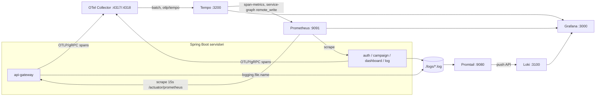

# 17. Observability: metriklər, trace-lər və loglar

## 17.1 Motivasiya: "nə baş verir?" sualına cavab vermək

Monolitdə bir log faylı və bir stack trace çox vaxt kifayətdir. Mikroservislərdə bir sorğu gateway, iki servis, Redis,
Kafka və Elasticsearch-dən keçir. Problemi tapmaq üçün üç növ siqnal lazımdır:

| Siqnal | Sual | Layihədə |
|---|---|---|
| **Metriklər** | Nə qədər? Nə qədər tez? Nə qədər xəta? (aqreqat, ucuz) | Micrometer → `/actuator/prometheus` → Prometheus |
| **Trace-lər** | Bu konkret sorğu hansı komponentlərdən keçdi, vaxt harada itdi? | Micrometer Tracing → OpenTelemetry → Collector → Tempo |
| **Loglar** | Hansı hadisə baş verdi, hansı detal ilə? | Log faylları → Promtail → Loki |
| Hamısının birləşməsi | Bir siqnaldan digərinə keçid | Grafana (traceId ilə korrelyasiya) |

Əlavə olaraq layihədə tətbiq səviyyəli iki "jurnal" var: Elasticsearch-dəki **yavaş sorğular** və **auth auditləri**.



## 17.2 Metriklər: Actuator, Micrometer, Prometheus

**Micrometer** metrik fasadıdır (SLF4J-in metrik analoqu): kod `Timer`, `Counter`, `Gauge` yaradır, registry onları
konkret formata (Prometheus, OTLP, ...) ixrac edir. Spring Boot avtomatik olaraq JVM (yaddaş, GC, thread-lər), sistem,
HTTP server (`http.server.requests`), HikariCP, Tomcat, Kafka consumer (Boot factory-si olduqda), cache və s. metriklərini
qeydiyyatdan keçirir.

Layihə konfiqurasiyası [FAKT] (məs. `campaign-service/src/main/resources/application.yml:50-59`):

```yaml
management:
  otlp:
    metrics:
      export:
        enabled: false
  endpoints:
    web:
      exposure:
        include: health,info,prometheus,metrics
```

- `micrometer-registry-prometheus` → `/actuator/prometheus` endpoint-i (mətn formatı).
- OTLP metrik ixracı söndürülüb — metriklər yalnız Prometheus **pull** modeli ilə toplanır; OTLP yalnız trace-lər üçündür.
- `health,info,prometheus,metrics` açıqdır və security-də `permitAll`-dur (F40).

**Prometheus scrape** [FAKT] (`observability/prometheus/prometheus.yml:1-24`): 15 s interval, beş iş (job):
`api-gateway`, `auth-service`, `campaign-service`, `dashboard-service`, `log-service`. [FAKT] Docker variantında
config-server və discovery-server scrape olunmur; lokal variant (`prometheus-local.yml`) isə onları da
`host.docker.internal` ilə scrape edir — iki fayl arasında uyğunsuzluq.

Prometheus Compose-da `--web.enable-remote-write-receiver` bayrağı ilə işləyir (`docker-compose.yml:378-382`) — bu,
Tempo-nun generasiya etdiyi span metriklərini qəbul etmək üçündür (aşağıda).

**Faydalı sorğular** (PromQL):

```promql
# Servis üzrə sorğu sürəti (Grafana dashboard-undakı ilə eyni)
sum by (job) (rate(http_server_requests_seconds_count{uri!~"/actuator.*"}[5m]))
# 5xx nisbəti
sum by (job) (rate(http_server_requests_seconds_count{status=~"5.."}[5m]))
  / sum by (job) (rate(http_server_requests_seconds_count[5m]))
# Orta gecikmə (histogram aktiv olmadıqda yalnız orta və max mövcuddur)
sum by (job) (rate(http_server_requests_seconds_sum[5m])) / sum by (job) (rate(http_server_requests_seconds_count[5m]))
# Bağlantı hovuzu gözləmələri
hikaricp_connections_pending
```

[NƏTİCƏ] `management.metrics.distribution.percentiles-histogram.http.server.requests` təyin edilməyib — Prometheus-da
p95/p99 hesablamaq üçün histogram bucket-ləri yoxdur, yalnız `count`, `sum` və `max`. Gecikmə SLO-ları üçün histogram
aktivləşdirilməlidir.

## 17.3 Distributed tracing

### Nəzəriyyə

- **Trace** — bir sorğunun bütün sistem üzrə yolu; **span** — bir işin vahidi (HTTP server sorğusu, HTTP klient çağırışı,
  DB sorğusu); span-ların valideyn-uşaq ağacı trace-i təşkil edir.
- **Kontekst yayılması (propagation)** — trace id və valideyn span id prosesdən prosesə başlıqla ötürülür. **W3C Trace
  Context** standartı: `traceparent: 00-<32 hex trace-id>-<16 hex span-id>-<flags>`.
- **Sampling** — hansı trace-lərin saxlanacağı. Layihədə `probability: 1.0` (hamısı) — dev üçün uyğun, yüksək trafikdə
  bahalıdır (tipik dəyər 0.01–0.1 və ya tail sampling Collector-da).

### Spring Boot 4 tracing steki

`spring-boot-starter-opentelemetry` (biznes servisləri) Micrometer Observation API-ni Micrometer Tracing → OpenTelemetry
bridge → OTLP exporter zəncirinə bağlayır. config-server və discovery-server isə eyni nəticəni
`micrometer-tracing-bridge-otel` + `opentelemetry-exporter-otlp` asılılıqları ilə alır (`config-server/pom.xml:29-36`).

Konfiqurasiya [FAKT] (`campaign-service/src/main/resources/application.yml:60-76`):

<!-- src: campaign-service/src/main/resources/application.yml:60-76 -->
```yaml
tracing:
  sampling:
    probability: ${MANAGEMENT_TRACING_SAMPLING_PROBABILITY:1.0}
  propagation:
    type: w3c
  export:
    otlp:
      enabled: ${MANAGEMENT_TRACING_EXPORT_OTLP_ENABLED:true}
opentelemetry:
  resource-attributes:
    service.name: ${OTEL_SERVICE_NAME:${spring.application.name}}
  enabled: true
  tracing:
    export:
      otlp:
        endpoint: ${OTEL_EXPORTER_OTLP_TRACES_ENDPOINT:http://localhost:4317}
        transport: ${OTEL_EXPORTER_OTLP_TRACES_PROTOCOL:grpc}
```

- `transport: grpc` → OTLP/gRPC, port 4317. OTLP/HTTP (4318) üçün endpoint `/v1/traces` ilə bitməlidir; README bu
  səhvin simptomunu (`404` export xətası) təsvir edir.
- `service.name` resurs atributu Tempo-da servisi müəyyən edir (`{ resource.service.name = "campaign-service" }`).
- [NƏTİCƏ] Compose-dakı `OTEL_TRACES_EXPORTER` və `OTEL_RESOURCE_ATTRIBUTES` dəyişənləri OpenTelemetry SDK
  autoconfigure konvensiyalarıdır; Spring Boot-un öz OpenTelemetry auto-configuration-u əsasən `management.*`
  xassələrindən istifadə edir. Yer tutanlarla xassələrə bağlanan dəyişənlər (`OTEL_EXPORTER_OTLP_TRACES_ENDPOINT`,
  `OTEL_SERVICE_NAME`) mütləq təsir edir; qalanlarının təsiri bu bələdçidə yoxlanmayıb.

### Observation fərdiləşdirməsi

`common` modulundakı konfiqurasiya iki bean təqdim edir [FAKT]
(`HttpServerObservationConfiguration.java:37-83`):

<!-- src: common/src/main/java/com/casestudy/insurancecampaign/common/observability/HttpServerObservationConfiguration.java:37-47 -->
```java
@Bean
public ObservationPredicate ignoreActuatorHttpServerObservations() {
    return (name, context) -> {
        if (!HTTP_SERVER_REQUESTS.equals(name)) {
            return true;
        }

        String path = requestPath(context);
        return path == null || !path.startsWith("/actuator");
    };
}
```

- **`ObservationPredicate`** observasiyanın ümumiyyətlə yaradılıb-yaradılmayacağını həll edir. Actuator sorğuları üçün
  `false` qaytarır. [NƏTİCƏ] Nəticə: Prometheus scrape-ləri Tempo-nu doldurmur — **həm də** actuator sorğuları
  `http_server_requests` metriklərində görünmür, çünki eyni observasiya həm metrik, həm span yaradır.
- **`ObservationFilter`** (`:58-83`) span-ın kontekstual adını `http <method> <route>` edir (məs.
  `http get /api/v1/campaigns/{id}`) — route şablonu (aşağı kardinallıq) istifadə olunur, konkret id yox; bu, Tempo-da
  axtarış və span-metric qruplaşdırması üçün vacibdir.
- `requestPath` (`:111-132`) refleksiya ilə həm Servlet (`getRequestURI`), həm WebFlux (`getURI`) carrier-lərini dəstəkləyir —
  eyni kodun gateway-də də işləməsi üçün. Lakin gateway `common`-dan asılı olmadığı üçün kod üç dəfə kopyalanıb (F23).

### Kontekst sistem üzrə necə yayılır

| Sərhəd | Yayılırmı | Mexanizm / qeyd |
|---|---|---|
| Klient → gateway → servis (HTTP) | Bəli [NƏTİCƏ] | SCG Netty klienti instrumentasiya olunur, `traceparent` əlavə edilir |
| auth → log (`RestClient` HTTP Interface) | Ehtimal ki, bəli [NƏTİCƏ] | Boot-un `RestClient.Builder`-i observation ilə konfiqurasiya olunur |
| `@Async` sərhədi (audit) | **Xeyr** [NƏTİCƏ] | `TaskExecutorAdapter(newVirtualThreadPerTaskExecutor())` kontekst ötürmür (F34) → audit çağırışı ayrı trace kimi görünə bilər |
| dashboard → campaign (gRPC) | Ehtimal ki, bəli [NƏTİCƏ] | net.devh `Grpc*MicrometerTraceAutoConfiguration` (`ObservationRegistry` bean-i olduqda) |
| campaign/log → Kafka → log-service | **Xeyr** | `KafkaTemplate` əl ilə yaradılıb, observation aktiv deyil; əvəzinə `traceId` payload-da ötürülür |
| Servis → PostgreSQL/Redis | Qismən | JDBC üçün xüsusi instrumentasiya (datasource-micrometer) yoxdur; Lettuce Micrometer inteqrasiyası Boot-da var |

### Collector və Tempo

OpenTelemetry Collector [FAKT] (`observability/otel-collector/otel-collector.yml:1-25`): `otlp` receiver (gRPC 4317,
HTTP 4318) → `batch` processor → `otlp/tempo` (TLS-siz) və `debug` exporter-ləri. Collector-un faydası: tətbiqləri
backend-dən ayırır (backend dəyişsə tətbiq dəyişmir), batch, retry, sampling, atribut emalı bir yerdə.

Tempo [FAKT] (`observability/tempo/tempo.yml`): lokal disk saxlaması; `metrics_generator` `span-metrics`,
`service-graphs` və `service-graphs-connection-info` prosessorları ilə trace-lərdən RED metrikləri və servis qrafını
çıxarıb Prometheus-a `remote_write` edir (`tempo.yml:16-28`, `40-44`). Grafana-nın Tempo datasource-u servis xəritəsi üçün
məhz bu metriklərdən istifadə edir.

TraceQL nümunələri (README-dən):

```text
{ resource.service.name = "campaign-service" && duration > 500ms }
{ status = error }
```

## 17.4 Loglar: fayllar, Promtail, Loki

Hər servis log-u fayla yazır və səviyyə nümunəsinə trace kontekstini əlavə edir [FAKT]
(`campaign-service/src/main/resources/application.yml:87-91`):

```yaml
logging:
  file:
    name: ${LOGGING_FILE_NAME:logs/campaign-service.log}
  pattern:
    level: '%5p [campaign-service,%X{traceId:-},%X{spanId:-}]'
```

`logging.pattern.level` Boot-un standart sətir nümunəsindəki səviyyə hissəsini əvəzləyir: `INFO [campaign-service,
4bf92f3577b34da6a3ce929d0e0e4736,00f067aa0ba902b7]`. `%X{traceId:-}` MDC-dən oxuyur — Micrometer Tracing aktiv span-ın
id-lərini MDC-yə yazır.

Compose bütün servislərin `/app/logs`-unu host-un `./logs` qovluğuna bağlayır, Promtail həmin qovluğu oxuyur.

**Promtail pipeline-ı** [FAKT] (`observability/promtail/promtail-config.yml:39-49`):

<!-- src: observability/promtail/promtail-config.yml:39-49 -->
```yaml
pipeline_stages:
  - regex:
      expression: '^(?P<timestamp>\d{4}-\d{2}-\d{2}T\S+)\s+(?P<level>TRACE|DEBUG|INFO|WARN|ERROR)\s+\[[^,\]]+,(?P<trace_id>[^,]*),(?P<span_id>[^\]]*)\].*$'
  - timestamp:
      source: timestamp
      format: RFC3339Nano
      action_on_failure: fudge
  - labels:
      level:
      trace_id:
      span_id:
```

- Regex Boot-un ISO vaxt damğası + yuxarıdakı səviyyə nümunəsi ilə uyğunlaşdırılıb.
- [RİSK] (F24) `trace_id` və `span_id` **label**-a çevrilir. Loki-də hər unikal label dəyəri kombinasiyası ayrı **stream**
  yaradır; hər sorğunun yeni trace id-si olduğu üçün stream sayı sorğu sayı qədər artır — indeks şişir, performans
  düşür. Loki-nin tövsiyəsi: yüksək kardinallıqlı dəyərləri label etməmək, sorğuda filtr (`|= "<traceId>"`) və ya
  **structured metadata** istifadə etmək.
- Çoxsətirli stack trace-lər üçün `multiline` mərhələsi yoxdur — hər stack trace sətri ayrı log qeydi olur.
- Yalnız beş servisin faylı toplanır; config-server və discovery-server log-ları (fayla yazılsa da) Loki-yə getmir.
- [NƏTİCƏ] Grafana Promtail-i köhnəlmiş (deprecated) elan edib və Grafana Alloy-a keçidi tövsiyə edir; yeni layihədə Alloy
  və ya OpenTelemetry Collector-un `filelog` receiver-i istifadə olunmalıdır.

Loki [FAKT] (`observability/loki/loki-config.yml`): auth söndürülüb, fayl sistemi saxlaması, TSDB sxemi v13, `inmemory`
ring, replikasiya 1 — tək node-lu dev konfiqurasiyası; saxlanma (retention) siyasəti yoxdur.

## 17.5 Grafana: korrelyasiya

Datasource provisioning [FAKT] (`observability/grafana/provisioning/datasources/datasources.yml`):

| Datasource | UID | Korrelyasiya |
|---|---|---|
| Prometheus | `prometheus` | Standart datasource |
| Loki | `loki` | **Derived field** `TraceID`: regex `\[[^,]+,([a-fA-F0-9]{16,32}),[a-fA-F0-9]{16}\]` (`datasources.yml:24-29`) log sətrindən trace id-ni çıxarır və Tempo-ya link edir |
| Tempo | `tempo` | **tracesToLogsV2** — trace-dən Loki-yə: `{job=~".*-logs", trace_id="${__trace.traceId}"}` (`:39-49`); `serviceMap` → Prometheus |

Beləliklə üç istiqamətdə keçid mümkündür: log → trace (derived field), trace → loglar (tracesToLogs), metrik → trace
(exemplar-lar aktiv olsaydı; Tempo `send_exemplars: true` göndərir).

Dashboard [FAKT] (`observability/grafana/dashboards/campaign-logs-traces.json`): "Campaign - Logs and Traces", servis
seçici dəyişəni və üç panel — Loki log siyahısı, Prometheus HTTP sorğu sürəti, səviyyə üzrə log sayı.

## 17.6 Sağlamlıq yoxlamaları

- `/actuator/health` hər servisdə açıqdır.
- Compose-da healthcheck yalnız infrastruktur üçündür (PostgreSQL, Redis, Kafka, Elasticsearch) — Spring servisləri üçün
  `healthcheck` yoxdur, ona görə `depends_on: condition: service_healthy` yalnız infrastruktura tətbiq oluna bilir.
- Eureka statusu health-ə bağlı deyil (fəsil 16.3).
- Kubernetes-də Boot liveness/readiness qruplarını (`/actuator/health/liveness`, `/readiness`) avtomatik aktivləşdirir;
  Compose-da bunlar istifadə olunmur.

## 17.7 Tətbiq səviyyəli jurnallar və metriklərin üst-üstə düşməsi

Yavaş sorğu jurnalı (Kafka → ES) ilə `http_server_requests` metrikləri və trace-lər eyni sualın fərqli cavablarıdır:
metriklər aqreqat gecikməni, trace-lər konkret sorğunun strukturunu, ES qeydi isə konkret sorğunun metadata-sını
(yol, status, müddət, user-agent, XFF, traceId) verir. [NƏTİCƏ] Tempo + histogram metrikləri olduqda ES yavaş sorğu jurnalı
əsasən təkrardır; onun dəyəri case study-də Kafka → ES axınını nümayiş etdirməkdir. İstehsalda bu məlumat adətən
trace backend-dən (TraceQL `duration > X`) alınır.

## 17.8 Real insident araşdırması: "Dashboard statistikası 500 qaytarır"

1. **Simptom**: admin `GET /api/v1/dashboard/classifieds/statistics` → 500,
   `{"code":"INTERNAL_SERVER_ERROR","message":"UNAVAILABLE: io exception"}`.
2. **Metrik**: Grafana → `http_server_requests_seconds_count{job="dashboard-service",status="500"}` artıb;
   `campaign-service` üçün sorğu sürəti sıfıra düşüb → campaign-service problemi ehtimalı.
3. **Trace**: Tempo → `{ resource.service.name = "dashboard-service" && status = error }`. Trace-də gateway span-ı →
   dashboard server span-ı → gRPC klient span-ı xəta ilə; campaign-service span-ı yoxdur → çağırış ora çatmayıb.
4. **Log**: Loki → `{job="dashboard-service-logs", level="ERROR"}`. [RİSK] (F38) `GlobalExceptionHandler` loglamadığı
   üçün burada stack trace **tapılmayacaq** — bu, araşdırmanı çətinləşdirən real boşluqdur. `{job="campaign-service-logs"}`
   — son log-lar startup xətası və ya OOM göstərə bilər.
5. **Platforma**: `docker compose ps campaign-service`, Eureka dashboard-da instans statusu.
6. **Kök səbəb** (nümunə): campaign-service `campaign-db` hazır olmadan başlayıb, Liquibase bağlantı xətası ilə çıxıb,
   `restart` siyasəti olmadığı üçün yenidən başlamayıb (F29).
7. **Düzəliş və qarşısının alınması**: `depends_on: condition: service_healthy`, `restart: on-failure`, gRPC klientində
   status → 503 xəritəsi, exception handler-də loglama.

## 17.9 Yeni layihədə tətbiq

- RED metrikləri (Rate, Errors, Duration) hər servis üçün; histogram + SLO alert-ləri (məs. "5 dəq ərzində 5xx > 1%").
- Strukturlaşdırılmış JSON loglar: Spring Boot 3.4+ `logging.structured.format.console=ecs|logstash|gelf` — trace id-lər
  ayrıca sahə kimi; regex parsing lazım olmur.
- Kafka observation: `KafkaTemplate.setObservationEnabled(true)`, konteynerdə `setObservationEnabled(true)` (və ya Boot
  xassələri `spring.kafka.template.observation-enabled`, `spring.kafka.listener.observation-enabled`).
- `@Async` üçün `ContextPropagatingTaskDecorator`.
- İstehsalda sampling < 100%, Collector-da tail sampling (xətalı və yavaş trace-lər həmişə saxlanılır).
- Loki label-ları: yalnız aşağı kardinallıqlı (`service`, `level`, `env`).
- Actuator-u ayrı port və şəbəkə ilə qorumaq.

## 17.10 Müsahibə sualları

**S1. Metrik, log və trace fərqi və hər birinin xərci?**
Cavab: Metrik — aqreqat ədədlər, ucuz, uzunmüddətli saxlanılır, "nə qədər" sualına cavab. Log — diskret hadisələr,
detallıdır, həcmi böyükdür. Trace — bir sorğunun komponentlər üzrə strukturu, "harada" sualına cavab; sampling tələb
edir. Yaxşı sistem onları id-lərlə əlaqələndirir.

**S2. W3C `traceparent` başlığında nə var?**
Cavab: Versiya, 16 baytlıq trace-id, 8 baytlıq valideyn span-id, flags (sampled). Hər hop yeni span yaradır, trace-id
eyni qalır.

**S3. Loki-də trace_id-ni label etmək niyə pisdir?**
Cavab: Hər label kombinasiyası ayrı stream-dir; trace_id unikal olduğu üçün stream sayı partlayır, indeks böyüyür,
sorğular yavaşlayır. Trace id log mətnində və ya structured metadata-da qalmalı, sorğuda filtr ilə tapılmalıdır.

**S4. `ObservationPredicate` actuator-u süzəndə metriklərə nə olur?**
Cavab: Observasiya ümumiyyətlə yaradılmır — həm span, həm `http.server.requests` timer-i yox olur. Yalnız trace-ləri süzmək
üçün span səviyyəli filtr (məs. sampler və ya `SpanExportingPredicate`) istifadə olunmalıdır.

**S5. Kafka sərhədində trace kontekstini necə ötürmək olar?**
Cavab: Producer observation `traceparent`-i Kafka başlığına yazır, consumer observation onu oxuyub yeni span-ı valideynə
bağlayır. Spring Kafka-da `observationEnabled`. Layihədə bu yoxdur — traceId payload-da daşınır, Tempo-da əlaqə qurulmur.

**S6. Collector-un tətbiqdən birbaşa Tempo-ya göndərməkdən üstünlüyü?**
Cavab: Backend müstəqilliyi, batch/retry, sampling (xüsusilə tail sampling), atributların zənginləşdirilməsi və ya
təmizlənməsi (PII), bir neçə backend-ə eyni anda göndərmə, tətbiq konfiqurasiyasının sadələşməsi.

## 17.11 Xülasə

- Metriklər Prometheus ilə pull, trace-lər OTLP/gRPC → Collector → Tempo, loglar fayl → Promtail → Loki; Grafana hamısını
  traceId ilə əlaqələndirir.
- Span adları route şablonu ilə, actuator süzülür (həm metrikdən, həm trace-dən).
- Boşluqlar: Kafka və `@Async` sərhədlərində trace yayılmır; Loki-də yüksək kardinallıqlı label-lar; histogram yoxdur;
  exception handler loglamır; 100% sampling.
- Növbəti fəsil bütün bu komponentlərin konteynerlərdə necə işə salındığını və CI/CD-ni izah edir.
