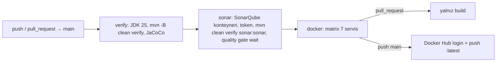

# 18. Konteynerlər, Docker Compose və CI/CD

## 18.1 Motivasiya

Yeddi Spring Boot tətbiqi və on iki infrastruktur komponenti olan sistemi əl ilə işə salmaq mümkün deyil. Konteynerlər
hər komponenti eyni qaydada paketləyir; Compose onları bir şəbəkədə, düzgün parametrlərlə birlikdə başladır; CI/CD isə
hər dəyişikliyi avtomatik yoxlayıb image-ləri nəşr edir. Bu fəsil layihənin bu üç qatını izah edir və istehsal
səviyyəsinə çatmaq üçün nəyin çatışmadığını göstərir.

## 18.2 Dockerfile-lar

Bütün tətbiq Dockerfile-ları eyni şablondadır (fəsil 3.11-də tam çıxarış: `campaign-service/Dockerfile:1-26`):

| Addım | Nə edir | Qiymətləndirmə |
|---|---|---|
| `FROM maven:3.9.11-amazoncorretto-25 AS build` | Build mərhələsi | Versiya bərkidilib — yaxşı |
| `COPY . .` | Bütün repozitoriya (build konteksti = kök) | Hər fayl dəyişikliyi asılılıqların yenidən endirilməsinə səbəb olur |
| `RUN mvn -pl <svc> -am clean package -DskipTests` | Servis və asılı modullar | Testlər CI-da ayrıca işləyir — məqbul |
| `FROM amazoncorretto:25` | Runtime | Tam JDK — image böyükdür; JRE və ya distroless kifayətdir |
| `COPY --from=build .../target/<svc>-*.jar <svc>.jar` | Fat jar | Layered jar istifadə olunmur |
| `EXPOSE` | Sənədləşmə | — |
| `ENTRYPOINT ["java", "--enable-preview", "-jar", ...]` | İşə salma | Exec forması (PID 1 = java, SIGTERM düzgün çatır) — yaxşı |

Çatışmayanlar [NƏTİCƏ]:
- **Root istifadəçi** — `USER` direktivi yoxdur; konteyner qaçışı (escape) zamanı riski artırır.
- **`HEALTHCHECK` yoxdur** — orkestrator tətbiqin hazır olduğunu bilmir.
- **JVM yaddaş parametrləri yoxdur** — müasir JVM konteyner limitlərini tanıyır, lakin standart heap konteyner yaddaşının
  25%-idir; Spring tətbiqləri üçün adətən `-XX:MaxRAMPercentage=75` təyin edilir.
- **Layer cache** — asılılıqlar mənbə ilə eyni layer-dadır.

İllüstrativ təkmilləşdirilmiş Dockerfile (repozitoriyada yoxdur):

```dockerfile
FROM maven:3.9.11-amazoncorretto-25 AS build
WORKDIR /workspace
COPY pom.xml .
COPY common/pom.xml common/ ; COPY security/pom.xml security/ ; COPY grpc-contract/pom.xml grpc-contract/
COPY campaign-service/pom.xml campaign-service/
RUN --mount=type=cache,target=/root/.m2 mvn -q -pl campaign-service -am dependency:go-offline
COPY . .
RUN --mount=type=cache,target=/root/.m2 mvn -q -pl campaign-service -am package -DskipTests \
 && java -Djarmode=tools -jar campaign-service/target/campaign-service-*.jar extract --layers --destination /extracted

FROM amazoncorretto:25-al2023-headless
RUN useradd --system --uid 10001 app
USER app
WORKDIR /app
COPY --from=build /extracted/dependencies/ ./
COPY --from=build /extracted/spring-boot-loader/ ./
COPY --from=build /extracted/snapshot-dependencies/ ./
COPY --from=build /extracted/application/ ./
ENV JAVA_TOOL_OPTIONS="-XX:MaxRAMPercentage=75 --enable-preview"
ENTRYPOINT ["java", "-jar", "campaign-service-1.0.0.jar"]
```

Alternativ: `mvn spring-boot:build-image` (Cloud Native Buildpacks) — Dockerfile yazmadan qatlı, non-root, optimallaşdırılmış
image.

## 18.3 `docker-compose.yml`: tam stek

[FAKT] Bir `insurance-network` bridge şəbəkəsi (`docker-compose.yml:497-499`), on bir adlı volume (`:485-496`) və
`./logs` bind mount-u. Konteynerlər bir-birini servis adı ilə tapır (Docker daxili DNS).

### Başlanğıc asılılıqları

| Servis | `depends_on` | Şərt | `restart` |
|---|---|---|---|
| discovery-server | otel-collector | started | — |
| config-server | discovery-server, otel-collector | started | — |
| api-gateway | config, discovery, otel, redis | started | — |
| auth-service | auth-db | **service_healthy** | `unless-stopped` |
| campaign-service | campaign-db, redis, kafka, config, otel | **started (sağlamlıq yoxlanmır)** | **yoxdur** |
| dashboard-service | campaign-service, config, otel | started | `unless-stopped` |
| log-service | kafka, elasticsearch | **service_healthy** | `on-failure:5` |

[RİSK] (F29) [NƏTİCƏ]:
- campaign-service PostgreSQL-in sağlamlığını gözləmir; DB qəbul etməyə hazır olmadan başlayarsa Liquibase bağlantı xətası
  ilə çıxar və `restart` siyasəti olmadığı üçün **dayanmış qalar**. auth-service-də isə həm sağlamlıq şərti, həm restart
  var — iki servis arasında ardıcıllıq yoxdur.
- Servislər Config Server-i yalnız `service_started` ilə gözləyir. Config Server HTTP-ni hələ açmayıbsa,
  `optional:configserver:` sakitcə uğursuz olur və servis paylaşılan konfiqurasiyasız işləyir (F32) — bu ssenari
  Compose-da real olaraq yarana bilər.
- Spring servisləri üçün healthcheck olmadığı üçün başqa servislər onların hazır olmasını gözləyə bilmir.

### Digər Compose müşahidələri

- **`latest` teqləri və `pull_policy: always`** (PostgreSQL, Redis, Kafka, Prometheus, Grafana, Tempo, Loki, Collector, ...)
  — hər işə salmada yeni versiya gələ bilər; README bunu "local case study" üçün qəbul edir. Nəticə: build-lər təkrar
  oluna bilmir, qəfil uyğunsuzluq yarana bilər. Elasticsearch istisnadır (`9.4.2`). Testcontainers isə fərqli image-lər
  istifadə edir (F28).
- **PostgreSQL volume yolu** `/var/lib/postgresql` (`docker-compose.yml:109`, `128`) — README-yə görə yeni PostgreSQL
  image-lərinin data qovluğu düzülüşünə uyğunlaşmaq üçündür.
- **`container_name`** sabitdir — `docker compose up --scale campaign-service=2` mümkün deyil.
- **Portlar host-a açıqdır** — bütün servislər və DB-lər (fəsil 10.8).
- **Sirrlər açıq mətndə** — DB şifrələri, `GF_SECURITY_ADMIN_PASSWORD` (dəyər redaktə olunub; `docker-compose.yml:396-398`); JWT private key
  image daxilində (F22).
- **Kafka KRaft** dinləyiciləri fəsil 11.10-da izah olunub.

### Mühit dəyişənləri → xassələr

| Dəyişən | Servis(lər) | Xassə |
|---|---|---|
| `CONFIG_SERVER_URL` | gateway, biznes servisləri | `spring.config.import` |
| `EUREKA_SERVER_URL`, `EUREKA_INSTANCE_IP_ADDRESS` | hamısı | `eureka.client.service-url.defaultZone`, `eureka.instance.ip-address` |
| `AUTH_DB_URL/USERNAME/PASSWORD` | auth | `spring.datasource.*` |
| `CAMPAIGN_DB_URL/...` | campaign | `spring.datasource.*` |
| `REDIS_HOST/PORT` | gateway, campaign | `spring.data.redis.*` |
| `KAFKA_BOOTSTRAP_SERVERS` | campaign, log | `spring.kafka.bootstrap-servers` |
| `ELASTICSEARCH_URIS`, `SPRING_ELASTICSEARCH_*` | log | `spring.elasticsearch.*` |
| `LOG_SERVICE_URL` | auth | `spring.http.serviceclient.log-service.base-url` |
| `CAMPAIGN_GRPC_ADDRESS` | dashboard | `grpc.client.campaign-service.address` |
| `JWT_PUBLIC_KEY_LOCATION`, `JWT_PRIVATE_KEY_LOCATION` | hamısı / auth | `app.jwt.*-location` |
| `LOG_SERVICE_CB_*`, `LOG_SERVICE_RETRY_*`, `LOG_SERVICE_BULKHEAD_*` | auth | `resilience4j.*` |
| `RATE_LIMITER_*` | gateway | `redis-rate-limiter.*` |
| `OTEL_EXPORTER_OTLP_TRACES_ENDPOINT/PROTOCOL`, `OTEL_SERVICE_NAME` | hamısı | `management.opentelemetry.*` |
| `MANAGEMENT_TRACING_*` | hamısı | `management.tracing.*` |
| `LOGGING_FILE_NAME` | hamısı | `logging.file.name` |

## 18.4 `docker-compose-local.yml`: yalnız infrastruktur

IDE-dən işə salınan servislər üçün eyni infrastrukturu verir, fərqlər [FAKT]:
- ayrı layihə adı (`insurance-campaign-local`), şəbəkə və volume adları;
- Prometheus `prometheus-local.yml` ilə host-dakı servisləri `host.docker.internal` vasitəsilə scrape edir və
  `extra_hosts: host.docker.internal:host-gateway` (Linux-da bu ad standart olaraq mövcud deyil)
  (`docker-compose-local.yml:124-134`);
- [FAKT] lokal Prometheus-da `--web.enable-remote-write-receiver` bayrağı yoxdur — [NƏTİCƏ] Tempo-nun span metriklərini
  `remote_write` etməsi lokal rejimdə uğursuz olar və Grafana-da servis xəritəsi boş qalar.

## 18.5 CI/CD: `.github/workflows/ci-cd.yml`



**verify** (`ci-cd.yml:21-49`): Temurin JDK 25, Maven cache, `mvn -B clean verify` — unit və Testcontainers testləri
(GitHub-un ubuntu runner-ində Docker var), JaCoCo hesabatları.

**sonar** (`ci-cd.yml:51-257`) — maraqlı həll: SonarQube serveri **pipeline daxilində konteyner kimi** qaldırılır
(`docker compose -f docker-compose-local.yml up -d sonarqube`), API ilə hazır olması gözlənilir, standart admin şifrəsi
dəyişdirilir, token yaradılır, analiz `-Dsonar.qualitygate.wait=true` ilə işləyir (quality gate uğursuzdursa job düşür),
nəticələr artefakt və step summary kimi nəşr olunur. [NƏTİCƏ] Qiymətləndirmə:
- Üstünlük: xarici Sonar serveri tələb olunmur, hər işə salma təcrid olunub.
- Çatışmazlıq: Sonar tarixçəsi saxlanılmır (konteyner hər dəfə silinir) — "yeni kod" müqayisəsi və trendlər işləmir;
  testlər iki dəfə icra olunur (verify və sonar job-larında `clean verify`); pipeline uzanır.
- Workflow faylında ephemeral konteynerin yeni admin şifrəsi açıq yazılıb (`ci-cd.yml:96-115`, maskalanır) — ephemeral
  olduğu üçün risk aşağıdır, lakin sirrləri koda yazmaq vərdişi tövsiyə olunmur.

**docker** (`ci-cd.yml:259-303`): `verify` və `sonar`-dan sonra; matrix ilə 7 servis paralel; PR-də yalnız build (image-lərin
qurula bildiyini yoxlayır), `main`-ə push-da `secrets.DOCKERHUB_USERNAME`/`DOCKER_PASSWORD` ilə login və
`<user>/campaign-<service>:latest` push. [NƏTİCƏ] Yalnız `latest` teqi var — konkret commit-ə bağlı (məs. `:sha-1500818`)
dəyişməz teq olmadığı üçün geri qayıtma (rollback) və "hansı versiya işləyir?" sualı çətinləşir. Docker layer cache
(`cache-from: type=gha`) istifadə olunmur.

**mark-done-on-merge.yml** — runtime ilə əlaqəsi yoxdur: birləşdirilmiş PR-də və ona bağlı issue-larda label-ları `done`
ilə əvəzləyən `actions/github-script` avtomatlaşdırmasıdır (ayrı token secret-i `INSURANCE_GITHUB_TOKEN` ilə).

**Deploy** — repozitoriyada Kubernetes manifestləri, Helm chart-ları və ya deploy job-u yoxdur. [NAMƏLUM] Image-lərin
Docker Hub-dan sonra harada və necə işlədildiyi repozitoriyadan müəyyən edilmir.

## 18.6 Troubleshooting (README + təhlil)

| Problem | Səbəb | Həll |
|---|---|---|
| Kafka/Tempo/Loki `Exited` | Köhnə volume vəziyyəti, `latest` image dəyişikliyi | `docker compose down -v --remove-orphans && pull && up -d` |
| campaign-service dayanıb qalıb | DB hazır olmadan başlayıb, restart yoxdur | `docker compose up -d campaign-service`; Compose-a healthcheck şərti və restart əlavə etmək |
| Servis paylaşılan konfiqurasiyanı almayıb | Config Server gec hazır olub (`optional:`) | Servisi restart; Config Server-ə healthcheck + `service_healthy` |
| Tempo-da trace yoxdur | Səhv OTLP endpoint/protokol | gRPC: `http://otel-collector:4317`, `/v1/traces` yalnız HTTP üçün |
| Loki-də log yoxdur | `./logs` boşdur, Promtail target-ləri | `http://localhost:9080/targets`, `ls -la ./logs` |
| gRPC sinifləri tapılmır (IDE) | Generasiya edilməyib | `mvn -pl grpc-contract -am clean install` |
| Testcontainers xətası | Docker işləmir | Docker Desktop/daemon |

## 18.7 Yeni layihədə tətbiq: yoxlama siyahısı

1. Image-lər: non-root, JRE/distroless, layered jar və ya Buildpacks, `HEALTHCHECK`, JVM yaddaş faizi.
2. Teqlər: dəyişməz (`sha`, semver) + `latest` yalnız rahatlıq üçün; infrastruktur image-lərini versiyalarla bərkitmək.
3. Compose: hər servis üçün healthcheck (actuator `/actuator/health/readiness`), `depends_on: condition: service_healthy`,
   `restart: on-failure`; sirrləri `.env` (gitignore-dadır) və ya Docker secrets ilə.
4. CI: testlər bir dəfə; Sonar davamlı serverə; Docker build cache; SBOM və image skanı (Trivy/Grype); imzalama (cosign).
5. CD: mühit başına konfiqurasiya, miqrasiyaların ayrıca addımı, mavi-yaşıl və ya canary deploy, avtomatik rollback.

## 18.8 Praktiki tapşırıqlar

Tapşırıqları öz fork-unuzda, ayrıca branch-da edin. Çətinlik: ★ — 30 dəqiqəyə qədər, ★★ — bir neçə saat, ★★★ — təxminən bir gün. "Gözlənilən nəticə" koddan çıxardığım proqnozdur; sizdə fərqli çıxarsa, səbəbini tapmaq tapşırığın ən dəyərli hissəsidir.

**T1 ★ — Asılılıq qrafı.** `docker-compose.yml`-dən bütün `depends_on` əlaqələrini qraf kimi çəkin və hansılarında
`condition: service_healthy` olduğunu işarələyin. **Yoxlama:** F29-dakı boşluqları qrafda göstərə bilirsiniz.

**T2 ★★ — Tətbiq servisinə healthcheck.** Əvvəlcə image-də hansı alətin olduğunu yoxlayın:
`docker run --rm amazoncorretto:25 sh -c 'command -v curl wget || true'`. Uyğun alətlə `/actuator/health`-i yoxlayan
healthcheck yazın və gateway-i `service_healthy` şərtinə bağlayın. **Yoxlama:** `docker compose ps`-də `healthy`.

**T3 ★ — Versiyaları sabitləyin.** `latest` teqlərini konkret versiyalarla əvəz edin (Elasticsearch artıq sabitdir).
**Yoxlama:** hər seçimi bir cümlə ilə əsaslandırın; test image-ləri ilə uyğunluğu yoxlayın (F28).

**T4 ★★ — CI-ya təhlükəsizlik skanı.** `.github/workflows/ci-cd.yml`-i oxuyun, pipeline-ı diaqram kimi çəkin və image
qurulduqdan sonra zəiflik skanı (məs. Trivy) addımı əlavə edin. **Yoxlama:** kritik zəiflik olanda pipeline qırmızı olur.

## 18.9 Müsahibə sualları

**S1. Çoxmərhələli Docker build nə qazandırır?**
Cavab: Build alətləri (Maven, JDK, mənbə kodu) son image-ə düşmür — image kiçik və təhlükəsiz olur; build mühiti
təkrarlanandır.

**S2. `depends_on` niyə tətbiqin hazır olmasına zəmanət vermir?**
Cavab: Standart `service_started` yalnız konteynerin başladığını gözləyir, prosesin port açmasını və ya hazır olmasını
yox. `service_healthy` healthcheck tələb edir. Üstəlik tətbiq özü də asılılıqların gecikməsinə dözümlü olmalıdır (retry,
restart), çünki istehsal orkestratorları başlanğıc sırasına zəmanət vermir.

**S3. `latest` teqinin problemləri?**
Cavab: Dəyişkəndir: eyni teq fərqli vaxtlarda fərqli image-ə işarə edir; təkrar oluna bilməyən build-lər, səssiz
uyğunsuzluqlar, rollback çətinliyi, hansı versiyanın işlədiyini bilməmək.

**S4. Bu pipeline-da Sonar quality gate deploy-u necə bloklayır?**
Cavab: `docker` job-u `needs: [verify, sonar]`-dır; `sonar` job-u `-Dsonar.qualitygate.wait=true` ilə quality gate
uğursuz olduqda düşür, ona görə image push edilmir.

**S5. Konteynerdə JVM yaddaşını necə konfiqurasiya edərdiniz?**
Cavab: Konteyner limitini təyin edib JVM-ə faizlə heap vermək (`-XX:MaxRAMPercentage=70-75`), qalan hissəni metaspace,
thread stack-ları, direct buffer-lər (Netty, Kafka) üçün saxlamaq; OOMKilled hallarını metriklərlə izləmək.

## 18.10 Xülasə

- Hər tətbiqin çoxmərhələli Dockerfile-ı var; non-root, healthcheck, layer cache və JVM parametrləri çatışmır.
- Compose iki variantdadır: tam stek və yalnız infrastruktur; başlanğıc asılılıqlarında sağlamlıq şərtləri və restart
  siyasətləri qeyri-ardıcıldır, `latest` teqləri təkrarlanmanı zəiflədir.
- CI: verify → ephemeral SonarQube ilə quality gate → 7 servisin image build/push; yalnız `latest` teqi.
- Növbəti fəsil test strategiyasını və test infrastrukturunu (MockMvc, Mockito, Testcontainers) izah edir.
