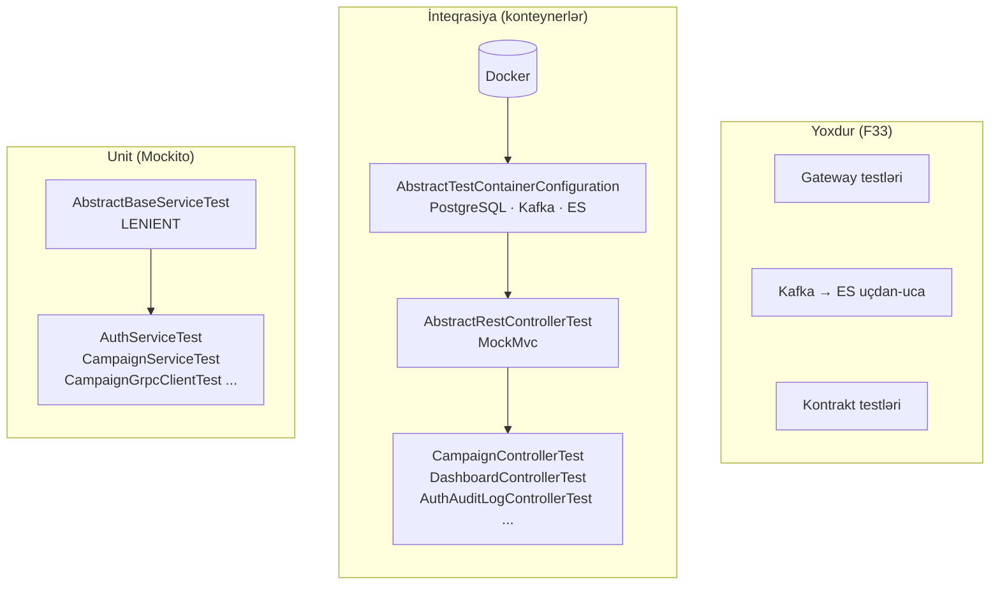

# 19. Test strategiyası və test infrastrukturu

## 19.1 Məqsəd: testlər nəyi sübut etməlidir?

Testlər üç sualı cavablandırır: (1) biznes qaydaları düzgündürmü (unit), (2) komponentlər bir-biri ilə və framework ilə
düzgün işləyirmi (inteqrasiya: Spring konteksti, security, DB, broker), (3) servislər arası kontraktlar uyğundurmu
(kontrakt/E2E). **Test piramidası**: çoxlu sürətli unit test, orta sayda inteqrasiya testi, az sayda E2E test.

## 19.2 Repozitoriyadakı testlərin inventarı

[FAKT] 24 test faylı, 93 `@Test` metodu; `common`, `security`, `api-gateway`, `config-server`, `discovery-server`,
`grpc-contract` modullarında test yoxdur.

| Modul | Test sinfi | Sayı | Növ | Nəyi yoxlayır |
|---|---|---:|---|---|
| auth-service | `AuthServiceTest` | 22 | Unit (Mockito) | Qeydiyyat, login, refresh, forgot/reset, logout — uğur və xəta halları |
| | `AuthMapperTest` | 14 | Unit (generasiya olunmuş `AuthMapperImpl`) | MapStruct xəritələri, null halları |
| | `AuthAuditServiceTest` | 12 | Unit + `OutputCaptureExtension` | Audit payload-ı, CB/bulkhead/ümumi xətanın loglanması |
| | `AuthControllerTest` | 4 | `@SpringBootTest` + MockMvc (**filtrlər söndürülüb**) + PostgreSQL konteyneri | HTTP bağlama və cavab formatı |
| campaign-service | `CampaignControllerTest` | 14 | `@SpringBootTest` + MockMvc (**filtrlər aktiv**, real RS256 token) + PostgreSQL + Kafka konteynerləri | Rol icazələri (201/200/403), cavab formatı, 409 xəritəsi |
| | `CampaignServiceTest` | 3 | Unit | `create`: LIFE → ACTIVE, TSS → PENDING, dublikat rəddi |
| dashboard-service | `CampaignGrpcClientTest` | 6 | Unit (mock stub) | Status süzgəci, sıfır dəyərlər, `""` → `null` |
| | `DashboardControllerTest` | 6 | `@SpringBootTest` + MockMvc (filtrlər aktiv) | ADMIN/USER/anonim → 200/403/401 |
| log-service | `AuthAuditLogControllerTest` | 4 | `@SpringBootTest` + MockMvc + Kafka + **Elasticsearch** konteynerləri | `INTERNAL_SERVICE` rolu; real ES-ə yazı |
| | `SlowRequestLogControllerTest` | 4 | Eyni (repository mock) | Səhifələmə, rol |
| | `AuthAuditLogServiceTest`, `SlowRequestLogConsumerTest` | 2 + 2 | Unit | Sənəd xəritələnməsi |

## 19.3 Test infrastrukturu: baza siniflər

Hər modulda üç baza sinif var:

**1. `AbstractBaseServiceTest`** — Mockito unit testləri üçün [FAKT]
(`campaign-service/src/test/java/com/casestudy/insurancecampaign/campaign/base/AbstractBaseServiceTest.java:8-12`):

```java
@ExtendWith(MockitoExtension.class)
@MockitoSettings(strictness = Strictness.LENIENT)
public class AbstractBaseServiceTest {
}
```

[NƏTİCƏ] `Strictness.LENIENT` istifadə olunmayan stub-lar haqqında xəbərdarlıqları söndürür. Mockito-nun standart
`STRICT_STUBS` rejimi lazımsız `when(...)` sətirlərini aşkarlayıb testləri təmiz saxlayır; LENIENT bunu gizlədir.
Maraqlıdır ki, `CampaignServiceTest` bu baza sinfi istifadə etmir — standart sərt rejimlə işləyir.

**2. `AbstractTestContainerConfiguration`** — real infrastruktur [FAKT]
(`campaign-service/src/test/java/com/casestudy/insurancecampaign/campaign/base/AbstractTestContainerConfiguration.java:13-43`):

<!-- src: campaign-service/src/test/java/com/casestudy/insurancecampaign/campaign/base/AbstractTestContainerConfiguration.java:13-44 -->
```java
@Testcontainers
public abstract class AbstractTestContainerConfiguration {

    private static final Logger log = LoggerFactory.getLogger(AbstractTestContainerConfiguration.class);

    @Container
    static PostgreSQLContainer<?> postgres = new PostgreSQLContainer<>("postgres:17-alpine");

    @Container
    static KafkaContainer kafka = new KafkaContainer(
            DockerImageName.parse("confluentinc/cp-kafka:7.6.1")
    );

    @DynamicPropertySource
    static void properties(DynamicPropertyRegistry registry) {
        registry.add("spring.datasource.url", postgres::getJdbcUrl);
        registry.add("spring.datasource.username", postgres::getUsername);
        registry.add("spring.datasource.password", postgres::getPassword);
        registry.add("spring.kafka.bootstrap-servers", kafka::getBootstrapServers);
        registry.add("spring.jpa.hibernate.ddl-auto", () -> "create-drop");
        registry.add("spring.liquibase.enabled", () -> false);
        registry.add("spring.data.redis.host", () -> "localhost");
        registry.add("spring.cache.type", () -> "simple");
        registry.add("eureka.client.enabled", () -> false);
        registry.add("spring.cloud.config.enabled", () -> false);
        registry.add("app.jwt.issuer", () -> "allianz-campaign-api");
        registry.add("app.jwt.expiration-minutes", () -> 120);
        registry.add("app.jwt.public-key-location", () -> "classpath:keys/public.pem");
        registry.add("grpc.server.port", () -> -1);
    }

}
```

| Sətir | Mənası |
|---|---|
| `@Testcontainers` + `@Container static` | JUnit 5 extension test sinfi başlamazdan əvvəl konteyneri qaldırır, sinif bitəndə dayandırır |
| `@DynamicPropertySource` | Konteynerin təsadüfi portunu Spring xassələrinə ötürür (kontekst yaradılmazdan əvvəl) |
| `ddl-auto=create-drop`, `liquibase.enabled=false` | Sxemi Hibernate yaradır — miqrasiyalar test edilmir (F27) |
| `spring.cache.type=simple` | Redis yerinə `ConcurrentMapCacheManager` |
| `eureka/config disabled` | Platforma servislərindən təcrid |
| `grpc.server.port=-1` | gRPC server-i başlatmamaq |

[NƏTİCƏ] Performans qeydləri:
- `@Container static` abstrakt baza sinifdə olduqda konteynerlər **hər test sinfi üçün** yenidən qaldırılır. "Singleton
  container" nümunəsi (statik initsializatorda bir dəfə `start()`) və ya Spring Boot 3.1+ `@ServiceConnection` +
  `@TestConfiguration` ilə konteyner bean-ləri bunu sürətləndirir.
- Hər sinifdə konteyner portları fərqli olduğu üçün Spring test kontekst cache-i siniflər arasında paylaşılmır.
- `KafkaContainer` (`org.testcontainers.containers`) Testcontainers 1.21-də köhnəlmiş API-dir; yeni modul
  `org.testcontainers.kafka.ConfluentKafkaContainer`/`KafkaContainer` (apache image) təklif edir.
- campaign controller testində servis mock olduğu halda Kafka konteyneri qaldırılır; dashboard testində isə **heç bir DB
  istifadə olunmadığı halda** PostgreSQL konteyneri qaldırılır və auth-a aid xassələr təyin edilir
  (`dashboard-service/src/test/java/com/casestudy/insurancecampaign/dashboard/base/AbstractTestContainerConfiguration.java:16-36`
  — dəyişən adı da `AUTH_POSTGRES`-dir). Bu, kopyala-yapışdır qalığıdır və CI vaxtını artırır.
- Image-lər istehsaldakılardan fərqlidir: `postgres:17-alpine` ↔ `postgres:latest`, `cp-kafka:7.6.1` ↔
  `apache/kafka:latest` (F28).

**3. `AbstractRestControllerTest`** — `@SpringBootTest` + MockMvc + real JWT [FAKT]
(`campaign-service/src/test/java/com/casestudy/insurancecampaign/campaign/base/AbstractRestControllerTest.java:23-77`):

<!-- src: campaign-service/src/test/java/com/casestudy/insurancecampaign/campaign/base/AbstractRestControllerTest.java:62-77 -->
```java
private String generateAccessToken(String username, List<String> roles) {
    Instant now = Instant.now();
    Instant expiresAt = now.plusSeconds(120 * 60);

    return Jwts.builder()
            .header()
            .add("typ", TOKEN_TYPE)
            .and()
            .issuer("allianz-campaign-api")
            .subject(username)
            .claims(Map.of("roles", roles))
            .issuedAt(Date.from(now))
            .expiration(Date.from(expiresAt))
            .signWith(readPrivateKey("classpath:keys/private.pem"), Jwts.SIG.RS256)
            .compact();
}
```

Bu, layihənin ən güclü test texnikalarından biridir: test öz private key-i (`src/test/resources/keys/private.pem`) ilə
**həqiqi RS256 token** imzalayır və `@AutoConfigureMockMvc(addFilters = true)` sayəsində sorğu bütün Spring Security
filtr zəncirindən və `@PreAuthorize`-dan keçir. Nəticədə avtorizasiya qaydaları (ADMIN/USER/anonim) həqiqətən test edilir.
`@WithMockUser` kimi qısayollar JWT filtrini yan keçərdi.

[NƏTİCƏ] auth-service-in controller testi isə `@AutoConfigureMockMvc(addFilters = false)` istifadə edir
(`auth-service/src/test/java/com/casestudy/insurancecampaign/auth/base/AbstractRestControllerTest.java:10-19`): auth
endpoint-ləri onsuz da açıqdır, lakin security konfiqurasiyasının auth-service-də düzgün tətbiq olunduğu yoxlanmır.

## 19.4 Test texnikaları

**`@MockitoBean`** — Spring Framework 6.2+-da `@MockBean`-in əvəzi; kontekstdəki bean-i Mockito mock-u ilə əvəzləyir
(`CampaignControllerTest.java:43-47`). Hər fərqli mock dəsti ayrı kontekst deməkdir.

**Mockito arqument yoxlamaları** — `argThat(...)` ilə servisə ötürülən obyektin sahələri yoxlanılır
(`CampaignControllerTest.java:88-92`); `verifyNoInteractions(campaignService)` 403 hallarında servisin heç çağırılmadığını
sübut edir (`:117-118`) — avtorizasiyanın **servisdən əvvəl** işlədiyinin dəqiq testidir.

**Log çıxışının yoxlanması** — `@ExtendWith(OutputCaptureExtension.class)` və `CapturedOutput` ilə
(`AuthAuditServiceTest.java:23-24`, `192-206`): log mesajları əməliyyat kontraktının bir hissəsidirsə (alert-lər
onlara bağlıdırsa), test edilməlidir.

**Xəta simulyasiyası** — Resilience4j istisnaları mock-dan atılır
(`AuthAuditServiceTest.java:229-301`): `CallNotPermittedException.createCallNotPermittedException(CircuitBreaker.ofDefaults(...))`.
Bu, `publishAudit`-in xəta emalını yoxlayır, lakin **aspektlərin özünü** yox.

**Struktur** — testlər `// Given`, `// When`, `// Then`, `// Verify` şərhləri ilə bölünüb və adlar
`shouldXWhenY` formasındadır — oxunaqlı və ardıcıl.

## 19.5 Nə test edilir, nə edilmir

| Komponent / davranış | Test edilib? | Qeyd |
|---|---|---|
| Campaign rol icazələri | ✓ | Real JWT ilə |
| `CampaignService.create` qaydaları | ✓ (3 test) | Mock repository |
| `approve`/`deactivate`/`getHistory`/`getStatistics` | ✗ | F33; F36 bu boşluqda qalıb |
| Dublikat üçün DB partial unique indeksi | ✗ | Liquibase testdə söndürülüb (F27) |
| `countByStatus` JPQL proyeksiyası | ✗ | Repository testi yoxdur |
| `GlobalExceptionHandler` xəritəsi (səhv JSON, səhv UUID) | ✗ | F07 aşkarlanmayıb |
| Etibarsız/vaxtı keçmiş JWT | ✗ | F08 |
| `SlowRequestLoggingFilter` | ✗ | — |
| Kafka produce → consume → ES | ✗ | Listener testdə işləmir; Kafka-ya mesaj göndərilmir |
| DLQ və deserializasiya xətası | ✗ | F11 aşkarlanmayıb |
| Redis cache davranışı | ✗ | `simple` cache |
| Resilience4j aspektləri | ✗ | Simulyasiya |
| gRPC endpoint (server) | ✗ | — |
| Gateway (marşrutlar, JWT filtri, rate limit, 429 formatı) | ✗ | Modulda test yoxdur |
| Servislər arası kontraktlar (audit DTO-ları, proto, Kafka JSON) | ✗ | Kontrakt testi yoxdur |
| Auth servis məntiqi | ✓ (22 test) | Ən yaxşı örtülmüş hissə |

## 19.6 Təkmilləşdirmə: tövsiyə olunan testlər (illüstrativ nümunələr, repozitoriyada yoxdur)

**Repository + miqrasiya testi** — Liquibase aktiv, real PostgreSQL:

```java
@DataJpaTest
@AutoConfigureTestDatabase(replace = Replace.NONE)
@Testcontainers
class CampaignRepositoryIT {
    @Container @ServiceConnection
    static PostgreSQLContainer<?> pg = new PostgreSQLContainer<>("postgres:18");   // istehsalla eyni versiya

    @Autowired CampaignRepository repo;

    @Test
    void uniqueIndexRejectsDuplicate() {
        repo.saveAndFlush(new CampaignEntity(UUID.randomUUID(), "Title 123456", "Description 1234567890", TSS, PENDING_APPROVAL, null));
        assertThatThrownBy(() -> repo.saveAndFlush(
                new CampaignEntity(UUID.randomUUID(), "Title 123456", "Description 1234567890", TSS, PENDING_APPROVAL, null)))
            .isInstanceOf(DataIntegrityViolationException.class);
    }

    @Test
    void countByStatusProjectionWorks() { /* bir neçə status yaz, countByStatus nəticəsini yoxla */ }
}
```

**Kafka uçdan-uca testi** — Awaitility ilə:

```java
kafkaTemplate.send("log-events", "/x", new SlowRequestLogEvent("svc", "GET", "/x", 200, 12, "t", Map.of(), Instant.now()));
await().atMost(Duration.ofSeconds(10)).untilAsserted(() ->
        assertThat(slowRequestLogRepository.findAll()).anyMatch(d -> d.getPath().equals("/x")));
```

**Resilience4j testi** — WireMock 503 qaytarır, `CircuitBreakerRegistry` ilə vəziyyət yoxlanılır:

```java
stubFor(post("/api/v1/logs/auth-audit").willReturn(serviceUnavailable()));
for (int i = 0; i < 2; i++) authAuditService.publishLoginSuccessAuditAsync("demo");
await().untilAsserted(() -> assertThat(registry.circuitBreaker("logServiceHttpClient").getState()).isEqualTo(OPEN));
verify(5, postRequestedFor(urlEqualTo("/api/v1/logs/auth-audit")));   // 3 + 2 cəhd, sonra CB açıq
```

**Exception mapping testi** — `POST /api/v1/campaigns` gövdəsində `"category":"XYZ"` → 400 gözlənilməlidir (hazırda 500).

**Kontrakt testləri** — Spring Cloud Contract və ya Pact: auth-service (consumer) ilə log-service (provider) arasında
audit kontraktı; Kafka hadisələri üçün JSON Schema və ya Avro + Schema Registry uyğunluq yoxlaması; proto üçün
`buf breaking` ilə geriyə uyğunluq yoxlaması.

**Arxitektura testləri** — ArchUnit: "controller paketləri repository-yə birbaşa müraciət etməsin", "entity-lər web qatına
çıxmasın".

**Gateway testləri** — `@SpringBootTest(webEnvironment = RANDOM_PORT)` + `WebTestClient` + WireMock downstream + Redis
Testcontainers: 401 (token yox), 429 (iki ardıcıl sorğu), marşrut StripPrefix.

## 19.7 Test infrastrukturunun xəritəsi



Diaqramdan çıxan nəticə: unit qatı yaxşı qurulub, inteqrasiya qatı real konteynerlərlə işləyir, lakin sistemin
ən riskli hissələri — servislərarası kontraktlar, asinxron axın və gateway — test piramidasının heç bir qatında yoxdur.

## 19.8 Alternativlər

| Ehtiyac | Layihədəki seçim | Alternativ | Nə vaxt |
|---|---|---|---|
| Real DB testi | Testcontainers PostgreSQL | H2 / in-memory | Demək olar ki, heç vaxt: partial indeks, tiplər və SQL dialekti fərqlənir |
| Spring kontekstinin ölçüsü | `@SpringBootTest` (tam kontekst) | Slice testlər: `@WebMvcTest`, `@DataJpaTest` | Yalnız bir qatı yoxlayanda daha sürətli və izolyasiyalı |
| Xarici HTTP asılılığı | Klient mock-lanır | WireMock / MockWebServer | Timeout, 5xx, yavaş cavab kimi real HTTP davranışlarını sınamaq üçün |
| Servislərarası kontrakt | Yoxdur | Pact, Spring Cloud Contract | Audit DTO-su, proto və Kafka JSON-u dəyişəndə istehlakçını sındırmamaq üçün |
| Arxitektura qaydaları | Yoxdur | ArchUnit, Spring Modulith testləri | Təbəqə qaydaları (controller → repository qadağası) avtomatik yoxlansın |
| Testlərin keyfiyyəti | JaCoCo əhatəsi | Mutation testing (PIT) | Əhatə faizi yüksək, amma assert-lər zəif olanda |

## 19.9 Uğursuzluq ssenariləri

| Simptom | Səbəb | Həll |
|---|---|---|
| `Could not find a valid Docker environment` | Docker işləmir və ya CI agentində yoxdur | Docker-i başlatmaq; CI-da Docker-in mövcud olduğu runner |
| Testlər çox yavaşdır | Hər test sinfi fərqli `@MockitoBean` dəsti ilə yeni Spring konteksti qurur | Mock-ları baza sinifdə birləşdirmək, kontekst keşini qorumaq (19.4) |
| Image endirilmir (`toomanyrequests`) | Docker Hub limitləri | Registry mirror, image-ləri əvvəlcədən çəkmək |
| Lokal yaşıl, CI-da qırmızı | Fərqli image versiyaları (F28), saat zonası, port konflikti | Sabit versiyalar, `Clock` inyeksiyası, təsadüfi portlar (Testcontainers standartı) |
| Asinxron test arabir sınır | `Thread.sleep` ilə gözləmə (Kafka, `@Async`) | Awaitility ilə şərt əsaslı gözləmə |
| Testdə keçən sxem istehsalda sınır | `create-drop` + Liquibase söndürülüb (F27) | Testlərdə miqrasiyaları işə salmaq |
| `UnnecessaryStubbingException` gözlənilmədən | `CampaignServiceTest` sərt rejimdədir, digərləri LENIENT | Bir siyasət seçmək; standart olaraq STRICT_STUBS |

## 19.10 Praktiki tapşırıqlar

Tapşırıqları öz fork-unuzda, ayrıca branch-da edin. Çətinlik: ★ — 30 dəqiqəyə qədər, ★★ — bir neçə saat, ★★★ — təxminən bir gün. "Gözlənilən nəticə" koddan çıxardığım proqnozdur; sizdə fərqli çıxarsa, səbəbini tapmaq tapşırığın ən dəyərli hissəsidir.

**T1 ★★ — Bug-ı testlə sənədləşdirin.** F07 halları üçün MockMvc testləri yazın (qırıq JSON → 400, səhv UUID → 400).
**Gözlənilən nəticə:** hazırda qırmızı; fəsil 8-dəki düzəlişdən (8, T2) sonra yaşıl. Bu, "əvvəl test, sonra düzəliş"
təcrübəsidir.

**T2 ★★ — Kafka inteqrasiya testi.** campaign-service-də Testcontainers Kafka ilə kampaniya yaradın və test consumer-i
ilə `campaign-events`-dən hadisəni oxuyun; `Thread.sleep` əvəzinə Awaitility. **Yoxlama:** hadisənin açarı, statusu və
kateqoriyası düzgündür.

**T3 ★★ — ArchUnit qaydası.** "Controller-lər repository-dən birbaşa asılı olmamalıdır" qaydasını yazın. **Gözlənilən
nəticə:** `SlowRequestLogController` qaydanı pozur (21.9) — ya kodu düzəldin, ya da istisnanı əsaslandırın.

**T4 ★★★ — Testləri istehsala yaxınlaşdırın.** Testlərdə Liquibase-i aktivləşdirin (7, T4) və Testcontainers
image-lərini Compose versiyaları ilə eyniləşdirin (F28). **Yoxlama:** bütün testlər yaşıl, sxem `validate` keçir.

## 19.11 Müsahibə sualları

**S1. `@WithMockUser` əvəzinə real JWT ilə test etməyin üstünlüyü?**
Cavab: `@WithMockUser` SecurityContext-i birbaşa qurur və JWT filtrini, imza yoxlamasını, claim → authority çevrilməsini
yan keçir. Real token bütün zənciri (filtr, issuer, rollar, `@PreAuthorize`) yoxlayır — istehsal davranışına daha yaxındır.

**S2. Testlərdə Liquibase-i söndürüb `create-drop` istifadə etməyin riski?**
Cavab: Testlərdəki sxem istehsal sxemi deyil: partial indekslər, default-lar, seed-lər, constraint-lərin adları, xüsusi SQL
yoxdur. DB səviyyəli qaydalara əsaslanan davranış test edilmir, miqrasiya xətaları gec aşkarlanır.

**S3. Testcontainers testlərini necə sürətləndirmək olar?**
Cavab: Singleton konteynerlər (bütün test sinifləri üçün bir dəfə), `@ServiceConnection` ilə eyni konteksti paylaşmaq,
lazımsız konteynerləri qaldırmamaq, reusable containers (lokal), paralel icra, test kontekst cache-ni sındıran fərqli
`@MockitoBean` dəstlərindən qaçmaq.

**S4. Mockito-da LENIENT strictness nə vaxt əsaslıdır?**
Cavab: Paylaşılan `@BeforeEach` stub-larının bəzi testlərdə istifadə olunmadığı hallarda; lakin standart olaraq STRICT_STUBS
lazımsız stub-ları və səhv arqumentli stub-ları aşkarlayır. Baza sinifdə hamı üçün LENIENT etmək problemləri gizlədir.

**S5. Mikroservislər arası kontraktı necə test edərdiniz?**
Cavab: Consumer-driven contract testing (Pact/Spring Cloud Contract): consumer gözləntisini yazır, provider build-i onu
yoxlayır. Asinxron hadisələr üçün sxem reyestri və uyğunluq qaydaları; gRPC üçün proto breaking-change yoxlaması.

## 19.12 Xülasə

- 93 test: auth məntiqi və campaign/dashboard/log avtorizasiyası yaxşı örtülüb; real RS256 token ilə MockMvc testləri
  nümunəvidir.
- Infrastruktur: Mockito, MockMvc, `@MockitoBean`, OutputCapture, Testcontainers (PostgreSQL, Kafka, Elasticsearch).
- Əsas boşluqlar: status keçidləri, DB constraint-ləri və miqrasiyalar, exception mapping, JWT xəta yolu, Kafka/DLQ, cache,
  Resilience4j, gRPC server, gateway, kontraktlar.
- IV hissə burada bitir. V hissə bütün bu komponentləri real uçdan-uca axınlarda birləşdirir.
