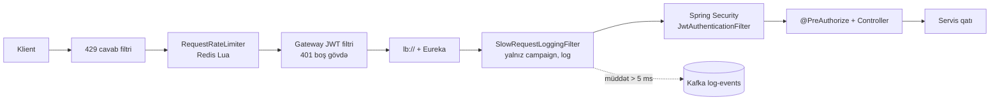
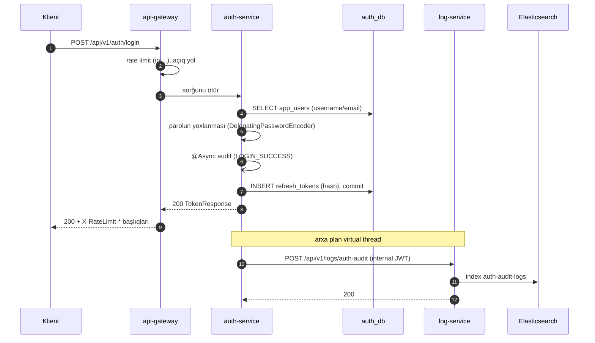
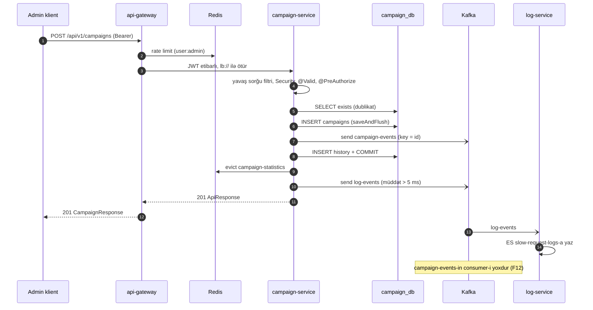
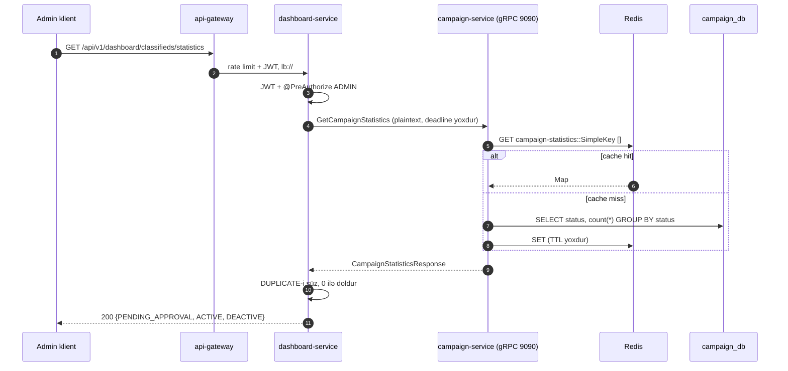
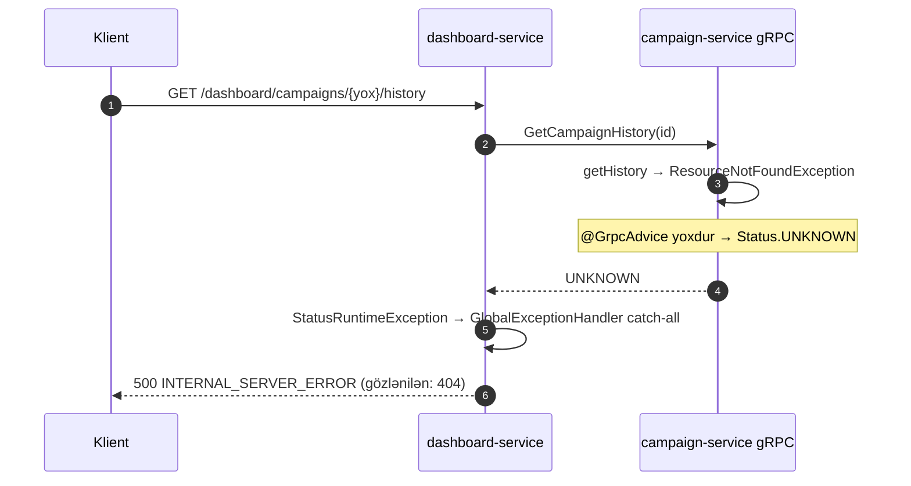
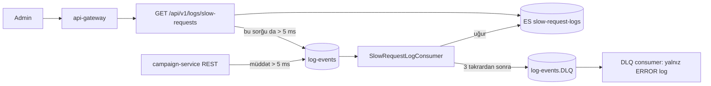
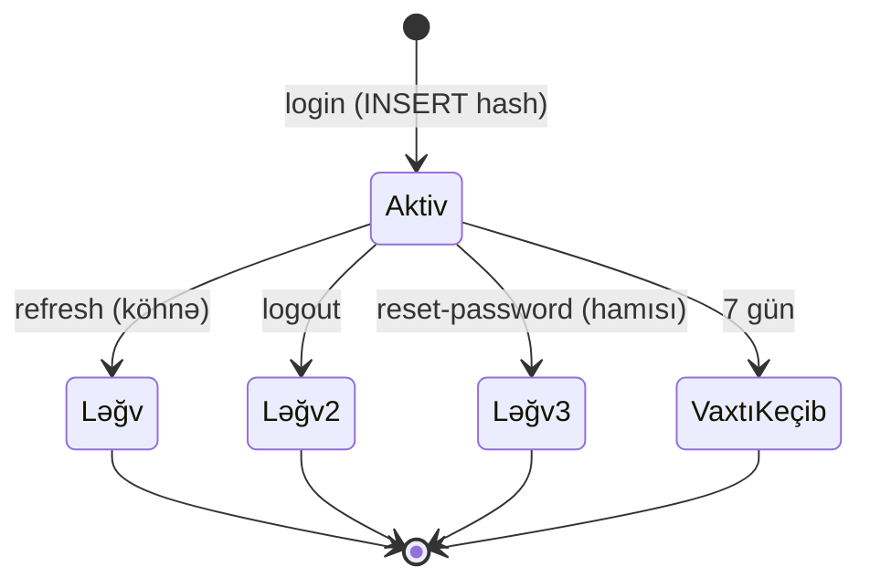

# 20. Uçdan-uca iş axınları

Əvvəlki fəsillər texnologiyaları tək-tək izah etdi. Bu fəsil onları real sorğuların yolu boyunca birləşdirir. Hər axın
eyni şablonla izlənir:

| Sahə | Sual |
|---|---|
| Giriş nöqtəsi | Sorğu hansı URL/metod ilə, hansı komponentə daxil olur? |
| Zəncir | Hansı filtr, controller, servis, repository, klient çağırılır? |
| Təhlükəsizlik | Harada, hansı qayda ilə yoxlanılır? |
| Tranzaksiya | Hansı sərhəd, nə commit olunur? |
| Sinxron / asinxron | Klient nəyi gözləyir, nə arxa planda baş verir? |
| Uğursuzluq yolları | Nə sına bilər və klient nə görür? |
| Müşahidə olunan nəticə | Cavab, DB, Kafka, Elasticsearch, log, metrik, trace-də nə qalır? |

[FAKT] Kod statik oxunub; axınlar işlədilməyib (fəsil 1.6). Ardıcıllıqdakı framework addımları (filtr sırası, proxy-lər,
commit anı) Spring-in sənədləşdirilmiş davranışına əsaslanır və [NƏTİCƏ] kimi işarələnib.

## 20.1 Bütün axınlar üçün ümumi gateway hissəsi

Xarici klientin hər sorğusu `api-gateway`-dən (8080) keçir. Gateway-dəki addımlar bütün axınlarda eynidir, ona görə bir
dəfə izah olunur.

1. **`GatewayRateLimitErrorResponseFilter`** (`Ordered.HIGHEST_PRECEDENCE`,
   `GatewayRateLimitErrorResponseFilter.java:118-119`) cavab obyektini dekorasiya edir ki, sonradan 429 yaranarsa JSON
   gövdə yazsın.
2. **`RequestRateLimiter`** — bütün marşrutlara tətbiq olunan default filtr (`api-gateway/src/main/resources/application.yml:20-26`).
   [NƏTİCƏ] SCG marşrut filtrlərinə siyahıdakı mövqeyə görə kiçik `order` verir, ona görə o, `order = 100` olan JWT
   filtrindən **əvvəl** işləyir. Açar `requestRateLimiterKeyResolver` tərəfindən hesablanır
   (`GatewayRateLimiterConfiguration.java:36-62`): etibarlı Bearer token varsa `user:`, yoxdursa
   `ip:<X-Forwarded-For-un birinci dəyəri | X-Real-IP | remote address>`. Redis Lua skripti tokeni çıxır; limit
   aşılıbsa 429 qaytarılır.
3. **`GatewayJwtAuthenticationFilter`** (`GatewayJwtAuthenticationFilter.java:76-95`) — `OPEN_PATHS` siyahısındakı
   prefikslər (`/api/v1/auth`, `/actuator`, Swagger/OpenAPI yolları; `GatewayJwtAuthenticationFilter.java:39-50`) yoxlanmadan
   keçir. Qalanlarında `Authorization: Bearer ...` olmalı və RS256 imzası ilə `iss` yoxlanmalıdır; əks halda **401, boş
   gövdə**. Rollar burada yoxlanmır — gateway yalnız autentifikasiya edir.
4. **Marşrutlaşdırma** — `Path` predikatı marşrutu seçir (`api-gateway/src/main/resources/application.yml:27-43`),
   `lb://<servis>` Eureka reyestrindən instansı LoadBalancer vasitəsilə seçir (compose-da `docker-compose.yml:62-65`).
   `Authorization` başlığı dəyişmədən ötürülür.

[NƏTİCƏ] Nəticə: autentifikasiya olunmuş hər sorğuda JWT **iki dəfə** parse olunur (açar resolver-də və JWT filtrində),
downstream servisdə isə üçüncü dəfə. RS256 yoxlaması ucuzdur, lakin bu, təkrarlanan işdir; parse nəticəsini exchange
atributunda saxlamaq olardı.

Downstream servisdə (`common` + `security` modulları ilə) eyni addımlar təkrarlanır:

- `SlowRequestLoggingFilter` (`SlowRequestLoggingFilter.java:88-120`) bütün zənciri ölçür — **yalnız campaign-service və
  log-service-də**, çünki `common`-da `spring-kafka` `optional`-dır (`common/pom.xml:27-31`) və auth/dashboard-un
  classpath-ında yoxdur (fəsil 2.5);
- Spring Security zənciri: `JwtAuthenticationFilter` (`JwtAuthenticationFilter.java:68-83`) token-dən `SecurityContext`
  qurur; URL qaydaları: `/api/v1/auth/**`, `/actuator/**`, OpenAPI yolları `permitAll`, qalanı `authenticated()`
  (`ServiceSecurityConfiguration.java:96-107`);
- `DispatcherServlet` → controller; `@PreAuthorize` metod səviyyəsində rolu yoxlayır.

## 20.2 Axın A: qeydiyyat və login (audit ilə)

**Giriş nöqtəsi:** `POST /api/v1/auth/register`, `POST /api/v1/auth/login` → gateway → auth-service (8081)
(`AuthController.java:47-64`).

**Zəncir (login):**

1. Gateway: açar `ip:...` (token yoxdur), JWT filtri yolu açıq sayır.
2. auth-service: `/api/v1/auth/**` `permitAll`; `@Valid LoginRequest` yoxlanır (səhvdirsə 400 `VALIDATION_ERROR`).
3. `AuthService.login` (`AuthService.java:140-161`), `@Transactional`:
   - `findByUsernameOrEmail` — `@` varsa e-poçt, yoxdursa istifadəçi adı ilə axtarış (`AuthService.java:328-334`);
   - istifadəçi yoxdur / aktiv deyil / parol uyğun gəlmir → `BusinessException(UNAUTHORIZED)` → 401; hər halda
     `publishLoginFailureAuditAsync` çağırılır;
   - uğur: `publishLoginSuccessAuditAsync`, sonra `createTokenResponse` (`AuthService.java:292-315`) — RS256 access
     token (120 dəq), təsadüfi refresh token; DB-yə yalnız refresh token-in SHA-256 hash-i yazılır.
4. Cavab: `ApiResponse<TokenResponse>` — access və refresh token, `Bearer`, vaxtlar, rollar.

**Asinxron hissə — audit:** `AuthAuditService`-in bütün `publish*Async` metodları `@Async`-dir
(`AuthAuditService.java:51-135`); `@EnableAsync` `common`-dakı `VirtualThreadConfiguration`-dadır. Arxa plan thread-i
`LogServiceHttpClient.sendAuthAuditLog`-u çağırır (`LogServiceHttpClient.java:27-31`):

- `RestClientHttpServiceGroupConfigurer` hər sorğuya `sub=auth-service`, `roles=[ROLE_INTERNAL_SERVICE]` olan təzə JWT
  əlavə edir (`LogServiceHttpClientConfiguration.java:32-48`);
- Resilience4j: Retry (3 cəhd, 500 ms) → CircuitBreaker (10 çağırışlıq pəncərə, 50%) → Bulkhead (10 eyni vaxtda, gözləmə
  0) (`auth-service/src/main/resources/application.yml:84-114`);
- log-service: `POST /api/v1/logs/auth-audit`, `@PreAuthorize("hasRole('INTERNAL_SERVICE')")`
  (`AuthAuditLogController.java:29-35`) → `AuthAuditLogService.save` → Elasticsearch `auth-audit-logs` indeksi
  (`AuthAuditLogService.java:25-36`);
- istənilən xəta `publishAudit`-də tutulur və WARN kimi loglanır (`AuthAuditService.java:147-179`) — login-ə təsir etmir.

**Uğursuzluq yolları:**

| Hadisə | Klient | Yan təsir |
|---|---|---|
| Yanlış parol / istifadəçi yoxdur | 401 `UNAUTHORIZED`, eyni mesaj | Audit `LOGIN_FAILURE`, `FAILED` |
| İstifadəçi aktiv deyil | 401, mesaj **"User is not active"** | Fərqli mesaj hesabın mövcudluğunu açır (F03) |
| log-service düşüb | Login uğurlu | 3 cəhd, sonra CB açılır; audit itir, WARN log |
| auth_db düşüb | 500 (catch-all) | Hikari bağlantı gözləməsi (standart 30 s) |
| Eyni IP-dən sürətli təkrar | 429 | 5 saniyədə 1 sorğu (fəsil 15.6) |

**Qeydiyyat fərqi** (`AuthService.java:103-126`): `existsByUsername` / `existsByEmail` yoxlamaları, parolun hash-lənməsi,
`save`, `publishRegisterAuditAsync`. [NƏTİCƏ] Audit tapşırığı metod daxilində, **commit-dən əvvəl** executor-a verilir.
Paralel qeydiyyatda unikal constraint commit zamanı pozularsa (F18) klient 500 alır, lakin audit artıq "User registered
successfully" yazmış ola bilər. Audit yalnız uğurlu commit-dən sonra göndərilməlidir
(`@TransactionalEventListener(phase = AFTER_COMMIT)`). Qeydiyyatda `role` sahəsi klientdən gəlir — istənilən şəxs
`ROLE_ADMIN` hesab yarada bilər (F01).

**Müşahidə olunan nəticə:** `app_users` / `refresh_tokens` sətirləri; ES `auth-audit-logs` sənədi; auth-service logunda
`Auth audit sent to log-service` INFO; Tempo-da gateway → auth span-ları [NƏTİCƏ] (RestClient observation ilə auth → log
span-ı da ola bilər). auth-service-də yavaş sorğu filtri yoxdur, ona görə login nə qədər çəksə də `log-events`-ə
qeyd düşmür.

## 20.3 Axın B: kampaniyanın yaradılması (tam zəncir)

Bu, layihənin ən zəngin axınıdır: rate limit, iki səviyyəli JWT, Bean Validation, metod təhlükəsizliyi, tranzaksiya,
dublikat qaydası (həm tətbiq, həm DB səviyyəsində), status tarixçəsi, cache eviction, Kafka hadisəsi və yavaş sorğu
jurnalı.

**Giriş nöqtəsi:** `POST /api/v1/campaigns`, gövdə `CreateCampaignRequest` (title 10–50 simvol, hərf və ya rəqəmlə
başlamalı; description 20–200; category məcburi — `CreateCampaignRequest.java:10-19`),
`CampaignController.create` (`CampaignController.java:42-48`), cavab `201 Created`.

**Zəncir:**

1. Gateway (20.1): açar `user:admin`, JWT etibarlıdır → `lb://campaign-service`.
2. campaign-service: `SlowRequestLoggingFilter` saatı işə salır.
3. `JwtAuthenticationFilter` → `SecurityContext`: `admin`, `ROLE_ADMIN`.
4. `anyRequest().authenticated()` keçir.
5. `@Valid` — arqumentlər həll olunarkən (controller metodu çağırılmazdan **əvvəl**) yoxlanır → səhv sahələr → 400
   `VALIDATION_ERROR` + sahə xətaları. Nəticə: səhv gövdə göndərən `ROLE_USER` 403 deyil, 400 alır (fəsil 8.9).
6. `@PreAuthorize("hasRole('ADMIN')")` — metod proxy-də, çağırış anında → `ROLE_USER` → 403 `FORBIDDEN`
   (`GlobalExceptionHandler` vasitəsilə).
7. `CampaignService.create` (`CampaignService.java:54-77`) — `@Transactional` və `@CacheEvict("campaign-statistics",
   allEntries = true)` proxy-ləri:
   1. `rejectIfDuplicateExists` — `existsByCategoryAndTitleAndDescriptionAndStatusNot(..., DUPLICATE)`
      (`CampaignService.java:140-150`, `CampaignRepository.java:13-18`) → varsa 409 `DUPLICATE_CAMPAIGN`;
   2. `resolveInitialStatus` — `LIFE` → `ACTIVE`, digərləri → `PENDING_APPROVAL` (`CampaignService.java:133-138`);
   3. `saveAndFlush` — INSERT dərhal icra olunur; paralel dublikat partial unique indeksə dəyir
      (`campaign-service/src/main/resources/db/changelog/db.changelog-master.yml:101-113`) →
      `DataIntegrityViolationException` → 409;
   4. `saveHistory` — `campaign_status_histories` sətri (`previous_status = NULL`, `"Campaign created"`);
   5. `publishStatusChange` — `kafkaTemplate.send("campaign-events", campaignId, event)` (`CampaignService.java:181-191`);
   6. domain obyektinə çevrilir, controller onu `CampaignResponse`-a xəritələyir.
8. Proxy-lər: [NƏTİCƏ] commit və `@CacheEvict` (Redis-dən `campaign-statistics` açarları silinir). Bu iki
   interceptor-un sırası açıq təyin olunmayıb (fəsil 15, F13); diaqram variantlardan birini göstərir.
9. Filtr: müddət > 5 ms → `SlowRequestLogEvent` `log-events` mövzusuna (açar — URI).
10. Gateway cavabı klientə qaytarır.

**Sinxron / asinxron:** Klient DB commit-ini və cache eviction-u gözləyir. `kafkaTemplate.send` asinxrondur — nəticə
(`CompletableFuture`) yoxlanmır; lakin metadata yoxdursa və ya buffer doludursa `send()` `max.block.ms` (60 s) qədər
çağıran thread-i bloklaya bilər (F10). Bu, tranzaksiya və DB bağlantısı açıq ikən baş verir.

**Uğursuzluq yolları:**

| Hadisə | Klient | Məlumat vəziyyəti |
|---|---|---|
| Dublikat (ardıcıl) | 409 `DUPLICATE_CAMPAIGN` | Heç nə yazılmır |
| Dublikat (paralel, yarış) | 409 (indeks + `saveAndFlush`) | Rollback |
| Kafka əlçatmazdır | Gecikmə ≤ 60 s, sonra [NƏTİCƏ] `send()` istisnası → catch-all 500 → rollback | DB-də sətir yoxdur; ya da göndərmə asinxron uğursuz olur, DB-də sətir var, hadisə yoxdur |
| Hadisə göndərildi, commit uğursuz oldu | 500 | Kafka-da **mövcud olmayan** kampaniya haqqında hadisə (F09) |
| Redis düşüb | [NƏTİCƏ] Eviction xətası → 500 | Interceptor sırasından asılıdır: evict commit-dən sonradırsa kampaniya yaradılıb və təkrar cəhd 409 alır; əvvəldirsə rollback |
| campaign-service instansı yoxdur | 503 (gateway) | — |

**Müşahidə olunan nəticə:** `campaigns` və `campaign_status_histories`-də bir sətir; `campaign-events`-də bir qeyd (heç
kim oxumur); Redis-də `campaign-statistics` boşalır; ES `slow-request-logs`-da ehtimalən bir sənəd (5 ms həddi demək olar ki,
hər yazı sorğusunu tutur — F25); Prometheus-da `http_server_requests_seconds{uri="/api/v1/campaigns",status="201"}`;
Tempo-da gateway → campaign trace-i (Kafka hissəsi trace-ə bağlanmır).

## 20.4 Axın C: təsdiq və deaktivasiya

**Giriş nöqtəsi:** `PATCH /api/v1/campaigns/{id}/approve` və `/deactivate`, yalnız `ADMIN`
(`CampaignController.java:66-78`).

**Zəncir:** `findEntity` (yoxdursa 404) → `ensureNotDuplicate` (409) → status yoxlaması (səhv keçid → 409
`INVALID_STATUS_TRANSITION`) → `changeStatus` (`CampaignService.java:162-169`): entity statusu dəyişir, `save` (idarə
olunan entity üçün əlavə SELECT ilə merge — F14), tarixçə sətri, Kafka hadisəsi; commit zamanı dirty checking UPDATE
yaradır və `@PreUpdate` `updatedAt`-i təyin edir.

Keçid qaydaları (`CampaignService.java:91-111`):

| Əvvəlki status | approve | deactivate |
|---|---|---|
| `PENDING_APPROVAL` | → `ACTIVE` | → `DEACTIVE` |
| `ACTIVE` | 409 | → `DEACTIVE` |
| `DEACTIVE` | 409 | 409 |
| `DUPLICATE` | 409 (dublikat) | 409 (dublikat) |

**Diqqət ediləcək detallar:**

- Cavabdakı `updatedAt` köhnədir (F36): domain obyekti commit-dən əvvəl yaradılır, `@PreUpdate` isə flush zamanı işləyir.
- `@Version` yoxdur (F37): iki admin eyni anda approve və deactivate etsə, hər ikisi `PENDING_APPROVAL` oxuya bilər; son
  commit qalib gəlir və tarixçədə bir-birinə zidd iki sətir olur.
- Hər uğurlu keçid `campaign-statistics` cache-ni təmizləyir.

## 20.5 Axın D: oxuma sorğuları (kampaniya, siyahı, tarixçə)

| Endpoint | Rol | Servis metodu | Qeyd |
|---|---|---|---|
| `GET /api/v1/campaigns/{id}` | USER, ADMIN | `getById` (`CampaignService.java:79-84`) | 404 yoxdursa; səhv UUID → `MethodArgumentTypeMismatchException` → catch-all → **500** (F07, fəsil 8) |
| `GET /api/v1/campaigns?page&size&sort` | USER, ADMIN | `getAll` (`CampaignService.java:86-89`) | Standart `size=10`, `createdAt DESC`; `CampaignPageResponse` |
| `GET /api/v1/campaigns/{id}/history` | ADMIN | `getHistory` (`CampaignService.java:113-119`) | `existsById` + `findByCampaignIdOrderByChangedAtAsc` (indekssiz FK — F15) |
| `GET /api/v1/campaigns/statistics` | ADMIN | `getStatistics` (cache) | Axın E ilə eyni metod |

`@Transactional(readOnly = true)` Hibernate-də flush-u söndürür və [NƏTİCƏ] JDBC sürücüsünə read-only işarəsi ötürür.
`open-in-view: false` olduğu üçün (`campaign-service/src/main/resources/application.yml:15`) lazy əlaqələr controller-də
yüklənə bilməz — bu layihədə lazy əlaqə olmadığı üçün problem yoxdur.

## 20.6 Axın E: dashboard statistikası (REST → gRPC → cache → DB)

**Giriş nöqtəsi:** `GET /api/v1/dashboard/classifieds/statistics`, yalnız `ADMIN` (`DashboardController.java:39-44`).

**Zəncir:**

1. Gateway → `lb://dashboard-service` (8083).
2. dashboard-service: JWT, `@PreAuthorize` (yavaş sorğu filtri bu serviste yoxdur).
3. `CampaignGrpcClient.getStatistics` (`CampaignGrpcClient.java:39-42`) — bloklayan stub, ünvan
   `static://campaign-service:9090`, plaintext (`dashboard-service/src/main/resources/application.yml:11-15`,
   `docker-compose.yml:225`). **Deadline yoxdur** (F19), **JWT ötürülmür** — gRPC portu autentifikasiyasızdır (F04).
4. campaign-service gRPC server (net.devh, port 9090): `CampaignGrpcEndpoint.getCampaignStatistics`
   (`CampaignGrpcEndpoint.java:24-32`) → `campaignService.getStatistics()`.
5. `@Cacheable("campaign-statistics")` (`CampaignService.java:121-131`): Redis-də dəyər varsa DB-yə getmir; yoxdursa
   `countByStatus` JPQL `GROUP BY` (`CampaignRepository.java:20-21`), bütün statuslar 0 ilə doldurulur, nəticə Redis-ə
   yazılır (TTL yoxdur).
6. dashboard: `DASHBOARD_VISIBLE_STATUSES` — yalnız `PENDING_APPROVAL`, `ACTIVE`, `DEACTIVE`; `DUPLICATE` süzülür
   (`CampaignGrpcClient.java:25-29`, `76-87`).

**Uğursuzluq yolları:**

| Hadisə | Klient | Səbəb |
|---|---|---|
| campaign-service düşüb | 500, mesaj məs. `UNAVAILABLE: io exception` | `StatusRuntimeException` catch-all-a düşür (F07, F19) |
| campaign-service asılıb | Dashboard thread-i qeyri-müəyyən gözləyir | Deadline yoxdur |
| Redis düşüb | 500 (gRPC `UNKNOWN`) | Cache oxuma xətası, `CacheErrorHandler` yoxdur |
| Köhnə statistika | 200, köhnə rəqəmlər | Eviction commit-dən əvvəl olubsa və arada oxuma baş veribsə (F13) |

**Arxitektura qeydi:** eyni məlumat `GET /api/v1/campaigns/statistics` ilə birbaşa da əlçatandır. Dashboard-un dəyəri —
süzgəc və gələcək aqreqasiya üçün ayrıca BFF qatı; qiyməti — əlavə şəbəkə hop-u və iki servis arasında sinxron asılılıq.

## 20.7 Axın F: dashboard tarixçəsi və xəta yayılması

**Giriş nöqtəsi:** `GET /api/v1/dashboard/campaigns/{campaignId}/history` (`DashboardController.java:52-57`).

`CampaignGrpcClient.getCampaignHistory` (`CampaignGrpcClient.java:50-68`) UUID-i sətir kimi göndərir; server
`UUID.fromString` və `getHistory` çağırır (`CampaignGrpcEndpoint.java:34-47`). Boş `previousStatus` `""` kimi gəlir və
klientdə `null`-a çevrilir; `changedAt` ISO sətirdir və `Instant.parse` ilə oxunur.

**Bu axın xəta yayılmasının ən yaxşı nümunəsidir:**

Eyni sorğu REST ilə (`GET /api/v1/campaigns/{id}/history`) düzgün 404 qaytarır. Düzəliş iki tərəflidir: serverdə
`@GrpcAdvice` ilə `ResourceNotFoundException → Status.NOT_FOUND`, klientdə `StatusRuntimeException`-ı status koduna görə
domen istisnasına çevirmək (fəsil 13.6 və 13.10).

## 20.8 Axın G: yavaş sorğu jurnalı (Kafka → Elasticsearch) və onun oxunması

**Yazma tərəfi:** `common` modulundakı `SlowRequestLoggingFilter` yalnız classpath-ında `KafkaTemplate` olan
servislərdə aktivdir (`@ConditionalOnClass`, `SlowRequestLoggingFilter.java:31-33`): **campaign-service və log-service**.
auth-service və dashboard-service `common`-dan asılıdır, lakin `spring-kafka` orada `optional` elan olunduğu üçün
(`common/pom.xml:27-31`) onlara keçmir [FAKT, Maven asılılıq ağacı]. gRPC çağırışları servlet filtrindən keçmir. `/actuator`,
Swagger və OpenAPI yolları istisnadır (`SlowRequestLoggingFilter.java:67-74`). Müddət hədddən (`5 ms`) böyükdürsə:
`SlowRequestLogEvent(service, method, path, status, durationMs, traceId (MDC), {user-agent, x-forwarded-for},
occurredAt)` → `log-events`, açar = URI.

**Oxuma (consumer) tərəfi:** `SlowRequestLogConsumer.consume` (`SlowRequestLogConsumer.java:35-47`), qrup `log-service`
→ `SlowRequestDocument` → ES `slow-request-logs` indeksi. Xəta → `DefaultErrorHandler` 1 s fasilə ilə 3 təkrar, sonra
`log-events.DLQ`-a eyni partisiyaya (`KafkaDlqConfiguration.java:26-33`); DLQ consumer yalnız ERROR loglayır
(`SlowRequestLogConsumer.java:54-65`).

**Sorğu tərəfi:** `GET /api/v1/logs/slow-requests?page&size`, yalnız `ADMIN` (`SlowRequestLogController.java:35-43`) —
`findAll(PageRequest.of(page, size))`, sıralama yoxdur (F42), Spring Data `Page` birbaşa qaytarılır (F26).

[NƏTİCƏ] **Öz-özünü qidalandıran dövrə:** log-service də `common`-u istifadə edir, ona görə yavaş sorğular siyahısını
oxuyan sorğunun özü (ES-ə şəbəkə çağırışı demək olar ki, həmişə 5 ms-dən uzundur) yeni yavaş sorğu hadisəsi yaradır.
Hər səhifə baxışı jurnala bir qeyd əlavə edir. Bu, sonsuz dövrə deyil (bir oxuma → bir yazı), lakin həddin real dəyərə
(məs. 500 ms) qaldırılmalı olduğunu göstərir.

**Poison pill (F11):** `ErrorHandlingDeserializer` olmadığı üçün səhv JSON `poll()` daxilində
`RecordDeserializationException` yaradır; `DefaultErrorHandler` onu emal edə bilmir, növbəti `poll()` eyni offsetdən
başlayır və partisiya sonsuz döngüdə bloklanır — DLQ boş qalır (fəsil 11-də spring-kafka mənbəsi ilə izah olunub).

## 20.9 Axın H: refresh, logout, forgot və reset

| Addım | Kod | DB dəyişikliyi | Audit | Xəta |
|---|---|---|---|---|
| Refresh | `AuthService.java:175-190` | Köhnə token `revoked_at`, yeni token INSERT | `REFRESH_TOKEN` | Yoxdur/ləğv/vaxtı keçib → 401 |
| Logout | `AuthService.java:269-279` | `revoked_at` (idempotent) | `LOGOUT` | Naməlum token → 401 |
| Forgot | `AuthService.java:205-230` | `password_reset_tokens` INSERT (hash) | `FORGOT_PASSWORD` | İstifadəçi yoxdur → **404** (F03) |
| Reset | `AuthService.java:244-260` | Parol UPDATE, token `used`, bütün aktiv refresh token-lər ləğv | `RESET_PASSWORD` | Etibarsız/istifadə olunub → 401 |

Kritik müşahidələr:

1. **Access token ləğv olunmur** (F35). Logout və reset yalnız refresh token-ləri ləğv edir; artıq verilmiş access token
   120 dəqiqə etibarlı qalır, çünki gateway və servislər yalnız imzanı yoxlayır.
2. **Reset token cavabda qaytarılır** (F02) — istifadəçi adını bilən istənilən şəxs parolu dəyişə bilər. Kod bunu
   mesajda etiraf edir (`AuthService.java:225-229`).
3. **Refresh yarışı** (F17): iki paralel refresh eyni token-i oxuyur, hər ikisi `isRevoked() == false` görür və iki yeni
   token cütü yaranır. Pessimistik kilid (`SELECT ... FOR UPDATE`) və ya `UPDATE ... WHERE revoked_at IS NULL` ilə
   şərti yeniləmə lazımdır.

## 20.10 Axın I: Swagger UI və OpenAPI aqreqasiyası

**Giriş nöqtəsi:** `GET /swagger-ui.html` (gateway). springdoc UI dörd URL göstərir: `/openapi/auth`, `/openapi/campaign`,
`/openapi/dashboard`, `/openapi/logs` (`api-gateway/src/main/resources/application.yml:68-83`).

`GatewayOpenApiController` (`GatewayOpenApiController.java:87-105`) servisin `lb://<servis>/v3/api-docs` sənədini
`WebClient` ilə alır; xəta olarsa `onErrorResume` əl ilə yığılmış **fallback** sənəd qaytarır
(`GatewayOpenApiController.java:128-140`) — yollar siyahısı və xəta mesajı ilə. Beləliklə bir servis düşəndə də UI
açılır. Swagger-dən göndərilən "Try it out" sorğuları adi API axınlarıdır və rate limit-ə tabedir (5 saniyədə 1).

Paralel olaraq `/auth/v3/api-docs` və s. marşrutları `StripPrefix=1` ilə birbaşa servisə ötürülür
(`api-gateway/src/main/resources/application.yml:44-67`) — fallback olmadan.

## 20.11 Axınlar × komponentlər matrisi

| Axın | Gateway | Redis | PostgreSQL | Kafka | ES | gRPC | HTTP (auth→log) |
|---|:-:|:-:|:-:|:-:|:-:|:-:|:-:|
| A. Login/qeydiyyat | ✓ | RL | auth_db | | audit | | ✓ |
| B. Yaratma | ✓ | RL + evict | campaign_db | campaign + yavaş | yavaş | | |
| C. Approve/deactivate | ✓ | RL + evict | campaign_db | campaign + yavaş | yavaş | | |
| D. Oxuma | ✓ | RL | campaign_db | yavaş | yavaş | | |
| E. Dashboard statistika | ✓ | RL + cache | campaign_db (miss) | | | ✓ | |
| F. Dashboard tarixçə | ✓ | RL | campaign_db | | | ✓ | |
| G. Yavaş sorğu oxuma | ✓ | RL | | yavaş | ✓ | | |
| H. Refresh/logout/reset | ✓ | RL | auth_db | | audit | | ✓ |
| I. OpenAPI | ✓ | RL | | | | | |

RL — rate limiter. "Yavaş" — `log-events` / `slow-request-logs`.

**Asılılıq nəticəsi:** Redis gateway-də fail-open olduğu üçün (F06) onun düşməsi yalnız campaign cache-li axınları (B, C,
E) sındırır. Kafka-nın düşməsi isə `max.block.ms` səbəbindən campaign-service və log-service-in **bütün** REST
axınlarını (B, C, D, G) yavaşladır, çünki yavaş sorğu filtri hər yavaş cavabdan sonra eyni thread-də `send()` çağırır
(F10); auth və dashboard axınları (dashboard-un gRPC çağırışı daxil) təsirlənmir.

## 20.12 Praktiki tapşırıqlar

Tapşırıqları öz fork-unuzda, ayrıca branch-da edin. Çətinlik: ★ — 30 dəqiqəyə qədər, ★★ — bir neçə saat, ★★★ — təxminən bir gün. "Gözlənilən nəticə" koddan çıxardığım proqnozdur; sizdə fərqli çıxarsa, səbəbini tapmaq tapşırığın ən dəyərli hissəsidir.

**T1 ★★ — Sübut zənciri.** B axınını (kampaniya yaratma) bir dəfə icra edin və hər izi cədvəldə toplayın: HTTP cavabı,
`campaigns` və `campaign_status_histories` sətirləri, `campaign-events` və `log-events` mesajları, Elasticsearch
sənədi, Tempo trace-i, Loki logları. **Yoxlama:** hər iz 20.3-dəki "müşahidə olunan nəticə" ilə üst-üstə düşür.

**T2 ★ — Ardıcıllıq diaqramını özünüz çəkin.** H axınından logout üçün Mermaid ardıcıllıq diaqramı yazın, sonra
`AuthService.logout` kodu ilə müqayisə edin. **Yoxlama:** tranzaksiya sərhədi və asinxron audit düzgün göstərilib.

**T3 ★★ — Uğursuzluq təlimi.** Redis, Kafka, Elasticsearch və log-service-i növbə ilə dayandırıb A, B, E, G axınlarını
icra edin. **Yoxlama:** nəticələri 20.11-dəki matrislə müqayisə edin; hər fərqi qeyd edin — kitabdakı proqnoz
yanlışdırsa, onu düzəltmək ən dəyərli öyrənmədir.

## 20.13 Müsahibə sualları

**S1. Kampaniya yaratma sorğusunu gateway-dən DB-yə və Kafka-ya qədər izah edin.**
Cavab: Rate limiter (Redis token bucket, `user:` açarı) → gateway JWT yoxlaması → `lb://` ilə instans seçimi →
servisdə yavaş sorğu filtri → JWT filtri ilə `SecurityContext` → `@Valid` → `@PreAuthorize ADMIN` → tranzaksiya:
dublikat yoxlaması, `saveAndFlush`, tarixçə, Kafka `send` → commit → cache evict → 201. Asinxron: `campaign-events`
(consumer-siz) və `log-events` → log-service → ES.

**S2. Bu axında atomiklik hansı nöqtədə pozulur?**
Cavab: Kafka göndərişi DB tranzaksiyasının daxilindədir, amma onun hissəsi deyil. Commit uğursuz olarsa hadisə artıq
gedib; göndəriş uğursuz olarsa və nəticə yoxlanmırsa, DB-də sətir var, hadisə yoxdur. Həll — transactional outbox.

**S3. Niyə dashboard tarixçəsi mövcud olmayan id üçün 500 qaytarır?**
Cavab: gRPC server istisnanı `Status.UNKNOWN`-a çevirir, klient `StatusRuntimeException`-ı tanımır və catch-all 500
qaytarır. Status xəritəsi (`NOT_FOUND`) və klient tərəfində tərcümə lazımdır.

**S4. Logout-dan sonra access token niyə işləməyə davam edir?**
Cavab: Access token stateless JWT-dir, yalnız imza və `exp` yoxlanır. Həllər: qısa ömür (5–15 dəq), `jti` deny-list
(Redis), token versiyası istifadəçidə saxlanıb claim ilə müqayisə edilməsi.

**S5. Kafka düşəndə hansı axınlar təsirlənir və niyə?**
Cavab: campaign-service və log-service-in REST axınları, çünki yavaş sorğu filtri (yalnız bu iki serviste aktivdir)
sinxron `send()` çağırır və metadata yoxdursa 60 s bloklanır;
kampaniya yazıları isə əlavə olaraq tranzaksiya daxilində bloklanır. Həll: `max.block.ms`-i azaltmaq, göndərişi ayrı
executor-a çıxarmaq, outbox.

**S6. Audit niyə commit-dən sonra göndərilməlidir?**
Cavab: Əks halda rollback olunan əməliyyat üçün "uğurlu" audit qeydi yaranır. `@TransactionalEventListener(AFTER_COMMIT)`
və ya outbox audit-i yalnız real nəticəyə bağlayır.

## 20.14 Xülasə

- Hər xarici sorğu: 429 filtri → rate limiter → gateway JWT → `lb://` → (campaign/log-da yavaş sorğu filtri) → Spring Security →
  `@PreAuthorize` → controller → servis.
- Yazı axınları (B, C) DB + tarixçə + Kafka + cache eviction-u bir metodda birləşdirir; atomiklik yalnız DB üçündür.
- Dashboard axınları sinxron gRPC asılılığını və xəta statuslarının itməsini göstərir.
- Yavaş sorğu jurnalı campaign-service və log-service-in sorğu yolunu Kafka-ya bağlayır; 5 ms həddi demək olar ki,
  onların hər sorğusunu qeyd edir.
- Auth axınlarında əsas risklər: admin self-register, reset token-in cavabda qaytarılması, enumerasiya, ləğv olunmayan
  access token, refresh yarışı.
- Növbəti fəsil bütün bu müşahidələri kateqoriyalara ayırır və prioritetləşdirir.
