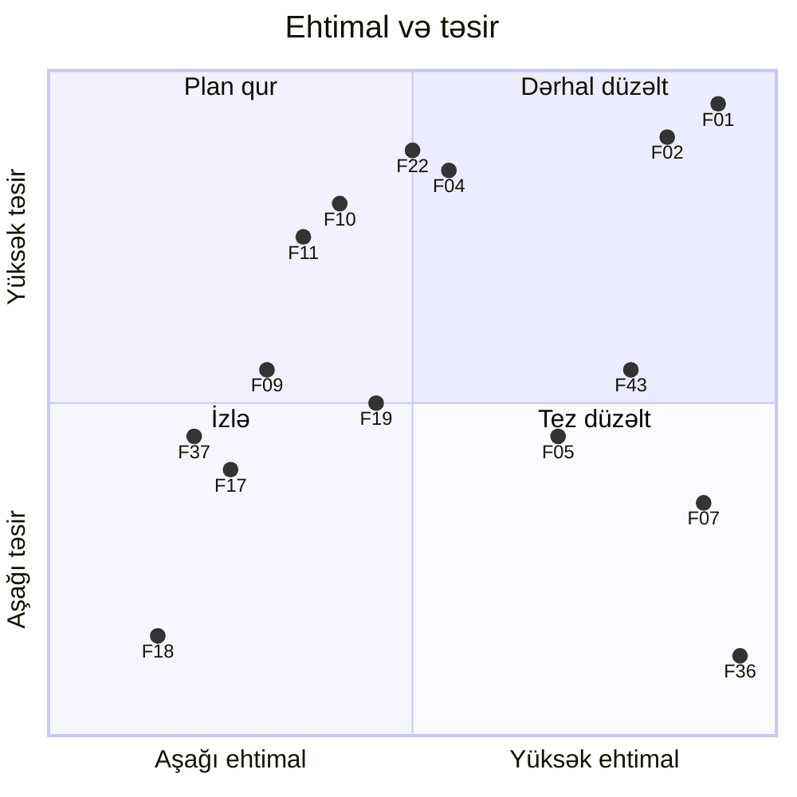

# 21. Mühəndislik qiymətləndirməsi

Bu fəsil əvvəlki fəsillərdə ayrı-ayrılıqda qeyd olunan bütün müşahidələri bir reyestrdə toplayır, kateqoriyalara ayırır,
prioritet verir və düzəliş yol xəritəsi təklif edir. Məqsəd layihəni "pisləmək" deyil: bu, case-study kimi yazılmış,
müasir stack üzərində qurulmuş və bir çox düzgün qərar verilmiş sistemdir. Məqsəd — istehsala hazırlıq baxımından nəyin
çatışmadığını dəqiq və sübutla göstərməkdir.

## 21.1 Metodologiya

**Kateqoriyalar** (fəsil 1.3-dəki etiketlərlə uyğun):

| Kod | Kateqoriya | Meyar |
|---|---|---|
| **D** | Təsdiqlənmiş defekt | Kod oxunuşundan birmənalı görünən səhv davranış; reproduksiya ssenarisi göstərilə bilir |
| **R** | Risk | Müəyyən şəraitdə (yük, uğursuzluq, hücum) problem yaradır; hazırda görünməyə bilər |
| **T** | Trade-off | Şüurlu və ya məqbul seçim; qiyməti var, lakin kontekstdə əsaslı ola bilər |
| **M** | Saxlanıla bilənlik | Davranışa təsir etmir, lakin dəyişikliyi çətinləşdirir, səhv ehtimalını artırır |
| **H** | Hipotez | Runtime yoxlaması olmadan təsdiq edilə bilməyən ehtimal |

**Ciddilik** (müəllifin qiymətləndirməsidir, [NƏTİCƏ]): **Kritik** — dərhal istismar oluna bilən təhlükəsizlik
boşluğu; **Yüksək** — əlçatanlığı və ya məlumat bütövlüyünü geniş miqyasda poza bilər; **Orta** — məhdud təsir və ya
xüsusi şərait tələb edir; **Aşağı** — kosmetik və ya nadir.

**Sübut qaydası:** hər tapıntı ya repozitoriya faylına və sətir aralığına, ya da kitabxana mənbəyinə (versiyası ilə)
istinad edir. Runtime-da yoxlanmayan hər şey [NƏTİCƏ] və ya H kimi işarələnib. Tam reyestr: `analysis/01-architecture-map.md`.

## 21.2 Güclü tərəflər

Qiymətləndirmə yalnız problemlərdən ibarət olsa, qərəzli olar. Repozitoriyada aşağıdakı qərarlar düzgündür və yeni
layihədə saxlanmağa dəyər [FAKT]:

| Sahə | Qərar | Niyə yaxşıdır |
|---|---|---|
| Data sahibliyi | Hər servisin öz DB-si (auth_db, campaign_db), başqa servisin cədvəlinə giriş yoxdur | Servislər müstəqil dəyişə bilir |
| Sxem idarəsi | Liquibase + `ddl-auto: validate`, `open-in-view: false` (`campaign-service/src/main/resources/application.yml:12-15`) | Sxem kodla versiyalanır; lazy-loading sızması yoxdur |
| Dublikat qaydası | Tətbiq yoxlaması **və** partial unique indeks (`campaign-service/src/main/resources/db/changelog/db.changelog-master.yml:101-113`) | Yarış vəziyyətində DB son müdafiə xəttidir |
| Token təhlükəsizliyi | RS256 (asimmetrik), servislərdə yalnız public key; refresh/reset token-lər SHA-256 hash kimi saxlanır | Servis kompromisi token buraxmağa imkan vermir; DB sızması token-ləri açmır |
| Refresh rotasiyası | Hər refresh köhnə token-i ləğv edir; reset bütün refresh token-ləri ləğv edir | Oğurlanmış refresh token-in ömrü qısalır |
| Servislərarası auth | auth → log çağırışı `ROLE_INTERNAL_SERVICE` JWT ilə (`LogServiceHttpClientConfiguration.java:32-48`) | Daxili endpoint istifadəçi token-i ilə çağırıla bilmir |
| Dayanıqlıq | Audit çağırışı Retry + CircuitBreaker + Bulkhead ilə qorunur, xəta login-i sındırmır | Qeyri-kritik asılılıq kritik axını aşağı salmır |
| Asinxron log | Yavaş sorğular Kafka ilə ayrılır; log-service-də DLQ (`KafkaDlqConfiguration.java:26-33`) | Log yazısı sorğu yolundan ayrılıb |
| Xəta formatı | Vahid `ApiResponse` / `ApiError` + `ErrorCode` enum, security handler-ləri eyni formatda | Klient üçün proqnozlaşdırıla bilən kontrakt |
| Kontrakt | `grpc-contract` ayrıca modul, proto-dan generasiya | Server və klient eyni kontraktdan qurulur |
| Müasir platforma | Java 25, Boot 4, virtual thread-lər, `@ImportHttpServices`, Testcontainers | Aktual texnikaların praktiki nümunəsi |
| Test keyfiyyəti | campaign/dashboard controller testləri real RS256 token və aktiv filtrlərlə | Təhlükəsizlik konfiqurasiyası həqiqətən test olunur |
| Müşahidə | Prometheus + OTel/Tempo + Loki + Grafana, log-larda `traceId` | Metrik, trace və log birləşdirilə bilir |
| Exhaustive switch | `resolveInitialStatus` enum üzərində `switch` ifadəsi (`CampaignService.java:133-138`) | Yeni kateqoriya əlavə olunanda kompilyator xəbərdar edir |

## 21.3 Tapıntılar: təsdiqlənmiş defektlər (D)

| ID | Ciddilik | Tapıntı | Sübut | Düzəliş |
|---|---|---|---|---|
| F01 | **Kritik** | Anonim istifadəçi `role: ROLE_ADMIN` ilə qeydiyyatdan keçir və bütün admin əməliyyatlarını edir | `RegisterRequest.java:18-24`, `AuthService.java:103-126`, `ServiceSecurityConfiguration.java:96-104` | Qeydiyyat həmişə `ROLE_USER`; admin yalnız admin endpoint-i və ya seed ilə |
| F02 | **Kritik** | `forgot-password` xam reset token-i cavabda qaytarır → hesabın ələ keçirilməsi | `AuthService.java:205-230` | Token yalnız e-poçt/SMS kanalı ilə; cavab həmişə eyni (`202`) |
| F07 | Orta | Catch-all handler 4xx xətalarını (səhv JSON, UUID, enum, 405, 404) 500-ə çevirir və `getMessage()`-i qaytarır | `GlobalExceptionHandler.java:130-139` | `ResponseEntityExceptionHandler` / `ProblemDetail`; catch-all yalnız ümumi mesaj + log |
| F18 | Aşağı | Paralel qeydiyyatda unique pozuntusu 500 + SQL mesajı | `AuthService.java:103-126` | `DataIntegrityViolationException` → 409; `saveAndFlush` |
| F36 | Aşağı | `approve`/`deactivate` cavabında köhnə `updatedAt` | `CampaignService.java:162-169`, `CampaignEntity.java:65-68` | `saveAndFlush` və ya vaxtı servisdə təyin etmək |

## 21.4 Tapıntılar: risklər (R)

| ID | Ciddilik | Tapıntı | Tetikleyici şərt | Düzəliş |
|---|---|---|---|---|
| F04 | Yüksək | gRPC 9090 autentifikasiyasız, Compose host-a açır (`docker-compose.yml:182-184`) | Şəbəkəyə çıxışı olan istənilən şəxs | Portu açmamaq; mTLS və ya JWT interceptor |
| F22 | Yüksək (istehsalda) | Demo private key və şifrələr repozitoriyada | Repozitoriyaya çıxış | Secret manager; açarlar build-dən kənarda; rotasiya |
| F10 | Yüksək | Kafka əlçatmaz olduqda `send()` 60 s-ə qədər bloklayır — filtrdə və tranzaksiyada | Broker/metadata problemi | `max.block.ms` 1–2 s, göndərişi ayrı executor-a, outbox |
| F11 | Yüksək | `ErrorHandlingDeserializer` yoxdur → poison pill partisiyanı bloklayır | Bir səhv JSON mesajı | `ErrorHandlingDeserializer` + DLQ |
| F05 | Orta | Rate limit açarı `X-Forwarded-For`-a etibar edir | Anonim sorğularda saxta başlıq | Yalnız etibarlı proxy-dən gələn XFF; `ForwardedHeaderTransformer` / trusted proxies |
| F03 | Orta | İstifadəçi enumerasiyası (fərqli mesajlar və 404) | Hücumçu istifadəçi adlarını yoxlayır | Eyni cavab və eyni gecikmə |
| F08 | Orta | JWT filtri `JwtException`-ı tutmur | Etibarsız/vaxtı keçmiş token | Spring Security Resource Server və ya açıq handler |
| F09 | Orta | Dual write (DB + Kafka) | Commit və ya göndəriş uğursuzluğu | Transactional outbox / CDC |
| F17 | Orta | Refresh token yarışı | Paralel iki refresh | Şərti UPDATE və ya `@Version` |
| F19 | Orta | gRPC deadline yoxdur, statuslar `UNKNOWN` | campaign-service asılır və ya 404 | `withDeadlineAfter`, `@GrpcAdvice`, klientdə tərcümə |
| F37 | Orta | `@Version` yoxdur → lost update | Paralel admin əməliyyatları | `@Version` + 409 |
| F38 | Orta | `GlobalExceptionHandler` loglamır | Hər 500 | 5xx üçün ERROR log + traceId |
| F40 | Orta | Actuator `permitAll` və portlar açıq | Şəbəkə çıxışı | Ayrı management portu, şəbəkə izolyasiyası, auth |
| F24 | Orta | Loki-də `trace_id` label-ı | Yük artdıqca | traceId log sətrində qalsın, label olmasın |
| F43 | Orta | ES indekslərində ILM/retention yoxdur | Zamanla disk dolur | ILM, data stream, rollover |
| F27 | Orta | Testlərdə miqrasiya işləmir | Sxem dəyişikliyi | Testlərdə Liquibase + `validate` |
| F13 | Aşağı | Evict/commit sırası, TTL yoxdur | Paralel oxu-yazı | Transaction-aware cache, TTL |
| F06 | Aşağı | Rate limiter fail-open | Redis düşür | Şüurlu seçim; alert ilə müşayiət |
| F32 | Aşağı | Config Server əlçatmazdırsa paylanan xassələr itir | Config Server düşür | Kritik xassələri lokal da saxlamaq, `fail-fast` |
| F34 | Aşağı (H) | `@Async`-də trace konteksti ötürülmür | Audit çağırışları | `ContextPropagatingTaskDecorator` |
| F46 | Aşağı | `@Async` audit commit-dən əvvəl göndərilir → rollback olunan əməliyyat üçün "uğurlu" audit | Commit xətası (məs. F18) | `@TransactionalEventListener(AFTER_COMMIT)` |

## 21.5 Tapıntılar: trade-off-lar (T)

| ID | Seçim | Qazanc | Qiymət | Qiymətləndirmə |
|---|---|---|---|---|
| F12 | `campaign-events` consumer-siz dərc olunur | Gələcək inteqrasiya üçün hazır hadisə axını | Dual-write riski heç bir faydasız daşınır; sxem sənədləşməyib | Ya consumer əlavə edin, ya da outbox ilə birlikdə saxlayın |
| F25 | Yavaş sorğu həddi 5 ms | Demo-da pipeline-ın işlədiyini görmək asandır | campaign-service və log-service-də praktiki olaraq hər sorğu Kafka-ya gedir; log-service öz oxumasını da qeyd edir | Mühitə görə konfiqurasiya; istehsalda yüzlərlə ms |
| F31 | Daxili çağırışlar static ünvanla, Eureka yalnız gateway-də | Sadəlik, Compose DNS kifayətdir | İki kəşf mexanizmi; ölçəkləmədə qarışıqlıq | Kubernetes-də Eureka-nı tamamilə çıxarmaq olar |
| F35 | 120 dəqiqəlik access token, ləğv mexanizmi yoxdur | Stateless yoxlama, DB-yə müraciət yoxdur | Logout/reset-dən sonra 2 saat giriş | 5–15 dəq ömür + refresh |
| F06 | Rate limiter fail-open | Redis problemi API-ni dayandırmır | Redis düşəndə limit yoxdur | Əksər API-lər üçün düzgün seçim |
| F44 | Gateway JWT/PEM kodu `security` modulundan ayrıca yazılıb | Gateway servlet asılılıqlarını (`HttpSecurity`) çəkmir | İki yerdə eyni məntiq (`GatewayPemKeyUtils.java:59`, `PemKeyUtils.java:59`) | Servlet-dən asılı olmayan `jwt-core` modulu ilə birləşdirmək olar |

## 21.6 Tapıntılar: saxlanıla bilənlik (M) və hipotezlər (H)

| ID | Tapıntı | Təsir | Tövsiyə |
|---|---|---|---|
| F14 | Təyin olunmuş UUID + `@Version` yoxdur → hər `save` əvvəl SELECT | Əlavə sorğular | `Persistable.isNew()` və ya `@Version` |
| F15 | Tarixçə FK-sı indekssiz, `idx_campaign_duplicate_lookup` təkrarlanır | Tarixçə sorğusu böyüdükcə yavaşlayır | `campaign_id` indeksi, təkrar indeksi silmək |
| F16 | auth-da `unique` + ayrıca indeks | Lazımsız yazı xərci | Yalnız unique constraint |
| F20 | Jackson 2 `ObjectMapper` yalnız Eureka tranzitivi ilə | Eureka çıxarılsa kontekst qalxmır | `JsonMapper` (Jackson 3) istifadə etmək |
| F21 | Deprecated `JsonSerializer`/`JsonDeserializer` | Gələcək versiyada silinəcək | `JacksonJsonSerializer`/`Deserializer` |
| F23 | Observation konfiqurasiyası 4 yerdə | Dəyişiklik 4 yerdə | Ortaq modul |
| F26 | log-service `Page` birbaşa qaytarır | Daxili model API-yə sızır | DTO, `PagedModel` |
| F28 | Test və Compose image-ləri fərqlidir; Compose-da ES-dən başqa demək olar ki, bütün image-lər `latest` teqlidir (`docker-compose.yml:94`, `286`, `301`) | "Testdə işləyir, prodda yox"; build təkrarlana bilmir | Eyni, sabitlənmiş versiyalar (və ya digest) |
| F29 | Compose `depends_on` sağlamlıqsız, `restart` yoxdur | Başlanğıc yarışları | `condition: service_healthy` |
| F33 | Test boşluqları (keçidlər, gRPC, gateway, filtrlər) | Reqressiya riski | Fəsil 19.6 |
| F39 | Audit request validasiyasız, `page/size` yoxlanmır | Səhv məlumat ES-ə düşür; mənfi page → 500 | `@Valid` + constraint-lər |
| F41 | CORS yoxdur | Brauzer klientləri başqa origin-dən işləmir | Gateway-də CORS |
| F42 | `slow-requests` sıralamasız, dinamik mapping | Nəticələr ixtiyari sırada | `Sort.by(occurredAt).descending()`, açıq mapping |
| F45 | `DUPLICATE` statusu heç bir axında təyin olunmur, lakin 4 yerdə nəzərə alınır | Ölü vəziyyət, oxucunu çaşdırır | Ya axını reallaşdırmaq, ya statusu silmək |
| F30 (H) | springdoc 2.8.13 Boot 4 ilə rəsmi uyğunluq xəttindən kənar | Runtime-da yoxlanmayıb | springdoc 3.x xəttinə keçid, smoke test |

F45 sübutu: `CampaignStatus.java:3-8`, `CampaignService.java:140-150` (`StatusNot(DUPLICATE)`), `CampaignService.java:171-175`
(`ensureNotDuplicate`), `CampaignGrpcClient.java:25-29` (süzgəc) və partial indeksin `WHERE status <> 'DUPLICATE'` şərti.

## 21.7 Risk matrisi



## 21.8 Prioritetləşdirilmiş düzəliş yol xəritəsi

Səy təxminləri (S — saatlar, M — 1–2 gün, L — həftə) [NƏTİCƏ] müəllifin qiymətləndirməsidir.

| Mərhələ | Tapıntılar | Hədəf | Səy |
|---|---|---|---|
| **P0 — təhlükəsizlik** | F01, F02, F04, F22, F40 | İstismar oluna bilən boşluqları bağlamaq | S–M |
| **P1 — düzgünlük** | F07, F08, F18, F19, F36, F37, F17, F38 | Düzgün HTTP statusları, ziddiyyətsiz məlumat, görünən xətalar | M |
| **P2 — dayanıqlıq** | F10, F11, F09, F13, F46, F05, F03 | Kafka/Redis uğursuzluğunda proqnozlaşdırıla bilən davranış | M–L |
| **P3 — əməliyyat** | F24, F25, F43, F42, F32, F29, F34 | İstehsalda müşahidə və saxlama | M |
| **P4 — gigiyena** | F14, F15, F16, F20, F21, F23, F26, F27, F28, F30, F33, F39, F41, F44, F45 | Saxlanıla bilənlik və test etibarlılığı | M–L |

Asılılıqlar: F27 (testlərdə miqrasiya) F15 və F37 düzəlişlərindən **əvvəl** edilməlidir — əks halda yeni indeks və
`version` sütunu test olunmur. F09 (outbox) F10-un tranzaksiya daxilindəki hissəsini də aradan qaldırır. F38 (loglama)
hər şeydən əvvəl edilə bilər və digər düzəlişlərin diaqnostikasını asanlaşdırır.

## 21.9 SOLID və təbəqələnmə təhlili

**SRP (tək məsuliyyət).** `CampaignService` persistensiya, tarixçə, hadisə dərci və cache invalidasiyasını
koordinasiya edir. 192 sətirlik sinif üçün bu məqbuldur — o, *tətbiq servisi* (orkestrator) rolundadır. Problem
məsuliyyətlərin sayında deyil, hadisə dərcinin infrastrukturla birbaşa bağlı olmasındadır (bax: DIP).
`SlowRequestLoggingFilter` həm ölçür, həm Kafka-ya yazır — ölçməni `ObservationRegistry`-yə, dərci isə ayrıca komponentə
vermək testi asanlaşdırar.

**OCP (açıq/qapalı).** Başlanğıc status exhaustive `switch` ilə həll olunur — yaxşı. Keçid qaydaları isə `approve` və
`deactivate` metodlarında `if` şərtləri kimi səpələnib (`CampaignService.java:91-111`). Yeni status (məs. `EXPIRED`)
əlavə etmək bir neçə metodu dəyişməyi tələb edir. Alternativ — keçid cədvəlini enum-a köçürmək:

```java
// İllüstrativ (repozitoriyada yoxdur)
public enum CampaignStatus {
    PENDING_APPROVAL, ACTIVE, DEACTIVE, DUPLICATE;

    private static final Map<CampaignStatus, Set<CampaignStatus>> ALLOWED = Map.of(
            PENDING_APPROVAL, EnumSet.of(ACTIVE, DEACTIVE),
            ACTIVE, EnumSet.of(DEACTIVE),
            DEACTIVE, EnumSet.noneOf(CampaignStatus.class),
            DUPLICATE, EnumSet.noneOf(CampaignStatus.class));

    public boolean canTransitionTo(CampaignStatus target) {
        return ALLOWED.get(this).contains(target);
    }
}
```

**LSP.** `BusinessException` iyerarxiyası (`DuplicateCampaignException`, `InvalidStatusTransitionException`,
`ResourceNotFoundException`) ardıcıldır: hər alt sinif `ErrorCode` daşıyır və handler onları eyni şəkildə emal edir.
Pozuntu müşahidə olunmur.

**ISP.** `LogServiceHttpClient` tək metodlu interfeysdir; `CampaignRepository` yalnız lazım olan sorğuları əlavə edir;
proyeksiya interfeysi (`CampaignStatusCountProjection`) minimaldır. Yaxşı.

**DIP.** `CampaignService` `KafkaTemplate<String, Object>`-dən birbaşa asılıdır (`CampaignService.java:37`) — domen
məntiqi infrastruktur detalına bağlıdır. `CampaignEventPublisher` portu (interfeys) və Kafka/outbox adapteri həm testi,
həm outbox-a keçidi asanlaşdırar. `DashboardController` konkret `CampaignGrpcClient` sinfindən asılıdır; testlərdə
`@MockitoBean` ilə əvəz olunduğu üçün praktiki problem yoxdur.

**Təbəqələnmə.** Controller → servis → repository istiqaməti pozulmur; controller-lər repository çağırmır — **istisna**
`SlowRequestLogController`-dir, o, servis qatı olmadan birbaşa repository-yə müraciət edir
(`SlowRequestLogController.java:22-43`). Sadə oxu üçün məqbuldur, lakin layihədaxili konvensiyanı pozur.

**Modullar arası ardıcıllıq (M).** auth-service Lombok + MapStruct + ayrıca domen record-ları istifadə edir;
campaign-service əl ilə yazılmış mapper və getter-lərlə işləyir; log-service DTO-suz `Page` qaytarır. Bir komandada bu,
"hansı üslub standartdır?" sualını doğurur. Kod-review qaydası və ya arxitektura qərar qeydi (ADR) ilə bir üsul
seçilməlidir.

**Paylaşılan modullar.** `common` həm xəta handler-i, həm Kafka filtri, həm virtual thread və observation
konfiqurasiyası daşıyır; komponent skanı ilə bütün servislərə avtomatik daxil olur (fəsil 4.4). Bu, "shared kernel"
yaradır: `common`-dakı dəyişiklik bütün servislərin yenidən yayımlanmasını tələb edir və davranış (məs. Kafka filtri)
classpath-dan asılı olaraq gizli aktivləşir. Kiçik komanda üçün məqbuldur; böyüdükcə auto-configuration modulu
(`@AutoConfiguration` + `AutoConfiguration.imports`) və açıq `@ConditionalOnProperty` keçidləri daha idarəolunandır.

## 21.10 Arxitektura səviyyəsində qiymətləndirmə

| Sual | Cavab | Etiket |
|---|---|---|
| Servis sərhədləri düzgündürmü? | auth və campaign aydın domenlərdir; log-service texniki servisdir (müşahidə məlumatı); dashboard nazik BFF-dir və hazırda yalnız süzgəc əlavə edir | [NƏTİCƏ] |
| Sinxron asılılıq zənciri | gateway → dashboard → campaign (gRPC) → Redis/PostgreSQL: dörd hop, deadline-sız | [FAKT] |
| Asinxron inteqrasiya | Yalnız log məlumatı üçün; biznes hadisəsi (`campaign-events`) heç kim tərəfindən istehlak olunmur | [FAKT] |
| Data tutarlılığı | Servis daxilində ACID; servislərarası yalnız log/audit (itirilə bilən) | [FAKT] |
| Miqyaslana bilənlik | Servislər stateless (JWT), horizontal miqyaslana bilər; Kafka açarları (URI, kampaniya id-si) partisiyalanmaya uyğundur | [NƏTİCƏ] |
| Tək uğursuzluq nöqtələri | Compose-da hər infrastruktur komponenti tək instansdır, replika yoxdur (iki ayrı PostgreSQL, bir Redis, bir Kafka broker, bir ES node) | [FAKT] |
| Konfiqurasiya | 12-factor-a yaxın: env dəyişənləri + Config Server (optional) | [FAKT] |
| Monolit alternativ | Bu həcmdə (≈ 6 200 sətir) modul-monolit daha sadə olardı; layihə mikroservis texnikalarını nümayiş etdirmək üçün yazılıb | [NƏTİCƏ] |

## 21.11 Komanda üçün açıq suallar (naməlumlar)

1. `campaign-events` hadisəsini kim istehlak etməlidir və hansı sxem uyğunluğu tələb olunur? [NAMƏLUM]
2. `DUPLICATE` statusu planlaşdırılan funksiyadır, yoxsa qalıqdır? [NAMƏLUM]
3. Admin hesabları necə yaradılmalıdır (seed, daxili panel, IdP)? [NAMƏLUM]
4. 5 ms həddi və 1 sorğu / 5 s rate limit demo üçündür, yoxsa tələbdir? [NAMƏLUM]
5. Audit qeydlərinin itirilməsi məqbuldurmu (hüquqi tələb)? Cavab "xeyr"-dirsə, HTTP + CB əvəzinə davamlı növbə lazımdır.
   [NAMƏLUM]
6. Hədəf yerləşdirmə mühiti (Compose, Kubernetes, bulud)? Eureka və Config Server qərarları bundan asılıdır. [NAMƏLUM]

## 21.12 Praktiki tapşırıqlar

Tapşırıqları öz fork-unuzda, ayrıca branch-da edin. Çətinlik: ★ — 30 dəqiqəyə qədər, ★★ — bir neçə saat, ★★★ — təxminən bir gün. "Gözlənilən nəticə" koddan çıxardığım proqnozdur; sizdə fərqli çıxarsa, səbəbini tapmaq tapşırığın ən dəyərli hissəsidir.

**T1 ★★ — Üç düzəliş, üç PR.** P0/P1 mərhələsindən üç tapıntı seçin, hər birini ayrıca branch-da test ilə düzəldin və
PR təsvirində "əvvəl/sonra" davranışını göstərin. **Yoxlama:** hər PR-də düzəlişi sübut edən ən azı bir test var.

**T2 ★ — ADR yazın.** F09 üçün qərar sənədi: kontekst, variantlar (tranzaksiya daxilində göndəriş, outbox + polling,
outbox + CDC), qərar və nəticələr (22.5-dəki format). **Yoxlama:** qiymətlər və risklər açıq yazılıb.

**T3 ★ — Risk matrisini yenidən qiymətləndirin.** 21.7-dəki matrisi iki ssenari üçün yenidən qurun: sistem internetə
açıqdır / yalnız daxili şəbəkədədir. **Yoxlama:** hansı tapıntıların kvadrantı dəyişir və niyə?

## 21.13 Müsahibə sualları

**S1. Kod-review zamanı tapıntıları necə prioritetləşdirirsiniz?**
Cavab: Təsir × ehtimal; təhlükəsizlik və məlumat bütövlüyü əvvəl, sonra əlçatanlıq, sonra saxlanıla bilənlik. Hər tapıntı
üçün reproduksiya ssenarisi və ya sübut; hipotezləri faktlardan ayırmaq.

**S2. Bu layihədə ən kritik iki problem hansıdır?**
Cavab: Admin rolunun özünü qeydiyyatı (F01) və reset token-in cavabda qaytarılması (F02) — hər ikisi anonim hücumçuya
tam nəzarət verir və bir neçə sətirlə düzəlir.

**S3. "Catch-all exception handler" niyə təhlükəlidir?**
Cavab: Framework-un düzgün 4xx xəritələrini udur, klientə daxili mesajlar sızdırır, loglanmırsa xətalar görünməz olur.
Düzgün: `ResponseEntityExceptionHandler`-i genişləndirmək, catch-all-da ümumi mesaj və ERROR log.

**S4. Layihədə DIP-in pozulduğu yeri və nəticəsini göstərin.**
Cavab: `CampaignService` `KafkaTemplate`-dən birbaşa asılıdır; outbox-a keçid və ya hadisə dərcinin test edilməsi servis
kodunu dəyişməyi tələb edir. Port/adapter ayrılığı bunu lokallaşdırır.

**S5. Trade-off ilə defekti necə ayırırsınız?**
Cavab: Trade-off — alternativlər bilinərək seçilmiş və qiyməti kontekstdə məqbul olan qərardır (fail-open rate limiter).
Defekt — niyyət edilən davranışla real davranış arasında fərqdir (köhnə `updatedAt`). Fərq niyyətdədir, ona görə
sənədləşmə (ADR) vacibdir.

**S6. Modul-monolit bu layihə üçün daha yaxşı olardımı?**
Cavab: Həcm və komanda ölçüsü baxımından bəli — tək yerləşdirmə, tək DB tranzaksiyası, daha az şəbəkə xətası. Mikroservis
müstəqil yerləşdirmə, fərqli miqyaslama və komanda muxtariyyəti lazım olanda özünü doğruldur. Layihənin məqsədi texnika
nümayişidir, ona görə seçim kontekstdə başa düşüləndir.

## 21.14 Xülasə

- 46 tapıntı: 5 təsdiqlənmiş defekt, 21 risk, 6 trade-off (F06 həm risk, həm trade-off kimi baxılır), 14 saxlanıla
  bilənlik, 1 hipotez (F30); F34 risk + hipotezdir.
- İki kritik təhlükəsizlik defekti (F01, F02) bir neçə sətirlə düzəlir və birinci prioritetdir.
- Ən geniş əlçatanlıq riski Kafka-dır (F10, F11): log pipeline-ı campaign-service və log-service-in sorğu yoluna
  bağlıdır.
- Güclü tərəflər real və çoxdur: DB-per-service, Liquibase, RS256, hash-lənmiş token-lər, dayanıqlıq pattern-ləri, DLQ,
  real token ilə inteqrasiya testləri, tam müşahidə stack-i.
- Növbəti fəsil bu dərsləri oxşar sistemin sıfırdan dizaynına çevirir.
