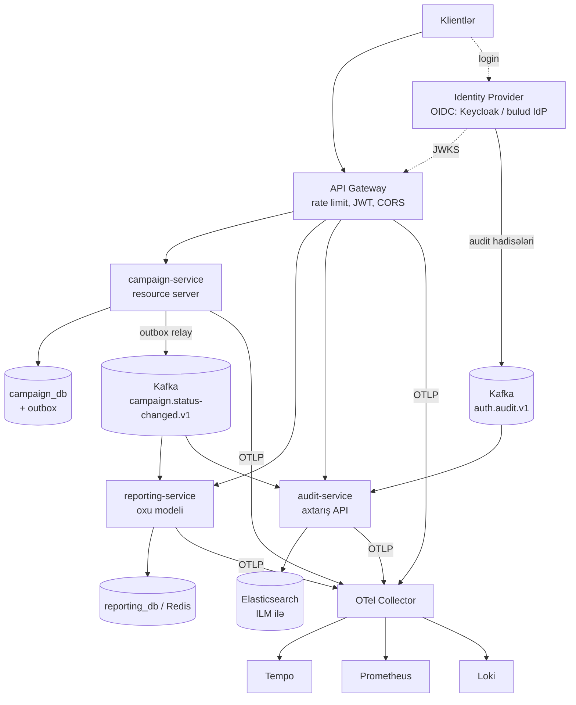

# 22. Oxşar sistemi sıfırdan dizayn etmək

Bu fəsil "repozitoriyanı başa düşdüm, indi özüm necə qurardım?" sualına cavab verir. Burada təqdim olunan kod və
konfiqurasiyalar **illüstrativdir, repozitoriyada yoxdur**; onlar əvvəlki fəsillərdə müəyyən edilən boşluqları
(fəsil 21) nəzərə alan hədəf dizaynı göstərir. Versiya və API adları layihənin istifadə etdiyi Spring Boot 4 / Spring
Framework 7 xəttinə uyğun seçilib; yeni layihədə onları rəsmi sənədlə yoxlayın.

## 22.1 Tələblərdən başlamaq

Repozitoriyanın README və kodundan bərpa olunan tələblər [NƏTİCƏ]:

| Növ | Tələb | Dizayna təsiri |
|---|---|---|
| Funksional | Admin kampaniya yaradır; LIFE dərhal aktiv, digərləri təsdiq gözləyir | Status maşını, rol modeli |
| Funksional | Eyni kateqoriya + başlıq + təsvir ilə dublikat qadağandır | Unikal constraint |
| Funksional | Status dəyişikliklərinin tarixçəsi | Append-only cədvəl və ya hadisə jurnalı |
| Funksional | Dashboard: status üzrə statistika və tarixçə | Oxu modeli, cache |
| Funksional | Qeydiyyat, login, refresh, logout, parol bərpası | IdP və ya auth servisi |
| Funksional | Autentifikasiya auditi və yavaş sorğu jurnalı | Asinxron log pipeline, axtarış |
| Qeyri-funksional | Rol əsaslı giriş, rate limit | Gateway + resource server |
| Qeyri-funksional | Müşahidə (metrik, trace, log) | OTel, Prometheus |
| Qeyri-funksional | Konteynerləşdirmə, CI | Docker, pipeline |

Dizayndan əvvəl cavablandırılmalı suallar (fəsil 21.11): audit itə bilərmi? `campaign-events`-i kim oxuyur? Gözlənilən
yük (sorğu/s, kampaniya sayı)? Yerləşdirmə mühiti? Bu cavablar aşağıdakı qərarların hər birini dəyişə bilər.

## 22.2 Birinci qərar: modul-monolit, yoxsa mikroservislər?

| Meyar | Modul-monolit | Mikroservislər |
|---|---|---|
| Komanda | 1–2 komanda | Hər servisə sahib komanda |
| Tranzaksiya | Bir DB tranzaksiyası, outbox lazım deyil (daxili hadisələr üçün) | Servislərarası eventual consistency |
| Yerləşdirmə | Bir artefakt | Müstəqil, lakin koordinasiya tələb edir |
| Uğursuzluq | Proses daxili çağırışlar | Şəbəkə xətaları, timeout, retry |
| Miqyaslama | Bütün tətbiq birlikdə | Servis üzrə |
| Əməliyyat xərci | Aşağı | Yüksək (kəşf, konfiqurasiya, trace, çoxlu DB) |

[NƏTİCƏ] Bu domen üçün tövsiyə: **modul-monolitlə başlamaq** (Spring Modulith və ya Maven modulları ilə ciddi
sərhədlər), sərhədləri hadisələrlə qurmaq və yalnız real səbəb (fərqli miqyas, fərqli komanda, fərqli yerləşdirmə
tezliyi) yarandıqda servisi ayırmaq. Repozitoriya isə mikroservis texnikalarını öyrətmək üçün qəsdən paylanmış
qurulub; aşağıdakı dizayn **paylanmış variantı** təsvir edir, çünki öyrənmə məqsədi budur.

## 22.3 Hədəf arxitektura



Repozitoriyadan əsas fərqlər və səbəbləri:

| Repozitoriya | Hədəf | Səbəb |
|---|---|---|
| Öz auth-service-i, öz JWT kodu | OIDC IdP + Spring Security Resource Server | Parol, MFA, bərpa, enumerasiya qorunması hazırdır; F01–F03, F08, F35 sinfi problemləri azalır |
| Dashboard sinxron gRPC ilə campaign-dən oxuyur | Reporting servisi hadisələrdən öz oxu modelini qurur (CQRS) | Sinxron asılılıq, deadline və status problemləri (F19) yox olur; `campaign-events` real istehlakçı qazanır (F12) |
| `kafkaTemplate.send` tranzaksiya daxilində | Transactional outbox + relay | Dual write (F09) və bloklanma (F10) aradan qalxır |
| Audit HTTP + Circuit Breaker, itə bilər | Audit hadisəsi Kafka-ya (outbox ilə) | Davamlılıq; log-service düşəndə audit itmir |
| Xüsusi yavaş sorğu filtri → Kafka → ES | OTel metrik və trace-lər, tail sampling | Standart alət; ayrıca pipeline lazım deyil (F25, F43) |
| Eureka + Config Server | Platformanın kəşfi (Kubernetes Service DNS) və ConfigMap/Secret | Daha az hərəkətli hissə (F31, F32) |

Yerləşdirmə Compose-dursa və IdP istifadə etmək mümkün deyilsə, öz auth servisi qala bilər — lakin fəsil 22.6-dakı
təhlükəsizlik qaydaları ilə.

## 22.4 Addım-addım qurma planı

| İterasiya | Nəticə | Yoxlama meyarı |
|---|---|---|
| 0. Skelet | Maven BOM (Boot + Cloud), modullar, Dockerfile, CI (build + test) | `mvn verify` yaşıl, image qurulur |
| 1. Kontrakt | OpenAPI spesifikasiyası, hadisə sxemləri (JSON Schema / Avro), xəta formatı (`ProblemDetail`) | Review edilmiş kontraktlar |
| 2. Domen | Status maşını enum-da, keçid cədvəli, unit testlər | Bütün keçidlər test olunur |
| 3. Persistensiya | Liquibase: cədvəllər, `version` sütunu, FK indeksləri, partial unique; `ddl-auto: validate` | Testcontainers-də miqrasiya + validate |
| 4. API | Controller, validasiya, `ProblemDetail` handler, səhifələmə DTO-su | MockMvc testləri: 400/401/403/404/409 |
| 5. Təhlükəsizlik | Resource server, rol xəritəsi, metod təhlükəsizliyi, actuator ayrı port | Real token ilə inteqrasiya testi |
| 6. Hadisələr | Outbox cədvəli, relay, hadisə versiyası | Commit olmayan əməliyyat hadisə yaratmır (test) |
| 7. İstehlakçılar | İdempotent consumer, `ErrorHandlingDeserializer`, DLQ, retry topologiyası | Poison pill testi DLQ-ya düşür |
| 8. Oxu modeli | Reporting proyeksiyası, cache TTL ilə | Hadisələrdən sonra statistika düzgündür |
| 9. Gateway | Marşrutlar, rate limit (etibarlı IP), CORS, timeout-lar | 429, CORS preflight testləri |
| 10. Müşahidə | OTel, Kafka observation, log korrelyasiyası, dashboard və alert-lər | Bir trace gateway → consumer-ə qədər görünür |
| 11. Dayanıqlıq | Timeout-lar, deadline-lar, retry yalnız idempotent əməliyyatlara | Chaos testi: broker/Redis/DB düşür |
| 12. Yerləşdirmə | Helm/Kustomize və ya Compose profilləri, secret manager, sabit image versiyaları | Staging-də smoke test |

## 22.5 Əsas dizayn qərarları (ADR formatında)

**ADR-1: Kampaniya statusu dəyişikliyi necə dərc olunur?**
- *Kontekst:* DB yazısı və hadisə atomik olmalıdır.
- *Variantlar:* (a) tranzaksiya daxilində `send` (repozitoriya), (b) Kafka tranzaksiyaları + DB (iki resursun
  sinxronizasiyası, tam atomik deyil), (c) transactional outbox + polling relay, (d) outbox + CDC (Debezium).
- *Qərar:* (c), yük artanda (d).
- *Nəticə:* At-least-once çatdırılma; istehlakçılar idempotent olmalıdır (hadisə id-si ilə dedup).

**ADR-2: Dashboard məlumatı haradan gəlir?**
- *Variantlar:* sinxron sorğu (gRPC/REST), hadisələrdən qurulan oxu modeli.
- *Qərar:* oxu modeli. *Qiymət:* eventual consistency (saniyələr), əlavə saxlama. *Qazanc:* campaign-service düşəndə
  dashboard işləyir, sorğu yükü ayrılır.

**ADR-3: Token strategiyası.**
- *Qərar:* OIDC IdP; access token 5–15 dəq, refresh token rotasiyası IdP-də; servislərdə yalnız JWKS ilə yoxlama.
- *Ləğv:* qısa ömür + kritik hallarda `jti` deny-list.

**ADR-4: Audit davamlılığı.**
- *Qərar:* audit hadisəsi eyni outbox mexanizmi ilə; audit-service idempotent yazır; ES-də ILM ilə saxlama müddəti
  (məs. 400 gün — hüquqi tələbə görə).

**ADR-5: Servis kəşfi və konfiqurasiya.**
- *Qərar:* Kubernetes-də platformanın DNS-i və ConfigMap/Secret; Eureka və Config Server yalnız platforma bunu
  təmin etmirsə.

## 22.6 Kritik komponentlərin nümunə implementasiyası

### Resource server və rol xəritəsi

Repozitoriyadakı əl ilə yazılmış JWT filtri əvəzinə Spring Security-nin standart mexanizmi xəta emalını (F08), `aud`/`exp`
yoxlamasını və açar rotasiyasını həll edir:

```java
// İllüstrativ (repozitoriyada yoxdur)
@Configuration
@EnableMethodSecurity
class SecurityConfig {

    @Bean
    SecurityFilterChain api(HttpSecurity http) throws Exception {
        http
            .csrf(AbstractHttpConfigurer::disable)
            .sessionManagement(s -> s.sessionCreationPolicy(SessionCreationPolicy.STATELESS))
            .authorizeHttpRequests(auth -> auth
                .requestMatchers("/v3/api-docs/**", "/swagger-ui/**").permitAll()
                .anyRequest().authenticated())
            .oauth2ResourceServer(rs -> rs.jwt(jwt ->
                jwt.jwtAuthenticationConverter(rolesConverter())));
        return http.build();
    }

    private JwtAuthenticationConverter rolesConverter() {
        var authorities = new JwtGrantedAuthoritiesConverter();
        authorities.setAuthoritiesClaimName("roles");
        authorities.setAuthorityPrefix("");          // claim artıq ROLE_ prefiksi ilə gəlir
        var converter = new JwtAuthenticationConverter();
        converter.setJwtGrantedAuthoritiesConverter(authorities);
        return converter;
    }
}
```

```yaml
# İllüstrativ
spring:
  security:
    oauth2:
      resourceserver:
        jwt:
          issuer-uri: https://idp.example.com/realms/campaigns   # JWKS avtomatik tapılır
management:
  server:
    port: 9091            # actuator ayrı portda, xaricə açılmır (F40)
```

### Status maşını və optimistik kilid

```java
// İllüstrativ
@Entity
class CampaignEntity {
    @Id private UUID id;
    @Version private long version;                    // F37, F14
    @Enumerated(EnumType.STRING) private CampaignStatus status;
    private Instant updatedAt;

    void transitionTo(CampaignStatus target, Clock clock) {
        if (!status.canTransitionTo(target)) {
            throw new InvalidStatusTransitionException(status, target);
        }
        this.status = target;
        this.updatedAt = clock.instant();             // F36: cavabda düzgün vaxt
    }
}
```

`Clock` inyeksiyası vaxtı testlərdə idarə etməyə imkan verir. `@Version` paralel yeniləmədə
`ObjectOptimisticLockingFailureException` atır; handler onu 409-a çevirir.

### Transactional outbox

```java
// İllüstrativ
@Transactional
public Campaign approve(UUID id) {
    CampaignEntity campaign = repository.findById(id).orElseThrow(() -> new ResourceNotFoundException(id));
    CampaignStatus previous = campaign.getStatus();
    campaign.transitionTo(CampaignStatus.ACTIVE, clock);
    history.save(CampaignStatusHistoryEntity.of(campaign, previous, "Campaign approved", clock));
    outbox.save(OutboxEvent.of("campaign.status-changed.v1", campaign.getId(),
            new CampaignStatusChanged(UUID.randomUUID(), campaign.getId(), previous, campaign.getStatus(), clock.instant())));
    return mapper.toDomain(campaign);                 // Kafka çağırışı yoxdur
}

@Component
class OutboxRelay {
    @Scheduled(fixedDelay = 500)
    @Transactional
    void publish() {
        // SELECT ... FROM outbox WHERE published_at IS NULL ORDER BY id LIMIT 100 FOR UPDATE SKIP LOCKED
        for (OutboxEvent e : outbox.lockNextBatch(100)) {
            kafka.send(e.topic(), e.aggregateId().toString(), e.payload()).join();   // ack gözlənilir
            e.markPublished(clock.instant());
        }
    }
}
```

Relay bir neçə instansda işləsə də `SKIP LOCKED` eyni sətri iki dəfə götürməyə imkan vermir. Göndərildikdən sonra commit
uğursuz olarsa hadisə təkrar göndərilir — buna görə istehlakçıda dedup lazımdır.

### İdempotent və poison-pill-ə davamlı consumer

```yaml
# İllüstrativ
spring:
  kafka:
    producer:
      properties:
        max.block.ms: 2000                 # F10
    consumer:
      group-id: reporting-service
      auto-offset-reset: earliest
      value-deserializer: org.springframework.kafka.support.serializer.ErrorHandlingDeserializer   # F11
      properties:
        spring.deserializer.value.delegate.class: org.springframework.kafka.support.serializer.JacksonJsonDeserializer
    listener:
      observation-enabled: true            # trace konteksti Kafka başlıqlarında
    template:
      observation-enabled: true
```

```java
// İllüstrativ
@KafkaListener(topics = "campaign.status-changed.v1")
@Transactional
void on(CampaignStatusChanged event) {
    if (!processedEvents.markProcessed(event.eventId())) {   // INSERT ... ON CONFLICT DO NOTHING
        return;                                                // dublikat çatdırılma
    }
    statistics.apply(event.previousStatus(), event.newStatus());
}
```

### Xəta formatı: `ProblemDetail`

```java
// İllüstrativ
@RestControllerAdvice
class ApiExceptionHandler extends ResponseEntityExceptionHandler {   // 400/404/405/415 standart xəritələr (F07)

    private static final Logger log = LoggerFactory.getLogger(ApiExceptionHandler.class);

    @ExceptionHandler(BusinessException.class)
    ProblemDetail business(BusinessException ex) {
        ProblemDetail pd = ProblemDetail.forStatusAndDetail(ex.getErrorCode().status(), ex.getMessage());
        pd.setProperty("code", ex.getErrorCode().name());
        return pd;
    }

    @ExceptionHandler(Exception.class)
    ProblemDetail unexpected(Exception ex) {
        log.error("Unhandled exception", ex);                         // F38
        return ProblemDetail.forStatusAndDetail(HttpStatus.INTERNAL_SERVER_ERROR, "Unexpected error");
    }
}
```

### Sinxron çağırışlar üçün timeout və deadline

```yaml
# İllüstrativ — HTTP Interface klientləri üçün. Xassə adları Boot 4.1 HttpClientProperties mənbəsindən yoxlanılıb
spring:
  http:
    serviceclient:
      audit:
        base-url: http://audit-service:8080
        connect-timeout: 1s
        read-timeout: 2s
```

```java
// İllüstrativ — gRPC: hər çağırışa deadline
var response = stub.withDeadlineAfter(500, TimeUnit.MILLISECONDS).getCampaignStatistics(request);
```

## 22.7 Paket quruluşu

Repozitoriyanın texniki qat üzrə paketləri (`controller`, `service`, `repository`) kiçik servisdə işləyir. Böyüyən
servis üçün funksional (feature) paketləmə tövsiyə olunur:

```text
campaign-service/src/main/java/.../campaign/
├── CampaignServiceApplication.java
├── campaign/                 # aqreqat: API + tətbiq servisi + domen + persistensiya
│   ├── api/                  # controller, request/response DTO, mapper
│   ├── application/          # CampaignService (use-case-lər), portlar (CampaignEventPublisher)
│   ├── domain/               # Campaign, CampaignStatus (keçid cədvəli), domen istisnaları
│   └── infrastructure/       # JPA entity, repository, outbox adapteri
├── history/
├── outbox/                   # OutboxEvent, OutboxRelay
└── config/                   # security, kafka, cache, observability
```

Paket-private görünürlük (`infrastructure` sinifləri `public` deyil) sərhədləri kompilyator səviyyəsində qoruyur; Spring
Modulith və ya ArchUnit testləri qaydaları avtomatik yoxlayır.

## 22.8 İstehsala hazırlıq yoxlama siyahısı

| Sahə | Yoxlama |
|---|---|
| Təhlükəsizlik | Rol klientdən gəlmir; bərpa token-i yalnız xarici kanalla; eyni cavab enumerasiyanı bağlayır; daxili portlar (gRPC, actuator) xaricə açılmır; secret-lər repozitoriyada yoxdur; etibarlı proxy siyahısı; CORS |
| Məlumat | `@Version`; FK indeksləri; unikal constraint-lər; miqrasiyalar testdə işləyir; geri qaytarma planı |
| Hadisələr | Outbox; versiyalı mövzu adları; sxem reyestri/uyğunluq; idempotent consumer; DLQ və onun emalı (alert + replay) |
| Dayanıqlıq | Hər uzaq çağırışda timeout; retry yalnız idempotent əməliyyatlarda; circuit breaker; bulkhead; `max.block.ms` |
| Cache | TTL; transaction-aware eviction; `CacheErrorHandler` (fail-open) |
| Müşahidə | RED metrikləri; Kafka lag; DLQ ölçüsü; trace-lər Kafka sərhədindən keçir; 5xx loglanır; aşağı kardinallı label-lar |
| Əməliyyat | Sabit image versiyaları; health/readiness ayrımı; graceful shutdown; resurs limitləri; ES ILM; backup |
| Test | Unit (domen), slice (web/data), Testcontainers (miqrasiya ilə), kontrakt testləri, gateway testləri |

## 22.9 Bu repozitoriyadan çıxarılan dərslər

| Nümunə | Dərs |
|---|---|
| `role` qeydiyyat sorğusunda | Səlahiyyət heç vaxt klientin özünü təyin etdiyi sahədən gəlməməlidir |
| Catch-all 500 | Framework-un düzgün davranışını udmayın; gözlənilməz xətanı loglayın |
| `send()` tranzaksiyada | Xarici sistemə yazı tranzaksiyanın hissəsi deyil — outbox |
| Consumer-siz mövzu | Hadisə yalnız istehlakçı və kontrakt olduqda dəyər yaradır |
| 5 ms həddi | Müşahidə məlumatının da qiyməti var: həcm, saxlama, kardinallıq |
| Deadline-sız gRPC | Sinxron zəncirdə hər hop gözləmə müddətini məhdudlaşdırmalıdır |
| Testdə `create-drop` | Testlər istehsal sxemi ilə işləməlidir |
| İki üslub (Lombok/MapStruct vs əl ilə) | Konvensiyanı ADR ilə sabitləyin |

## 22.10 Praktiki tapşırıqlar

Tapşırıqları öz fork-unuzda, ayrıca branch-da edin. Çətinlik: ★ — 30 dəqiqəyə qədər, ★★ — bir neçə saat, ★★★ — təxminən bir gün. "Gözlənilən nəticə" koddan çıxardığım proqnozdur; sizdə fərqli çıxarsa, səbəbini tapmaq tapşırığın ən dəyərli hissəsidir.

**T1 ★★ — Yeni funksiyanı dizayn edin.** "Müştərinin kampaniyaya qoşulması" funksiyası üçün API, data modeli,
hadisələr və hansı servisin sahib olduğunu yazın; qərarı ADR ilə əsaslandırın. **Yoxlama:** dublikat qoşulma, kampaniya
deaktiv olanda davranış və idempotentlik həll olunub.

**T2 ★★★ — Outbox relay.** 22.6-dakı relay-i `SELECT ... FOR UPDATE SKIP LOCKED` ilə reallaşdırın və iki relay
instansı ilə test edin. **Yoxlama:** normal axında heç bir hadisə iki dəfə göndərilmir; bir instans dayananda digəri
davam edir.

**T3 ★★ — C4 konteyner diaqramı.** 22.3-dəki hədəf arxitekturanı C4 "container" səviyyəsində çəkin: hər konteyner
üçün texnologiya, məsuliyyət və əlaqə protokolu. **Yoxlama:** diaqramı görən başqa mühəndis sistemi sizin izahınız
olmadan başa düşür.

## 22.11 Müsahibə: "Kampaniya idarəetmə sistemi dizayn edin"

Sistem dizaynı müsahibəsində 45 dəqiqəlik cavabın strukturu:

1. **Tələblər (5 dəq):** aktorlar, status maşını, dublikat qaydası, audit, dashboard; yük təxmini (məs. gündə min
   kampaniya, saniyədə yüzlərlə oxu) — yazı az, oxu çox.
2. **API (5 dəq):** `POST /campaigns`, `PATCH /campaigns/{id}/status` (və ya `.../approve`), `GET` səhifələmə ilə;
   idempotency açarı yaratma üçün.
3. **Data modeli (5 dəq):** `campaigns` (+`version`), `campaign_status_history`, `outbox`; partial unique indeks.
4. **Yüksək səviyyəli arxitektura (10 dəq):** gateway, campaign-service, outbox → Kafka, reporting oxu modeli, audit,
   IdP.
5. **Dərinləşmə (15 dəq):** atomik dərc (outbox), paralel yeniləmə (`@Version`), cache invalidasiyası, rate limit,
   təhlükəsizlik (rol, token ömrü), uğursuzluq ssenariləri (broker düşür → outbox yığılır, sonra boşalır).
6. **Müşahidə və əməliyyat (5 dəq):** RED metrikləri, consumer lag, DLQ alert-i, trace-lər.

Bu repozitoriyanı nümunə kimi gətirmək güclü arqumentdir: "Mən bunu qurulmuş bir sistemdə gördüm, burada dual write və
deadline-sız gRPC problemləri var idi; dizaynımda onları belə həll edirəm."

## 22.12 Xülasə

- Başlanğıc nöqtəsi tələblər və açıq suallardır; arxitektura onlardan çıxır.
- Bu ölçüdə modul-monolit daha sadədir; paylanmış variant seçilərsə — outbox, oxu modeli, IdP, platformanın kəşfi.
- Fəsil 21-dəki hər tapıntının hədəf dizaynda konkret qarşılığı var: `@Version`, `ProblemDetail`, resource server,
  `ErrorHandlingDeserializer`, timeout/deadline, TTL, ILM.
- Plan iterativdir və hər iterasiyanın yoxlanıla bilən meyarı var.
