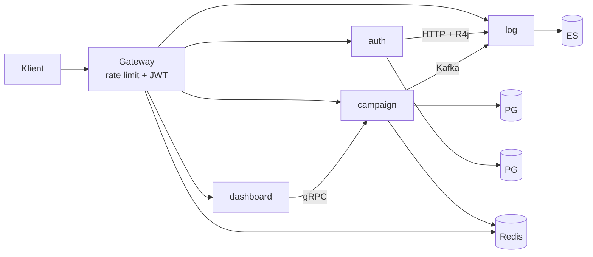

# 24. Sistemi təqdim etmək və müsahibəyə hazırlıq

Hər fəslin sonunda mövzu üzrə suallar var. Bu fəsil onları üç formaya salır: (1) sistemi 1 və 5 dəqiqədə izah etmək,
(2) mövzular üzrə sual bankı (qısa, layihəyə bağlı cavablarla), (3) bu repozitoriya haqqında verilə biləcək "çətin"
suallar və onlara dürüst cavablar. Cavablar yadda saxlamaq üçün deyil — məntiqi və faktları göstərmək üçündür; öz
sözlərinizlə danışın.

## 24.1 Yadda saxlanmalı faktlar

| Sahə | Dəyər |
|---|---|
| Platforma | Java 25 (`--enable-preview`), Spring Boot 4.1.0, Spring Cloud 2025.1.2, Maven multi-module (10 modul) |
| Servislər və portlar | gateway 8080, auth 8081, campaign 8082 (+ gRPC 9090), dashboard 8083, log 8084, Eureka 8761, Config 8888 |
| Verilənlər | PostgreSQL ×2 (auth_db, campaign_db), Redis, Kafka (KRaft, 1 broker), Elasticsearch 9.4.2 |
| Mövzular | `log-events`, `log-events.DLQ`, `campaign-events` (consumer-siz) |
| ES indeksləri | `auth-audit-logs`, `slow-request-logs` |
| Rollar | `ROLE_USER`, `ROLE_ADMIN`, `ROLE_INTERNAL_SERVICE` (servislərarası) |
| Statuslar | `PENDING_APPROVAL`, `ACTIVE`, `DEACTIVE`, `DUPLICATE` (istifadə olunmur); `LIFE` → dərhal `ACTIVE` |
| Token-lər | RS256; access 120 dəq; refresh 7 gün (hash); reset 15 dəq (hash) |
| Rate limit | replenish 1/s, burst 5, hər sorğu 5 token → 5 saniyədə 1 sorğu (marşrut + açar üzrə) |
| Resilience4j (auth → log) | Retry 3 × 500 ms; CB 50% / 10 çağırış / 30 s; Bulkhead 10, gözləmə 0 |
| DLQ | `DefaultErrorHandler` + `FixedBackOff(1000, 3)` → `<mövzu>.DLQ` |
| Yavaş sorğu həddi | 5 ms |
| Cache | `campaign-statistics`, Redis, TTL yoxdur |
| Testlər | 24 fayl, 93 `@Test`; Testcontainers (PostgreSQL, Kafka, Elasticsearch) |

## 24.2 Bir dəqiqəlik təqdimat

> "Bu, sığorta kampaniyalarını idarə edən mikroservis sistemidir. Admin kampaniya yaradır; həyat sığortası kampaniyaları
> dərhal aktiv olur, digərləri təsdiq gözləyir. Sistem beş tətbiq servisindən ibarətdir: Spring Cloud Gateway — rate
> limit və JWT yoxlaması ilə vahid giriş; auth-service — RS256 token-lər, refresh rotasiyası; campaign-service —
> PostgreSQL, Liquibase, Redis cache, status dəyişikliklərini Kafka-ya dərc edir və dashboard üçün gRPC server;
> dashboard-service — gRPC klienti; log-service — Kafka-dan yavaş sorğuları və HTTP ilə audit qeydlərini
> Elasticsearch-ə yazır. Java 25, Spring Boot 4, virtual thread-lər, Testcontainers, Prometheus/Tempo/Loki/Grafana.
> Kodu təhlil edərkən bir neçə ciddi problem tapdım — məsələn, admin rolunun özünü qeydiyyatı və tranzaksiya daxilində
> Kafka göndərişi — və onların həllini bilirəm."

## 24.3 Beş dəqiqəlik izah (struktur)

| Dəqiqə | Mövzu | Nə demək |
|---|---|---|
| 0:00–0:45 | Biznes | Kampaniya, kateqoriya, status maşını, dublikat qaydası, rollar |
| 0:45–2:00 | Arxitektura | Sxemi çəkin; hər servisin məsuliyyəti; DB-per-service; sinxron (REST, gRPC, HTTP) və asinxron (Kafka) kanallar |
| 2:00–3:15 | Bir axın dərindən | Kampaniya yaratma: gateway filtrləri → JWT → `@Valid` → `@PreAuthorize` → tranzaksiya → partial unique indeks → tarixçə → Kafka → cache evict → yavaş sorğu jurnalı (fəsil 20.3) |
| 3:15–4:15 | Texniki qərarlar | RS256 və public key paylanması; refresh token hash-i; Resilience4j ilə audit; DLQ; virtual thread-lər; Testcontainers |
| 4:15–5:00 | Təkmilləşdirmələr | F01/F02 (təhlükəsizlik), outbox (F09/F10), `ErrorHandlingDeserializer` (F11), gRPC deadline və status xəritəsi (F19), `@Version` (F37) |

Məsləhət: təkmilləşdirmələri "kod pisdir" kimi deyil, "istehsala keçid üçün növbəti addımlar" kimi təqdim edin və hər
birinin səbəbini bir cümlə ilə izah edin.

## 24.4 Sual bankı

### Java və Spring əsasları

**1. Spring Boot auto-configuration necə işləyir və Boot 4-də nə dəyişdi?**
`AutoConfiguration.imports` faylındakı siniflər `@Conditional*` şərtləri ilə qiymətləndirilir. Boot 4-də auto-config
texnologiya üzrə ayrıca modullara bölünüb (`spring-boot-kafka`, `spring-boot-jackson` və s.); starter-lər onları gətirir
(fəsil 3.6, 4.5).

**2. `@ConditionalOnClass(name = "...KafkaTemplate")` niyə sətir ilə yazılıb?**
Sinif classpath-da olmadıqda belə annotasiya oxuna bilsin deyə; `common` modulu Kafka-sız servislərdə də yüklənir.

**3. Virtual thread-lər nəyi dəyişir?**
Bloklayan I/O ucuzlaşır: Tomcat hər sorğuya virtual thread verir (`spring.threads.virtual.enabled`). Darboğaz DB
hovuzu kimi məhdud resurslara keçir; `synchronized` daxilində bloklanma (pinning) JDK 24+-da əsasən aradan qalxıb.

**4. Spring proxy-ləri və self-invocation problemi?**
`@Transactional`, `@Cacheable`, `@Async`, `@PreAuthorize` proxy ilə işləyir; eyni sinif daxilində `this.method()`
çağırışı proxy-dən keçmir və annotasiya işləmir.

**5. `@Async` metodunun nəticəsi və istisnası haraya gedir?**
`void` metodda istisna `AsyncUncaughtExceptionHandler`-ə gedir; layihədə `publishAudit` bütün istisnaları özü tutur.
Trace konteksti `TaskDecorator` olmadan ötürülmür (F34).

**6. Constructor injection niyə üstündür?**
Asılılıqlar açıqdır, `final` sahələr, testdə `new` ilə yaratmaq, dövri asılılıq erkən aşkarlanır. Layihədə hamısı
constructor injection-dır; istisna — `@GrpcClient` sahə inyeksiyası.

### REST, validasiya, xətalar

**7. 400, 401, 403, 404, 409, 422, 500 fərqləri və layihədəki istifadəsi?**
400 validasiya; 401 autentifikasiya yoxdur/etibarsız; 403 rol çatmır; 404 resurs yoxdur; 409 dublikat və səhv status
keçidi; 500 gözlənilməz xəta. Layihə catch-all səbəbindən bəzi 400/404/405 hallarını 500 qaytarır (F07).

**8. `@Valid` və `@Validated` fərqi?**
`@Valid` (Jakarta) kaskad validasiya; `@Validated` (Spring) qrupları dəstəkləyir və sinif səviyyəsində metod
parametrlərinin validasiyasını aktivləşdirir.

**9. Niyə DTO, domen və entity ayrılır?**
API kontraktı, biznes modeli və persistensiya modeli fərqli səbəblərdən dəyişir. Entity-ni API-yə çıxarmaq lazy-loading,
sızma və kontrakt kövrəkliyi yaradır (fəsil 5.6).

**10. Səhifələmə cavabını necə qurmaq lazımdır?**
Öz DTO-nuz (`content`, `page`, `size`, `totalElements`) — `CampaignPageResponse` kimi; Spring Data `Page`-i birbaşa
serializasiya etmək sabit olmayan formatdır (F26).

### Persistensiya və tranzaksiyalar

**11. `save()` və `saveAndFlush()` fərqi? Layihədə niyə `saveAndFlush`?**
`saveAndFlush` SQL-i dərhal icra edir; unique pozuntusu metod daxilində `DataIntegrityViolationException` kimi tutulub
409-a çevrilir. `save` ilə xəta commit zamanı, servisdən kənarda yaranardı (F18 məhz budur).

**12. Təyin olunmuş UUID id ilə `save()` niyə SELECT edir?**
`isNew()` id `null` olmadığı üçün `false` qaytarır, Spring Data `merge` çağırır; Hibernate əvvəlcə SELECT edir (F14).
Həll: `Persistable` və ya `@Version`.

**13. Dirty checking nədir?**
Persistence context entity-nin ilkin vəziyyətini saxlayır; flush zamanı fərqləri UPDATE edir. `changeStatus`-dan sonra
`save` əslində lazım deyil.

**14. Optimistik və pessimistik kilid?**
Optimistik — `@Version`, konflikt commit-də aşkarlanır (409); pessimistik — `SELECT ... FOR UPDATE`. Layihədə heç biri
yoxdur (F37, F17).

**15. Partial unique indeks nəyi həll edir?**
`WHERE status <> 'DUPLICATE'` ilə yalnız "aktiv" sətirlər arasında unikallıq; tətbiq yoxlaması ilə birlikdə yarış
vəziyyətində son müdafiə.

**16. `open-in-view: false` niyə vacibdir?**
Sessiya controller/serializasiya zamanı açıq qalmır; lazy yükləmə xidmət qatında açıq edilməlidir, bağlantı tez
qaytarılır.

**17. Liquibase-də changeset dəyişdirilsə nə olur?**
Checksum uyğunsuzluğu, tətbiq başlamır. Qayda: tətbiq olunmuş changeset dəyişdirilmir, yenisi yazılır.

### Təhlükəsizlik

**18. JWT RS256 ilə HS256 fərqi və layihənin seçimi?**
RS256 asimmetrikdir: yalnız auth-service private key saxlayır, digərləri public key ilə yoxlayır. HS256-da hər
yoxlayıcı token buraxa bilərdi.

**19. Gateway JWT-ni yoxlayırsa, servislər niyə yenidən yoxlayır?**
Defense in depth: servis portları birbaşa əlçatan ola bilər (Compose host-a açır); rollar yalnız servisdə yoxlanır.

**20. Refresh token niyə hash kimi saxlanır?**
DB sızması aktiv token-ləri açmasın; SHA-256 təsadüfi yüksək entropiyalı token üçün kifayətdir (parol kimi yavaş hash
lazım deyil).

**21. Access token-i necə ləğv etmək olar?**
Qısa ömür, `jti` deny-list, istifadəçi üzrə token versiyası. Layihədə yoxdur (F35).

**22. Layihədəki ən ciddi təhlükəsizlik boşluqları?**
F01 (özünü admin kimi qeydiyyat), F02 (reset token cavabda), F04 (autentifikasiyasız gRPC), F05 (XFF ilə rate limit
yan keçmə), F03 (enumerasiya).

**23. Servislərarası autentifikasiya necə qurulub?**
auth-service hər audit sorğusuna `sub=auth-service`, `ROLE_INTERNAL_SERVICE` olan qısa ömürlü JWT əlavə edir; log-service
`hasRole('INTERNAL_SERVICE')` tələb edir. Alternativlər: mTLS, OAuth2 client credentials.

**24. CSRF niyə söndürülüb?**
Stateless API, cookie əsaslı autentifikasiya yoxdur; token `Authorization` başlığındadır, brauzer onu avtomatik
göndərmir.

### Kafka

**25. At-least-once, at-most-once, exactly-once?**
Consumer offseti emaldan sonra commit edirsə — at-least-once (dublikat mümkün); əvvəl — at-most-once. Exactly-once
Kafka daxilində tranzaksiyalarla; xarici sistemlə idempotent emal lazımdır.

**26. Açar seçimi nəyə təsir edir?**
Partisiya və sıra. `campaign-events` açarı kampaniya id-sidir — bir kampaniyanın hadisələri sıralıdır; `log-events`
açarı URI-dir.

**27. DLQ necə işləyir?**
`DefaultErrorHandler` 1 s fasilə ilə 3 təkrar, sonra `DeadLetterPublishingRecoverer` qeydi `log-events.DLQ`-a eyni
partisiya nömrəsinə, xəta başlıqları ilə göndərir.

**28. Poison pill nədir və layihədə niyə təhlükəlidir?**
Emal oluna bilməyən mesaj. `ErrorHandlingDeserializer` olmadığı üçün deserializasiya xətası DLQ-ya getmir, eyni offset
sonsuz təkrarlanır (F11).

**29. Dual write problemi və həlli?**
DB commit və Kafka göndərişi atomik deyil. Transactional outbox və ya CDC (F09).

**30. `max.block.ms` nədir?**
`send()`-in metadata və buffer üçün çağıran thread-i bloklaya biləcəyi maksimum vaxt (standart 60 s). Kafka düşəndə
campaign-service və log-service-in HTTP sorğuları bu qədər gecikir (F10).

**31. Consumer group rebalance nədir?**
Qrupa üzv qoşulanda/çıxanda partisiyaların yenidən paylanması; zamanı emal dayanır. Partisiya sayı consumer
paralelliyinin yuxarı həddidir (layihədə 1).

### Elasticsearch

**32. Niyə audit və yavaş sorğular üçün ES?**
Tam mətn axtarışı, vaxt seriyası sorğuları, aqreqasiyalar; append-only məlumat. Əsas biznes məlumatı üçün deyil.

**33. `text` və `keyword` fərqi?**
`text` analiz olunur (tokenlər), `keyword` dəqiq dəyər (filtr, sıralama, aqreqasiya). Dinamik mapping hər sətir üçün
ikisini də yaradır.

**34. ILM nədir və niyə lazımdır?**
Index lifecycle management: rollover, köhnə indekslərin silinməsi. Olmasa, log indeksləri limitsiz böyüyür (F43).

**35. ES-də sıralamasız `findAll` nə qaytarır?**
Daxili sıra ilə ixtiyari nəticələr; ən son qeydlər üçün `occurredAt desc` sıralaması lazımdır (F42).

### gRPC

**36. gRPC-nin REST-dən üstünlükləri və çatışmazlıqları?**
Kontrakt (proto), binar format, HTTP/2, streaming, kod generasiyası. Çatışmazlıq: brauzer dəstəyi, debug çətinliyi, daha
mürəkkəb infrastruktur. Layihədə bir sadə çağırış üçün istifadə olunur — nümayiş məqsədli.

**37. Deadline niyə vacibdir?**
Sinxron zəncirdə gözləmə vaxtını məhdudlaşdırır və ləğvi serverə ötürür. Layihədə yoxdur (F19).

**38. gRPC status kodlarını necə xəritələmək lazımdır?**
Serverdə `@GrpcAdvice` (domen istisnası → `NOT_FOUND`, `INVALID_ARGUMENT`), klientdə status → HTTP. Layihədə
`UNKNOWN` → 500 olur.

**39. Proto-nu necə təkamül etdirmək olar?**
Sahə nömrələrini dəyişməmək və təkrar istifadə etməmək, silinən sahələri `reserved` etmək, yalnız yeni sahələr əlavə
etmək.

### Redis, cache, rate limit

**40. `@Cacheable` / `@CacheEvict` və tranzaksiya sırası?**
İki interceptor; sıra açıq deyilsə eviction commit-dən əvvəl ola bilər və köhnə dəyər yenidən cache-ə yazılar (F13).
Həll: transaction-aware cache, TTL.

**41. Token bucket alqoritmi?**
Vedrə sabit sürətlə dolur, hər sorğu token xərcləyir; burst vedrə tutumu qədərdir. SCG bunu Redis Lua skripti ilə
atomik edir.

**42. Rate limiter niyə fail-open-dur və bu düzgündürmü?**
Redis xətasında sorğunu buraxır — əlçatanlıq üçün düzgün standartdır; amma alert olmalıdır (F06).

**43. Rate limit açarı üçün IP-yə etibar etmək təhlükəsizdirmi?**
Yalnız etibarlı proxy-nin yazdığı başlığa; klient `X-Forwarded-For`-u özü yaza bilər (F05).

### Spring Cloud

**44. Eureka və client-side load balancing?**
Servislər qeydiyyatdan keçir, gateway reyestri keşləyir və `lb://` üçün Spring Cloud LoadBalancer instans seçir.
Layihədə daxili çağırışlar static ünvanla gedir (F31).

**45. Config Server `optional:` prefiksi nə edir?**
Server əlçatmaz olsa da servis başlayır — əlçatanlıq üçün yaxşı, lakin paylanan xassələr səssizcə itir (F32).

**46. Gateway-də GlobalFilter və GatewayFilter fərqi?**
GlobalFilter bütün marşrutlara tətbiq olunur; GatewayFilter marşruta (və ya default-filters ilə hamısına) bağlıdır.
Hamısı birlikdə `order`-ə görə sıralanır.

### Dayanıqlıq

**47. Retry + Circuit Breaker birlikdə necə işləyir?**
Resilience4j aspekt sırasında Retry xaricdədir: hər cəhd CB-dən keçir və nəticəsi CB pəncərəsinə yazılır; CB açılanda
`CallNotPermittedException` retry olunmur (konfiqurasiyada ignore).

**48. Bulkhead nə üçündür?**
Bir asılılığın bütün thread-ləri/icazələri tutmasının qarşısını alır. Semafor bulkhead 10 icazə, gözləmə 0 — artıq
çağırış dərhal rədd olunur.

**49. Hansı əməliyyatları retry etmək təhlükəsizdir?**
İdempotent olanları. Audit POST idempotent deyil — timeout-dan sonra retry dublikat yarada bilər.

### Müşahidə

**50. Metrik, trace və log nə vaxt?**
Metrik — trend və alert (nə qədər?); trace — bir sorğunun yolu (harada?); log — detallar (nə?). traceId onları
birləşdirir.

**51. Kardinallıq problemi?**
Hər unikal label kombinasiyası ayrıca seriyadır; `trace_id` label-ı Loki-də indeksi partladır (F24).

**52. Trace kontekstini Kafka sərhədindən necə keçirmək olar?**
Producer və consumer observation (`traceparent` başlığı). Layihədə yoxdur; traceId payload-dadır.

### Test və CI/CD

**53. Testcontainers niyə H2-dən yaxşıdır?**
Real PostgreSQL davranışı: partial indeks, tiplər, SQL dialekti. Amma layihədə testlər Liquibase-i söndürür (F27).

**54. `@MockitoBean` nədir?**
Boot 3.4+ / Framework 6.2+ mexanizmi (köhnə `@MockBean`-in yerinə); kontekstdəki bean-i mock ilə əvəz edir. Fərqli mock
dəstləri kontekst cache-ni parçalayır.

**55. Surefire və Failsafe fərqi?**
Surefire `test` fazasında unit testlər, Failsafe `integration-test`/`verify` fazasında `*IT`. Layihədə inteqrasiya
testləri də `*Test` adlanır.

**56. CI pipeline-da nə olmalıdır?**
Build + test, coverage, statik analiz (Sonar), image build, zəiflik skanı, artefaktın versiyalanması, deploy mərhələləri.

### Dizayn və davranış

**57. Bu layihəni yenidən qursaydınız nəyi dəyişərdiniz?**
Fəsil 22: IdP + resource server, outbox, hadisələrdən oxu modeli, `ProblemDetail`, `@Version`, timeout/deadline,
OTel-əsaslı müşahidə, testlərdə miqrasiya.

**58. Mikroservis bu ölçüdə əsaslıdırmı?**
Texniki nümayiş üçün bəli; istehsal üçün modul-monolit daha sadə olardı (fəsil 22.2).

**59. Kodda tapdığınız problemi komandaya necə çatdırardınız?**
Reproduksiya ssenarisi, təsir, təklif olunan düzəliş və test; ciddiliyə görə prioritet; şəxsi deyil, kod haqqında.

**60. Yeni komandaya qoşulanda kod bazasını necə öyrənirsiniz?**
Build və modul qrafı → giriş nöqtələri (controller, listener) → bir axını uçdan-uca izləmək → testlər → konfiqurasiya
və yerləşdirmə → müşahidə alətləri. Bu kitabın quruluşu da belədir.

## 24.5 Bu repozitoriya haqqında çətin suallar

| Sual | Dürüst cavab |
|---|---|
| "Niyə bir çağırış üçün gRPC?" | Texnikanı nümayiş etdirmək üçün; real ehtiyac yoxdur, REST eyni işi görərdi. İstehsalda hadisələrdən qurulan oxu modeli daha uyğundur. |
| "`campaign-events`-i kim oxuyur?" | Heç kim. Hadisə gələcək inteqrasiya üçün dərc olunur, lakin dual-write riskini daşıyır. |
| "Testlər niyə Liquibase-i söndürür?" | Sürət və sadəlik üçün; nəticədə partial indeks və sxem validasiyası test olunmur. Düzəltmək lazımdır. |
| "5 ms həddi niyə?" | Demo-da pipeline görünsün deyə; istehsalda mənasızdır və log həcmini partladır. |
| "Kafka düşsə nə olar?" | campaign-service və log-service-in REST sorğuları `max.block.ms` səbəbindən 60 s-ə qədər gecikə bilər (yavaş sorğu filtri yalnız bu iki serviste aktivdir) — ən böyük əlçatanlıq riski. |
| "Admin necə yaranır?" | Qeydiyyatda rol klientdən gəlir — bu, kritik boşluqdur; düzgün yol seed və ya admin endpoint-idir. |
| "Bu kodu işə salıb yoxlamısınız?" | Bu kitab statik təhlilə əsaslanır (mühitdə Java 25 yox idi); runtime iddiaları [NƏTİCƏ] kimi işarələnib. Müsahibədə də fakt və fərziyyəni ayırın. |

## 24.6 Xülasə

- 1 dəqiqəlik təqdimat: məqsəd, servislər, texnologiyalar, bir-iki təkmilləşdirmə.
- 5 dəqiqəlik izah: biznes → sxem → bir axın dərindən → qərarlar → təkmilləşdirmələr.
- Sual bankı fəsillərə istinad edir; dərin cavab üçün həmin fəslə qayıdın.
- Çətin suallarda dürüstlük və trade-off-u izah etmək bacarığı faktların özündən daha çox dəyər qazanır.
